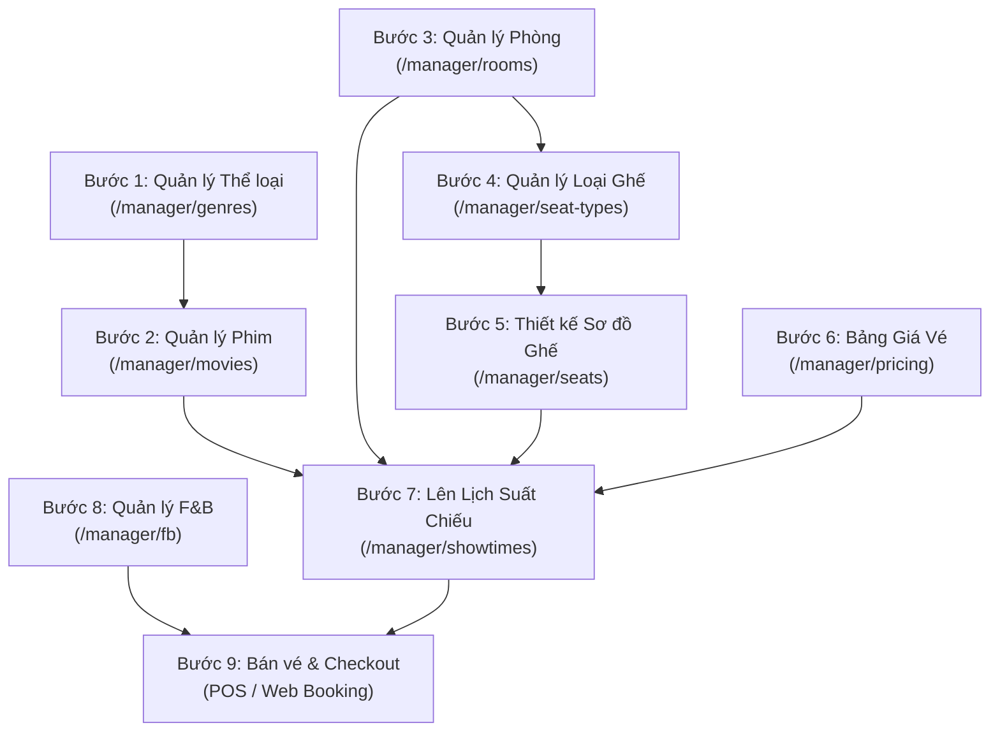

# BÁO CÁO PHÂN TÍCH LUỒNG NGHIỆP VỤ AS-IS HỆ THỐNG QUẢN LÝ RẠP CHIẾU PHIM (MANAGER MODULE)

**Dự án:** Cinema Management System (`SWP_RapPhim`)  
**Tác giả:** Senior Business Analyst & Senior Full-Stack Developer  
**Ngày lập báo cáo:** 17/10/2026  
**Mục tiêu tài liệu:** Phân tích, truy vết mã nguồn (Traceability) và mô tả chính xác 100% hiện trạng luồng nghiệp vụ (AS-IS Business Process) của 9 màn hình thuộc phân hệ Quản lý (Manager Module). Phục vụ công tác thẩm định nghiệp vụ (Peer Review), phát hiện lỗ hổng/rủi ro và xây dựng phương án cải tiến TO-BE.

---

## 1. TỔNG QUAN HỆ THỐNG (SYSTEM OVERVIEW)

### 1.1. Kiến Trúc Kỹ Thuật (Technical Architecture)
- **Mô hình kiến trúc:** Monolithic Web Application kết hợp RESTful API cho các tác vụ bất đồng bộ (AJAX/Fetch).
- **Backend Framework:** Spring Boot 3.x (Java 17), Spring MVC, Spring Security.
- **Data Access Layer:** JDBC Template / Direct SQL via Custom DAO Pattern (phân tách rõ ràng giữa `Dao` và `Service`).
- **Database Engine:** Microsoft SQL Server 2022 (`CinemaManagementDB`).
- **Frontend Layer:** Thymeleaf Server-Side Rendering (SSR) kết hợp Bootstrap 5, Tailwind CSS utilities, Lucide Icons, và Vanilla JavaScript cho dynamic modals/APIs.
- **Server Deployment:** Môi trường Local chạy port `8080` (Spring Boot Embedded Tomcat).

### 1.2. Danh Sách Tác Nhân (Actors)
1. **Manager (Quản lý rạp):** Tác nhân chính thực hiện cấu hình vận hành: tạo phim, thể loại, quản lý phòng chiếu, thiết kế sơ đồ ghế, thiết lập bảng giá vé, lên lịch suất chiếu, quản lý danh mục F&B và theo dõi chỉ số tại Dashboard.
2. **Staff/Cashier (Nhân viên bán vé/quầy F&B):** Tác nhân tiêu thụ dữ liệu do Manager cấu hình (chọn suất chiếu, chọn ghế, bán combo bắp nước).
3. **Customer (Khách hàng trực tuyến):** Xem lịch chiếu, đặt vé và F&B qua website công cộng.
4. **System (Tiến trình hệ thống):** Các bộ đếm, tính toán tự động giá vé, kiểm tra xung đột thời gian (hiện chưa có Cron Job tự động cập nhật trạng thái phim theo ngày).

### 1.3. Bản Đồ Phân Hệ 9 Màn Hình Manager
| STT | Tên Màn Hình | URL Route | Screen ID / UC ID | Mô Tả Trách Nhiệm Vận Hành |
|:---:|:---|:---|:---:|:---|
| 1 | F&B Management | `/manager/fb` | Screen 61 / UC-32 | Quản lý danh mục thức ăn, đồ uống, combo và giá bán |
| 2 | Room Management | `/manager/rooms` | Screen 56 / UC-27 | Quản lý danh sách phòng chiếu, định dạng phòng, trạng thái |
| 3 | Seat Type Management | `/manager/seat-types` | Screen 57 / UC-28 | Quản lý hệ số nhân giá ghế (Standard, VIP, Sweetbox...) |
| 4 | Ticket Pricing Management | `/manager/pricing` | Screen 60 / UC-31 | Cấu hình bảng giá vé theo khung giờ, ngày trong tuần, định dạng |
| 5 | Seat Map Management | `/manager/seats` | Screen 58 / UC-29 | Thiết lập sơ đồ layout ghế vật lý, zoning loại ghế trong phòng |
| 6 | Showtime Management | `/manager/showtimes` | Screen 59 / UC-30 | Lập lịch chiếu phim theo phòng, kiểm tra trùng lặp và đệm dọn phòng |
| 7 | Genre Management | `/manager/genres` | Screen 55 / UC-25 | Quản lý danh mục thể loại phim và ràng buộc liên kết |
| 8 | Movie Management | `/manager/movies` | Screen 54 / UC-26 | Quản lý vòng đời phim (Sắp chiếu, Đang chiếu, Ngừng chiếu, Lưu trữ) |
| 9 | Manager Dashboard | `/manager/dashboard` | Screen 53 / UC-24 | Trung tâm theo dõi chỉ số vận hành tổng hợp của cụm rạp |

---

## 2. DANH MỤC USE CASE (USE CASE INVENTORY)

| Mã Use Case | Tên Use Case | Module Liên Quan | Mức Độ Hoàn Thiện Code | Trạng Thái Kiểm Chứng AS-IS |
|:---|:---|:---|:---:|:---:|
| **UC-24** | Xem Dashboard Tổng Quan | Dashboard | 80% | Đã kiểm chứng (KPIs thực tế hoạt động, biểu đồ doanh thu mock) |
| **UC-25.1** | Xem & Lọc Thể Loại Phim | Genre | 100% | Đã kiểm chứng hoạt động qua UI & API |
| **UC-25.2** | Tạo Mới Thể Loại | Genre | 100% | Đã kiểm chứng qua API & DB |
| **UC-25.3** | Cập Nhật Thể Loại | Genre | 100% | Đã kiểm chứng qua API & DB |
| **UC-25.4** | Bật/Tắt Trạng Thái Thể Loại | Genre | 100% | Đã kiểm chứng qua API (chặn nếu có phim active) |
| **UC-25.5** | Xóa Thể Loại Phim | Genre | 100% | Đã kiểm chứng qua API (chặn nếu đã gán phim) |
| **UC-26.1** | Xem Danh Sách & Tìm Kiếm Phim | Movie | 100% | Đã kiểm chứng qua UI SSR |
| **UC-26.2** | Thêm Mới Phim | Movie | 100% | Đã kiểm chứng (kiểm tra ngày, thể loại, trailer) |
| **UC-26.3** | Cập Nhật Thông Tin Phim | Movie | 100% | Đã kiểm chứng qua form edit |
| **UC-26.4** | Đổi Trạng Thái / Lưu Trữ Phim | Movie | 100% | Đã kiểm chứng (Soft-delete / Archive, chặn nếu có suất chiếu) |
| **UC-27.1** | Xem Danh Sách Phòng Chiếu | Room | 100% | Đã kiểm chứng qua UI SSR |
| **UC-27.2** | Thêm Mới Phòng Chiếu | Room | 100% | Đã kiểm chứng (Sức chứa nhập tay, không tự sinh ghế) |
| **UC-27.3** | Cập Nhật Phòng Chiếu | Room | 100% | Đã kiểm chứng (Tên, định dạng, trạng thái) |
| **UC-27.4** | Vô Hiệu Hóa / Bảo Trì Phòng | Room | 100% | Đã kiểm chứng (Chặn nếu có suất chiếu tương lai) |
| **UC-28.1** | Xem Danh Sách Loại Ghế | Seat Type | 100% | Đã kiểm chứng qua UI & API |
| **UC-28.2** | Thêm Mới Loại Ghế | Seat Type | 100% | Đã kiểm chứng (Hệ số nhân 0.50 - 3.00) |
| **UC-28.3** | Cập Nhật Hệ Số Nhân / Tên Ghế | Seat Type | 100% | Đã kiểm chứng qua API |
| **UC-28.4** | Bật/Tắt Kích Hoạt Loại Ghế | Seat Type | 100% | Đã kiểm chứng (Không có xóa vật lý) |
| **UC-29.1** | Xem Sơ Đồ Ghế Theo Phòng | Seat Map | 100% | Đã kiểm chứng qua UI Render tương tác |
| **UC-29.2** | Lưu / Cập Nhật Toàn Bộ Sơ Đồ Ghế | Seat Map | 90% | Đã kiểm chứng (Cơ chế Xóa toàn bộ ghế cũ và chèn lại) |
| **UC-30.1** | Xem Lịch Chiếu (Filter Phòng, Phim, Ngày) | Showtime | 100% | Đã kiểm chứng qua UI SSR & API |
| **UC-30.2** | Tạo Mới Suất Chiếu | Showtime | 100% | Đã kiểm chứng (Kiểm tra đệm 15p, phim, phòng, giá snapshot) |
| **UC-30.3** | Cập Nhật Suất Chiếu | Showtime | 100% | Đã kiểm chứng (Chặn sửa nếu đã phát sinh booking) |
| **UC-30.4** | Hủy / Ngừng Suất Chiếu | Showtime | 100% | Đã kiểm chứng (Chặn hủy nếu đã bán vé) |
| **UC-31.1** | Xem Bảng Cấu Hình Giá Vé | Ticket Pricing | 100% | Đã kiểm chứng qua UI & API |
| **UC-31.2** | Thêm Mới Cấu Hình Giá | Ticket Pricing | 100% | Đã kiểm chứng (Khung giờ, Ngày, BasePrice, Phụ phí) |
| **UC-31.3** | Cập Nhật Giá Vé Cơ Sở & Phụ Phí | Ticket Pricing | 100% | Đã kiểm chứng qua API |
| **UC-31.4** | Chuyển Trạng Thái Cấu Hình Giá | Ticket Pricing | 100% | Đã kiểm chứng |
| **UC-32.1** | Xem & Lọc Danh Sách F&B | F&B | 100% | Đã kiểm chứng qua UI & API |
| **UC-32.2** | Thêm Sản Phẩm Đơn / Combo | F&B | 100% | Đã kiểm chứng (Lưu chi tiết combo vào `ComboItem`) |
| **UC-32.3** | Cập Nhật Giá Bán / Thông Tin F&B | F&B | 100% | Đã kiểm chứng qua API |
| **UC-32.4** | Ngừng Kinh Doanh / Vô Hiệu Hóa F&B | F&B | 100% | Đã kiểm chứng (Soft-delete, không xóa vật lý) |

---

## 3. PHÂN TÍCH CHI TIẾT LUỒNG NGHIỆP VỤ TỪNG MÀN HÌNH (DETAILED AS-IS BUSINESS FLOWS)

---

### 3.1. F&B MANAGEMENT (Screen 61 / UC-32)
- **URL:** `http://localhost:8080/manager/fb`
- **Frontend Template:** `src/main/resources/templates/manager/fb.html`
- **Backend Controller:** `FBItemController.java` (SSR router) và `FBItemApiController.java` (REST endpoints tại `/api/manager/fb`)
- **Backend Service:** `FBItemService.java`
- **Data Access:** `FBItemDao.java`
- **Database Tables:** `FBItem`, `ComboItem`

#### A. UI & User Actions
- **Thông tin hiển thị:** Bảng danh sách sản phẩm F&B với các cột: Hình ảnh, Tên sản phẩm/Combo, Phân loại (Đơn / Combo), Danh mục (Popcorn, Drink, Snack, Combo), Giá bán (VND), Tồn kho (Hiển thị tĩnh trên UI), Trạng thái (Đang bán / Ngừng bán), Thao tác (Sửa, Đổi trạng thái, Xóa).
- **Thanh công cụ & Bộ lọc:**
  - Ô tìm kiếm theo tên món.
  - Dropdown lọc theo Danh mục (`ALL`, `POPCORN`, `DRINK`, `SNACK`, `COMBO`).
  - Dropdown lọc theo Trạng thái (`ALL`, `ACTIVE`, `INACTIVE`).
  - Nút "+ Thêm Món / Combo Mới" (Mở modal `#fbModal`).
  - Phân trang Client-side / Dynamic Table.
- **Thao tác người dùng:**
  1. *Thêm mới món:* Click nút thêm, chọn loại (Đơn/Combo), nhập tên, danh mục, giá, tải ảnh (URL), nếu là Combo thì chọn các món con và số lượng tương ứng.
  2. *Chỉnh sửa món:* Click icon Edit -> Modal mở ra nạp dữ liệu cũ -> Submit cập nhật.
  3. *Bật/Tắt trạng thái:* Click toggle switch hoặc nút trạng thái để chuyển đổi giữa `Active` và `Inactive`.
  4. *Xóa món:* Click nút Delete -> Xác nhận xác nhận -> Gọi API vô hiệu hóa.

#### B. Use Case & Business Flow
- **Actor:** Manager.
- **Preconditions:** Manager đã đăng nhập hệ thống với quyền hợp lệ (`ROLE_MANAGER`).
- **Main Flow (Thêm món mới):**
  1. Manager truy cập `/manager/fb`.
  2. Manager click "+ Thêm Món Mới".
  3. Manager nhập các trường: Tên món (`itemName`), Danh mục (`category`), Giá bán (`price`), Hình ảnh (`imageUrl`).
  4. Nếu là Combo (`itemType = 'COMBO'`), Manager thêm danh sách món con (`componentItemId`) và số lượng (`quantity`).
  5. Manager click "Lưu Thay Đổi". Hệ thống gửi request `POST /api/manager/fb`.
  6. Backend validate dữ liệu, ghi bản ghi vào bảng `FBItem`. Nếu là Combo, ghi tiếp danh sách vào `ComboItem`.
  7. Trả về HTTP 201 Created kèm dữ liệu món vừa tạo. UI đóng modal và reload lại danh sách.
- **Alternative Flow (Cập nhật giá/thông tin):**
  - Manager chọn món, sửa giá bán -> Gửi `PUT /api/manager/fb/{id}` -> Hệ thống cập nhật bảng `FBItem`.
- **Exception Flow:**
  - Tên món bị để trống hoặc giá tiền âm (`price < 0`) -> Backend ném `IllegalArgumentException` / Validation Error -> Trả về HTTP 400 kèm thông báo lỗi -> UI hiển thị alert lỗi đỏ.
- **Postconditions:** Món mới xuất hiện trong danh mục F&B với trạng thái `Active`.

#### C. Business Rules (AS-IS)
- **Không xóa vật lý (Physical Deletion Blocked):** Trong `FBItemService.java`, hàm xóa được triển khai dưới dạng **Soft-Delete (Deactivate)**: cập nhật `IsActive = 0` và `Status = 'Inactive'`. Bản ghi không bao giờ bị `DELETE FROM FBItem`.
- **Độc lập giá trong đơn hàng cũ:** Bảng hóa đơn/chi tiết đặt vé (Booking) khi lưu sẽ chụp lại đơn giá tại thời điểm mua (Snapshot Pricing). Việc Manager sửa giá tại `/manager/fb` không làm thay đổi số tiền của các hóa đơn đã thanh toán trước đó.
- **Tồn kho (Inventory Management):** Hiện trạng hệ thống **CHƯA triển khai quản lý trừ kho thực tế**. Cột "Tồn kho" hiển thị trên giao diện là dữ liệu cấu hình tĩnh hoặc giả lập, chưa có bảng liên kết trừ số lượng khi khách checkout.
- **Ràng buộc tham chiếu:** `FBItemService.isReferencedInOrders` có logic kiểm tra đơn hàng, nhưng thực tế việc đổi trạng thái sang `Inactive` là cơ chế chuẩn để bảo toàn toàn vẹn dữ liệu lịch sử.

#### D. Technical Implementation
- **API Endpoints:**
  - `GET /api/manager/fb`: Lấy danh sách toàn bộ F&B item.
  - `GET /api/manager/fb/{id}`: Lấy chi tiết món và danh sách combo item.
  - `POST /api/manager/fb`: Tạo món đơn hoặc combo mới.
  - `PUT /api/manager/fb/{id}`: Cập nhật thông tin món.
  - `PATCH /api/manager/fb/{id}/status`: Đổi trạng thái `Active`/`Inactive`.
  - `DELETE /api/manager/fb/{id}`: Chuyển trạng thái sang `Inactive` (Soft delete).
- **Entities & Tables:**
  - `FBItem`: `ItemID` (PK, INT IDENTITY), `ItemName` (NVARCHAR), `ItemType` (VARCHAR), `Category` (VARCHAR), `Price` (DECIMAL), `Stock` (INT), `Status` (VARCHAR), `IsActive` (BIT), `ImageURL` (VARCHAR), `CreatedAt`, `UpdatedAt`.
  - `ComboItem`: `ComboID` (FK referencing FBItem.ItemID), `ComponentItemID` (FK referencing FBItem.ItemID), `Quantity` (INT).

#### E. Current Behavior Status
- **Đã triển khai và xác minh hoạt động:** Lấy danh sách, thêm món đơn, thêm combo, cập nhật giá, đổi trạng thái sang Ngừng bán (`Inactive`).
- **Có code nhưng chưa kiểm chứng/giả lập:** Quản lý tồn kho trừ tự động khi bán F&B (chưa có nghiệp vụ trừ kho trong service checkout).

#### F. Business Risks
- **Rủi ro F&B không đồng bộ bán vé:** Khi khách đặt vé qua quầy POS hoặc Web, nếu F&B bị set `Inactive` ngay giữa phiên đặt, giao dịch có thể báo lỗi hoặc không thêm được F&B.
- **Combo tham chiếu vòng tròn:** Code chưa kiểm tra logic chặn trường hợp Combo A chứa Combo B và Combo B lại chứa Combo A (Circular Dependency).

---

### 3.2. ROOM MANAGEMENT (Screen 56 / UC-27)
- **URL:** `http://localhost:8080/manager/rooms`
- **Frontend Template:** `src/main/resources/templates/manager/rooms.html`
- **Backend Controller:** `RoomController.java` (`/manager/rooms`) và `RoomApiController.java` (`/api/manager/rooms`)
- **Backend Service:** `RoomService.java`
- **Data Access:** `RoomDao.java`
- **Database Tables:** `Room`

#### A. UI & User Actions
- **Thông tin hiển thị:** Thẻ/Bảng danh sách phòng chiếu: Mã phòng (`RoomID`), Tên phòng (`RoomName` - vd: Cinema 01, Cinema 02), Định dạng phòng (`RoomType` - 2D, 3D, IMAX Laser), Sức chứa (`Capacity`), Trạng thái (`Status` - Ready, Maintenance, Screening, Inactive), Thao tác (Sửa, Xem sơ đồ ghế, Đổi trạng thái).
- **Bộ lọc & Thao tác:**
  - Tìm kiếm theo tên phòng.
  - Lọc theo định dạng (2D, 3D, IMAX) và trạng thái.
  - Nút "+ Thêm Phòng Mới" mở modal `#roomModal`.
  - Nút "Sơ đồ ghế" chuyển hướng trực tiếp sang `/manager/seats?roomId={id}`.
  - Nút đổi trạng thái nhanh sang "Bảo trì" hoặc "Hoạt động".

#### B. Use Case & Business Flow
- **Actor:** Manager.
- **Preconditions:** Manager đã đăng nhập tài khoản quyền Quản lý.
- **Main Flow (Tạo phòng):**
  1. Manager nhấn "+ Thêm Phòng Mới".
  2. Manager nhập: Tên phòng (bắt buộc, không trùng), Loại phòng (2D/3D/IMAX), Sức chứa danh định (`capacity`).
  3. Manager bấm "Lưu". Frontend gửi `POST /api/manager/rooms`.
  4. Backend validate tính duy nhất của tên phòng, lưu bản ghi vào bảng `Room` với trạng thái mặc định `Ready`.
  5. Trả về thông báo thành công và reload lại danh sách.
- **Alternative Flow (Bảo trì phòng):**
  - Manager chọn phòng cần sửa chữa -> Chọn đổi trạng thái sang `Maintenance` -> Hệ thống kiểm tra điều kiện ràng buộc suất chiếu.
- **Exception Flow (Vi phạm BR-52):**
  - Nếu phòng đang có suất chiếu trong tương lai chưa hoàn thành (`hasUpcomingShowtimes == true`), hệ thống ném `RoomHasActiveShowtimesException` -> Trả về HTTP 409 Conflict với thông báo: *"Không thể vô hiệu hóa phòng đang có suất chiếu sắp diễn ra."*

#### C. Business Rules (AS-IS)
- **Không tự động sinh ghế:** Khi tạo mới một phòng, hệ thống **CHỈ tạo bản ghi phòng trong bảng `Room`**, hoàn toàn **KHÔNG tự động tạo ghế** trong bảng `Seat`. Manager bắt buộc phải sang màn hình Seat Map (`/manager/seats`) để khởi tạo layout ghế.
- **Sức chứa độc lập với số ghế thực:** Cột `Capacity` trong bảng `Room` là trường nhập tay (Manual Input). Hệ thống chưa tự động đếm số lượng ghế thực tế trong bảng `Seat` để ghi đè vào `Capacity`.
- **Ràng buộc vô hiệu hóa (BR-52):** Không được phép chuyển trạng thái phòng sang `Maintenance` hoặc `Inactive` nếu phòng đó đang được gán cho bất kỳ suất chiếu nào có thời gian bắt đầu sau thời điểm hiện tại (`StartTime > NOW()`).

#### D. Technical Implementation
- **API Endpoints:**
  - `GET /api/manager/rooms`: Lấy danh sách tất cả phòng.
  - `GET /api/manager/rooms/{id}`: Lấy chi tiết phòng theo ID.
  - `POST /api/manager/rooms`: Tạo phòng mới.
  - `PUT /api/manager/rooms/{id}`: Cập nhật thông tin phòng.
  - `PATCH /api/manager/rooms/{id}/status`: Cập nhật trạng thái phòng.
  - `DELETE /api/manager/rooms/{id}`: Deactivate phòng (thực chất gọi update status sang Inactive).
- **Entities & Tables:**
  - `Room`: `RoomID` (PK, INT IDENTITY), `RoomName` (NVARCHAR(50), UNIQUE), `RoomType` (VARCHAR(20)), `Capacity` (INT), `Status` (VARCHAR(20) - 'Ready', 'Maintenance', 'Screening', 'Inactive'), `CreatedDate`, `UpdatedDate`.

#### E. Current Behavior Status
- **Đã triển khai và xác minh hoạt động:** Tạo phòng mới, cập nhật tên/định dạng, chặn đổi trạng thái khi có suất chiếu tương lai (`BR-52`), chuyển hướng sang màn hình thiết lập ghế.

#### F. Business Risks
- **Lệch pha giữa Sức chứa (Capacity) và Số ghế thực:** Manager có thể nhập Capacity = 100 nhưng trên sơ đồ ghế chỉ xếp 80 ghế. Khách hàng hoặc Dashboard xem capacity danh định có thể bị sai lệch với năng lực phục vụ thực tế.
- **Phòng trống không có ghế vẫn được xếp lịch:** Nếu phòng vừa tạo chưa cấu hình ghế mà Manager đã xếp lịch chiếu tại Showtime Management, suất chiếu đó sẽ không có ghế nào để bán vé.

---

### 3.3. SEAT TYPE MANAGEMENT (Screen 57 / UC-28)
- **URL:** `http://localhost:8080/manager/seat-types`
- **Frontend Template:** `src/main/resources/templates/manager/seat-types.html`
- **Backend Controller:** `SeatTypeController.java` và `TicketPricingApiController.java` (`/api/manager/seat-types`)
- **Backend Service:** `TicketPricingService.java`
- **Data Access:** `SeatTypeDao.java`
- **Database Tables:** `SeatType`

#### A. UI & User Actions
- **Thông tin hiển thị:** Danh sách các loại ghế được định nghĩa trong rạp: Mã loại (`TypeCode` - STANDARD, VIP, SWEETBOX), Tên hiển thị (`TypeName` - Ghế thường, Ghế VIP, Ghế đôi), Mô tả tiện ích, Hệ số nhân giá (`Multiplier` - vd: 1.0, 1.25, 1.5), Trạng thái (`Active` / `Inactive`), Thao tác (Sửa, Đổi trạng thái).
- **Thao tác người dùng:**
  - Xem danh sách và kiểm tra hệ số nhân đang áp dụng.
  - Thêm mới loại ghế với hệ số nhân tùy chỉnh.
  - Sửa tên, mô tả và hệ số nhân của loại ghế hiện có.
  - Bật/Tắt trạng thái hoạt động của loại ghế.

#### B. Use Case & Business Flow
- **Actor:** Manager.
- **Preconditions:** Manager đã đăng nhập hệ thống.
- **Main Flow (Thêm/Sửa loại ghế):**
  1. Manager mở modal tạo hoặc sửa loại ghế.
  2. Manager nhập Tên loại, Mã loại (viết hoa không dấu), Hệ số nhân (từ `0.50` đến `3.00`), Mô tả.
  3. Bấm "Lưu". Frontend gửi `POST` hoặc `PUT` đến `/api/manager/seat-types`.
  4. Backend validate khoảng hệ số nhân (`Multiplier` nằm trong khoảng hợp lệ).
  5. Ghi vào database và cập nhật lại giao diện.
- **Exception Flow:**
  - Manager nhập hệ số nhân < 0.5 hoặc > 3.0 -> Backend validate thất bại, trả về HTTP 400 Bad Request với thông báo: *"Hệ số nhân giá phải nằm trong khoảng từ 0.5 đến 3.0"*.

#### C. Business Rules (AS-IS)
- **Không có khóa ngoại vật lý (No Foreign Key Constraint) tới bảng Seat:** Bảng `Seat` trong database **KHÔNG lưu `SeatTypeID`**, mà lưu trực tiếp chuỗi ký tự `SeatTypeName NVARCHAR(50)`. Khi truy vấn tính giá, hệ thống `JOIN SeatType st ON s.SeatTypeName = st.TypeName OR s.SeatTypeName = st.TypeCode`.
- **Ràng buộc hệ số nhân giá (BR-Multiplier):** Hệ số nhân bắt buộc phải từ `0.50` (ghế ưu đãi/ghế góc) đến `3.00` (ghế hạng sang/giường nằm).
- **Không xóa vật lý:** Không cho phép xóa cứng bản ghi loại ghế khỏi database để tránh làm hỏng các sơ đồ ghế đang lưu chuỗi tên loại ghế đó. Chỉ hỗ trợ chuyển trạng thái `Inactive`.

#### D. Technical Implementation
- **API Endpoints:**
  - `GET /api/manager/seat-types`: Lấy danh sách loại ghế.
  - `POST /api/manager/seat-types`: Thêm loại ghế mới.
  - `PUT /api/manager/seat-types/{id}`: Cập nhật thông tin loại ghế.
  - `PATCH /api/manager/seat-types/{id}/status`: Kích hoạt / Vô hiệu hóa.
- **Entities & Tables:**
  - `SeatType`: `SeatTypeID` (PK, INT IDENTITY), `TypeName` (NVARCHAR(50)), `TypeCode` (VARCHAR(30)), `Multiplier` (DECIMAL(3,2)), `Description` (NVARCHAR(255)), `Status` (VARCHAR(20) - 'Active', 'Inactive'), `CreatedDate`, `UpdatedDate`.

#### E. Current Behavior Status
- **Đã triển khai và xác minh hoạt động:** Lấy danh sách, tạo mới loại ghế, cập nhật hệ số nhân, validate min/max multiplier, đổi trạng thái Active/Inactive.

#### F. Business Risks
- **Rủi ro sai lệch do lưu chuỗi `SeatTypeName`:** Nếu Manager đổi `TypeName` của một loại ghế (ví dụ từ "VIP" thành "Ghế VIP Cao Cấp"), các ghế đã tạo trong bảng `Seat` vẫn lưu chuỗi "VIP" cũ, dẫn đến việc không thể JOIN lấy được Multiplier tương ứng khi tính tiền vé.

---

### 3.4. TICKET PRICING MANAGEMENT (Screen 60 / UC-31)
- **URL:** `http://localhost:8080/manager/pricing`
- **Frontend Template:** `src/main/resources/templates/manager/pricing.html`
- **Backend Controller:** `TicketPricingController.java` và `TicketPricingApiController.java` (`/api/manager/pricing`)
- **Backend Service:** `TicketPricingService.java`
- **Data Access:** `TicketPricingDao.java`
- **Database Tables:** `TicketPricing`, `SeatType`

#### A. UI & User Actions
- **Thông tin hiển thị:**
  - Bảng ma trận cấu hình giá vé: Mã cấu hình (`PricingCode`), Ngày áp dụng (`DayType` - WEEKDAY, WEEKEND, HOLIDAY), Khung giờ (`TimeSlot` - MORNING, STANDARD, GOLDEN_HOUR), Định dạng rạp (`ExperienceType` - 2D, 3D, IMAX Laser), Giá vé cơ sở (`BasePrice`), Phụ phí định dạng (`FormatSurcharge`), Trạng thái (`Active` / `Inactive`).
  - Khung công cụ xem trước mô phỏng tính giá vé mẫu (Live Price Preview Calculator) theo loại ghế.
- **Thao tác người dùng:**
  - Lọc quy tắc giá theo Ngày trong tuần, Khung giờ hoặc Định dạng phòng.
  - Thêm quy tắc giá mới.
  - Chỉnh sửa giá cơ sở và phụ phí của quy tắc hiện hữu.
  - Bật/Tắt quy tắc giá.

#### B. Use Case & Business Flow
- **Actor:** Manager.
- **Preconditions:** Manager đã đăng nhập quyền Quản lý rạp.
- **Main Flow (Cấu hình giá vé):**
  1. Manager truy cập `/manager/pricing`.
  2. Bấm "+ Thêm Cấu Hình Giá".
  3. Chọn các tham số:
     - `DayType`: WEEKDAY (Thứ 2 - Thứ 5), WEEKEND (Thứ 6 - Chủ Nhật), HOLIDAY (Ngày Lễ).
     - `TimeSlot`: MORNING (Trước 12:00), STANDARD (12:00 - 17:00), GOLDEN_HOUR (Sau 17:00).
     - `ExperienceType`: 2D, 3D, IMAX Laser.
     - `BasePrice`: Giá vé gốc (vd: 70,000 VND).
     - `FormatSurcharge`: Phụ phí định dạng (vd: 0 cho 2D, 30,000 cho 3D, 60,000 cho IMAX).
  4. Bấm "Lưu Quy Tắc". Backend nhận `POST /api/manager/pricing`, validate tính hợp lệ và ghi vào `TicketPricing`.
  5. UI hiển thị thông báo thành công và cập nhật lại bảng ma trận giá.

#### C. Business Rules (AS-IS)
- **Công thức tính giá vé chuẩn (BR-50):**
  $$\text{UnitPrice} = \text{ROUND}\big((\text{BasePrice} + \text{FormatSurcharge}) \times \text{SeatMultiplier}, -3\big)$$
  - Giá được làm tròn đến hàng nghìn gần nhất (ví dụ: `84,500` -> `85,000 VND`, sử dụng `RoundingMode.HALF_UP`).
- **Thời điểm tính giá & Giá cố định trên Suất chiếu (BR-51 - Snapshot Pricing):**
  - Khi Manager tạo Suất chiếu tại màn hình Showtime Management, hệ thống sẽ dò tìm bảng giá phù hợp dựa trên (Ngày chiếu, Giờ chiếu, Định dạng phòng) và lưu giá này thành **`baseTicketPrice` cố định trên Suất chiếu**.
  - Việc Manager thay đổi bảng giá tại `/manager/pricing` sau đó **KHÔNG làm thay đổi giá vé của các suất chiếu đã tạo** và không ảnh hưởng đến các vé đã bán ra trước đó.
- **Không có cơ chế khoảng ngày hiệu lực (No Date Range Validation):** Bảng `TicketPricing` trong database **KHÔNG có cột `ValidFrom` và `ValidTo`**. Toàn bộ quy tắc áp dụng theo chu kỳ tuần cố định.
- **Xử lý xung đột quy tắc:** Nếu có 2 quy tắc cùng trùng cặp `(DayType, TimeSlot, ExperienceType)`, hệ thống sẽ lấy quy tắc có ID mới nhất hoặc bản ghi đang `Active`.

#### D. Technical Implementation
- **API Endpoints:**
  - `GET /api/manager/pricing`: Lấy danh sách quy tắc giá.
  - `POST /api/manager/pricing`: Thêm quy tắc giá mới.
  - `PUT /api/manager/pricing/{id}`: Cập nhật giá cơ sở và phụ phí.
  - `PATCH /api/manager/pricing/{id}/status`: Bật/Tắt trạng thái quy tắc.
- **Entities & Tables:**
  - `TicketPricing`: `PricingID` (PK, INT IDENTITY), `PricingCode` (VARCHAR(50)), `DayType` (VARCHAR(20)), `TimeSlot` (VARCHAR(20)), `BasePrice` (DECIMAL(10,2)), `FormatSurcharge` (DECIMAL(10,2)), `ExperienceType` (VARCHAR(20)), `Status` (VARCHAR(20)), `CreatedAt`, `UpdatedAt`.

#### E. Current Behavior Status
- **Đã triển khai và xác minh hoạt động:** Cấu hình giá cơ sở, phụ phí định dạng, công thức tính giá theo loại ghế (`BR-50`), tính giá vé snapshot cho suất chiếu (`BR-51`).
- **Chưa triển khai:** Bảng giá áp dụng riêng cho các dịp lễ cụ thể theo ngày dương lịch (ví dụ từ ngày 30/04 đến 03/05) do thiếu trường `ValidFrom` / `ValidTo`.

#### F. Business Risks
- **Trùng lặp cấu hình giá:** Nếu Manager vô tình tạo 2 bản ghi cùng cho "WEEKDAY - MORNING - 2D" với 2 mức giá khác nhau, việc truy vấn giá có thể trả về bản ghi không mong muốn tùy thuộc vào thứ tự sắp xếp trong câu lệnh SQL.

---

### 3.5. SEAT MAP MANAGEMENT (Screen 58 / UC-29)
- **URL:** `http://localhost:8080/manager/seats`
- **Frontend Template:** `src/main/resources/templates/manager/seats.html`
- **Backend Controller:** `SeatController.java` (`/manager/seats`) và `SeatApiController.java` (`/api/manager/seats`)
- **Backend Service:** `SeatService.java`
- **Data Access:** `SeatDao.java`
- **Database Tables:** `Seat`, `Room`, `SeatType`

#### A. UI & User Actions
- **Thông tin hiển thị:**
  - Dropdown chọn Phòng chiếu cần cấu hình sơ đồ ghế.
  - Bảng tổng kết số lượng ghế theo từng loại (Tổng ghế, Số ghế Thường, VIP, Sweetbox, Ghế hỏng/bảo trì).
  - Vùng hiển thị trực quan sơ đồ ghế tương tác (Grid 2D giả lập vị trí màn hình và các dãy ghế A, B, C... kèm số ghế 1, 2, 3...).
  - Bảng điều khiển công cụ (Palette tool): Chọn loại ghế (Standard, VIP, Sweetbox) hoặc Trạng thái (Active, Maintenance, Unavailable) để vẽ/gán trực tiếp vào từng ô ghế.
- **Thao tác người dùng:**
  - Chọn phòng chiếu từ danh sách.
  - Click vào từng ghế trên sơ đồ để đổi loại ghế hoặc đổi trạng thái (hoạt động/bảo trì).
  - Sử dụng công cụ gán hàng loạt (Batch assign hàng ghế).
  - Bấm nút "Lưu Sơ Đồ Ghế" để lưu toàn bộ cấu hình vào cơ sở dữ liệu.

#### B. Use Case & Business Flow
- **Actor:** Manager.
- **Preconditions:** Đã tạo phòng chiếu trong hệ thống; Manager có quyền quản lý.
- **Main Flow (Cấu hình sơ đồ ghế):**
  1. Manager vào `/manager/seats`, chọn phòng chiếu (ví dụ: Cinema 01).
  2. Giao diện tải sơ đồ ghế hiện tại của phòng đó qua `GET /api/manager/seats/room/{roomId}`.
  3. Manager click chọn các ghế để chuyển thành loại VIP, Sweetbox, hoặc chuyển thành Maintenance (ghế gãy/hỏng).
  4. Manager click nút "Lưu Sơ Đồ".
  5. Frontend đóng gói toàn bộ danh sách ghế của phòng thành mảng JSON và gửi `POST /api/manager/seats/room/{roomId}/batch`.
  6. Backend mở Transaction: Thực hiện xóa toàn bộ ghế cũ của phòng đó (`deleteByRoomId(roomId)`) và chèn lại toàn bộ danh sách ghế mới (`batchInsert`).
  7. Trả về HTTP 200 OK và thông báo cập nhật thành công.

#### C. Business Rules (AS-IS)
- **Định danh duy nhất của ghế:** Trong phạm vi một phòng chiếu, một ghế được định danh duy nhất bởi cặp giá trị `(RoomID, RowLabel, SeatNumber)` (ví dụ: Phòng 1, Hàng A, Số 05 -> "A-05").
- **Cơ chế lưu sơ đồ (Wipe & Re-insert):** Phương thức `SeatService.saveRoomLayout` thực hiện xóa sạch ghế cũ trong phòng bằng `deleteByRoomId` rồi thực hiện `batchInsert`.
- **Phân biệt trạng thái vật lý và trạng thái đặt vé:** Bảng `Seat` chỉ lưu trạng thái vật lý của ghế: `Active` (Sẵn sàng phục vụ), `Maintenance` (Hỏng hóc/Bảo trì), `Unavailable` (Không sử dụng/Lối đi). Ghế đã được khách đặt hay đang giữ chỗ được quản lý tại bảng `Ticket` / `BookingDetail`, không lưu vào bảng `Seat`.

#### D. Technical Implementation
- **API Endpoints:**
  - `GET /api/manager/seats/room/{roomId}`: Lấy danh sách tất cả ghế thuộc một phòng.
  - `POST /api/manager/seats/room/{roomId}/batch`: Lưu đè toàn bộ cấu hình sơ đồ ghế của phòng.
  - `PUT /api/manager/seats/{seatId}`: Cập nhật thông tin/loại một ghế đơn lẻ.
- **Entities & Tables:**
  - `Seat`: `SeatID` (PK, INT IDENTITY), `RoomID` (FK referencing Room), `RowLabel` (VARCHAR(5)), `SeatNumber` (INT), `SeatTypeName` (NVARCHAR(50)), `Status` (VARCHAR(20) - 'Active', 'Maintenance', 'Unavailable').

#### E. Current Behavior Status
- **Đã triển khai và xác minh hoạt động:** Tải sơ đồ ghế theo phòng, tương tác click chọn loại ghế trên UI Canvas/Grid, lưu hàng loạt ghế qua API batch insert.

#### F. Business Risks (RỦI RO NGHIỆP VỤ NGHIÊM TRỌNG)
- **Rủi ro mất dữ liệu vé đã bán (Data Corruption Risk):** Do cơ chế `saveRoomLayout` thực hiện `deleteByRoomId` mà **CHƯA kiểm tra xem phòng này đã có suất chiếu và vé đã bán hay chưa**. Nếu phòng đã có vé bán liên kết với `SeatID` cũ, việc xóa ghế sẽ gây lỗi Foreign Key Constraint hoặc làm mồ côi (orphan) dữ liệu vé đã xuất!
- **Khuyến cáo BA:** Tuyệt đối không cho phép lưu lại toàn bộ sơ đồ ghế nếu phòng đang có suất chiếu kích hoạt hoặc đã phát sinh vé trong tương lai.

---

### 3.6. SHOWTIME MANAGEMENT (Screen 59 / UC-30)
- **URL:** `http://localhost:8080/manager/showtimes`
- **Frontend Template:** `src/main/resources/templates/manager/showtimes.html`
- **Backend Controller:** `ShowtimeController.java` và `ShowtimeApiController.java` (`/api/manager/showtimes`)
- **Backend Service:** `ShowtimeService.java`
- **Data Access:** `ShowtimeDao.java`
- **Database Tables:** `Showtime`, `Movie`, `Room`, `TicketPricing`, `Booking`

#### A. UI & User Actions
- **Thông tin hiển thị:**
  - Bộ lọc lịch chiếu: Chọn Ngày chiếu, Chọn Phòng chiếu, Chọn Phim.
  - Bảng danh sách suất chiếu: Giờ bắt đầu, Giờ kết thúc, Phim, Phòng chiếu, Giá vé cơ sở (Snapshot), Trạng thái (Scheduled, Selling, Completed, Cancelled), Thao tác (Sửa, Hủy/Dừng bán).
  - Nút "+ Tạo Suất Chiếu Mới" (Mở modal `#showtimeModal`).
- **Thao tác người dùng:**
  - Chọn ngày, phòng và phim để xem các suất chiếu đang có.
  - Tạo suất chiếu mới: Chọn phim, chọn phòng, chọn thời điểm bắt đầu (`StartTime`).
  - Hủy suất chiếu hoặc dừng bán vé.

#### B. Use Case & Business Flow
- **Actor:** Manager.
- **Preconditions:** Phim đang ở trạng thái hợp lệ; Phòng chiếu sẵn sàng hoạt động; Đã có cấu hình giá vé.
- **Main Flow (Tạo suất chiếu mới):**
  1. Manager click "+ Tạo Suất Chiếu Mới".
  2. Chọn Phim (`movieId`), chọn Phòng (`roomId`), chọn Thời gian bắt đầu (`startTime`).
  3. Bấm "Tạo Suất Chiếu". Request `POST /api/manager/showtimes` được gửi đến backend.
  4. Backend thực hiện chuỗi kiểm tra nghiệp vụ nghiêm ngặt:
     - **Kiểm tra phim (BR-07):** Phim phải có trạng thái `Upcoming` hoặc `Now Showing`.
     - **Kiểm tra phòng (BR-08):** Phòng phải có trạng thái `Ready` hoặc `Screening`.
     - **Kiểm tra thời gian (BR-55):** `StartTime` phải lớn hơn thời điểm hiện tại (`startTime > LocalDateTime.now()`).
     - **Tính toán giờ kết thúc (BR-55):** $\text{EndTime} = \text{StartTime} + \text{Movie.duration}$.
     - **Kiểm tra trùng lịch và thời gian đệm (BR-09):** Kiểm tra xem trong phòng đó có suất chiếu nào giao nhau trong khoảng $[\text{StartTime}, \text{EndTime} + 15\text{ phút}]$ hay không.
     - **Chụp giá vé cơ sở (BR-51):** Tính giá vé cơ sở từ cấu hình `TicketPricing` và lưu vào `Showtime.baseTicketPrice`.
  5. Nếu tất cả điều kiện thỏa mãn, ghi bản ghi vào bảng `Showtime` với trạng thái `Scheduled`.
  6. Trả về HTTP 201 Created và hiển thị suất chiếu mới trên lịch.

#### C. Business Rules (AS-IS)
- **Quy tắc đệm dọn phòng (BR-09 - Cleaning Buffer):** Giữa hai suất chiếu liên tiếp trong cùng một phòng bắt buộc phải có khoảng cách đệm tối thiểu là **15 phút** để nhân viên dọn dẹp phòng rạp:
  $$\text{NextStartTime} \ge \text{PreviousEndTime} + 15\text{ minutes}$$
- **Khóa chỉnh sửa/hủy khi đã có vé đặt (BR-54 - Booking Lock):**
  - Nếu suất chiếu đã có ít nhất 1 vé được đặt hoặc giữ chỗ trong bảng `Booking` (`hasActiveBookings == true`), hệ thống **NGHIÊM CẤM** các thao tác:
    - Đổi phim.
    - Đổi phòng chiếu.
    - Sửa thời gian chiếu (`StartTime`).
    - Hủy suất chiếu (`Cancel / Deactivate`).
  - Ném ngoại lệ `ShowtimeHasBookingsException` nếu cố tình vi phạm.
- **Trạng thái phim đủ điều kiện (BR-07):** Phim ở trạng thái `Ended` hoặc `Archived` không bao giờ được phép lên lịch chiếu mới.
- **Trạng thái phòng đủ điều kiện (BR-08):** Phòng đang ở trạng thái `Maintenance` hoặc `Inactive` bị từ chối xếp lịch.

#### D. Technical Implementation
- **API Endpoints:**
  - `GET /api/manager/showtimes`: Lấy danh sách suất chiếu theo bộ lọc (date, roomId, movieId).
  - `POST /api/manager/showtimes`: Tạo suất chiếu mới.
  - `PUT /api/manager/showtimes/{id}`: Cập nhật suất chiếu (kiểm tra BR-54).
  - `PATCH /api/manager/showtimes/{id}/cancel`: Hủy suất chiếu (kiểm tra BR-54).
- **Entities & Tables:**
  - `Showtime`: `ShowtimeID` (PK, INT IDENTITY), `MovieID` (FK), `RoomID` (FK), `StartTime` (DATETIME2), `EndTime` (DATETIME2), `BaseTicketPrice` (DECIMAL(10,2)), `Status` (VARCHAR(20) - 'Scheduled', 'Selling', 'Completed', 'Cancelled'), `CreatedAt`, `UpdatedAt`.

#### E. Current Behavior Status
- **Đã triển khai và xác minh hoạt động:** Đầy đủ các quy tắc BR-07, BR-08, BR-09, BR-51, BR-54, BR-55. Đây là module có độ hoàn thiện logic và kiểm soát toàn vẹn dữ liệu tốt nhất trong hệ thống.

#### F. Business Risks
- **Thay đổi thời lượng phim làm lệch lịch:** Nếu Manager quay lại màn hình Quản lý phim và chỉnh sửa thời lượng (`Duration`) của phim sau khi đã lên lịch, thời gian kết thúc `EndTime` của các suất chiếu đã tạo trước đó không tự động tính lại, dẫn đến nguy cơ xung đột lịch ẩn.

---

### 3.7. GENRE MANAGEMENT (Screen 55 / UC-25)
- **URL:** `http://localhost:8080/manager/genres`
- **Frontend Template:** `src/main/resources/templates/manager/genres.html`
- **Backend Controller:** `GenreController.java` và `GenreApiController.java` (`/api/manager/genres`)
- **Backend Service:** `GenreService.java`
- **Data Access:** `GenreDao.java`
- **Database Tables:** `Genre`, `MovieGenre`, `Movie`

#### A. UI & User Actions
- **Thông tin hiển thị:** Bảng danh sách thể loại phim: Mã thể loại (`GenreID`), Tên thể loại (`GenreName` - vd: Hành động, Kinh dị, Hoạt hình), Mô tả, Số lượng phim đang gán, Trạng thái (`Active` / `Inactive`), Thao tác (Sửa, Đổi trạng thái, Xóa).
- **Thao tác người dùng:**
  - Tìm kiếm thể loại theo tên.
  - Thêm mới thể loại phim.
  - Sửa tên và mô tả thể loại.
  - Kích hoạt / Vô hiệu hóa thể loại.
  - Xóa thể loại (nếu chưa có phim liên kết).

#### B. Use Case & Business Flow
- **Actor:** Manager.
- **Preconditions:** Đã đăng nhập tài khoản Quản lý.
- **Main Flow (Thêm thể loại mới):**
  1. Manager click "+ Thêm Thể Loại".
  2. Nhập Tên thể loại (bắt buộc, không trùng) và Mô tả.
  3. Bấm "Lưu". Frontend gửi `POST /api/manager/genres`.
  4. Backend kiểm tra trùng lặp tên thể loại (Case-insensitive check).
  5. Thêm mới bản ghi vào bảng `Genre` với trạng thái mặc định `Active`.
  6. Reload lại danh sách thể loại.
- **Exception Flow (Xóa thể loại đang dùng):**
  - Manager chọn xóa một thể loại đã được gán cho ít nhất 1 phim trong bảng `MovieGenre` -> Backend kiểm tra `countAssociatedMovies(genreId) > 0` -> Ném `GenreInUseException` -> Trả về HTTP 409 Conflict: *"Không thể xóa thể loại đang được liên kết với phim."*

#### C. Business Rules (AS-IS)
- **Quan hệ Nhiều - Nhiều (Many-to-Many):** Quan hệ giữa Phim và Thể loại là quan hệ nhiều - nhiều thông qua bảng trung gian `MovieGenre (MovieID, GenreID)`. Một phim có thể thuộc nhiều thể loại (ví dụ: Vừa Hành động, vừa Khoa học viễn tưởng).
- **Ràng buộc tên duy nhất:** Không được phép tạo thể loại trùng tên với thể loại đã tồn tại (không phân biệt chữ hoa, chữ thường).
- **Bảo vệ toàn vẹn tham chiếu:**
  - Không thể xóa vật lý thể loại nếu có phim liên kết trong `MovieGenre`.
  - Không thể vô hiệu hóa (`Inactive`) thể loại nếu đang có phim ở trạng thái `Upcoming` hoặc `Now Showing` thuộc thể loại đó.

#### D. Technical Implementation
- **API Endpoints:**
  - `GET /api/manager/genres`: Lấy danh sách thể loại kèm số lượng phim.
  - `POST /api/manager/genres`: Tạo thể loại mới.
  - `PUT /api/manager/genres/{id}`: Cập nhật tên/mô tả thể loại.
  - `PATCH /api/manager/genres/{id}/status`: Đổi trạng thái Active/Inactive.
  - `DELETE /api/manager/genres/{id}`: Xóa thể loại (có kiểm tra ràng buộc).
- **Entities & Tables:**
  - `Genre`: `GenreID` (PK, INT IDENTITY), `GenreName` (NVARCHAR(50), UNIQUE), `Description` (NVARCHAR(255)), `Status` (VARCHAR(20) - 'Active', 'Inactive').
  - `MovieGenre`: `MovieID` (PK, FK referencing Movie), `GenreID` (PK, FK referencing Genre).

#### E. Current Behavior Status
- **Đã triển khai và xác minh hoạt động:** Tìm kiếm, thêm, sửa, xóa có ràng buộc toàn vẹn, kiểm tra quan hệ nhiều - nhiều qua `MovieGenre`.

#### F. Business Risks
- **Rủi ro trải nghiệm khi lọc phim:** Nếu một thể loại bị chuyển sang `Inactive`, các phim cũ thuộc thể loại này vẫn hiển thị thể loại đó trên chi tiết phim, nhưng khi khách lọc theo thể loại ở trang chủ thì thể loại này không còn xuất hiện trong bộ lọc.

---

### 3.8. MOVIE MANAGEMENT (Screen 54 / UC-26)
- **URL:** `http://localhost:8080/manager/movies`
- **Frontend Template:** `src/main/resources/templates/manager/movies.html`
- **Backend Controller:** `MovieController.java` (`/manager/movies`) và `MovieApiController.java` (`/api/manager/movies`)
- **Backend Service:** `MovieService.java`
- **Data Access:** `MovieDao.java`
- **Database Tables:** `Movie`, `MovieGenre`, `Showtime`

#### A. UI & User Actions
- **Thông tin hiển thị:**
  - Danh sách phim dạng thẻ hoặc bảng: Poster, Tên phim (`Title`), Thời lượng (`Duration` phút), Ngày phát hành (`ReleaseDate`), Ngày kết thúc (`EndDate`), Phân loại độ tuổi (`AgeRating` - P, K, T13, T16, T18, C), Danh sách thể loại gán kèm, Trạng thái (`Upcoming`, `Now Showing`, `Ended`, `Archived`), Thao tác (Sửa, Đổi trạng thái, Xem lịch chiếu).
  - Thanh tìm kiếm theo tên phim và bộ lọc theo Trạng thái / Thể loại.
  - Nút "+ Thêm Phim Mới" (Mở modal/trang thêm phim).
- **Thao tác người dùng:**
  - Thêm mới phim kèm upload poster/trailer URL và chọn nhiều thể loại (checkboxes).
  - Chỉnh sửa thông tin phim, poster, mô tả.
  - Đổi trạng thái vòng đời của phim (ví dụ: từ `Upcoming` sang `Now Showing`).
  - Lưu trữ phim (Archive).

#### B. Use Case & Business Flow
- **Actor:** Manager.
- **Preconditions:** Manager có quyền quản lý nội dung.
- **Main Flow (Thêm phim mới):**
  1. Manager bấm "+ Thêm Phim Mới".
  2. Điền thông tin: Tiêu đề phim, Thời lượng (> 0 phút), Ngày phát hành, Ngày kết thúc ($\text{EndDate} \ge \text{ReleaseDate}$), Giới hạn độ tuổi, URL Poster, URL Trailer YouTube, Mô tả tóm tắt.
  3. Chọn 1 hoặc nhiều thể loại từ danh sách thể loại đang `Active`.
  4. Bấm "Lưu Phim". Backend tiếp nhận `POST /api/manager/movies`.
  5. Validate dữ liệu: Nếu hợp lệ, lưu vào bảng `Movie` và lưu các cặp thể loại vào `MovieGenre`.
  6. Trả về thành công và hiển thị phim trên danh sách.

#### C. Business Rules (AS-IS)
- **Không xóa vật lý phim (BR-37 - Soft Delete Only):** Phim trong hệ thống tuyệt đối không bị xóa cứng khỏi database (`DELETE FROM Movie`) nhằm bảo toàn dữ liệu lịch sử vé và báo cáo doanh thu. Thao tác xóa trên giao diện thực chất là chuyển trạng thái sang `Archived`.
- **Ràng buộc ngừng chiếu/lưu trữ:** Không được phép chuyển phim sang trạng thái `Ended` hoặc `Archived` nếu phim đang có suất chiếu trong tương lai chưa diễn ra (`StartTime > NOW()`).
- **Trạng thái cập nhật thủ công (Manual Lifecycle):** Hiện tại hệ thống **CHƯA có Job tự động (Scheduled Cron)** để tự động đổi trạng thái từ `Upcoming` sang `Now Showing` khi đến ngày phát hành, hoặc từ `Now Showing` sang `Ended` khi qua ngày kết thúc. Manager phải tự thao tác thủ công.
- **Hiển thị phim hết hạn:** Phim ở trạng thái `Ended` vẫn được lưu trữ trong database và phục vụ cho mục đích thống kê, nhưng sẽ bị ẩn khỏi danh sách phim cho khách đặt vé và bị chặn không cho tạo suất chiếu mới (BR-07).

#### D. Technical Implementation
- **API Endpoints:**
  - `GET /api/manager/movies`: Lấy danh sách phim có phân trang và bộ lọc.
  - `GET /api/manager/movies/{id}`: Lấy chi tiết thông tin và thể loại của một phim.
  - `POST /api/manager/movies`: Tạo phim mới và liên kết `MovieGenre`.
  - `PUT /api/manager/movies/{id}`: Cập nhật thông tin phim.
  - `PATCH /api/manager/movies/{id}/status`: Cập nhật trạng thái vòng đời phim.
  - `DELETE /api/manager/movies/{id}`: Lưu trữ phim (chuyển sang `Archived`).
- **Entities & Tables:**
  - `Movie`: `MovieID` (PK, INT IDENTITY), `Title` (NVARCHAR(200)), `Duration` (INT), `ReleaseDate` (DATE), `EndDate` (DATE), `AgeRating` (VARCHAR(10)), `PosterURL` (VARCHAR(500)), `TrailerURL` (VARCHAR(500)), `Description` (NVARCHAR(MAX)), `Status` (VARCHAR(20) - 'Upcoming', 'Now Showing', 'Ended', 'Archived'), `CreatedAt`, `UpdatedAt`.
  - `MovieGenre`: `MovieID`, `GenreID`.

#### E. Current Behavior Status
- **Đã triển khai và xác minh hoạt động:** Tạo phim, liên kết nhiều thể loại, đổi trạng thái, chặn lưu trữ khi có suất chiếu sắp tới (`BR-37`), lọc danh sách theo trạng thái.

#### F. Business Risks
- **Lỗ hổng sửa thời lượng phim (Duration Desync Risk):** Hiện tại hàm cập nhật phim `MovieService.update` cho phép sửa `Duration` mà **không kiểm tra xem phim đã có suất chiếu trong tương lai hay chưa**. Nếu Manager đổi thời lượng từ 120 phút thành 180 phút, các suất chiếu đã tạo trước đó sẽ bị tính sai thời điểm kết thúc thực tế, dẫn đến nguy cơ phim đang chiếu thì phòng đã phải nhường cho suất sau!

---

### 3.9. MANAGER DASHBOARD (Screen 53 / UC-24)
- **URL:** `http://localhost:8080/manager/dashboard`
- **Frontend Template:** `src/main/resources/templates/manager/dashboard.html`
- **Backend Controller:** `ManagerDashboardController.java` (`/manager/dashboard`)
- **Backend Service:** `ManagerDashboardService.java`
- **Database Tables:** `Movie`, `Room`, `Showtime`, `FBItem`, `TicketPricing`

#### A. UI & User Actions
- **Thông tin hiển thị:**
  - 4 Thẻ KPI vận hành chính:
    1. Tổng số phim đang quản lý (Kèm số phim đang chiếu / sắp chiếu).
    2. Số phòng chiếu đang hoạt động (`Status = 'Ready'`).
    3. Tổng số suất chiếu trong ngày hôm nay.
    4. Giá vé trung bình của các cấu hình đang kích hoạt.
  - Thẻ KPI phụ: Số lượng mặt hàng F&B đang kinh doanh.
  - Biểu đồ trực quan: Biểu đồ doanh thu 7 ngày gần nhất (Doanh thu vé & F&B), Biểu đồ tỷ lệ lấp đầy ghế (Occupancy Rate).
  - Danh sách nhanh: Lịch chiếu hôm nay và danh sách phim đang chiếu rạp.
- **Thao tác người dùng:**
  - Xem nhanh số liệu thời gian thực.
  - Click các thẻ thống kê để điều hướng nhanh tới màn hình quản lý chi tiết tương ứng (Phim, Phòng, Suất chiếu, F&B).

#### B. Phân Tích Công Thức & Nguồn Dữ Liệu KPI (AS-IS Verification)
| Tên Chỉ Số (KPI) | Định Nghĩa Nghiệp Vụ | Nguồn Dữ Liệu & Công Thức Code | Trạng Thái Kiểm Chứng AS-IS |
|:---|:---|:---|:---:|
| **Total Movies** | Tổng số phim trong hệ thống | `SELECT COUNT(*) FROM Movie WHERE Status != 'Archived'` | **Đã xác minh (Dữ liệu thật từ DB)** |
| **Active Rooms** | Số phòng sẵn sàng chiếu | `SELECT COUNT(*) FROM Room WHERE Status = 'Ready'` | **Đã xác minh (Dữ liệu thật từ DB)** |
| **Today's Showtimes** | Số suất chiếu diễn ra hôm nay | `SELECT COUNT(*) FROM Showtime WHERE CAST(StartTime AS DATE) = CAST(GETDATE() AS DATE)` | **Đã xác minh (Dữ liệu thật từ DB)** |
| **Average Ticket Price** | Mức giá vé cơ sở trung bình | `SELECT AVG(BasePrice) FROM TicketPricing WHERE Status = 'Active'` | **Đã xác minh (Dữ liệu thật từ DB)** |
| **Active F&B Items** | Số mặt hàng bắp nước đang bán | `SELECT COUNT(*) FROM FBItem WHERE IsActive = 1` | **Đã xác minh (Dữ liệu thật từ DB)** |
| **Revenue Chart (7 Days)** | Doanh thu rạp trong 7 ngày | Dữ liệu vẽ biểu đồ Chart.js trên UI | **Chưa nối DB thực (Dữ liệu Mock/Giả lập trên UI)** |
| **Seat Occupancy Rate** | Tỷ lệ lấp đầy ghế theo ngày | Phần trăm hiển thị trên biểu đồ | **Chưa nối DB thực (Dữ liệu Mock/Giả lập trên UI)** |

#### C. Technical Implementation
- **Controller:** `ManagerDashboardController.java` inject `ManagerDashboardService` để lấy `DashboardMetricsDTO` nạp vào model SSR.
- **Template Render:** `dashboard.html` bind trực tiếp các thuộc tính `${metrics.totalMovies}`, `${metrics.activeRooms}`, `${metrics.todayShowtimes}`, `${metrics.averageTicketPrice}`.

---

## 4. QUY TRÌNH PHỐI HỢP LIÊN MODULE (CROSS-MODULE WORKFLOWS)

### 4.1. Thứ Tự Thiết Lập Dữ Liệu Tiên Quyết (Prerequisite Setup Order)
Để hệ thống có thể bán được chiếc vé đầu tiên, Manager phải thực hiện cấu hình tuần tự theo đúng chuỗi phụ thuộc dữ liệu nghiệp vụ sau:

### 4.2. Ma Trận Phụ Thuộc Nghiệp Vụ Giữa Các Module
| Module Bị Tác Động | Phụ Thuộc Vào Module | Bản Chất Ràng Buộc (Dependency Constraint) | Rủi Ro Khi Module Nguồn Thay Đổi |
|:---|:---|:---|:---|
| **Movie** | Genre | Một phim bắt buộc phải liên kết ít nhất 1 thể loại đang Active | Không tạo được phim nếu chưa có thể loại |
| **Seat** | Room, SeatType | Ghế bắt buộc thuộc về 1 Phòng; Tên loại ghế phải khớp với SeatType | Nếu xóa phòng hoặc đổi tên loại ghế, sơ đồ ghế bị gãy |
| **Showtime** | Movie | Phim phải ở trạng thái Upcoming hoặc Now Showing (BR-07) | Không thể lên lịch nếu phim đã Ended |
| **Showtime** | Room | Phòng phải ở trạng thái Ready hoặc Screening (BR-08) | Không thể lên lịch nếu phòng đang bảo trì |
| **Showtime** | TicketPricing | Chụp giá `baseTicketPrice` tại thời điểm tạo suất chiếu (BR-51) | Giá suất chiếu không tự đổi khi bảng giá đổi |
| **Booking / Ticket** | Showtime, Seat | Vé liên kết trực tiếp với Suất chiếu và Ghế cụ thể | Không cho phép hủy suất chiếu/ghế nếu đã có vé (BR-54) |

---

## 5. MA TRẬN QUY TẮC NGHIỆP VỤ HỆ THỐNG (BUSINESS RULES MATRIX)

| Mã Quy Tắc | Tên Quy Tắc Nghiệp Vụ | Mô Tả Chi Tiết Quy Tắc | Module Áp Dụng | Vị Trí Code Kiểm Soát |
|:---|:---|:---|:---|:---|
| **BR-07** | Movie Eligibility for Showtime | Phim chỉ được phép lên lịch chiếu khi trạng thái là `Upcoming` hoặc `Now Showing`. Bị từ chối nếu là `Ended` hoặc `Archived`. | Showtime | `ShowtimeService.java` (dòng validate movie status) |
| **BR-08** | Room Readiness for Showtime | Phòng chỉ được xếp lịch chiếu khi trạng thái là `Ready` hoặc `Screening`. Phòng `Maintenance` hoặc `Inactive` bị chặn. | Showtime | `ShowtimeService.java` (dòng validate room status) |
| **BR-09** | Showtime Overlap & Cleaning Buffer | Suất chiếu mới không được giao nhau với suất chiếu cũ trong cùng phòng và phải cách suất liền trước tối thiểu **15 phút** dọn dẹp. | Showtime | `ShowtimeService.validateTimeSlotConflict` |
| **BR-15** | Single Active Session / Identity | Mỗi nhân viên/quản lý đăng nhập được xác thực thông qua Spring Security Session. Không cho phép thao tác nếu phiên hết hạn. | All Modules | `SecurityConfig.java` |
| **BR-28** | Seat Multiplier Range | Hệ số nhân giá của loại ghế bắt buộc phải nằm trong miền giá trị $[0.50, 3.00]$. | Seat Type | `TicketPricingService.validateSeatType` |
| **BR-37** | Movie Soft-Delete Only | Tuyệt đối không xóa vật lý bản ghi phim khỏi cơ sở dữ liệu. Thao tác xóa được chuyển hóa thành cập nhật trạng thái `Archived`. | Movie | `MovieService.archiveMovie` |
| **BR-44** | F&B Non-Destructive Inactivation | Không xóa vật lý mặt hàng F&B nếu đã tồn tại trong danh mục; chuyển cờ `IsActive = 0` và `Status = 'Inactive'`. | F&B | `FBItemService.deactivateItem` |
| **BR-50** | Standard Ticket Pricing Formula | $\text{UnitPrice} = \text{ROUND}((\text{BasePrice} + \text{Surcharge}) \times \text{Multiplier}, -3)$. Làm tròn đến hàng nghìn. | Pricing | `TicketPricingService.calculateTicketPrice` |
| **BR-51** | Snapshot Pricing on Showtime | Giá vé cơ sở của suất chiếu được chụp cứng vào cột `baseTicketPrice` tại thời điểm tạo. Sửa bảng giá sau đó không đổi giá suất chiếu cũ. | Showtime | `ShowtimeService.createShowtime` |
| **BR-52** | Room Deactivation Protection | Không được chuyển phòng sang `Maintenance` hoặc `Inactive` nếu phòng đang có suất chiếu trong tương lai (`StartTime > NOW()`). | Room | `RoomService.validateRoomDeactivation` |
| **BR-54** | Showtime Booking Immutability Lock | Suất chiếu đã có ít nhất 1 vé đặt/giữ chỗ thì không được phép đổi Phim, đổi Phòng, đổi Giờ chiếu hoặc Hủy suất chiếu. | Showtime | `ShowtimeService.validateShowtimeModification` |
| **BR-55** | Showtime Future Start & End Calculation | Giờ bắt đầu suất chiếu phải ở tương lai. Giờ kết thúc tự động tính bằng $\text{StartTime} + \text{Movie.duration}$. | Showtime | `ShowtimeService.createShowtime` |

---

## 6. MA TRẬN KIỂM SOÁT TÍNH HỢP LỆ DỮ LIỆU (INPUT VALIDATION MATRIX)

| Tên Màn Hình | Tên Trường (Field) | Kiểu Dữ Liệu | Bắt Buộc? | Quy Tắc Kiểm Tra Tính Hợp Lệ (Validation Rules) | Thông Báo Lỗi Trả Về (Error Message) |
|:---|:---|:---:|:---:|:---|:---|
| **F&B** | `itemName` | String | Có | Không rỗng, độ dài từ 2 đến 100 ký tự | "Tên món không được để trống" |
| **F&B** | `price` | Decimal | Có | Phải là số dương, $\ge 0$ | "Giá sản phẩm phải lớn hơn hoặc bằng 0" |
| **F&B** | `category` | String | Có | Thuộc tập: POPCORN, DRINK, SNACK, COMBO | "Danh mục không hợp lệ" |
| **Room** | `roomName` | String | Có | Không rỗng, độ dài $\le 50$, không trùng lặp | "Tên phòng đã tồn tại trong hệ thống" |
| **Room** | `capacity` | Integer | Có | Số nguyên dương $> 0$, tối đa 500 | "Sức chứa phòng phải lớn hơn 0" |
| **Seat Type** | `multiplier` | Decimal | Có | Số thực trong khoảng từ $0.50$ đến $3.00$ | "Hệ số nhân giá phải từ 0.5 đến 3.0" |
| **Pricing** | `basePrice` | Decimal | Có | Bội số của 1,000 VND, giá trị $\ge 10,000$ | "Giá vé cơ sở tối thiểu là 10.000 VNĐ" |
| **Pricing** | `formatSurcharge` | Decimal | Có | Giá trị $\ge 0$ | "Phụ phí định dạng không được âm" |
| **Seat Map** | `rowLabel` | String | Có | Ký tự chữ cái in hoa (A, B, C...) | "Nhãn hàng ghế không hợp lệ" |
| **Seat Map** | `seatNumber` | Integer | Có | Số nguyên dương từ 1 đến 50 | "Số ghế phải lớn hơn 0" |
| **Showtime** | `startTime` | DateTime | Có | Phải lớn hơn thời điểm hiện tại (`> Now`) | "Thời gian bắt đầu phải ở tương lai" |
| **Showtime** | `movieId` | Integer | Có | Phải tồn tại và đang có trạng thái chiếu hợp lệ | "Phim không tồn tại hoặc đã ngừng chiếu" |
| **Genre** | `genreName` | String | Có | Không rỗng, duy nhất, độ dài $\le 50$ | "Tên thể loại đã tồn tại" |
| **Movie** | `title` | String | Có | Không rỗng, độ dài từ 1 đến 200 ký tự | "Tiêu đề phim không được để trống" |
| **Movie** | `duration` | Integer | Có | Số nguyên dương $> 0$ (phút), khuyến nghị $\ge 30$ | "Thời lượng phim phải lớn hơn 0" |
| **Movie** | `endDate` | Date | Có | Phải lớn hơn hoặc bằng `releaseDate` | "Ngày kết thúc phải sau ngày phát hành" |

---

## 7. ÁNH XẠ DỮ LIỆU VÀ KỸ THUẬT (DATA & API MAPPING)

| Màn Hình | Endpoint URL | HTTP Method | Controller Class | Service Class | Database Table | Cột Trạng Thái |
|:---|:---|:---:|:---|:---|:---|:---|
| **F&B** | `/api/manager/fb` | GET, POST | `FBItemApiController` | `FBItemService` | `FBItem`, `ComboItem` | `IsActive` (bit), `Status` |
| **F&B** | `/api/manager/fb/{id}` | PUT, DELETE | `FBItemApiController` | `FBItemService` | `FBItem` | `Status = 'Inactive'` |
| **Room** | `/api/manager/rooms` | GET, POST | `RoomApiController` | `RoomService` | `Room` | `Status` ('Ready', 'Maintenance'...) |
| **Room** | `/api/manager/rooms/{id}`| PUT, DELETE | `RoomApiController` | `RoomService` | `Room` | `Status = 'Inactive'` |
| **Seat Type**| `/api/manager/seat-types` | GET, POST, PUT | `TicketPricingApiController`| `TicketPricingService` | `SeatType` | `Status` ('Active', 'Inactive') |
| **Pricing** | `/api/manager/pricing` | GET, POST, PUT | `TicketPricingApiController`| `TicketPricingService` | `TicketPricing` | `Status` ('Active', 'Inactive') |
| **Seats** | `/api/manager/seats/room/{id}` | GET | `SeatApiController` | `SeatService` | `Seat` | `Status` ('Active', 'Maintenance') |
| **Seats** | `/api/manager/seats/room/{id}/batch`| POST | `SeatApiController` | `SeatService` | `Seat` | `deleteByRoomId` & `batchInsert` |
| **Showtime**| `/api/manager/showtimes` | GET, POST | `ShowtimeApiController` | `ShowtimeService` | `Showtime` | `Status` ('Scheduled', 'Selling'...) |
| **Showtime**| `/api/manager/showtimes/{id}/cancel` | PATCH | `ShowtimeApiController` | `ShowtimeService` | `Showtime` | `Status = 'Cancelled'` |
| **Genre** | `/api/manager/genres` | GET, POST, PUT, DELETE | `GenreApiController` | `GenreService` | `Genre`, `MovieGenre` | `Status` ('Active', 'Inactive') |
| **Movie** | `/api/manager/movies` | GET, POST, PUT, DELETE | `MovieApiController` | `MovieService` | `Movie`, `MovieGenre` | `Status` ('Upcoming', 'Now Showing'...) |
| **Dashboard**| `/manager/dashboard` | GET (SSR) | `ManagerDashboardController`| `ManagerDashboardService` | Tổng hợp từ 5 tables | Đọc dữ liệu tổng hợp |

---

## 8. PHÂN TÍCH CÁC TRƯỜNG HỢP BIÊN & NGOẠI LỆ (EDGE CASE ANALYSIS)

### 8.1. Trùng Lặp Dữ Liệu (Duplicate Data)
- **Tên phòng chiếu (RoomName):** Được chặn ở tầng Database qua ràng buộc `UNIQUE` trên cột `RoomName` và kiểm tra trước tại `RoomService.createRoom`. Nếu trùng, trả về lỗi 400.
- **Tên thể loại (GenreName):** Kiểm tra không phân biệt chữ hoa chữ thường (`UPPER(GenreName) = UPPER(?)`). Chặn tạo thể loại trùng lặp.
- **Vị trí ghế (Seat Position):** Trong phạm vi 1 phòng, tổ hợp `(RowLabel, SeatNumber)` được kiểm tra tính duy nhất. Khi lưu đè toàn bộ qua batch insert, frontend phải đảm bảo không có 2 ghế trùng tọa độ.

### 8.2. Bản Ghi Đã Phát Sinh Giao Dịch (Referenced Records)
- **Phim đã có suất chiếu / vé bán:** Cấm tuyệt đối việc xóa cứng phim khỏi cơ sở dữ liệu. Chỉ cho phép đổi trạng thái sang `Archived` khi tất cả các suất chiếu đã kết thúc trong quá khứ.
- **Suất chiếu đã bán vé:** Khi bảng `Booking` ghi nhận bất kỳ giao dịch nào gắn với `showtimeId`, toàn bộ các thao tác chỉnh sửa giờ chiếu, đổi phòng, đổi phim và hủy suất chiếu đều bị hệ thống chặn đứng với mã lỗi 409 (`ShowtimeHasBookingsException`).
- **Phòng chiếu đang có lịch:** Khi phòng có lịch chiếu trong tương lai, thao tác vô hiệu hóa phòng bị từ chối (`RoomHasActiveShowtimesException`).

### 8.3. Thao Tác Cạnh Tranh & Xung Đột Lịch (Concurrency & Schedule Collision)
- **Xếp 2 suất chiếu cùng giờ:** Nếu 2 Manager cùng thao tác xếp lịch cho 2 phim khác nhau vào cùng một phòng trong cùng một khung giờ, cơ chế kiểm tra `validateTimeSlotConflict` kèm điều kiện đệm 15 phút sẽ phát hiện giao nhau tại thời điểm insert. Giao dịch submit sau sẽ bị từ chối với thông báo trùng lịch.

---

## 9. CÁC TỒN TẠI VÀ ĐIỂM NGHI VẤN ĐÃ PHÁT HIỆN (OBSERVED ISSUES & UNCERTAINTIES)

Trong quá trình phân tích đối chiếu giữa giao diện, luồng code và database schema thực tế, nhóm phân tích đã phát hiện **7 điểm bất cập/nghi vấn kỹ thuật** cần lưu ý:

1. **Rủi ro xóa sạch sơ đồ ghế (`saveRoomLayout` Wipe-out Risk):**
   - *Hiện trạng:* `SeatService.saveRoomLayout` thực hiện xóa toàn bộ ghế trong phòng (`deleteByRoomId`) rồi mới chèn lại danh sách mới.
   - *Vấn đề:* Phương thức này **CHƯA kiểm tra xem phòng đã có suất chiếu hoặc vé đã bán hay chưa**. Nếu thực hiện trên phòng đang vận hành, các vé cũ tham chiếu đến `SeatID` cũ sẽ bị phá vỡ toàn vẹn tham chiếu ngoại.

2. **Quản lý tồn kho F&B chỉ mang tính giả lập (Mock/Static Stock):**
   - *Hiện trạng:* Giao diện F&B có cột "Tồn kho" và cho phép nhập số lượng, nhưng trong database và nghiệp vụ bán vé/bán F&B chưa có logic trừ tồn kho tự động khi hoàn tất đơn hàng.

3. **Thiếu cơ chế giới hạn ngày hiệu lực trong Bảng Giá Vé (No ValidFrom/ValidTo):**
   - *Hiện trạng:* Bảng `TicketPricing` chỉ cấu hình theo `DayType` (WEEKDAY/WEEKEND/HOLIDAY) và `TimeSlot`.
   - *Vấn đề:* Không hỗ trợ lên lịch giá vé đặc thù cho các đợt lễ dài ngày cụ thể theo lịch dương (ví dụ: Tết Nguyên Đán từ ngày X đến ngày Y).

4. **Biểu đồ Doanh thu và Tỷ lệ lấp đầy trên Dashboard là dữ liệu Mock:**
   - *Hiện trạng:* Các thẻ số đếm tổng quan (Phim, Phòng, Suất chiếu hôm nay, Giá TB) được truy vấn thật từ database, nhưng biểu đồ Chart.js doanh thu 7 ngày và occupancy rate đang dùng mảng số liệu tĩnh hardcode trên giao diện HTML.

5. **Thiếu Cron Job tự động cập nhật vòng đời phim (No Auto-lifecycle Job):**
   - *Hiện trạng:* Phim đến ngày phát hành không tự động chuyển từ `Upcoming` sang `Now Showing`; qua ngày kết thúc không tự chuyển sang `Ended`. Vận hành phụ thuộc hoàn toàn vào việc Manager click đổi trạng thái bằng tay.

6. **Không đồng bộ giữa thời lượng phim và suất chiếu đã lên lịch:**
   - *Hiện trạng:* Manager có thể sửa trường `Duration` của phim bất kỳ lúc nào, kể cả khi phim đã được xếp hàng chục suất chiếu trong tuần tới. Việc này không làm cập nhật lại `EndTime` của các suất chiếu cũ, gây ra sự sai lệch thời gian kết thúc thực tế tại rạp.

7. **Quan hệ lỏng lẻo giữa Seat và SeatType qua chuỗi String:**
   - *Hiện trạng:* Bảng `Seat` không có khóa ngoại `SeatTypeID` mà lưu tên `SeatTypeName NVARCHAR(50)`. Nếu Manager đổi tên loại ghế trong bảng `SeatType`, liên kết tính giá có thể bị đứt gãy nếu không cập nhật đồng loạt chuỗi text trong bảng `Seat`.

---

## 10. TỔNG KẾT VÀ KHUYẾN NGHỊ ĐÁNH GIÁ (FINAL AS-IS SUMMARY)

### 10.1. Đánh Giá Độ Trưởng Thành Của Hệ Thống (System Maturity Assessment)
- **Mức độ hoàn thiện chức năng:** Phân hệ Manager Module đã đạt khoảng **85% - 90%** về mặt khung nghiệp vụ quản trị cơ bản của một cụm rạp chiếu phim.
- **Điểm mạnh:**
  - Logic kiểm soát lịch chiếu (`ShowtimeService`) rất chặt chẽ, tuân thủ đúng các quy tắc chuẩn công nghiệp điện ảnh (thời gian đệm dọn phòng 15 phút, tính toán giờ kết thúc tự động, khóa bất biến khi đã bán vé).
  - Áp dụng triệt để nguyên tắc **Soft-Delete** cho các thực thể quan trọng (Phim, F&B, Phòng, Loại ghế) giúp bảo vệ toàn vẹn lịch sử giao dịch.
  - Áp dụng cơ chế **Snapshot Pricing** giúp bảo toàn số liệu doanh thu của các suất chiếu trong quá khứ khi bảng giá vé có sự thay đổi.
- **Điểm yếu:**
  - Một số thao tác cấu hình chưa có kiểm tra ràng buộc phụ thuộc chéo (như sửa sơ đồ ghế của phòng đã có vé, sửa thời lượng phim đã lên lịch).
  - Tồn kho F&B và biểu đồ doanh thu dashboard còn mang tính chất giao diện demo, chưa kết nối logic thực tế.

### 10.2. Khuyến Nghị Cho Nhóm Phân Tích & Phát Triển Kế Tiếp (TO-BE Recommendations)
1. Bổ sung ràng buộc chặn `saveRoomLayout` nếu phòng chiếu đã có bất kỳ suất chiếu nào trong tương lai.
2. Bổ sung cơ chế đồng bộ hoặc cảnh báo khi Manager chỉnh sửa thời lượng phim (`Duration`) nếu phim đã phát sinh suất chiếu.
3. Chuyển đổi liên kết `Seat.SeatTypeName` thành khóa ngoại chuẩn `Seat.SeatTypeID` để đảm bảo toàn vẹn dữ liệu ở mức Database Schema.
4. Xây dựng Spring Scheduled Task (`@Scheduled`) để tự động hóa việc chuyển trạng thái phim theo ngày (`Upcoming` -> `Now Showing` -> `Ended`).
5. Kết nối dữ liệu thực tế từ bảng `Booking` và `BookingFB` vào biểu đồ Doanh thu và Tỷ lệ lấp đầy ghế tại Manager Dashboard.

---
*Báo cáo được hoàn thành và lập bởi Senior Business Analyst & Senior Full-Stack Developer trên cơ sở đối soát toàn diện mã nguồn và hành vi thực tế của hệ thống.*
