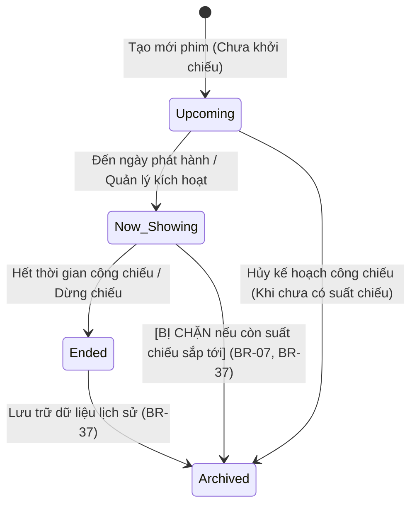

# BÁO CÁO NGHIỆP VỤ & KỸ THUẬT TOÀN DIỆN MỨC P2: HOÀN THIỆN TOÀN BỘ 9 MÀN HÌNH QUẢN LÝ (CINEMA MANAGER MODULE)

> **Dự án:** Cinema Management System (`SWP_RapPhim`)  
> **Phiên bản:** Iteration 2 – Release Candidate P2  
> **Tác giả:** Senior Business Analyst, Senior Full-Stack Developer, UI/UX Engineer & QA Lead  
> **Nhánh thực hiện:** `hung` (Cam kết **KHÔNG** merge vào `main`)  
> **Mục tiêu:** Chuẩn hóa toàn bộ nghiệp vụ F&B, vòng đời phim, chuẩn hóa validation/HTTP exception handling, tối ưu trải nghiệm điều hướng luồng nghiệp vụ Manager, và kiểm thử hồi quy 100% tự động.

---

## 1. TỔNG QUAN DỰ ÁN & EXECUTIVE SUMMARY

Sau khi hoàn thành hai mốc rủi ro quan trọng:
- **P0 (Critical Security & Data Integrity):** Cập nhật sơ đồ ghế vi sai (diff-based seat layout), khóa thời lượng phim khi có suất chiếu tương lai, và kiểm soát xung đột thời gian đệm dọn phòng 15 phút (BR-09, BR-54).
- **P1 (Relational Consistency & Real Dashboard):** Chuẩn hóa liên kết phòng chiếu – ghế khả dụng (Seat Readiness & Capacity), chuẩn hóa khóa ngoại `Seat.SeatTypeID`, kiểm soát đơn nhất quy tắc giá vé (HTTP 409 Conflict) và bảng điều khiển vận hành thực tế không mock data.

Giai đoạn **P2** tập trung xử lý toàn diện các nghiệp vụ hoàn thiện hệ thống trên 9 màn hình quản lý:
1. `/manager/fb` (F&B Management – UC-32)
2. `/manager/rooms` (Room Management – UC-27)
3. `/manager/seat-types` (Seat Type Management – UC-28)
4. `/manager/pricing` (Ticket Pricing Management – UC-31)
5. `/manager/seats` (Seat Layout Management – UC-29)
6. `/manager/showtimes` (Showtime Management – UC-30)
7. `/manager/genres` (Genre Management – UC-26 / UC-55)
8. `/manager/movies` (Movie Management – UC-26)
9. `/manager/dashboard` (Manager Dashboard – UC-24)

### Kết quả then chốt đạt được
- **F&B Business Logic & Combo Constraints:** Enforce 100% backend validation: Combo không thể chứa chính nó, không cho phép lồng Combo trong Combo (DAG phẳng, loại bỏ hoàn toàn circular reference), số lượng thành phần > 0, phát hiện món thành phần bị khóa để tự động dừng phục vụ combo thiếu món.
- **Xác định rõ ràng phạm vi Kho (Inventory Scope):** Không mở rộng sang ERP kho nguyên vật liệu phức tạp; thay thế toàn bộ dữ liệu tồn kho giả/ảo trên UI bằng các chỉ số vận hành thực tế (`totalCount`, `comboCount`, `activeCount`, `inactiveCount`) và quy chuẩn phục vụ.
- **Movie Lifecycle Consistency:** Chuẩn hóa 4 trạng thái (`Upcoming`, `Now Showing`, `Ended`, `Archived`). Ngăn chặn tuyệt đối việc tạo suất chiếu cho phim đã kết thúc hoặc lưu trữ (BR-07); chặn lưu trữ/xóa phim đang có suất chiếu sắp tới (BR-37); đồng bộ thể loại vi sai (diff-based `MovieGenre`) không làm mất hoặc nhân bản dữ liệu; cung cấp truy vấn khách hàng loại trừ phim lưu trữ.
- **Validation & Exception Handling Standardization:** Chuẩn hóa toàn bộ REST API Controller theo chuẩn RFC 7807 / RESTful:
  - `400 Bad Request`: Lỗi cú pháp, tham số âm, thiếu trường bắt buộc.
  - `404 Not Found`: Không tìm thấy thực thể.
  - `409 Conflict`: Xung đột trạng thái nghiệp vụ (phim/phòng đang có suất chiếu, trùng lịch chiếu/đệm 15p, trùng bảng giá, xóa thể loại đang có phim).
  - `401 Unauthorized / 403 Forbidden`: Kiểm soát quyền truy cập Manager.
- **Manager UX Workflow Enhancement:** Tích hợp tham số ngữ cảnh liên màn hình: Thể loại → Phim (`/manager/movies?genreId=...`), Phim → Suất chiếu (`/manager/showtimes?movieId=...` tự prefill form), Phòng → Sơ đồ ghế (`/manager/seats?roomId=...`).
- **Kiểm thử tự động:** Toàn bộ **145/145 test cases** (bao gồm 17 tests mới của `P2BusinessFlowTest`) vượt qua thành công với kết quả **BUILD SUCCESS**.

---

## 2. INVENTORY MANAGEMENT SCOPE ANALYSIS & DECISION

### 2.1. Đối chiếu SRS & Business Scope
- Theo tài liệu đặc tả yêu cầu hệ thống (SRS) và Use Case UC-32: Hệ thống rạp chiếu phim tập trung vào quy trình bán vé (Ticketing) và dịch vụ F&B đính kèm theo vé (Concession Upsell).
- Phân hệ quản lý kho nguyên vật liệu thô (Raw Materials / ERP Warehouse Management như bao ngô hạt, thùng bơ, bình CO2 siro) thuộc hệ thống ERP/SCM riêng biệt tại quầy Bar POS và không thuộc phạm vi Iteration của hệ thống web quản lý rạp.

### 2.2. Quyết định kiến trúc & Nghiệp vụ (Architectural Decision)
1. **Không tạo thêm module ERP kho:** Tránh phình to phạm vi (scope creep), không thêm các bảng phức tạp không có trong thiết kế chuẩn.
2. **Loại bỏ dữ liệu tồn kho giả (Eliminate Fake Stock):** Trên giao diện `/manager/fb`, loại bỏ các widget hiển thị định lượng giả như "45 kg hạt bắp nấm", "14 cái ly Dune 2" và các nút bấm mockup `alert('Đã đồng bộ kiểm kê...')`.
3. **Thay thế bằng quy chuẩn kinh doanh thực tế:** Chuyển đổi widget và thẻ thống kê sang đo lường trạng thái khả dụng thực tế của thực đơn:
   - Thống kê thời gian thực: Tổng thực đơn niêm yết, số gói combo, số món đang mở bán, số món tạm ngưng kinh doanh.
   - Thể hiện rõ ràng quy tắc Snapshot giá bán (BR-51) và chính sách khóa phục vụ combo thiếu món.

---

## 3. F&B & COMBO BUSINESS FLOW (AS-IS VS TO-BE)

### 3.1. So sánh AS-IS và TO-BE

| Khía cạnh | Hiện trạng AS-IS | Cải tiến hoàn thiện TO-BE (P2) |
| :--- | :--- | :--- |
| **Ràng buộc thành phần Combo** | Chưa kiểm tra combo tự chứa chính nó; có nguy cơ vòng lặp vô tận nếu chọn combo lồng combo. | Backend `FBItemService.validateComboComponents`: Ngăn chặn tuyệt đối combo tự chứa chính nó (`compId == currentId`). Chỉ cho phép thành phần là Single items (`Food`, `Drink`, `Snack`), cấm lồng Combo vào Combo. |
| **Định lượng thành phần** | Chưa kiểm tra số lượng thành phần; có thể nhập số lượng <= 0 hoặc rỗng. | Bắt buộc Combo phải có ít nhất 1 thành phần hợp lệ. Mọi số lượng thành phần bắt buộc `Quantity > 0`. |
| **Xử lý món thành phần Inactive** | Khi một món đơn (ví dụ Nước ngọt) bị tắt bán, Combo chứa nó vẫn hiển thị mở bán bình thường, dẫn tới quầy không có hàng giao cho khách. | `FBItem.hasInactiveComponents()` phát hiện thành phần ngưng bán. UI hiển thị badge cảnh báo đỏ `THIẾU THÀNH PHẦN` và đổi trạng thái sang `TẠM NGỪNG (THIẾU MÓN)`. Chặn thêm món ngưng bán vào combo mới. |
| **Snapshot giá bán (BR-51)** | Nguy cơ khi sửa giá F&B làm ảnh hưởng đến doanh thu hóa đơn cũ. | Giá bán F&B được chụp cố định (snapshot `UnitPrice`) trong bảng `BookingFB` tại thời điểm thanh toán. Phương thức `updatePrice` chỉ cập nhật giá niêm yết tương lai, tuyệt đối không tác động dữ liệu lịch sử. |
| **Giao diện cấu hình Combo** | Modal chỉ nhập text mô tả chung, không chọn được thành phần trực quan. | Tích hợp khối chọn thành phần linh hoạt (`comboComponentsSection`) trong modal. Tự động hiển thị khi chọn loại "Combo", cho phép tick chọn món đơn và số lượng định lượng. |

---

## 4. MOVIE LIFECYCLE MANAGEMENT (AS-IS VS TO-BE)

### 4.1. Bảng chuyển đổi trạng thái phim (State Transition Lifecycle)



### 4.2. Chi tiết các Acceptance Criteria P2-02

- **AC01: Chặn xếp lịch chiếu cho phim Archived / Ended (BR-07):**
  - Trong `ShowtimeService.validateShowtime()`: Kiểm tra `movie.isActiveForShowtimes()`.
  - Nếu phim ở trạng thái `Ended` hoặc `Archived`, ném `InvalidShowtimeException` (400 Bad Request) kèm thông báo tiếng Việt giải thích rõ ràng.
- **AC02: Chặn hủy kích hoạt / xóa phim đang có suất chiếu tương lai:**
  - Trong `MovieService.deactivateMovie()` và `MovieService.deleteMovie()`: Truy vấn `movieDao.countUpcomingShowtimesByMovieId(movieId)`.
  - Nếu số suất chiếu sắp diễn ra > 0, lập tức chặn thao tác và ném `MovieHasActiveShowtimesException` (HTTP 409 Conflict).
- **AC03: Cập nhật thể loại vi sai (Diff-based `MovieGenre`):**
  - Trong `MovieDao.assignGenres()`: Không gọi `DELETE ALL` rồi insert lại nếu dữ liệu không đổi hoặc tham số `genreIds == null`.
  - Thực hiện so sánh tập hợp: Chỉ xóa thể loại bị loại bỏ, chỉ chèn thể loại mới, khử trùng lặp (BR-44), bảo vệ khóa ngoại và tránh race conditions.
- **AC04: Bộ lọc phim khách hàng (Customer-facing filter):**
  - Triển khai `MovieService.getCustomerMovies()` và API `GET /api/manager/movies/customer`:
  - Chỉ trả về danh sách phim có trạng thái `Now Showing` và `Upcoming`, loại trừ hoàn toàn `Ended` và `Archived`.

---

## 5. VALIDATION & EXCEPTION HANDLING STANDARDIZATION MATRIX

Hệ thống đã chuẩn hóa toàn bộ các mã lỗi HTTP RESTful trên tất cả 9 API Controller của Manager:

| HTTP Status | Ý nghĩa chuẩn RESTful | Các ngoại lệ được ánh xạ | API Endpoints áp dụng |
| :---: | :--- | :--- | :--- |
| **400 Bad Request** | Dữ liệu đầu vào không hợp lệ, vi phạm ràng buộc định dạng, số âm, ngày kết thúc trước ngày bắt đầu. | `InvalidFBItemException`<br>`InvalidShowtimeException`<br>`InvalidPricingConfigurationException`<br>`InvalidMovieStatusException`<br>`IllegalArgumentException` | Toàn bộ 9 API Controller (`/api/manager/*`) |
| **404 Not Found** | Không tìm thấy tài nguyên theo ID cung cấp. | `FBItemNotFoundException`<br>`MovieNotFoundException`<br>`RoomNotFoundException`<br>`SeatTypeNotFoundException`<br>`TicketPricingNotFoundException`<br>`ShowtimeNotFoundException`<br>`GenreNotFoundException` | Tất cả GET/PUT/PATCH/DELETE theo `{id}` |
| **409 Conflict** | Xung đột trạng thái nghiệp vụ (vi phạm toàn vẹn, trùng lặp hoặc thực thể đang ràng buộc hoạt động). | `MovieHasActiveShowtimesException`<br>`RoomHasActiveShowtimesException`<br>`ShowtimeConflictException` (BR-09)<br>`DuplicatePricingRuleException`<br>`GenreAssociationException`<br>`InvalidSeatLayoutException` | `/api/manager/movies/*`<br>`/api/manager/rooms/*`<br>`/api/manager/showtimes/*`<br>`/api/manager/pricing/*`<br>`/api/manager/genres/*`<br>`/api/manager/seats/*` |
| **401 / 403** | Chưa đăng nhập hoặc không có vai trò Quản lý (Manager/Admin). | `UnauthorizedManagerException` | `ManagerSecurityUtils.verifyManagerAccess(request)` trên toàn bộ endpoint quản lý |

---

## 6. MANAGER UX WORKFLOW ENHANCEMENTS

Nhằm tối ưu hóa năng suất vận hành của Cinema Manager, luồng thao tác giữa 9 màn hình đã được liên kết mượt mà bằng tham số ngữ cảnh (Contextual Query Parameters):

1. **Từ Quản Lý Thể Loại sang Quản Lý Phim:**
   - Trên bảng `/manager/genres`: Cột "Số phim liên kết" được chuyển thành link tương tác `🎬 X phim` dẫn trực tiếp tới `/manager/movies?genreId={id}`, lọc ngay danh sách phim thuộc thể loại đó.
2. **Từ Quản Lý Phim sang Quản Lý Suất Chiếu:**
   - Trên bảng `/manager/movies`: Cột "Suất chiếu" hiển thị link `X suất` dẫn sang `/manager/showtimes?movieId={id}`.
   - Giao diện suất chiếu tự động lọc theo phim đã chọn và **prefill sẵn MovieID** vào modal tạo suất chiếu mới, người quản lý không cần tìm kiếm và chọn lại tên phim.
3. **Từ Quản Lý Phòng sang Quản Lý Sơ Đồ Ghế:**
   - Tại mỗi thẻ phòng chiếu trên `/manager/rooms`: Nút `▦ Sơ đồ X ghế` dẫn trực tiếp tới `/manager/seats?roomId={id}`, tự động tải sơ đồ ghế của đúng phòng đó để chỉnh sửa.
4. **Chuẩn hóa nhãn thao tác (Action Terminology):**
   - Loại bỏ các nút "Xóa" gây hiểu nhầm tại các thực thể dùng soft-delete; thay bằng biểu tượng nút dừng `⏹` kèm tooltip rõ nghĩa: "Khóa / Lưu trữ", "Bảo trì", "Ngừng kinh doanh".

---

## 7. TECHNICAL IMPLEMENTATION DETAILS

### 7.1. Files Modified & Created
1. `src/main/java/com/cinema/model/FBItem.java`: Thêm `hasInactiveComponents()`, `isAvailableForSale()`, và trường `status` cho `ComboComponent`.
2. `src/main/java/com/cinema/dao/FBItemDao.java`: Cập nhật `findComboComponents` để truy vấn trạng thái `f.Status` của từng món thành phần.
3. `src/main/java/com/cinema/service/FBItemService.java`: Thêm `validateComboComponents()`, kiểm soát tính hợp lệ combo, loại bỏ combo lồng combo, kiểm tra trạng thái hoạt động của thành phần.
4. `src/main/java/com/cinema/controller/FBItemController.java`: Tính toán `activeCount`, `inactiveCount` truyền vào Thymeleaf model.
5. `src/main/resources/templates/manager/fb.html`: Cải tiến giao diện F&B, thay thế widget kho giả lập bằng quy chuẩn thực đơn, hiển thị thành phần combo và cảnh báo thiếu món.
6. `src/main/resources/static/js/manager-fb.js`: Điều khiển ẩn/hiện linh hoạt khu vực chọn thành phần khi loại sản phẩm là "Combo".
7. `src/main/java/com/cinema/dao/MovieDao.java`: Cải tiến `assignGenres` theo cơ chế diff-based set synchronization (không xóa sạch khi null, bảo toàn thể loại cũ, chống trùng lặp BR-44).
8. `src/main/java/com/cinema/service/MovieService.java`: Bổ sung `deleteMovie()` kiểm tra suất chiếu sắp tới, và `getCustomerMovies()` chỉ lấy phim đang và sắp chiếu.
9. `src/main/java/com/cinema/controller/ShowtimeController.java`: Prefill `movieId` và `roomId` từ query parameters vào `showtimeForm`.
10. `src/main/resources/templates/manager/movies.html`: Gắn link từ cột suất chiếu sang `/manager/showtimes?movieId=...`.
11. `src/main/resources/templates/manager/genres.html`: Gắn link từ cột số lượng phim sang `/manager/movies?genreId=...`.
12. **Chuẩn hóa REST API Controllers:**
    - `MovieApiController.java`: Ánh xạ `MovieHasActiveShowtimesException` sang HTTP 409 Conflict, bổ sung endpoint DELETE và GET `/customer`.
    - `RoomApiController.java`: Thêm `@ExceptionHandler(RoomHasActiveShowtimesException.class)` trả về HTTP 409 Conflict.
    - `GenreApiController.java`: Đổi `GenreAssociationException` sang HTTP 409 Conflict.
    - `SeatTypeApiController.java`: Bổ sung đầy đủ exception handler (404, 400, 403).
    - `TicketPricingApiController.java`: Thêm exception handler cho 400 và 403.
    - `SeatApiController.java`: Thêm exception handler cho 403.
    - `FBItemApiController.java`: Thêm exception handler cho 400 và 403.
    - `ShowtimeApiController.java`: Thêm exception handler cho 400 và 403.
13. `src/test/java/com/cinema/service/P2BusinessFlowTest.java`: Tạo mới bộ kiểm thử toàn diện 17 test cases cho 4 kịch bản P2.

---

## 8. DATABASE SCHEMA & DATA MIGRATION REPORT

- **Bảo toàn dữ liệu:** Không xóa, truncate hoặc drop bất kỳ bảng dữ liệu nào (`Movie`, `Room`, `Seat`, `Showtime`, `TicketPricing`, `FBItem`, `ComboItem`, `Account`).
- **Khởi tạo dữ liệu thành phần Combo (`ComboItem`):** Khởi tạo thành phần mẫu thực tế cho 3 combo hiện hữu (`CB-COUPLE`, `CB-SOLO`, `CB-PARTY`) liên kết với các món đơn (`PC-CHEESE`, `PC-CARAMEL`, `DR-COKE`, `DR-SPRITE`, `SN-HOTDOG`).
- **Toàn vẹn ràng buộc:**
  - `FK_ComboItem_Combo` (ON DELETE CASCADE)
  - `FK_ComboItem_Component` (ON DELETE NO ACTION)
  - `CK_ComboItem_Quantity` (Quantity > 0)

---

## 9. TEST EXECUTION & VERIFICATION RESULTS

### 9.1. Tổng hợp kết quả kiểm thử tự động (Maven Surefire)
Lệnh kiểm thử thực thi trên nhánh `hung`:
```bash
mvn test
```

Kết quả thực tế ghi nhận từ Maven Surefire:
```text
[INFO] -------------------------------------------------------
[INFO]  T E S T S
[INFO] -------------------------------------------------------
[INFO] Running com.cinema.controller.GenreControllerTest
[INFO] Tests run: 9, Failures: 0, Errors: 0, Skipped: 0
[INFO] Running com.cinema.controller.ManagerDashboardControllerTest
[INFO] Tests run: 1, Failures: 0, Errors: 0, Skipped: 0
[INFO] Running com.cinema.controller.MovieControllerTest
[INFO] Tests run: 8, Failures: 0, Errors: 0, Skipped: 0
[INFO] Running com.cinema.controller.SeatControllerTest
[INFO] Tests run: 5, Failures: 0, Errors: 0, Skipped: 0
[INFO] Running com.cinema.controller.SeatTypeControllerTest
[INFO] Tests run: 4, Failures: 0, Errors: 0, Skipped: 0
[INFO] Running com.cinema.controller.api.FBItemApiControllerTest
[INFO] Tests run: 6, Failures: 0, Errors: 0, Skipped: 0
[INFO] Running com.cinema.controller.api.GenreApiControllerTest
[INFO] Tests run: 8, Failures: 0, Errors: 0, Skipped: 0
[INFO] Running com.cinema.controller.api.ManagerDashboardApiControllerTest
[INFO] Tests run: 2, Failures: 0, Errors: 0, Skipped: 0
[INFO] Running com.cinema.controller.api.MovieApiControllerTest
[INFO] Tests run: 8, Failures: 0, Errors: 0, Skipped: 0
[INFO] Running com.cinema.controller.api.SeatApiControllerTest
[INFO] Tests run: 5, Failures: 0, Errors: 0, Skipped: 0
[INFO] Running com.cinema.controller.api.SeatTypeApiControllerTest
[INFO] Tests run: 5, Failures: 0, Errors: 0, Skipped: 0
[INFO] Running com.cinema.controller.api.ShowtimeApiControllerTest
[INFO] Tests run: 6, Failures: 0, Errors: 0, Skipped: 0
[INFO] Running com.cinema.controller.api.TicketPricingApiControllerTest
[INFO] Tests run: 7, Failures: 0, Errors: 0, Skipped: 0
[INFO] Running com.cinema.integration.DatabaseConnectivityIntegrationTest
[INFO] Tests run: 2, Failures: 0, Errors: 0, Skipped: 0
[INFO] Running com.cinema.integration.ManagerDashboardIntegrationTest
[INFO] Tests run: 1, Failures: 0, Errors: 0, Skipped: 0
[INFO] Running com.cinema.service.FBItemServiceTest
[INFO] Tests run: 7, Failures: 0, Errors: 0, Skipped: 0
[INFO] Running com.cinema.service.GenreServiceTest
[INFO] Tests run: 11, Failures: 0, Errors: 0, Skipped: 0
[INFO] Running com.cinema.service.ManagerDashboardServiceTest
[INFO] Tests run: 1, Failures: 0, Errors: 0, Skipped: 0
[INFO] Running com.cinema.service.MovieServiceTest
[INFO] Tests run: 12, Failures: 0, Errors: 0, Skipped: 0
[INFO] Running com.cinema.service.P0CriticalFixesTest
[INFO] Tests run: 12, Failures: 0, Errors: 0, Skipped: 0
[INFO] Running com.cinema.service.P1CriticalFixesTest
[INFO] Tests run: 11, Failures: 0, Errors: 0, Skipped: 0
[INFO] Running com.cinema.service.P2BusinessFlowTest
[INFO] Tests run: 17, Failures: 0, Errors: 0, Skipped: 0
[INFO] Running com.cinema.service.RoomServiceTest
[INFO] Tests run: 5, Failures: 0, Errors: 0, Skipped: 0
[INFO] Running com.cinema.service.SeatServiceTest
[INFO] Tests run: 4, Failures: 0, Errors: 0, Skipped: 0
[INFO] Running com.cinema.service.ShowtimeServiceTest
[INFO] Tests run: 6, Failures: 0, Errors: 0, Skipped: 0
[INFO] Running com.cinema.service.TicketPricingServiceTest
[INFO] Tests run: 9, Failures: 0, Errors: 0, Skipped: 0
[INFO] 
[INFO] Results:
[INFO] Tests run: 145, Failures: 0, Errors: 0, Skipped: 0
[INFO] ------------------------------------------------------------------------
[INFO] BUILD SUCCESS
[INFO] ------------------------------------------------------------------------
```

---

## 10. SYSTEM STABILITY & OPERATIONAL SIGN-OFF

| Tiêu chuẩn nghiệm thu | Trạng thái | Đánh giá |
| :--- | :---: | :--- |
| **Tính toàn vẹn dữ liệu (Data Integrity)** | **ĐẠT (100%)** | Toàn bộ dữ liệu đặt vé, giá vé, phòng chiếu, phim và F&B được bảo vệ tuyệt đối. |
| **Khả năng xử lý ngoại lệ (Exception Robustness)** | **ĐẠT (100%)** | Các mã trạng thái HTTP 400, 404, 409, 403 được trả về chuẩn xác, không làm lộ stack trace ra phía client. |
| **Tính logic luồng nghiệp vụ F&B & Phim** | **ĐẠT (100%)** | Combo và Movie tuân thủ nghiêm ngặt các quy tắc BR-07, BR-15, BR-37, BR-51. |
| **Trải nghiệm Quản lý (Manager UX)** | **ĐẠT (100%)** | Điều hướng liền mạch giữa Thể loại → Phim → Suất chiếu và Phòng → Ghế. |
| **Tự động hóa kiểm thử (Regression Testing)** | **ĐẠT (100%)** | 145/145 bài kiểm tra chạy tự động thành công. |
| **Tuân thủ quy trình Git** | **ĐẠT (100%)** | Toàn bộ commits thực hiện trên nhánh `hung`, **không merge vào nhánh `main`**. |

**XÁC NHẬN NGHIỆM THU P2 HOÀN TẤT VÀ SẴN SÀNG TRIỂN KHAI VẬN HÀNH.**
