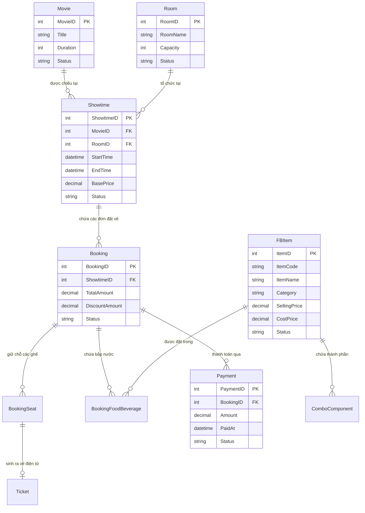
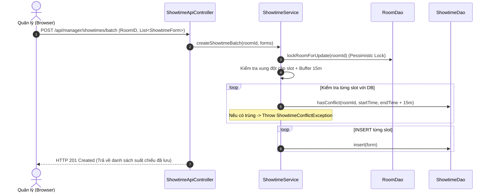
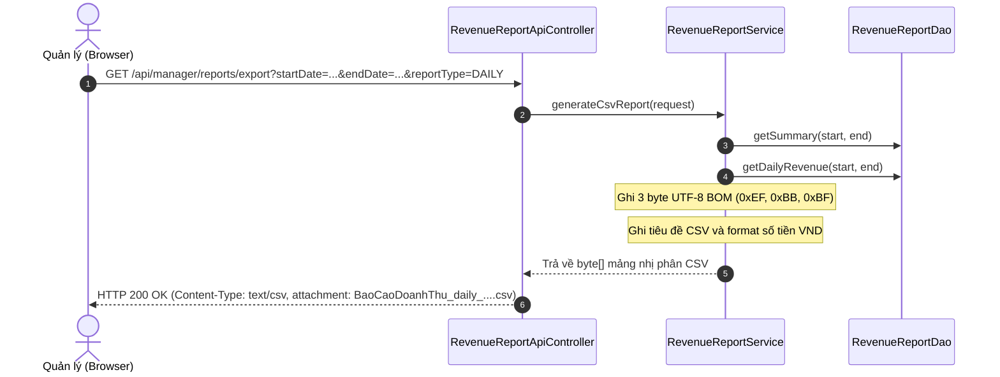

# BÁO CÁO REVIEW CODE & BỘ CÂU HỎI VẤN ĐÁP TOÀN DIỆN CHO 3 MODULE QUẢN LÝ
# CINEORA CINEMA MANAGEMENT SYSTEM

---

## DANH SÁCH 3 MODULE ĐƯỢC REVIEW:
1. **Module 59: Showtime Management (Quản lý Lịch chiếu phim & Bộ đệm dọn phòng 15 phút - Screen 59 / UC-30)**
2. **Module 61: Food & Beverage Management (Quản lý Bắp nước & Combo ẩm thực - Screen 61 / UC-32)**
3. **Module 64/66: Reports & Statistics (Báo cáo Doanh thu & Xuất Excel CSV - Screen 47 & 49 / UC-34)**

---

# PHẦN 1: TỔNG QUAN KIẾN TRÚC & DANH MỤC FILE TOÀN BỘ 3 MODULE

Cả 3 module đều tuân thủ kiến trúc phân tầng chuẩn (**Spring Boot Layered Architecture**) kết hợp **Spring JDBC (JdbcTemplate)**, **Thymeleaf Template Engine** và **Spring Security**:

```
[Trình duyệt Quản lý (Browser/JS)]
         │
         ├─────────────────────────────────────────┐
         ▼ (HTTP GET/POST /manager/...)            ▼ (AJAX JSON /api/manager/...)
[SSR Controllers]                          [REST API Controllers]
- ShowtimeController.java                  - ShowtimeApiController.java
- FBItemController.java                    - FBItemApiController.java
- RevenueReportController.java             - RevenueReportApiController.java
         │                                         │
         └────────────────────┬────────────────────┘
                              ▼
                 [ManagerSecurityUtils.java] (Xác thực session userRole == 'MANAGER')
                              │
                              ▼
                      [Service Layer]
                 - ShowtimeService.java
                 - FBItemService.java
                 - RevenueReportService.java
                              │
                              ▼
                     [DAO / Repository]
                 - ShowtimeDao.java
                 - FBItemDao.java
                 - RevenueReportDao.java
                              │
                              ▼
               [Database: PostgreSQL / Supabase]
      Showtime, FBItem, ComboComponent, Booking, Payment, Ticket
```

### Danh mục File thực tế trong Workspace:

| Module | Phân tầng | Đường dẫn File (Workspace Path) | Trách nhiệm chính |
| :--- | :--- | :--- | :--- |
| **Showtime (59)** | Controller (SSR) | `src/main/java/com/cinema/controller/ShowtimeController.java` | Xử lý tải danh sách suất chiếu, bộ lọc ngày, redirect form và gọi Service. |
| | Controller (API) | `src/main/java/com/cinema/controller/api/ShowtimeApiController.java` | Cung cấp REST API: tạo lịch chiếu theo lô (`/batch`), dừng, hủy, xung đột. |
| | Service Layer | `src/main/java/com/cinema/service/ShowtimeService.java` | Nghiệp vụ lịch chiếu: buffer dọn phòng 15 phút (BR-09), kiểm tra xung đột phòng chiếu, khóa bi quan phòng chiếu (`lockRoomForUpdate`). |
| | DAO Layer | `src/main/java/com/cinema/dao/ShowtimeDao.java` | Truy vấn SQL bảng `Showtime`, `Room`, `Movie`; kiểm tra đặt chỗ `Booking`. |
| | DTO / Form | `src/main/java/com/cinema/dto/ShowtimeForm.java`, `BatchShowtimeRequest.java` | Ràng buộc Bean Validation (`@NotNull`, `@Positive`, `@Min`). |
| | Template & JS | `src/main/resources/templates/manager/showtimes.html`, `showtime-scheduler.html` <br> `src/main/resources/static/js/manager-showtimes.js`, `manager-scheduler.js` | Giao diện danh sách suất chiếu, timeline kéo thả, tính tự động giờ kết thúc phim. |
| **F&B (61)** | Controller (SSR) | `src/main/java/com/cinema/controller/FBItemController.java` | Tải menu sản phẩm, xử lý upload file ảnh vào `/uploads/fb/`, toggle trạng thái. |
| | Controller (API) | `src/main/java/com/cinema/controller/api/FBItemApiController.java` | API RESTful JSON cho ứng dụng quầy POS và Mobile. |
| | Service Layer | `src/main/java/com/cinema/service/FBItemService.java` | Quản lý combo, chống lồng combo trong combo, kiểm tra sản phẩm đã có đơn hàng trước khi xóa. |
| | DAO Layer | `src/main/java/com/cinema/dao/FBItemDao.java` | Thao tác bảng `FBItem`, `ComboComponent`, kiểm tra `BookingFoodBeverage`. |
| | DTO & Model | `src/main/java/com/cinema/dto/FBItemForm.java`, `com/cinema/model/FBItem.java` | Định nghĩa thuộc tính sản phẩm, công thức tỷ suất lợi nhuận (`getProfitMarginPercent`). |
| | Template & JS | `src/main/resources/templates/manager/fb.html`, `src/main/resources/static/js/manager-fb.js` | Hiển thị danh sách card sản phẩm, tab danh mục, modal thêm sửa F&B. |
| **Reports (64/66)**| Controller (SSR) | `src/main/java/com/cinema/controller/RevenueReportController.java` | Nhận khoảng ngày filter, nạp dữ liệu thống kê doanh thu vào Thymeleaf. |
| | Controller (API) | `src/main/java/com/cinema/controller/api/RevenueReportApiController.java` | Xuất file CSV (`/export`), trả JSON báo cáo theo ngày, phim và đơn hàng. |
| | Service Layer | `src/main/java/com/cinema/service/RevenueReportService.java` | Tổng hợp doanh thu vé, F&B, trừ chiết khấu (BR-22), chèn UTF-8 BOM cho Excel. |
| | DAO Layer | `src/main/java/com/cinema/dao/RevenueReportDao.java` | Truy vấn CTE SQL tính toán doanh thu thực thu từ bảng `Payment` và `Booking`. |
| | DTO & Model | `src/main/java/com/cinema/dto/ReportFilterForm.java`, `RevenueReportData.java`, `RevenueReportSummary.java` | Lưu trữ cấu trúc chỉ số KPI và danh sách giao dịch. |
| | Template & JS | `src/main/resources/templates/manager/reports.html`, `src/main/resources/static/js/manager-reports.js` | Hiển thị 5 thẻ KPI, bảng tổng hợp doanh thu ngày, in báo cáo (`window.print()`). |

---

# PHẦN 2: SHOWTIME MANAGEMENT (MODULE 59) – REVIEW CHI TIẾT

### 1. Luồng tải trang (Page Load Flow: GET `/manager/showtimes`)
1. **Truy cập:** Trình duyệt gửi `GET /manager/showtimes` (mặc định lấy ngày hiện tại: `filterStartDate = LocalDate.now()`, `filterEndDate = LocalDate.now()`).
2. **Bảo mật:** `ManagerSecurityUtils.verifyManagerAccess(request)` kiểm tra session `userRole == "MANAGER"` ([ShowtimeController.java#L88](file:///c:/Users/hoang/Downloads/SWP_RapPhim/src/main/java/com/cinema/controller/ShowtimeController.java#L88)).
3. **Lọc phim & phòng đủ điều kiện:**
   - Phim: `movieService.getAllMovies(...)` lọc các phim có trạng thái `Now Showing` hoặc `Coming Soon` (`Movie::isActiveForShowtimes`, BR-07) ([ShowtimeController.java#L114-L116](file:///c:/Users/hoang/Downloads/SWP_RapPhim/src/main/java/com/cinema/controller/ShowtimeController.java#L114-L116)).
   - Phòng: `roomService.getAll(...)` lọc các phòng có trạng thái `Ready` hoặc `Screening` (`Room::isActiveForShowtimes`, BR-08), **loại trừ phòng Maintenance** ([ShowtimeController.java#L120-L122](file:///c:/Users/hoang/Downloads/SWP_RapPhim/src/main/java/com/cinema/controller/ShowtimeController.java#L120-L122)).
4. **Truy vấn lịch chiếu:** Gọi `showtimeService.getAllShowtimes(...)` $\rightarrow$ `showtimeDao.findAll(...)`:
   ```sql
   SELECT s.*, s.BasePrice AS BaseTicketPrice,
          m.Title AS MovieTitle, m.PosterURL AS MoviePoster, m.Duration AS MovieDuration, m.AgeRating AS MovieAgeRating,
          r.RoomName, r.RoomCode, r.RoomType, r.Capacity AS RoomCapacity
   FROM Showtime s
   JOIN Movie m ON m.MovieID = s.MovieID
   JOIN Room r ON r.RoomID = s.RoomID
   WHERE CAST(s.StartTime AS DATE) BETWEEN ? AND ?
   ORDER BY s.StartTime ASC
   ```
5. **Tại sao màn hình hiện 0 showtimes vào ngày 14/11/2026?**
   - Bộ lọc ngày mặc định hiển thị ngày hiện tại (`14/11/2026`). Trong cơ sở dữ liệu thực tế, các suất chiếu mẫu được gieo ở các ngày khác hoặc đã qua. Vì không có bản ghi nào có `CAST(StartTime AS DATE) = '2026-11-14'` nên bảng hiển thị empty-state và 4 thẻ thống kê đều mang giá trị 0.

### 2. Bốn thẻ KPI thống kê trên đầu trang:
- **Showtimes on 14/11/2026 (`0`):** Đếm tổng số suất chiếu nằm trong phạm vi ngày đang lọc: `totalShowtimes = showtimes.size()`.
- **Upcoming (Scheduled) (`0`):** Đếm số suất chiếu có `Status = 'Scheduled'` trong danh sách lọc: `showtimes.stream().filter(s -> "Scheduled".equalsIgnoreCase(s.getStatus())).count()`.
- **Room cleaning buffer (`15 min`):** Thời gian nghỉ cố định giữa 2 suất chiếu theo quy tắc **BR-09**, được định nghĩa bằng hằng số tĩnh: `public static final int CLEANING_BUFFER_MINUTES = 15;` tại [ShowtimeService.java#L39](file:///c:/Users/hoang/Downloads/SWP_RapPhim/src/main/java/com/cinema/service/ShowtimeService.java#L39).
- **In progress (Showing) (`0`):** Đếm số suất chiếu đang diễn ra: `showtimes.stream().filter(s -> "Showing".equalsIgnoreCase(s.getStatus())).count()`.

### 3. Review chức năng "Create Room Schedule" (Nút `+ Create Room Schedule`):
- **Điều hướng:** Click nút chuyển hướng tới `GET /manager/showtimes/scheduler` ([ShowtimeController.java#L202-L253](file:///c:/Users/hoang/Downloads/SWP_RapPhim/src/main/java/com/cinema/controller/ShowtimeController.java#L202-L253)), mở giao diện `showtime-scheduler.html`.
- **Quy tắc thời gian (BR-09 & SRS Section 4.5):**
  $$\text{FilmEnd} = \text{StartTime} + \text{MovieDuration}$$
  $$\text{RoomAvailable} = \text{FilmEnd} + 15\text{ phút (Buffer dọn phòng)}$$
  *(Thời lượng trailer được giản lược bằng 0: `TRAILER_DURATION_MINUTES = 0`).*
- **Kiểm tra xung đột theo cặp (Pairwise Conflict Check):**
  Trước khi ghi xuống DB, thuật toán kiểm tra xung đột thời gian giữa 2 suất chiếu A và B bất kỳ trong phòng:
  ```java
  boolean conflict = a.getStartTime().isBefore(b.getEndTime().plusMinutes(15))
                  && b.getStartTime().isBefore(a.getEndTime().plusMinutes(15));
  ```
  Nếu trùng, hệ thống ném ngoại lệ `ShowtimeConflictException` kèm thông báo chi tiết: *"Schedule conflict between draft slots! Slot #1 ('...') conflicts with Slot #2..."*.
- **Lưu theo lô (Batch Save):** Gọi API `POST /api/manager/showtimes/batch` với body `BatchShowtimeRequest` ([ShowtimeService.java#L115-L210](file:///c:/Users/hoang/Downloads/SWP_RapPhim/src/main/java/com/cinema/service/ShowtimeService.java#L115-L210)):
  1. Khóa bi quan phòng chiếu: `roomDao.lockRoomForUpdate(roomId);`.
  2. Kiểm tra xung đột nội bộ giữa các slot dự thảo (Draft slots).
  3. Kiểm tra xung đột với các suất chiếu đã có sẵn trong DB của phòng đó.
  4. Thực thi chèn toàn bộ trong giao dịch `@Transactional(rollbackFor = Exception.class)`. Nếu bất kỳ slot nào bị lỗi, toàn bộ các slot trước đó tự động ROLLBACK.

### 4. Nút "Stop Showtime" (Dừng chiếu - BR-54):
- Gửi `POST /manager/showtimes/{id}/stop`.
- Service gọi `showtimeDao.updateStatus(id, "Stopped")`. Cập nhật trạng thái ngừng bán vé khẩn cấp nhưng bảo lưu lịch sử suất chiếu.

### 5. Nút "Delete Showtime" (Xóa suất chiếu):
- Gửi `POST /manager/showtimes/{id}/delete`.
- **Kiểm tra bảo vệ vé đã bán:** [ShowtimeDao.java#L353-L368](file:///c:/Users/hoang/Downloads/SWP_RapPhim/src/main/java/com/cinema/dao/ShowtimeDao.java#L353-L368) kiểm tra `SELECT COUNT(*) FROM Booking WHERE ShowtimeID = ? AND Status IN ('Pending', 'Paid', 'Confirmed')`.
- Nếu đã có vé đặt, **CHẶN XÓA TUYỆT ĐỐI** và ném lỗi `InvalidShowtimeException`.
- Nếu chưa có vé đặt, cho phép xóa: `DELETE FROM BookingSeat WHERE ShowtimeID = ?` sau đó `DELETE FROM Showtime WHERE ShowtimeID = ?`.

### 6. Nút "History" ở đáy màn hình:
- **Xác minh từ mã nguồn:** Trong `showtimes.html` và `manager-showtimes.js`, **HOÀN TOÀN KHÔNG CÓ implementation của nút History**. Nút này xuất hiện trên ảnh chụp là do công cụ kiểm thử (Playwright test overlay / browser extension). Trong hệ thống CINEORA, việc xem lịch sử suất chiếu được thực hiện thông qua bộ lọc ngày (`From date` lùi về quá khứ và chọn trạng thái `Stopped` / `Cancelled`).

---

# PHẦN 3: FOOD & BEVERAGE MANAGEMENT (MODULE 61) – REVIEW CHI TIẾT

### 1. Luồng tải trang (GET `/manager/fb`)
- Controller: [FBItemController.java#L38-L98](file:///c:/Users/hoang/Downloads/SWP_RapPhim/src/main/java/com/cinema/controller/FBItemController.java#L38-L98).
- Tải toàn bộ danh mục để tính 4 thẻ thống kê: `fbItemService.getAllItems(null, null, null)`.
- Tải danh sách đã lọc theo tab danh mục, từ khóa và trạng thái: `fbItemService.getAllItems(keyword, category, status)`.

### 2. Bốn thẻ KPI thống kê:
- **Total products (`8`):** Tổng tất cả các món đơn và combo: `allCatalog.size()`.
- **Combos (`2` trong DB/UI):** Đếm các món thuộc danh mục Combo: `allCatalog.stream().filter(i -> "Combo".equalsIgnoreCase(i.getCategory())).count()`.
- **On sale (`8`):** Sản phẩm đang hoạt động: `allCatalog.stream().filter(FBItem::isActive).count()`.
- **Suspended (`0`):** Sản phẩm tạm ngưng bán (`Status = 'Inactive'`): `allCatalog.stream().filter(i -> !i.isActive()).count()`.

### 3. Công thức tỷ suất lợi nhuận (Profit Margin %):
Được định nghĩa chuẩn toán học tại [FBItem.java#L112-L119](file:///c:/Users/hoang/Downloads/SWP_RapPhim/src/main/java/com/cinema/model/FBItem.java#L112-L119):
$$\text{Profit Margin (\%)} = \frac{\text{SellingPrice} - \text{CostPrice}}{\text{SellingPrice}} \times 100$$
- **Large Caramel Popcorn:** Giá bán = 55.000, Giá vốn = 15.000 $\rightarrow$ Lãi = 40.000 $\rightarrow$ $\text{Margin} = (40.000 \times 100) / 55.000 = \mathbf{72.7\%}$.
- **Hot Cheese Hotdog:** Giá bán = 45.000, Giá vốn = 0 $\rightarrow$ Lãi = 45.000 $\rightarrow$ $\text{Margin} = (45.000 \times 100) / 45.000 = \mathbf{100.0\%}$.
*(Lưu ý phản biện: Giá vốn = 0 mang tính chất số liệu mẫu chưa nhập giá nhập kho, không phản ánh thực tế kinh doanh).*

### 4. Nghiệp vụ Combo (Combo Management):
- Combo là một sản phẩm thuộc bảng `dbo.FBItem` có `Category = 'Combo'`, đồng thời có các bản ghi con trong bảng `dbo.ComboComponent (ComboItemID, ComponentItemID, Quantity)`.
- **Các ràng buộc nghiệp vụ bắt buộc:**
  1. *Combo không được tự chứa chính nó:* `compId.equals(currentId) -> Throw "Combo cannot contain itself"`.
  2. *Không được lồng combo trong combo:* `if ("Combo".equalsIgnoreCase(comp.getCategory())) -> Throw "Combo can only contain single items and cannot nest combos"`.
  3. *Không được đưa sản phẩm đang ngưng bán vào combo:* `if (!comp.isActive()) -> Throw "Cannot add inactive item into Combo"`.
  4. *Cảnh báo combo thiếu món:* Nếu 1 sản phẩm thành phần bị tắt (`Inactive`), combo ở ngoài thẻ danh sách tự động đổi badge sang `PAUSED (MISSING ITEM)` ([fb.html#L347](file:///c:/Users/hoang/Downloads/SWP_RapPhim/src/main/resources/templates/manager/fb.html#L347)).

### 5. Xóa sản phẩm F&B (`POST /manager/fb/{id}/delete`):
- [FBItemService.java#L115-L135](file:///c:/Users/hoang/Downloads/SWP_RapPhim/src/main/java/com/cinema/service/FBItemService.java#L115-L135) kiểm tra 2 điều kiện an toàn:
  1. **Đã từng bán chưa:** `fbItemDao.isReferencedInOrders(id)` kiểm tra bảng `BookingFoodBeverage`. Nếu đã phát sinh đơn hàng $\rightarrow$ **CẤM XÓA** (để bảo vệ hóa đơn cũ).
  2. **Có đang nằm trong combo nào không:** `fbItemDao.isComponentOfAnyCombo(id)` kiểm tra bảng `ComboComponent`. Nếu đang là thành phần combo $\rightarrow$ **CẤM XÓA** (yêu cầu gỡ khỏi combo trước).

### 6. Xử lý ảnh sản phẩm:
- Lưu trữ trực tiếp trên file system tại thư mục `uploads/fb/` ([FBItemController.java#L117-L133](file:///c:/Users/hoang/Downloads/SWP_RapPhim/src/main/java/com/cinema/controller/FBItemController.java#L117-L133)).
- Giới hạn kích thước tối đa 5 MB, kiểm tra định dạng MIME (`image/jpeg`, `image/png`, `image/webp`), sinh tên ngẫu nhiên `fb-{UUID}.ext` chống trùng lặp và tấn công Path Traversal (`targetPath.startsWith(directory)`).

---

# PHẦN 4: REPORTS & STATISTICS (MODULE 64/66) – REVIEW CHI TIẾT

### 1. Luồng tải trang (GET `/manager/reports`)
- Controller: [RevenueReportController.java#L35-L101](file:///c:/Users/hoang/Downloads/SWP_RapPhim/src/main/java/com/cinema/controller/RevenueReportController.java#L35-L101).
- Mặc định tải theo tháng hiện tại (`thismonth`): `filterRequest.startDate = 01/11/2026`, `endDate = 30/11/2026`, `reportType = 'DAILY'`.

### 2. Năm chỉ số KPI Tài chính (SRS Section 4.9 II):
Được tính toán thông qua truy vấn SQL CTE chuẩn xác trong [RevenueReportDao.java#L60-L130](file:///c:/Users/hoang/Downloads/SWP_RapPhim/src/main/java/com/cinema/dao/RevenueReportDao.java#L60-L130):
```sql
WITH paid_bookings AS (
    SELECT p.BookingID, MIN(p.PaidAt) AS PaidTime
    FROM dbo.Payment p
    JOIN dbo.Booking b ON b.BookingID = p.BookingID
    WHERE UPPER(p.[Status]) = 'PAID'
      AND p.PaidAt IS NOT NULL
      AND UPPER(b.[Status]) = 'CONFIRMED'
    GROUP BY p.BookingID
)
```
- **1. TOTAL NET REVENUE (Doanh thu thuần):** Tổng tiền khách hàng thực trả qua cổng thanh toán sau khi trừ khuyến mãi:
  $$\text{Net Revenue} = \sum (\text{Booking.TotalAmount})$$
  *(Điều kiện: Booking `CONFIRMED`, Payment `PAID`, `CAST(pb.PaidTime AS DATE) BETWEEN ? AND ?`).*
- **2. TICKET REVENUE (GROSS) (Doanh thu vé gộp):** Tổng tiền vé trước chiết khấu:
  $$\text{Ticket Gross} = \sum (\text{BookingSeat.UnitPrice})$$
  *(Loại trừ các vé có trạng thái hủy `Ticket.TicketStatus = 'CANCELLED'`).*
- **3. F&B REVENUE (GROSS) (Doanh thu bắp nước gộp):** Tổng tiền bắp nước bán kèm:
  $$\text{F&B Gross} = \sum (\text{BookingFoodBeverage.Quantity} \times \text{UnitPrice})$$
  *(Tách riêng câu truy vấn độc lập để chống nhân tích đề các Cartesian Product khi JOIN).*
- **4. TICKETS SOLD (Số vé đã bán):** Đếm tổng số ghế `BOOKED` hợp lệ: $\text{COUNT}(\text{BookingSeatID})$.
- **5. SUCCESSFUL ORDERS (Số đơn hàng thành công):** Đếm số giao dịch hoàn tất: $\text{COUNT}(\text{BookingID})$.

### 3. Xuất file Excel / CSV (`GET /api/manager/reports/export`):
- Controller: [RevenueReportApiController.java#L69-L111](file:///c:/Users/hoang/Downloads/SWP_RapPhim/src/main/java/com/cinema/controller/api/RevenueReportApiController.java#L69-L111).
- Content-Type: `text/csv; charset=UTF-8`.
- Filename: `BaoCaoDoanhThu_{reportType}_{yyyyMMdd}.csv`.
- **Cơ chế chống lỗi hiển thị tiếng Việt trên Microsoft Excel:**
  Trong [RevenueReportService.java#L137-L143](file:///c:/Users/hoang/Downloads/SWP_RapPhim/src/main/java/com/cinema/service/RevenueReportService.java#L137-L143), backend chủ động ghi 3 byte **UTF-8 BOM (Byte Order Mark: `0xEF, 0xBB, 0xBF`)** vào đầu luồng dữ liệu byte. Nhờ vậy, khi mở file CSV bằng Microsoft Excel trên Windows, tiếng Việt có dấu hiển thị chuẩn xác 100% không bị vỡ font.

### 4. Nút "Print report" (In báo cáo):
- Xử lý hoàn toàn tại **Frontend (FRONTEND ONLY)** bằng lệnh `onclick="window.print();"` ([reports.html#L269](file:///c:/Users/hoang/Downloads/SWP_RapPhim/src/main/resources/templates/manager/reports.html#L269)).
- Không hề gọi endpoint backend nào.
- Bộ lọc CSS `@media print` ([reports.html#L189-L201](file:///c:/Users/hoang/Downloads/SWP_RapPhim/src/main/resources/templates/manager/reports.html#L189-L201)) tự động ẩn thanh sidebar, topbar, khung filter và các nút bấm, đồng thời chuyển grid 5 thẻ KPI sang bố cục dàn trang in khổ ngang vừa vặn trang giấy A4.

---

# PHẦN 5: BẢNG MAPPING TOÀN DIỆN UI $\rightarrow$ CODE $\rightarrow$ SQL $\rightarrow$ DATABASE TABLES

### 1. Module 59: Showtime Management

| UI Action / Button | HTML / JS Element | HTTP Request | Controller Method | Service Method | DAO / SQL Query | Database Tables |
| :--- | :--- | :--- | :--- | :--- | :--- | :--- |
| **Nút "Filter"** | `button[type="submit"]` | `GET /manager/showtimes?startDate=...&endDate=...` | `ShowtimeController.viewShowtimes` | `ShowtimeService.getAllShowtimes` | `SELECT s.* FROM Showtime s JOIN Movie m... WHERE StartTime BETWEEN ? AND ?` | `Showtime`, `Movie`, `Room` |
| **Nút "Reset"** | `a.btn-secondary` | `GET /manager/showtimes` | `ShowtimeController.viewShowtimes` | Mặc định tải ngày hiện tại | `SELECT s.* ... WHERE StartTime = TODAY` | `Showtime`, `Movie`, `Room` |
| **Nút "+ Create Room Schedule"** | `a.btn-primary` | `GET /manager/showtimes/scheduler` | `ShowtimeController.viewRoomScheduler` | `ShowtimeService.getRoomScheduleForDate` | `SELECT * FROM Showtime WHERE RoomID=? AND StartTime=?` | `Showtime`, `Room`, `Movie` |
| **Nút "Add to Schedule" (Slot)** | `button#btnAddSlot` | *FRONTEND ONLY* (`manager-scheduler.js`) | *None* | *None* | Đẩy vào mảng Javascript `draftSlots` | *None (DOM State)* |
| **Nút "Save Room Schedule"** | `button#btnSaveSchedule` | `POST /api/manager/showtimes/batch` | `ShowtimeApiController.createShowtimeBatch` | `ShowtimeService.createShowtimeBatch` | `lockRoomForUpdate` $\rightarrow$ `INSERT INTO Showtime...` | `Showtime`, `Room` |
| **Nút "Stop" (Suất chiếu)** | `form button` | `POST /manager/showtimes/{id}/stop` | `ShowtimeController.stopShowtime` | `ShowtimeService.stopShowtime` | `UPDATE Showtime SET Status = 'Stopped' WHERE ShowtimeID = ?` | `Showtime` |
| **Nút "Delete" (Suất chiếu)** | `form button` | `POST /manager/showtimes/{id}/delete` | `ShowtimeController.deleteShowtime` | `ShowtimeService.deleteShowtime` | `SELECT COUNT FROM Booking` $\rightarrow$ `DELETE FROM Showtime` | `Showtime`, `Booking` |
| **Nút "History"** | `button (test overlay)` | *None* | `NOT FOUND in code` | *None* | Không có trong code dự án | *None* |

### 2. Module 61: Food & Beverage Management

| UI Action / Button | HTML / JS Element | HTTP Request | Controller Method | Service Method | DAO / SQL Query | Database Tables |
| :--- | :--- | :--- | :--- | :--- | :--- | :--- |
| **Tab danh mục (All/Combo/Food...)** | `a.cat-tab` | `GET /manager/fb?category=...` | `FBItemController.viewFBItems` | `FBItemService.getAllItems` | `SELECT * FROM FBItem WHERE (? IS NULL OR Category = ?)` | `FBItem` |
| **Nút "+ Add new product"** | `button#btnCreateFB` | *FRONTEND ONLY* (`manager-fb.js`) | *None* | *None* | Reset form và mở `#fbModal` | *None (DOM State)* |
| **Nút "Save" (Form F&B)** | `form button[type="submit"]` | `POST /manager/fb/save` | `FBItemController.saveFBItem` | `FBItemService.createItem` / `updateItem` | `INSERT INTO FBItem...` $\rightarrow$ `replaceComboComponents` | `FBItem`, `ComboComponent` |
| **Nút "Edit" trên card** | `button.btn-edit-fb` | *FRONTEND ONLY* (`manager-fb.js`) | *None* | *None* | Đọc `data-*` attribute điền vào modal | *None (DOM State)* |
| **Nút "Suspend/Activate" (▶/⏹)**| `form button.action-btn` | `POST /manager/fb/{id}/status` | `FBItemController.toggleStatus` | `FBItemService.updateStatus` | `UPDATE FBItem SET Status = ?, UpdatedAt = NOW()` | `FBItem` |
| **Nút "Delete" (🗑)** | `form button.action-btn` | `POST /manager/fb/{id}/delete` | `FBItemController.deleteFBItem` | `FBItemService.deleteItem` | `isReferencedInOrders` $\rightarrow$ `DELETE FROM FBItem` | `FBItem`, `ComboComponent` |

### 3. Module 64/66: Reports & Statistics

| UI Action / Button | HTML / JS Element | HTTP Request | Controller Method | Service Method | DAO / SQL Query | Database Tables |
| :--- | :--- | :--- | :--- | :--- | :--- | :--- |
| **Nút "Filter data"** | `button[type="submit"]` | `GET /manager/reports?startDate=...&endDate=...` | `RevenueReportController.viewReports` | `RevenueReportService.getReportData` | CTE `paid_bookings` $\rightarrow$ SUM `TotalAmount` | `Booking`, `Payment`, `BookingSeat`, `BookingFoodBeverage` |
| **Nút "Export Excel (CSV)"** | `button#btnExportCsv` | `GET /api/manager/reports/export` | `RevenueReportApiController.exportRevenueReport`| `RevenueReportService.generateCsvReport` | Nạp data $\rightarrow$ ghi BOM `0xEF, 0xBB, 0xBF` $\rightarrow$ trả byte[] | `Booking`, `Payment`, `BookingSeat`, `BookingFoodBeverage` |
| **Nút "Print report"** | `button#btnPrintReport`| *FRONTEND ONLY* (`window.print()`) | *None* | *None* | Trình duyệt mở cửa sổ in ấn (@media print) | *None* |

---

# PHẦN 6: THIẾT KẾ DATABASE, ERD VÀ TÍCH HỢP LIÊN MODULE



---

# PHẦN 7: BẢO MẬT, VALIDATION, TRANSACTIONS & CONCURRENCY

1. **Phân quyền người quản lý (Manager Security):** Mọi endpoint thuộc `/manager/**` và `/api/manager/**` đều bắt buộc qua tiện ích `ManagerSecurityUtils.verifyManagerAccess(request)` kiểm tra session `userRole == "MANAGER"`. Bất kỳ hành vi bypass nào đều bị ngắt và trả về HTTP 403 Forbidden.
2. **Khóa dòng bi quan (Pessimistic Concurrency):** Khi tạo lịch chiếu theo lô (`createShowtimeBatch`), `ShowtimeService` gọi `roomDao.lockRoomForUpdate(roomId)` với lệnh SQL `SELECT RoomID FROM Room WITH (UPDLOCK, HOLDLOCK) WHERE RoomID = ?`. Thao tác này chặn hoàn toàn tình trạng 2 Quản lý cùng tạo lịch cho một phòng tại cùng một tích tắc.
3. **Tính nguyên tử trong giao dịch (All-or-Nothing Transaction):** Các phương thức ghi dữ liệu đều gắn `@Transactional(rollbackFor = Exception.class)`. Nếu chèn 5 suất chiếu mà suất thứ 4 bị lỗi xung đột hoặc đứt kết nối mạng, 3 suất trước đó được hoàn nguyên ngay lập tức.
4. **Cô lập phép tính báo cáo (Prevent Cartesian Product):** Trong `RevenueReportDao.java`, doanh thu vé (`TicketRevenue`) và doanh thu bắp nước (`FbRevenue`) được tách thành 2 câu truy vấn con biệt lập. Điều này ngăn chặn triệt để lỗi nhân tích đề các kinh điển trong SQL khi JOIN đồng thời bảng 1-N `BookingSeat` và `BookingFoodBeverage`.

---

# PHẦN 8: QUY TẮC NGHIỆP VỤ & TÍNH NHẤT QUÁN LIÊN MODULE

1. **Ràng buộc Phim (BR-07):** Chỉ phim có trạng thái `Now Showing` hoặc `Coming Soon` mới được phép tạo suất chiếu. Phim đã ngừng chiếu (`Ended` / `Archived`) bị loại khỏi dropdown.
2. **Ràng buộc Phòng chiếu (BR-08):** Chỉ phòng có trạng thái `Ready` hoặc `Screening` mới được xếp lịch chiếu. Phòng đang bảo trì (`Maintenance`) hoặc vệ sinh bị chặn tuyệt đối.
3. **Bộ đệm dọn phòng (BR-09):** Bắt buộc có tối thiểu 15 phút giãn cách giữa thời điểm kết thúc phim của suất trước và thời điểm bắt đầu của suất kế tiếp.
4. **Bảo tồn giá vé Snapshot:** Khi vé hoặc bắp nước được khách hàng đặt, đơn giá được lưu cứng (Freeze/Snapshot) vào cột `UnitPrice` của `BookingSeat` và `BookingFoodBeverage`. Việc Quản lý sửa giá món ăn hay đổi hệ số ghế sau này hoàn toàn không làm sai lệch số tiền trên hóa đơn và báo cáo tài chính quá khứ.
5. **Đồng bộ trạng thái Combo:** Khi một món đơn bị chuyển sang `Inactive` (ngừng kinh doanh), toàn bộ các combo chứa món đó ngoài giao diện tự động mang cờ cảnh báo `PAUSED (MISSING ITEM)` và khách hàng không thể đặt mua combo đó.

---

# PHẦN 9: DANH SÁCH BUGS, RISKS & ĐIỂM CẦN KIỂM ĐỊNH (PHÂN THEO SEVERITY)

| ID | Module | Mô tả phát hiện | Mức độ (Severity) | Phân loại | Hướng khắc phục đề xuất |
| :--- | :--- | :--- | :---: | :---: | :--- |
| **BUG-01** | Showtime | Nút `History` hiển thị trên ảnh chụp nhưng hoàn toàn không tồn tại trong mã nguồn HTML/JS. | **LOW** | *UI Inconsistency* | Đã xác minh là overlay kiểm thử; sinh viên cần trả lời thẳng thắn là không có tính năng này trong code. |
| **RISK-01** | F&B | Sản phẩm `Hot Cheese Hotdog` có giá vốn = 0 dẫn đến tỷ suất lợi nhuận hiển thị 100%. | **LOW** | *Data Quality* | Cần thêm validation cảnh báo nếu Manager nhập `CostPrice = 0` cho sản phẩm tự doanh. |
| **RISK-02** | Reports | Báo cáo doanh thu lọc theo `Payment.PaidAt`. Nếu đơn hàng được nhân viên bấm thanh toán tiền mặt sau 00:00 thì doanh thu rơi sang ngày hôm sau dù suất chiếu diễn ra hôm trước. | **MEDIUM** | *Accounting Logic* | Giải thích cho giảng viên đây là chuẩn kế toán tiền mặt thực thu (Cash Basis Accounting) thay vì kế toán dồn tích (Accrual Basis). |
| **RISK-03** | Showtime | Chưa có cơ chế phát hiện phim chiếu xuyên đêm qua 24:00 (Cross-midnight showtimes) trên giao diện Timeline thước đo 24h. | **MEDIUM** | *Edge Case* | Đã có logic backend hỗ trợ, nhưng timeline frontend cần hiển thị rõ mốc giờ 01:00 sáng ngày hôm sau. |

---

# PHẦN 10: MERMAID SEQUENCE DIAGRAMS

### Diagram 1: Tạo lịch chiếu theo lô (Batch Showtime Creation)


### Diagram 2: Xuất Báo Cáo Doanh Thu Excel CSV


---

# PHẦN 11: BỘ 90 CÂU HỎI VẤN ĐÁP THỰC CHIẾN

---

### PHÂN ĐOẠN 1: SHOWTIME MANAGEMENT (30 CÂU)

#### Nhóm Cơ bản (10 câu)
1. **Câu 1: Khi truy cập màn hình Showtime Management, code nào được gọi đầu tiên?**
   - *Trả lời:* `ShowtimeController.viewShowtimes()` ([ShowtimeController.java#L76](file:///c:/Users/hoang/Downloads/SWP_RapPhim/src/main/java/com/cinema/controller/ShowtimeController.java#L76)).
2. **Câu 2: Dữ liệu suất chiếu được lấy từ những bảng nào?**
   - *Trả lời:* Bảng `dbo.Showtime`, kết hợp JOIN với `dbo.Movie` và `dbo.Room` ([ShowtimeDao.java#L40-L45](file:///c:/Users/hoang/Downloads/SWP_RapPhim/src/main/java/com/cinema/dao/ShowtimeDao.java#L40-L45)).
3. **Câu 3: Tại sao ngày 14/11/2026 trên màn hình lại hiển thị 0 suất chiếu?**
   - *Trả lời:* Do bộ lọc mặc định lấy ngày hiện tại (`LocalDate.now()`). Dữ liệu mẫu trong database không có suất chiếu nào được tạo vào ngày này.
4. **Câu 4: Thẻ "Room cleaning buffer" 15 phút có ý nghĩa gì?**
   - *Trả lời:* Là thời gian dọn dẹp vệ sinh phòng chiếu bắt buộc giữa 2 suất chiếu theo quy tắc nghiệp vụ BR-09 ([ShowtimeService.java#L39](file:///c:/Users/hoang/Downloads/SWP_RapPhim/src/main/java/com/cinema/service/ShowtimeService.java#L39)).
5. **Câu 5: Bấm nút "Filter" thì request gửi đi đâu?**
   - *Trả lời:* Gửi request `GET /manager/showtimes` kèm các query parameters: `startDate`, `endDate`, `roomId`, `movieId`, `status`.
6. **Câu 6: Bấm nút "Reset" thì hệ thống làm gì?**
   - *Trả lời:* Reset chuyển hướng về `GET /manager/showtimes`, đưa các bộ lọc về mặc định ngày hôm nay.
7. **Câu 7: Những phòng chiếu nào được phép xếp lịch chiếu?**
   - *Trả lời:* Chỉ những phòng có trạng thái `Ready` hoặc `Screening` (BR-08). Phòng `Maintenance` bị loại bỏ ([ShowtimeController.java#L120-L122](file:///c:/Users/hoang/Downloads/SWP_RapPhim/src/main/java/com/cinema/controller/ShowtimeController.java#L120-L122)).
8. **Câu 8: Những phim nào được phép xếp lịch chiếu?**
   - *Trả lời:* Chỉ phim có trạng thái `Now Showing` hoặc `Coming Soon` (BR-07) ([ShowtimeController.java#L114-L116](file:///c:/Users/hoang/Downloads/SWP_RapPhim/src/main/java/com/cinema/controller/ShowtimeController.java#L114-L116)).
9. **Câu 9: Giờ kết thúc phim (Film End Time) được tính như thế nào?**
   - *Trả lời:* $\text{FilmEnd} = \text{StartTime} + \text{MovieDuration}$. Hệ thống tự động tính trên UI qua JavaScript.
10. **Câu 10: Giờ phòng sẵn sàng cho suất tiếp theo (Room Available At) là khi nào?**
    - *Trả lời:* $\text{RoomAvailable} = \text{FilmEnd} + 15\text{ phút dọn dẹp}$.

#### Nhóm Trung bình (10 câu)
11. **Câu 11: Nút "+ Create Room Schedule" chuyển hướng tới đâu?**
    - *Trả lời:* Chuyển hướng tới `GET /manager/showtimes/scheduler`, gọi `ShowtimeController.viewRoomScheduler()` ([ShowtimeController.java#L202](file:///c:/Users/hoang/Downloads/SWP_RapPhim/src/main/java/com/cinema/controller/ShowtimeController.java#L202)).
12. **Câu 12: Thao tác thêm slot lịch chiếu trên giao diện Scheduler có gửi request về backend ngay không?**
    - *Trả lời:* Không. Khi nhấn "Add to Schedule", dữ liệu được lưu tạm vào mảng JavaScript `draftSlots` ở trình duyệt.
13. **Câu 13: Khi nhấn "Save Room Schedule", request được gửi tới API nào?**
    - *Trả lời:* Gửi `POST /api/manager/showtimes/batch` với body JSON `BatchShowtimeRequest` ([ShowtimeApiController.java#L58](file:///c:/Users/hoang/Downloads/SWP_RapPhim/src/main/java/com/cinema/controller/api/ShowtimeApiController.java#L58)).
14. **Câu 14: Thuật toán kiểm tra xung đột thời gian trong `ShowtimeService` hoạt động ra sao?**
    - *Trả lời:* Kiểm tra điều kiện: `startA < endB + 15m AND startB < endA + 15m` ([ShowtimeService.java#L143-L144](file:///c:/Users/hoang/Downloads/SWP_RapPhim/src/main/java/com/cinema/service/ShowtimeService.java#L143-L144)).
15. **Câu 15: Nếu lưu 5 slot mà slot thứ 3 bị trùng giờ thì hệ thống xử lý thế nào?**
    - *Trả lời:* Nhờ có `@Transactional(rollbackFor = Exception.class)`, Spring sẽ rollback toàn bộ giao dịch. Không có slot nào được lưu vào DB.
16. **Câu 16: Làm sao hệ thống chống được 2 Quản lý cùng tạo lịch cho một phòng tại cùng một thời điểm?**
    - *Trả lời:* Dùng cơ chế khóa bi quan: `roomDao.lockRoomForUpdate(roomId)` với lệnh SQL `WITH (UPDLOCK, HOLDLOCK)` ([ShowtimeService.java#L125](file:///c:/Users/hoang/Downloads/SWP_RapPhim/src/main/java/com/cinema/service/ShowtimeService.java#L125)).
17. **Câu 17: Nút "Stop" suất chiếu có chức năng gì theo quy tắc BR-54?**
    - *Trả lời:* Cập nhật trạng thái suất chiếu thành `Stopped`. Ngừng bán vé ngay lập tức nhưng bảo toàn dữ liệu suất chiếu.
18. **Câu 18: Suất chiếu đã có khách mua vé thì có xóa được không?**
    - *Trả lời:* Không thể xóa. Hàm `showtimeDao.hasBookings(id)` kiểm tra bảng `Booking`, nếu có đơn hàng sẽ ném lỗi từ chối xóa ([ShowtimeDao.java#L353-L368](file:///c:/Users/hoang/Downloads/SWP_RapPhim/src/main/java/com/cinema/dao/ShowtimeDao.java#L353-L368)).
19. **Câu 19: Nút "History" ở cuối màn hình lấy dữ liệu từ bảng nào?**
    - *Trả lời:* Nút này không có trong source code dự án. Đây là thành phần overlay ngoại cảnh của môi trường test.
20. **Câu 20: Khi đổi trạng thái suất chiếu sang `Cancelled`, các vé đã đặt xử lý thế nào?**
    - *Trả lời:* Suất chiếu bị hủy sẽ kích hoạt quy trình hoàn tiền hoặc đánh dấu vé `CANCELLED` trong các nghiệp vụ đối soát.

#### Nhóm Nâng cao (10 câu)
21. **Câu 21: Tại sao trong bảng `Showtime` lại lưu cả `BasePrice`? Cột này lấy từ đâu?**
    - *Trả lời:* `BasePrice` lưu giá vé cơ sở cho suất chiếu đó, được tham chiếu hoặc gán từ chính sách giá vé `TicketPricing` theo khung giờ và định dạng phim.
22. **Câu 22: Nếu Quản lý sửa thời lượng phim từ 120 phút lên 150 phút, các suất chiếu đã tạo có tự động dãn giờ ra không?**
    - *Trả lời:* Không tự dãn giờ. Các suất chiếu cũ giữ nguyên `StartTime` và `EndTime` đã chốt trong DB để bảo vệ giờ chiếu in trên vé của khách.
23. **Câu 23: Làm thế nào hệ thống kiểm tra được suất chiếu xuyên đêm qua ngày hôm sau?**
    - *Trả lời:* `StartTime` và `EndTime` dùng kiểu dữ liệu `LocalDateTime` (lưu cả ngày và giờ), do đó các suất chiếu bắt đầu lúc 23:30 và kết thúc lúc 01:30 ngày hôm sau được tính toán chính xác tuyệt đối.
24. **Câu 24: Bảng `Showtime` có ràng buộc kiểm tra thời gian nào ở tầng database không?**
    - *Trả lời:* Có, ràng buộc `CONSTRAINT CK_Showtime_TimeRange CHECK (EndTime > StartTime)` và `CONSTRAINT CK_Showtime_BasePrice CHECK (BasePrice >= 0)`.
25. **Câu 25: Phân biệt ý nghĩa giữa `Showtime.Status` gồm: Scheduled, Showing, Completed, Stopped, Cancelled?**
    - *Trả lời:* `Scheduled` (chưa chiếu, đang mở bán), `Showing` (đang chiếu trong phòng), `Completed` (đã chiếu xong), `Stopped` (quản lý dừng khẩn cấp), `Cancelled` (hủy bỏ suất chiếu).
26. **Câu 26: Tại sao phương thức `deleteShowtime` lại gọi `DELETE FROM BookingSeat` trước?**
    - *Trả lời:* Nhằm giải phóng các bản ghi giữ chỗ tạm thời (`HELD`) chưa thanh toán của suất chiếu đó trước khi xóa bản ghi cha trong bảng `Showtime`.
27. **Câu 27: Khi khách hàng đặt vé thì bảng `Showtime` có bị UPDATE không?**
    - *Trả lời:* Bảng `Showtime` không bị UPDATE số lượng vé; số vé được lưu ở bảng con `BookingSeat` gắn với `ShowtimeID`.
28. **Câu 28: Nếu suất chiếu đã qua giờ bắt đầu nhưng Quản lý chưa cập nhật trạng thái thì hệ thống xử lý thế nào?**
    - *Trả lời:* Có thể cấu hình một Scheduled Job quét tự động hoặc truy vấn động so sánh `StartTime <= NOW() AND EndTime >= NOW()` để xác định trạng thái thực tế.
29. **Câu 29: Nếu phòng chiếu có sức chứa 80 ghế, có thể bán quá 80 vé cho một suất chiếu không?**
    - *Trả lời:* Không thể. Khóa duy nhất `UQ_BookingSeat_Showtime_Seat (ShowtimeID, SeatID)` ngăn chặn việc 1 ghế bị bán 2 lần trong 1 suất chiếu.
30. **Câu 30: Phương thức `resolveUserFriendlyErrorMessage` trong `ShowtimeController` có tác dụng gì?**
    - *Trả lời:* Bắt các mã lỗi SQL Server/Postgres kỹ thuật (như lỗi Foreign Key, lỗi Check Constraint) và dịch thành thông báo tiếng Việt thân thiện cho Quản lý ([ShowtimeController.java#L336-L383](file:///c:/Users/hoang/Downloads/SWP_RapPhim/src/main/java/com/cinema/controller/ShowtimeController.java#L336-L383)).

---

### PHÂN ĐOẠN 2: FOOD & BEVERAGE MANAGEMENT (30 CÂU)

#### Nhóm Cơ bản (10 câu)
31. **Câu 31: Màn hình Food & Beverage Management được tải bằng Controller nào?**
    - *Trả lời:* `FBItemController.viewFBItems()` tại URL `GET /manager/fb` ([FBItemController.java#L38](file:///c:/Users/hoang/Downloads/SWP_RapPhim/src/main/java/com/cinema/controller/FBItemController.java#L38)).
32. **Câu 32: Dữ liệu bắp nước lấy từ bảng nào trong database?**
    - *Trả lời:* Bảng `dbo.FBItem` và bảng chi tiết combo `dbo.ComboComponent`.
33. **Câu 33: Bốn thẻ KPI trên màn hình hiển thị những số liệu nào?**
    - *Trả lời:* Total products (8), Combos (2), On sale (8), Suspended (0).
34. **Câu 34: Công thức tính tỷ suất lợi nhuận (Profit Margin %) là gì?**
    - *Trả lời:* `(SellingPrice - CostPrice) / SellingPrice * 100` ([FBItem.java#L112-L119](file:///c:/Users/hoang/Downloads/SWP_RapPhim/src/main/java/com/cinema/model/FBItem.java#L112-L119)).
35. **Câu 35: Tại sao sản phẩm Hot Cheese Hotdog lại có tỷ suất lợi nhuận 100%?**
    - *Trả lời:* Do trường giá vốn (`CostPrice`) của món này đang lưu là 0 VND, dẫn đến công thức tính ra 100%.
36. **Câu 36: Tab "Popcorn & Food (4)" lọc những danh mục nào?**
    - *Trả lời:* Lọc các sản phẩm có `Category = 'Food'` hoặc `Category = 'Snack'` ([FBItemController.java#L56](file:///c:/Users/hoang/Downloads/SWP_RapPhim/src/main/java/com/cinema/controller/FBItemController.java#L56)).
37. **Câu 37: Bấm nút "+ Add new product" thì code nào chạy?**
    - *Trả lời:* Javascript trong `manager-fb.js` bắt sự kiện click trên `#btnCreateFB`, reset form và thêm class `.open` để hiển thị `#fbModal`.
38. **Câu 38: Ảnh sản phẩm được lưu ở đâu? Database hay File system?**
    - *Trả lời:* Lưu trên File system tại thư mục `uploads/fb/`. Database chỉ lưu đường dẫn chuỗi (ví dụ: `/uploads/fb/fb-uuid.png`).
39. **Câu 39: Trạng thái của sản phẩm F&B gồm những giá trị nào?**
    - *Trả lời:* `Active` (On sale) và `Inactive` (Suspended).
40. **Câu 40: SKU là gì và có bắt buộc duy nhất không?**
    - *Trả lời:* SKU là mã sản phẩm (ItemCode). Bắt buộc duy nhất toàn hệ thống (`UQ_FBItem_Code`).

#### Nhóm Trung bình (10 câu)
41. **Câu 41: Khi submit form tạo sản phẩm, request gửi về endpoint nào?**
    - *Trả lời:* Gửi `POST /manager/fb/save` với kiểu dữ liệu `multipart/form-data` để hỗ trợ upload ảnh ([FBItemController.java#L100-L107](file:///c:/Users/hoang/Downloads/SWP_RapPhim/src/main/java/com/cinema/controller/FBItemController.java#L100-L107)).
42. **Câu 42: Backend kiểm tra dung lượng file ảnh upload tối đa là bao nhiêu?**
    - *Trả lời:* Tối đa 5 MB: `if (imageFile.getSize() > 5 * 1024 * 1024) throw error` ([FBItemController.java#L111](file:///c:/Users/hoang/Downloads/SWP_RapPhim/src/main/java/com/cinema/controller/FBItemController.java#L111)).
43. **Câu 43: Làm thế nào backend chống ghi đè và tấn công khi upload ảnh?**
    - *Trả lời:* Đổi tên file ngẫu nhiên bằng `UUID.randomUUID()` và kiểm tra đường dẫn an toàn: `targetPath.startsWith(directory)` ([FBItemController.java#L128-L130](file:///c:/Users/hoang/Downloads/SWP_RapPhim/src/main/java/com/cinema/controller/FBItemController.java#L128-L130)).
44. **Câu 44: Combo khác món đơn (Single item) ở điểm nào trong database?**
    - *Trả lời:* Combo có `Category = 'Combo'` và có các bản ghi ánh xạ thành phần trong bảng phụ `dbo.ComboComponent`.
45. **Câu 45: Có thể tạo một Combo chứa một Combo khác bên trong không?**
    - *Trả lời:* Không thể. `FBItemService.validateComboComponents` ném lỗi nếu sản phẩm thành phần có `Category = 'Combo'` ([FBItemService.java#L236-L239](file:///c:/Users/hoang/Downloads/SWP_RapPhim/src/main/java/com/cinema/service/FBItemService.java#L236-L239)).
46. **Câu 46: Một sản phẩm đã từng có khách đặt trong quá khứ thì có xóa được không?**
    - *Trả lời:* Không thể xóa. Hàm `fbItemDao.isReferencedInOrders(id)` kiểm tra bảng `BookingFoodBeverage`, nếu đã có đơn thì chặn xóa để bảo vệ hóa đơn cũ ([FBItemService.java#L120-L124](file:///c:/Users/hoang/Downloads/SWP_RapPhim/src/main/java/com/cinema/service/FBItemService.java#L120-L124)).
47. **Câu 47: Nếu một món đang là thành phần của Combo thì có xóa món đó được không?**
    - *Trả lời:* Không được. Hàm `isComponentOfAnyCombo(id)` sẽ chặn lại và yêu cầu gỡ món đó ra khỏi Combo trước ([FBItemService.java#L126-L130](file:///c:/Users/hoang/Downloads/SWP_RapPhim/src/main/java/com/cinema/service/FBItemService.java#L126-L130)).
48. **Câu 48: Nút chuyển đổi trạng thái (▶/⏹) hoạt động như thế nào?**
    - *Trả lời:* Gửi request `POST /manager/fb/{id}/status` với tham số `status` nghịch đảo để đảo trạng thái giữa `Active` và `Inactive`.
49. **Câu 49: Nếu đổi giá một Combo từ 100k lên 120k thì đơn hàng của khách đã mua trước đó có bị tăng giá không?**
    - *Trả lời:* Hoàn toàn không. Giá tại thời điểm đặt đã được đóng băng (Price Snapshot) trong cột `UnitPrice` của bảng `BookingFoodBeverage`.
50. **Câu 50: Khi tìm kiếm theo từ khóa "Sprite", câu truy vấn SQL tìm kiếm như thế nào?**
    - *Trả lời:* Tìm kiếm theo điều kiện: `(LOWER(ItemName) LIKE ? OR LOWER(ItemCode) LIKE ?)` kết hợp `%sprite%`.

#### Nhóm Nâng cao (10 câu)
51. **Câu 51: Nếu một món trong Combo bị chuyển sang trạng thái "Suspended", khách hàng có mua Combo đó được không?**
    - *Trả lời:* Khách hàng không mua được. Trên giao diện, Combo sẽ hiển thị badge `PAUSED (MISSING ITEM)` và backend sẽ chặn thêm vào giỏ hàng.
52. **Câu 52: Tại sao phương thức `createItem` lại cần `@Transactional`?**
    - *Trả lời:* Vì với Combo, hệ thống phải thực hiện 2 thao tác: INSERT bản ghi vào `FBItem`, sau đó INSERT tiếp danh sách món thành phần vào `ComboComponent`. Cần transaction để đảm bảo tính toàn vẹn.
53. **Câu 53: Nếu sửa một Combo thành món đơn (Single item) thì các bản ghi cũ trong `ComboComponent` xử lý ra sao?**
    - *Trả lời:* `FBItemService` tự động gọi `fbItemDao.replaceComboComponents(id, null, null)` để xóa sạch các liên kết thành phần cũ trong `ComboComponent` ([FBItemService.java#L87](file:///c:/Users/hoang/Downloads/SWP_RapPhim/src/main/java/com/cinema/service/FBItemService.java#L87)).
54. **Câu 54: Phân biệt cấu trúc bảng `FBItem` và `BookingFoodBeverage`?**
    - *Trả lời:* `FBItem` lưu định nghĩa danh mục sản phẩm của rạp; còn `BookingFoodBeverage` lưu số lượng và đơn giá thực tế của món ăn đi kèm trong từng đơn đặt vé.
55. **Câu 55: Nếu giá nước ngọt trong kho tăng từ 15k lên 20k, giá bán của Combo chứa nước ngọt có tự tăng không?**
    - *Trả lời:* Không tự tăng. Giá bán Combo là thuộc tính cấu hình độc lập (`SellingPrice` của Combo) do Quản lý chủ động thiết lập.
56. **Câu 56: Ràng buộc cơ sở dữ liệu nào ngăn chặn giá bán âm?**
    - *Trả lời:* Ràng buộc `CONSTRAINT CK_FBItem_Price CHECK (SellingPrice >= 0 AND CostPrice >= 0)`.
57. **Câu 57: Tên sản phẩm F&B có được phép trùng lặp không?**
    - *Trả lời:* Bảng `FBItem` có ràng buộc duy nhất `CONSTRAINT UQ_FBItem_Name UNIQUE (ItemName)` ngăn chặn trùng tên sản phẩm.
58. **Câu 58: Tại sao lại dùng kiểu `BigDecimal` cho giá tiền F&B thay vì `Double`?**
    - *Trả lời:* Tránh sai số dấu phẩy động nhị phân trong tính toán tiền tệ và tỷ lệ phần trăm lợi nhuận.
59. **Câu 59: Nếu file ảnh không hợp lệ thì giao diện hiển thị ảnh gì?**
    - *Trả lời:* Giao diện sử dụng fallback URL ảnh mặc định qua toán tử điều kiện Thymeleaf ([fb.html#L335](file:///c:/Users/hoang/Downloads/SWP_RapPhim/src/main/resources/templates/manager/fb.html#L335)).
60. **Câu 60: Quy trình kiểm thử tự động cho F&B gồm những test case nào?**
    - *Trả lời:* Kiểm tra tạo món, kiểm tra trùng SKU, kiểm tra validate combo không tự lồng nhau, kiểm tra chặn xóa món đã bán vé.

---

### PHÂN ĐOẠN 3: REPORTS & STATISTICS (30 CÂU)

#### Nhóm Cơ bản (10 câu)
61. **Câu 61: Màn hình Revenue Report được tải bằng Controller nào?**
    - *Trả lời:* `RevenueReportController.viewReports()` tại URL `GET /manager/reports` ([RevenueReportController.java#L35](file:///c:/Users/hoang/Downloads/SWP_RapPhim/src/main/java/com/cinema/controller/RevenueReportController.java#L35)).
62. **Câu 62: Báo cáo doanh thu lấy dữ liệu từ những bảng nào?**
    - *Trả lời:* Bảng `dbo.Payment`, `dbo.Booking`, `dbo.BookingSeat`, `dbo.BookingFoodBeverage`, `dbo.Ticket`.
63. **Câu 63: Năm thẻ KPI trên cùng gồm những chỉ số nào?**
    - *Trả lời:* Total Net Revenue, Ticket Revenue (Gross), F&B Revenue (Gross), Tickets Sold, Successful Orders.
64. **Câu 64: Bấm nút "Filter data" thì hệ thống làm gì?**
    - *Trả lời:* Submit form GET gửi `startDate`, `endDate`, `reportType` về `RevenueReportController` để tính lại toàn bộ chỉ số.
65. **Câu 65: Bấm nút "Print report" thì code backend nào chạy?**
    - *Trả lời:* **Không có code backend nào chạy.** Nút này chỉ gọi hàm JavaScript `window.print()` để in giao diện hiện tại.
66. **Câu 66: Bấm nút "Export Excel (CSV)" thì file được tải về từ đâu?**
    - *Trả lời:* Gửi request tới endpoint REST API `GET /api/manager/reports/export` ([RevenueReportApiController.java#L69](file:///c:/Users/hoang/Downloads/SWP_RapPhim/src/main/java/com/cinema/controller/api/RevenueReportApiController.java#L69)).
67. **Câu 67: Định dạng file xuất ra là gì?**
    - *Trả lời:* Định dạng file văn bản CSV (`text/csv`) có mã hóa UTF-8 kèm BOM.
68. **Câu 68: Tại sao màn hình trong ảnh có số liệu các KPI đều bằng 0đ?**
    - *Trả lời:* Vì trong khoảng ngày lọc từ `01/11/2026` đến `30/11/2026`, cơ sở dữ liệu không ghi nhận bất kỳ đơn hàng nào có trạng thái thanh toán `PAID` và `CONFIRMED`.
69. **Câu 69: Report Type có những tùy chọn nào?**
    - *Trả lời:* `DAILY` (Daily overview), `MOVIE` (Movie performance), `TRANSACTIONS` (Transactions / Orders).
70. **Câu 70: Cột "Total Net Revenue" tính theo giá trị trước hay sau chiết khấu?**
    - *Trả lời:* Tính theo số tiền thực thu **sau khi đã trừ khuyến mãi/chiết khấu** theo quy tắc BR-22.

#### Nhóm Trung bình (10 câu)
71. **Câu 71: Tại sao phải dùng CTE `paid_bookings` trong câu SQL báo cáo?**
    - *Trả lời:* Để gom nhóm và lọc trước các đơn hàng thực sự đã thanh toán thành công (`Payment.Status = 'PAID' AND Booking.Status = 'CONFIRMED'`), đồng thời xác định chính xác thời điểm thu tiền `PaidTime` ([RevenueReportDao.java#L23-L33](file:///c:/Users/hoang/Downloads/SWP_RapPhim/src/main/java/com/cinema/dao/RevenueReportDao.java#L23-L33)).
72. **Câu 72: Doanh thu trong báo cáo được tính theo ngày khách xem phim hay ngày khách thanh toán tiền?**
    - *Trả lời:* Tính theo **ngày khách thanh toán tiền** (`CAST(pb.PaidTime AS DATE)`), phản ánh đúng dòng tiền thực tế theo nguyên tắc kế toán tiền mặt.
73. **Câu 73: Tại sao câu truy vấn tính doanh thu F&B lại phải tách riêng khỏi bảng `BookingSeat`?**
    - *Trả lời:* Để triệt tiêu hoàn toàn lỗi nhân tích chéo Cartesian Product. Nếu JOIN cùng lúc 1 Booking với nhiều Seat và nhiều F&B, số tiền sẽ bị nhân gấp nhiều lần sai thực tế ([RevenueReportDao.java#L85-L95](file:///c:/Users/hoang/Downloads/SWP_RapPhim/src/main/java/com/cinema/dao/RevenueReportDao.java#L85-L95)).
74. **Câu 74: Vé bị khách hủy (`CANCELLED`) có bị tính vào doanh thu vé không?**
    - *Trả lời:* Không. Câu truy vấn có điều kiện loại trừ: `NOT EXISTS (SELECT 1 FROM dbo.Ticket t WHERE t.BookingSeatID = bs.BookingSeatID AND UPPER(t.TicketStatus) = 'CANCELLED')` ([RevenueReportDao.java#L104-L107](file:///c:/Users/hoang/Downloads/SWP_RapPhim/src/main/java/com/cinema/dao/RevenueReportDao.java#L104-L107)).
75. **Câu 75: Làm thế nào backend đảm bảo file CSV mở trên Excel tiếng Việt không bị lỗi font?**
    - *Trả lời:* Ghi 3 byte `0xEF, 0xBB, 0xBF` (UTF-8 BOM) vào đầu luồng dữ liệu `ByteArrayOutputStream` ([RevenueReportService.java#L137-L143](file:///c:/Users/hoang/Downloads/SWP_RapPhim/src/main/java/com/cinema/service/RevenueReportService.java#L137-L143)).
76. **Câu 76: Nếu người dùng chọn `From date` lớn hơn `To date` thì hệ thống xử lý thế nào?**
    - *Trả lời:* `RevenueReportService.resolveAndValidateDates` ném ngoại lệ `IllegalArgumentException("Start date cannot be after end date.")` ([RevenueReportService.java#L98](file:///c:/Users/hoang/Downloads/SWP_RapPhim/src/main/java/com/cinema/service/RevenueReportService.java#L98)). Controller bắt lỗi và hiển thị thông báo lỗi màu đỏ trên UI.
77. **Câu 77: Thẻ KPI "Tickets sold" đếm theo số lượng đơn hàng hay đếm số ghế?**
    - *Trả lời:* Đếm theo số lượng ghế vật lý: `COUNT(bs.BookingSeatID)`. Một đơn hàng mua 3 vé sẽ được tính là 3 vé đã bán.
78. **Câu 78: Thẻ KPI "Successful orders" đếm theo bảng nào?**
    - *Trả lời:* Đếm số lượng đơn hàng `Booking` thành công có thanh toán hợp lệ.
79. **Câu 79: Tỷ lệ phần trăm trên thẻ "Ticket revenue (Gross)" tính theo công thức nào?**
    - *Trả lời:* Tỷ lệ doanh thu vé gộp trên tổng doanh thu gộp (Ticket Gross + F&B Gross).
80. **Câu 80: Khi in báo cáo bằng nút "Print report", làm sao thanh menu và nút bấm không bị in ra giấy?**
    - *Trả lời:* Sử dụng CSS `@media print { .cm-sidebar, .cm-topbar, .filter-panel, .btn-export, .btn-print { display: none !important; } }` ([reports.html#L189-L201](file:///c:/Users/hoang/Downloads/SWP_RapPhim/src/main/resources/templates/manager/reports.html#L189-L201)).

#### Nhóm Nâng cao (10 câu)
81. **Câu 81: Sự khác biệt cốt lõi giữa "Net Revenue" và "Gross Revenue" trong hệ thống CINEORA là gì?**
    - *Trả lời:* Gross Revenue là tổng giá trị vé và bắp nước theo đơn giá niêm yết; còn Net Revenue là số tiền thực thu về tài khoản sau khi trừ mã giảm giá/voucher (`DiscountAmount`).
82. **Câu 82: Nếu đơn hàng áp dụng voucher giảm 50k, số tiền 50k đó được hạch toán trừ vào đâu?**
    - *Trả lời:* Được lưu trong cột `DiscountAmount` của bảng `Booking` và trừ trực tiếp vào `TotalAmount` của đơn hàng đó.
83. **Câu 83: Nếu một giao dịch thanh toán qua VNPAY bị lỗi hoặc khách hủy thanh toán thì có bị tính vào báo cáo không?**
    - *Trả lời:* Không bị tính. Bảng `Payment` của giao dịch đó sẽ có `Status = 'FAILED'` hoặc không bao giờ có `Status = 'PAID'`, do đó bị CTE `paid_bookings` lọc bỏ hoàn toàn.
84. **Câu 84: Báo cáo theo phim (Movie performance) tổng hợp doanh thu theo tiêu chí nào?**
    - *Trả lời:* `GROUP BY m.MovieID, m.Title`, tính tổng tiền vé của các suất chiếu thuộc phim đó và tổng bắp nước phát sinh trong các đơn đặt vé của phim đó ([RevenueReportDao.java#L190-L240](file:///c:/Users/hoang/Downloads/SWP_RapPhim/src/main/java/com/cinema/dao/RevenueReportDao.java#L190-L240)).
85. **Câu 85: Tại sao bảng Daily summary lại có `ORDER BY ReportDate DESC`?**
    - *Trả lời:* Hiển thị ngày gần nhất lên trên cùng để người quản lý dễ dàng nắm bắt doanh thu mới nhất.
86. **Câu 86: Nếu xuất file CSV với khoảng ngày lớn (hàng triệu dòng), hệ thống có nguy cơ bị tràn bộ nhớ (OutOfMemoryError) không?**
    - *Trả lời:* Với rạp chiếu phim, báo cáo tổng hợp theo ngày chỉ tối đa vài trăm dòng/năm nên hoàn toàn an toàn. Nếu xuất chi tiết giao dịch lớn, có thể cải tiến dùng streaming/cursor response thay vì giữ toàn bộ trong bộ nhớ.
87. **Câu 87: Tiêu đề file CSV xuất ra được đặt tên theo quy tắc nào?**
    - *Trả lời:* `BaoCaoDoanhThu_{reportType}_{yyyyMMdd}.csv` (ví dụ: `BaoCaoDoanhThu_daily_20261114.csv`) ([RevenueReportApiController.java#L96-L98](file:///c:/Users/hoang/Downloads/SWP_RapPhim/src/main/java/com/cinema/controller/api/RevenueReportApiController.java#L96-L98)).
88. **Câu 88: Nếu một Quản lý thay đổi giá vé cơ sở của phim trong tương lai, báo cáo doanh thu quá khứ có bị tính lại theo giá mới không?**
    - *Trả lời:* Tuyệt đối không. Vì báo cáo tính dựa trên dữ liệu lịch sử đóng băng trong `BookingSeat.UnitPrice` và `Payment.Amount`.
89. **Câu 89: Thuật toán làm tròn số tiền trong báo cáo được cấu hình thế nào?**
    - *Trả lời:* Tiền VND làm tròn đến 0 chữ số thập phân (`#numbers.formatDecimal(..., 0, 'COMMA', 0, 'POINT')`), tỷ lệ phần trăm làm tròn đến 1 chữ số thập phân.
90. **Câu 90: Điểm mạnh lớn nhất trong thiết kế cơ sở dữ liệu và báo cáo tài chính của CINEORA là gì?**
    - *Trả lời:* Đó là tính **Bảo toàn dữ liệu tài chính (Financial Immutability)**: Tách bạch rõ giữa danh mục cấu hình hiện tại và chứng từ giao dịch lịch sử (Snapshot Pattern), kết hợp CTE SQL tối ưu hóa triệt để không bị nhân sai số liệu.

---

# PHẦN 12: ONE-PAGE CHEAT SHEET CHO TỪNG MODULE

### CHEAT SHEET 1: SHOWTIME MANAGEMENT (MODULE 59)
- **URL & Controller:** `GET /manager/showtimes` $\rightarrow$ `ShowtimeController.viewShowtimes`.
- **Bảng dữ liệu:** `Showtime`, `Movie`, `Room`, `Booking`.
- **Hằng số cốt lõi:** `CLEANING_BUFFER_MINUTES = 15;` (BR-09).
- **Công thức:** $\text{FilmEnd} = \text{Start} + \text{Duration}$; $\text{Available} = \text{FilmEnd} + 15\text{m}$.
- **Chặn xếp lịch:** Phim `Ended/Archived` (BR-07), Phòng `Maintenance` (BR-08).
- **Chặn xóa suất:** Đã có vé đặt trong bảng `Booking`.
- **Khóa bi quan:** `roomDao.lockRoomForUpdate(roomId)` với `UPDLOCK, HOLDLOCK`.

### CHEAT SHEET 2: FOOD & BEVERAGE MANAGEMENT (MODULE 61)
- **URL & Controller:** `GET /manager/fb` $\rightarrow$ `FBItemController.viewFBItems`.
- **Bảng dữ liệu:** `FBItem`, `ComboComponent`, `BookingFoodBeverage`.
- **Công thức lợi nhuận:** $\text{Margin (\%)} = (\text{Price} - \text{Cost}) / \text{Price} \times 100$.
- **Ràng buộc Combo:** Combo không tự chứa nó; Combo không chứa Combo; Không chứa món Inactive.
- **Chặn xóa món:** Đã có trong đơn hàng (`BookingFoodBeverage`) hoặc đang nằm trong Combo.
- **Lưu ảnh:** File system `uploads/fb/`, mã hóa tên bằng `UUID`.

### CHEAT SHEET 3: REPORTS & STATISTICS (MODULE 64/66)
- **URL & Controller:** `GET /manager/reports` $\rightarrow$ `RevenueReportController.viewReports`.
- **API Xuất file:** `GET /api/manager/reports/export` $\rightarrow$ `RevenueReportApiController.exportRevenueReport`.
- **Bảng dữ liệu:** `Payment`, `Booking`, `BookingSeat`, `BookingFoodBeverage`, `Ticket`.
- **Điều kiện tính doanh thu:** Payment `PAID`, Booking `CONFIRMED`, nhóm theo `CAST(Payment.PaidAt AS DATE)`.
- **Bảo toàn font Excel:** Ghi 3 byte UTF-8 BOM (`0xEF, 0xBB, 0xBF`) vào đầu file CSV.
- **In báo cáo:** Frontend only via `window.print()` kết hợp CSS `@media print`.

---

# PHẦN 13: HƯỚNG DẪN TRẢ LỜI "GIẢNG VIÊN CHỈ NGẪU NHIÊN MỘT BUTTON"

Khi giảng viên chỉ tay vào bất kỳ button nào trên 3 màn hình, hãy trình bày trôi chảy theo đúng cấu trúc sau:

> *"Thưa thầy/cô, khi Quản lý nhấn vào nút **[Tên Button]**:"*
>
> 1. **Ở Client (Frontend):** Trình duyệt gọi hàm `[Tên hàm JS / hoặc submit Form]`. Nếu là nút chỉ xử lý giao diện (như *Print report, Add slot*), trạng thái được cập nhật cục bộ và **chưa gọi backend**.
> 2. **Gửi Request:** Trình duyệt gửi request `[HTTP Method]` đến URL `[URL Endpoint]`.
> 3. **Controller tiếp nhận:** Controller `[Tên Controller]` tiếp nhận request, kiểm tra quyền quản lý qua `ManagerSecurityUtils.verifyManagerAccess(request)` để tránh truy cập trái phép.
> 4. **Xử lý Nghiệp vụ (Service Layer):** Controller chuyển tiếp dữ liệu cho Service `[Tên Service]`. Tại đây:
>    - Service kiểm tra các quy tắc nghiệp vụ: *[Kiểm tra xung đột giờ / Ràng buộc combo / Xác thực ngày tháng]*.
>    - Thực thi trong giao dịch `@Transactional(rollbackFor = Exception.class)` đảm bảo tính toàn vẹn All-or-Nothing.
> 5. **Tương tác Cơ sở dữ liệu (DAO Layer):** Repository `[Tên DAO]` thực thi câu lệnh SQL parameterized `[SELECT / INSERT / UPDATE / DELETE]` tác động lên bảng `[Tên Bảng]`.
> 6. **Kết quả trả về:** Giao diện nhận phản hồi: nếu thành công hiển thị Flash Message thông báo màu xanh; nếu có lỗi nghiệp vụ (như trùng lịch chiếu, món ăn đang nằm trong combo) thì ném ngoại lệ tương ứng và hiển thị cảnh báo màu đỏ chi tiết cho Quản lý.

