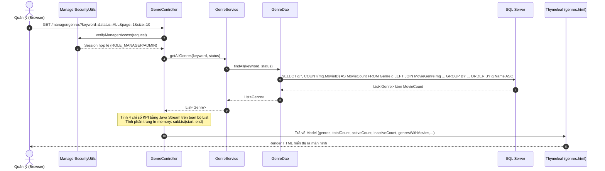
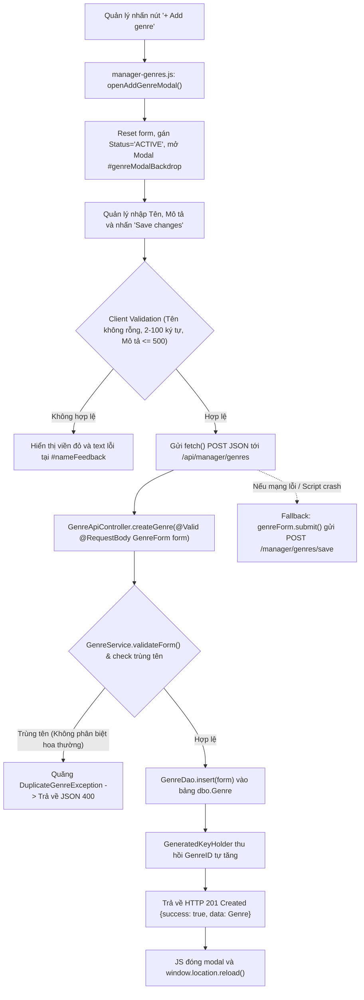
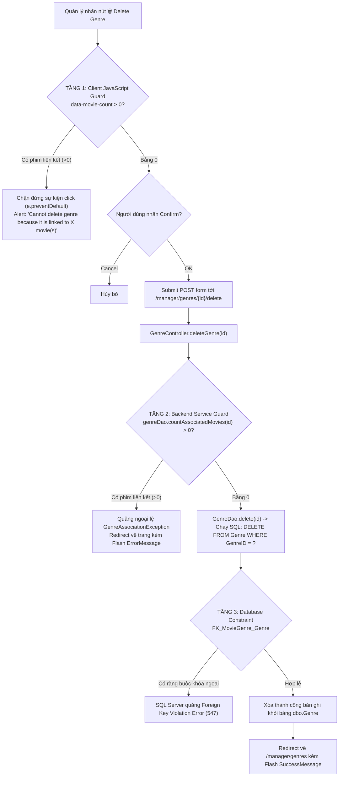
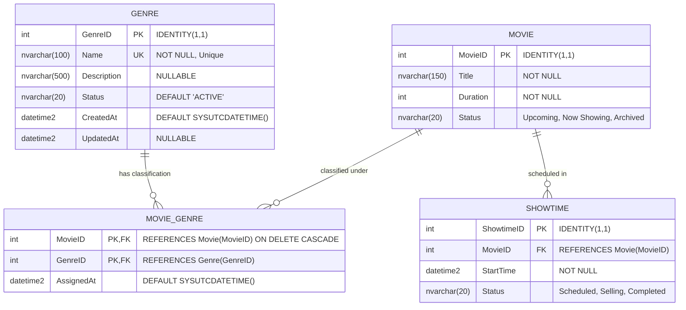

# BÁO CÁO REVIEW TOÀN DIỆN MÃ NGUỒN VÀ BỘ ĐỀ VẤN ĐÁP: MOVIE GENRE MANAGEMENT – CINEORA SYSTEM

---

## PART 1 – ARCHITECTURE & RELATED FILES

### 1. Sơ đồ kiến trúc thực tế của chức năng Quản lý Thể loại (Screen 55, Iteration 2)

Hệ thống triển khai theo mô hình kiến trúc phân lớp chuẩn **Spring MVC + Service Layer + DAO Layer (JdbcTemplate) + Dual Submission (AJAX REST API & HTML Form Fallback)**:

```
[Trình duyệt Quản lý (Manager Browser)]
  │
  ├─► (1) Tải trang / Lọc danh sách: GET /manager/genres
  │     └─► GenreController.java ──► GenreService.java ──► GenreDao.java ──► DB (SQL Server)
  │           └─► Trả về View Thymeleaf: templates/manager/genres.html (SSR)
  │
  ├─► (2) Modal Xem phim thuộc thể loại (Popup Linked Movies):
  │     └─► AJAX fetch(GET) ──► GenreApiController.java (/api/manager/genres/{id}/movies)
  │           └─► GenreService.java ──► GenreDao.java (findAssociatedMovies) ──► JSON Response
  │
  ├─► (3) Thêm mới / Chỉnh sửa thể loại (Modal Add/Edit):
  │     ├─► [Ưu tiên] AJAX fetch(POST/PUT) ──► GenreApiController.java (/api/manager/genres)
  │     │     └─► GenreService.java ──► GenreDao.java ──► JSON {success: true} ──► Reload trang
  │     └─► [Fallback] Submit Form POST ──► GenreController.java (/manager/genres/save)
  │           └─► GenreService.java ──► Redirect /manager/genres
  │
  ├─► (4) Đổi trạng thái Hoạt động (Toggle Active / Inactive - Nút ⏹/▶):
  │     └─► AJAX fetch(PATCH) ──► GenreApiController.java (/api/manager/genres/{id}/toggle-status)
  │           └─► GenreService.java (Kiểm tra an toàn dừng hoạt động) ──► GenreDao.updateStatus()
  │
  └─► (5) Xóa thể loại (Nút 🗑):
        └─► Form POST ──► GenreController.java (/manager/genres/{id}/delete)
              └─► GenreService.deleteGenre() (Chặn nếu có phim liên kết) ──► GenreDao.delete()
```

---

### 2. Bảng tổng hợp các file thực tế trong mã nguồn

| Layer | File Path | Class / Function Chính | Trách Nhiệm Nghiệp Vụ |
|:---|:---|:---|:---|
| **View (HTML)** | [genres.html](file:///c:/Users/hoang/Downloads/SWP_RapPhim/src/main/resources/templates/manager/genres.html) | Template Thymeleaf | Render layout quản trị, 4 thẻ thống kê KPI, bảng danh sách thể loại, Modal Add/Edit và Modal Xem phim liên kết |
| **Client Script** | [manager-genres.js](file:///c:/Users/hoang/Downloads/SWP_RapPhim/src/main/resources/static/js/manager-genres.js) | JavaScript điều khiển UI | Quản lý Modal, đếm ký tự, gửi AJAX fetch(), xử lý nút Toggle status, bắt sự kiện chặn xóa nếu có phim |
| **Style** | [manager-genres.css](file:///c:/Users/hoang/Downloads/SWP_RapPhim/src/main/resources/static/css/manager-genres.css) | CSS Stylesheet | Định dạng bảng dữ liệu, badge trạng thái, modal popup, spinner animation |
| **Controller (MVC)** | [GenreController.java](file:///c:/Users/hoang/Downloads/SWP_RapPhim/src/main/java/com/cinema/controller/GenreController.java) | `GenreController` | Xử lý `GET /manager/genres`, fallback `POST /manager/genres/save`, `POST /{id}/toggle-status`, `POST /{id}/delete` |
| **Controller (API)** | [GenreApiController.java](file:///c:/Users/hoang/Downloads/SWP_RapPhim/src/main/java/com/cinema/controller/api/GenreApiController.java) | `GenreApiController` | REST Endpoints: `POST/PUT /api/manager/genres`, `PATCH /{id}/toggle-status`, `GET /{id}/movies` |
| **Service Layer** | [GenreService.java](file:///c:/Users/hoang/Downloads/SWP_RapPhim/src/main/java/com/cinema/service/GenreService.java) | `GenreService` | Kiểm tra tính duy nhất tên thể loại (BR-Identity), quy tắc vô hiệu hóa an toàn, kiểm tra ràng buộc liên kết phim |
| **DAO Layer** | [GenreDao.java](file:///c:/Users/hoang/Downloads/SWP_RapPhim/src/main/java/com/cinema/dao/GenreDao.java) | `GenreDao` | Thực thi các câu SQL thuần bằng Spring `JdbcTemplate` trên bảng `Genre` và `MovieGenre` |
| **DTO / Form** | [GenreForm.java](file:///c:/Users/hoang/Downloads/SWP_RapPhim/src/main/java/com/cinema/dto/GenreForm.java) | `GenreForm` | Đối tượng binding dữ liệu form từ client, chứa Bean Validation annotations (`@NotBlank`, `@Size`) |
| **Model (Entity)** | [Genre.java](file:///c:/Users/hoang/Downloads/SWP_RapPhim/src/main/java/com/cinema/model/Genre.java) | `Genre` | Đối tượng chứa thông tin thể loại (`genreId`, `name`, `description`, `status`, `movieCount`, `createdAt`) |
| **Model Phụ** | [MovieSummary.java](file:///c:/Users/hoang/Downloads/SWP_RapPhim/src/main/java/com/cinema/model/MovieSummary.java) | `MovieSummary` | Chứa thông tin tóm tắt phim (`movieId`, `title`, `status`) hiển thị trên Modal chi tiết |
| **Bảo Mật** | [ManagerSecurityUtils.java](file:///c:/Users/hoang/Downloads/SWP_RapPhim/src/main/java/com/cinema/util/ManagerSecurityUtils.java) | `ManagerSecurityUtils` | Kiểm tra session người dùng, chặn truy cập trái phép nếu không có vai trò `MANAGER` hoặc `ADMIN` |
| **Database Schema**| [00_full_database.sql](file:///c:/Users/hoang/Downloads/SWP_RapPhim/database/00_full_database.sql#L194-L256) | Bảng `Genre`, `MovieGenre` | Định nghĩa DDL bảng `Genre`, bảng trung gian `MovieGenre`, Primary Key, Unique Constraint và Foreign Key |

---

## PART 2 – PAGE LOADING FLOW (`GET /manager/genres`)

Khi Quản lý rạp truy cập trang quản lý thể loại, luồng xử lý diễn ra qua 7 bước:



### Chi tiết các bước thực thi:
1. **Tiếp nhận Request**: Trình duyệt gửi request `GET /manager/genres` với các query parameters mặc định: `status=ALL`, `page=1`, `size=10`.
2. **Kiểm tra Phân quyền (Security Interception)**: [GenreController.java: dòng 63](file:///c:/Users/hoang/Downloads/SWP_RapPhim/src/main/java/com/cinema/controller/GenreController.java#L63) gọi `ManagerSecurityUtils.verifyManagerAccess(request)`. Nếu session không tồn tại hoặc user không mang quyền Quản lý/Admin, ném ra ngoại lệ `AccessDeniedException`.
3. **Truy vấn Dữ liệu Thể loại & Đếm số phim**:
   - Controller gọi `genreService.getAllGenres(keyword, status)`.
   - Service gọi `genreDao.findAll(keyword, status)` ([GenreDao.java: dòng 84-124](file:///c:/Users/hoang/Downloads/SWP_RapPhim/src/main/java/com/cinema/dao/GenreDao.java#L84-L124)).
   - Câu SQL thực thi sử dụng `LEFT JOIN` và gom nhóm:
     ```sql
     SELECT
         g.GenreID, g.[Name], g.[Description], g.[Status], g.CreatedAt, g.UpdatedAt,
         COUNT(mg.MovieID) AS MovieCount
     FROM Genre g
     LEFT JOIN MovieGenre mg ON mg.GenreID = g.GenreID
     WHERE 1=1
     GROUP BY g.GenreID, g.[Name], g.[Description], g.[Status], g.CreatedAt, g.UpdatedAt
     ORDER BY g.[Name] ASC
     ```
4. **Tính toán 4 Thẻ KPI Dashboard**:
   - File: [GenreController.java: dòng 68-71](file:///c:/Users/hoang/Downloads/SWP_RapPhim/src/main/java/com/cinema/controller/GenreController.java#L68-L71)
   - `totalCount = genres.size()`
   - `activeCount = genres.stream().filter(Genre::isActive).count()`
   - `inactiveCount = totalCount - activeCount`
   - `genresWithMovies = genres.stream().filter(g -> g.getMovieCount() > 0).count()`
5. **Thực hiện Phân trang In-Memory**:
   - [GenreController.java: dòng 73-81](file:///c:/Users/hoang/Downloads/SWP_RapPhim/src/main/java/com/cinema/controller/GenreController.java#L73-L81) tính toán chỉ số `start = (page - 1) * size` và `end = Math.min(start + size, totalFiltered)`.
   - Cắt danh sách hiển thị cho trang hiện tại bằng `genres.subList(start, end)` (mặc định 10 bản ghi đầu tiên).
6. **Đẩy Model vào View**: Đưa `pagedGenres`, `totalCount`, `activeCount`, `inactiveCount`, `genresWithMovies`, `currentPage`, `totalPages` vào Spring `Model`.
7. **Render Template**: Thymeleaf biên dịch [genres.html](file:///c:/Users/hoang/Downloads/SWP_RapPhim/src/main/resources/templates/manager/genres.html) và trả mã HTML về Client.

---

## PART 3 – DASHBOARD STATISTICS (4 THẺ THỐNG KÊ & BÍ ẨN 13 VS 10)

### 1. Chi tiết 4 thẻ thống kê
- **Total genres (Tổng thể loại)**: Đếm tổng số phần tử trong danh sách trả về từ `findAll()` (`totalCount = genres.size()`). Tính cả các thể loại `Active` lẫn `Inactive`.
- **Active (Đang hoạt động)**: Lọc các thể loại có `status.equalsIgnoreCase("ACTIVE")` thông qua phương thức `Genre::isActive`.
- **Inactive (Ngưng hoạt động)**: Tính bằng công thức bù trừ: `inactiveCount = totalCount - activeCount`. Đại diện cho các thể loại tạm thời bị khóa, không cho phép gán cho các phim mới.
- **Genres with movies (Thể loại đang có phim)**: Lọc các thể loại có `g.getMovieCount() > 0`. Do câu truy vấn SQL đã gom nhóm `GROUP BY g.GenreID` và đếm `COUNT(mg.MovieID)`, một thể loại dù liên kết 100 phim thì cũng chỉ được tính **1 lần** vào chỉ số này.

---

### 2. Giải mã hiện tượng: "Total genres là 13 nhưng Genre list hiển thị 10 genres"

Đây là câu hỏi kiểm tra độ sâu sắc khi đọc code:

- **Bằng chứng trong Controller**: [GenreController.java: dòng 59, 79-81](file:///c:/Users/hoang/Downloads/SWP_RapPhim/src/main/java/com/cinema/controller/GenreController.java#L59)
  Tham số kích thước trang mặc định là `@RequestParam(defaultValue = "10") int size`. Hệ thống thực hiện cắt mảng 10 phần tử đầu tiên (`subList(0, 10)`) để đưa vào biến `model.addAttribute("genres", pagedGenres)`.
- **Bằng chứng trong Thymeleaf Template**: [genres.html: dòng 148](file:///c:/Users/hoang/Downloads/SWP_RapPhim/src/main/resources/templates/manager/genres.html#L148)
  Tại tiêu đề bảng danh sách thể loại:
  ```html
  <span class="badge badge-blue" style="margin-left:6px;" th:text="${#lists.size(genres)} + ' genres'">0 genres</span>
  ```
  Thẻ badge màu xanh lam này sử dụng biểu thức `${#lists.size(genres)}`, tức là **đếm số phần tử của trang hiện tại** (đang là 10) thay vì in ra `${totalFilteredCount}` hoặc `${totalCount}` (là 13)!
- **Bằng chứng ở thanh phân trang cuối bảng**: [genres.html: dòng 241](file:///c:/Users/hoang/Downloads/SWP_RapPhim/src/main/resources/templates/manager/genres.html#L241)
  ```html
  Showing <span th:text="${startItem}">1</span> – <span th:text="${endItem}">10</span> out of <span th:text="${totalCount}">13</span> genres
  ```
- **Kết luận vấn đáp**: Đây **KHÔNG PHẢI LÀ LỖI DATABASE HAY MẤT DỮ LIỆU**, mà là kết quả của cơ chế **Phân trang (Pagination 10 items/page)** kết hợp với việc thẻ badge tiêu đề đang đọc độ dài của trang hiện tại thay vì tổng số thể loại. 3 thể loại còn lại nằm ở Trang 2 (bấm nút phân trang số `2` hoặc `›` sẽ thấy).

---

## PART 4 – SEARCH AND FILTER FLOW

### 1. Các thành phần điều khiển
- **Ô tìm kiếm Keyword**: `<input type="text" name="keyword" th:value="${keyword}" placeholder="Search by genre name or description...">`
- **Dropdown Trạng thái**: `<select name="status" onchange="this.form.submit()">` gồm: `ALL` (Tất cả), `ACTIVE` (Đang hoạt động), `INACTIVE` (Ngưng hoạt động).
- **Nút "Filter"**: Submit form bằng phương thức `GET /manager/genres`.
- **Nút "Clear filters"**: Thẻ link `<a th:href="@{/manager/genres}">`, tải lại trang với URL sạch không có query param.

### 2. Xử lý câu truy vấn tại Database (An toàn tuyệt đối)
Tại [GenreDao.java: dòng 101-111](file:///c:/Users/hoang/Downloads/SWP_RapPhim/src/main/java/com/cinema/dao/GenreDao.java#L101-L111):
```java
if (keyword != null && !keyword.trim().isEmpty()) {
    sql.append(" AND (LOWER(g.[Name]) LIKE LOWER(?) OR LOWER(g.[Description]) LIKE LOWER(?))");
    String pattern = "%" + keyword.trim() + "%";
    params.add(pattern);
    params.add(pattern);
}

if (status != null && !status.trim().isEmpty() && !"ALL".equalsIgnoreCase(status.trim())) {
    sql.append(" AND UPPER(g.[Status]) = UPPER(?)");
    params.add(status.trim());
}
```
- **Chống SQL Injection**: Sử dụng PreparedStatement với tham số hóa `?`. Giá trị người dùng nhập vào được truyền an toàn qua mảng `params.toArray()`.
- **Tìm kiếm không phân biệt hoa thường**: Dùng hàm `LOWER()` ở cả hai vế so sánh.
- **Tìm kiếm đa trường**: Tìm đồng thời trên cả Tên thể loại (`Name`) và Mô tả thể loại (`Description`).
- **Tiếng Việt có dấu**: Cột CSDL là `NVARCHAR(100)` và `NVARCHAR(500)`, kết hợp Collation mặc định của SQL Server (`SQL_Latin1_General_CP1_CI_AS` hoặc `Vietnamese_CI_AS`) hỗ trợ tìm kiếm tiếng Việt chính xác.

---

## PART 5 – ADD GENRE FLOW (THÊM THỂ LOẠI MỚI)



### Các trường dữ liệu trong Form:
1. `genreName` (`NVARCHAR(100)`): Bắt buộc, độ dài từ 2 đến 100 ký tự.
2. `genreDescription` (`NVARCHAR(500)`): Tùy chọn, tối đa 500 ký tự, có bộ đếm ký tự live `#descCharCounter` (`x/500`).
3. `genreStatus` (`NVARCHAR(20)`): Bắt buộc, mặc định chọn `ACTIVE`.

### Quy tắc nghiệp vụ BR-Identity (Chống trùng lặp):
Tại [GenreService.java: dòng 48-51](file:///c:/Users/hoang/Downloads/SWP_RapPhim/src/main/java/com/cinema/service/GenreService.java#L48-L51), trước khi chèn vào database, service gọi:
```java
if (genreDao.existsByNameIgnoreCase(trimmedName, null)) {
    throw new DuplicateGenreException("Genre '" + trimmedName + "' already exists in the system.");
}
```
Tại database, bảng `dbo.Genre` có ràng buộc duy nhất: `[Name] NVARCHAR(100) NOT NULL CONSTRAINT UQ_Genre_Name UNIQUE`. Vì vậy, tên thể loại được bảo vệ chống trùng lặp ở cả 2 tầng: Service Logic và Database Constraint.

---

## PART 6 – EDIT GENRE FLOW (CHỈNH SỬA THỂ LOẠI - NÚT ✎)

1. **Kích hoạt Form**: Quản lý nhấn icon bút chì `✎`.
2. **Nạp dữ liệu vào Modal**: Hàm `openEditGenreModal(button)` ([manager-genres.js: dòng 25-54](file:///c:/Users/hoang/Downloads/SWP_RapPhim/src/main/resources/static/js/manager-genres.js#L25-L54)) lấy các thuộc tính `data-id`, `data-name`, `data-description`, `data-status` từ chính nút bấm đó và điền vào các ô input trong form. Không cần gửi thêm HTTP request để lấy chi tiết.
3. **Gửi dữ liệu cập nhật**: Khi nhấn Save, JS gửi request `PUT /api/manager/genres/{id}` với payload JSON.
4. **Kiểm tra trùng tên loại trừ chính nó**:
   Tại [GenreService.java: dòng 70-72](file:///c:/Users/hoang/Downloads/SWP_RapPhim/src/main/java/com/cinema/service/GenreService.java#L70-L72):
   ```java
   if (genreDao.existsByNameIgnoreCase(trimmedName, genreId)) {
       throw new DuplicateGenreException("Genre name '" + trimmedName + "' is already in use by another genre.");
   }
   ```
   Hàm SQL kiểm tra: `WHERE LOWER(Name) = LOWER(?) AND GenreID <> ?`. Nếu quản lý giữ nguyên tên cũ và chỉ sửa mô tả thì hệ thống không báo lỗi trùng.

---

> [!IMPORTANT]
> ### CÂU HỎI VẤN ĐÁP CỐT LÕI:
> **"Nếu thể loại 'Hành Động' đang được gắn vào 3 phim, em đổi tên thành 'Action' thì 3 phim đó có tự động hiển thị 'Action' không?"**
>
> **TRẢ LỜI:** **Có, hiển thị ngay lập tức 100%!**
> **Giải thích bản chất kỹ thuật:**
> Trong cơ sở dữ liệu, quan hệ giữa Phim và Thể loại được chuẩn hóa theo **Dạng chuẩn 3 (3NF)**. Bảng liên kết `dbo.MovieGenre` chỉ lưu trữ 2 khóa ngoại là `MovieID` và `GenreID`, tuyệt đối **không lưu trữ chữ 'Hành Động'**.
> Khi hệ thống hiển thị phim và thể loại, câu lệnh SQL sẽ thực hiện phép nối bảng:
> ```sql
> SELECT g.Name FROM Genre g JOIN MovieGenre mg ON mg.GenreID = g.GenreID WHERE mg.MovieID = ?
> ```
> Do đó, khi ta sửa tên `Name` trong bảng gốc `Genre` từ 'Hành Động' thành 'Action', bảng `MovieGenre` không cần sửa đổi bất kỳ dòng nào, và tất cả các câu truy vấn thông tin phim trên toàn hệ thống lập tức hiển thị tên mới 'Action' mà không có độ trễ hay sai lệch dữ liệu.

---

## PART 7 – LINKED MOVIES FLOW (XEM PHIM THUỘC THỂ LOẠI)

Màn hình cung cấp 2 cách để xem các bộ phim thuộc một thể loại:

```
[Bảng Thể Loại]
  │
  ├─► Cách 1: Click trực tiếp vào Badge "X movies" (Cột Linked movies)
  │     └─► Gọi openAssociatedMovies(id, name)
  │           └─► Mở Modal Popup ngay trên trang -> Gọi AJAX GET /api/manager/genres/{id}/movies
  │                 └─► Hiển thị danh sách chip tên phim kèm badge trạng thái (Now Showing, Upcoming)
  │                       └─► Có nút bấm: "View these movies in Movie Management →"
  │
  └─► Cách 2: Click vào icon hình Cuộn Phim (🎬 Clapperboard trong Cột Actions)
        └─► Thẻ liên kết: <a th:href="@{/manager/movies(genreId=${genre.genreId})}">
              └─► Chuyển hướng toàn trang sang màn hình Movie Management (/manager/movies?genreId=X)
                    └─► Tự động áp dụng bộ lọc thể loại, chỉ hiển thị danh sách phim của thể loại này
```

- **Lỗi ngữ pháp `1 movies`**: Tại [genres.html: dòng 190](file:///c:/Users/hoang/Downloads/SWP_RapPhim/src/main/resources/templates/manager/genres.html#L190), code đang viết cứng `<span th:text="${genre.movieCount}">0</span> movies`. Khi `movieCount == 1`, chuỗi hiển thị vẫn là `1 movies` thay vì `1 movie`.

---

## PART 8 – ACTIVE / INACTIVE FLOW (NÚT ⏹ / ▶ & QUY TẮC VÔ HIỆU HÓA AN TOÀN)

### 1. Ý nghĩa biểu tượng trong cột Actions:
- **Biểu tượng hình vuông ⏹ (`action-btn-view`)**: Hiển thị khi thể loại đang ở trạng thái `Active`. Nhấn vào để **Dừng hoạt động (Deactivate)** thể loại.
- **Biểu tượng tam giác ▶**: Hiển thị khi thể loại đang `Inactive`. Nhấn vào để **Tái kích hoạt (Reactivate)**.

### 2. Luồng thực thi khi nhấn nút ⏹ (Deactivate):
1. Quản lý nhấn nút ⏹ $\rightarrow$ Gọi hàm JavaScript `toggleGenreStatus(this)`.
2. Nếu thể loại đang có phim (`movieCount > 0`), JS hiển thị hộp thoại xác nhận:
   *"Genre 'Action' is currently assigned to 3 movie(s). Deactivating hides this genre when assigning genres to new movies. Are you sure you want to deactivate it?"*
3. Nếu bấm OK $\rightarrow$ Gửi request `PATCH /api/manager/genres/{id}/toggle-status`.
4. **Quy tắc an toàn tại Backend (Deactivation Safety)**:
   Tại [GenreService.java: dòng 143-150](file:///c:/Users/hoang/Downloads/SWP_RapPhim/src/main/java/com/cinema/service/GenreService.java#L143-L150):
   ```java
   private void validateDeactivationSafety(int genreId, String genreName) {
       int activeMovies = genreDao.countActiveAssociatedMovies(genreId);
       if (activeMovies > 0) {
           throw new GenreAssociationException(
                   "Cannot deactivate genre '" + genreName + "' because there are currently "
                           + activeMovies + " now showing or upcoming movie(s) in this genre. "
                           + "Please update movie categorizations before deactivating."
           );
       }
   }
   ```
   **Hệ thống sẽ TỪ CHỐI vô hiệu hóa thể loại nếu thể loại đó đang có phim Đang chiếu (Now Showing) hoặc Sắp chiếu (Upcoming)!**
   Chỉ khi tất cả các phim thuộc thể loại này đã ngừng chiếu (Archived/Ended) hoặc không có phim nào, thể loại mới được phép chuyển sang `INACTIVE`.

### 3. Tác động của Thể loại Inactive đối với Movie Management:
- **Khi thêm phim mới (Add Movie)**: Thể loại `INACTIVE` bị lọc bỏ khỏi danh sách checkbox chọn thể loại (chỉ lấy `Status = 'ACTIVE'`).
- **Các phim đã liên kết trong quá khứ**: Vẫn giữ nguyên thể loại đó trong cơ sở dữ liệu và trên giao diện chi tiết phim, không bị mất quan hệ.

---

## PART 9 – DELETE GENRE FLOW (XÓA THỂ LOẠI - NÚT 🗑)

Hệ thống thiết kế cơ chế **Bảo Vệ Đa Tầng (3-Layer Defense Integrity)** để ngăn chặn việc xóa thể loại đang có phim:



### Chi tiết 3 tầng bảo vệ:
1. **Tầng 1 (Client-side JavaScript)**: [manager-genres.js: dòng 324-340](file:///c:/Users/hoang/Downloads/SWP_RapPhim/src/main/resources/static/js/manager-genres.js#L324-L340) bắt sự kiện click nút xóa. Nếu thuộc tính `data-movie-count > 0`, script chặn ngay lập tức, không cho phép form submit, hiển thị thông báo yêu cầu chuyển sang Deactivate thay vì xóa.
2. **Tầng 2 (Backend Service Layer)**: [GenreService.java: dòng 111-118](file:///c:/Users/hoang/Downloads/SWP_RapPhim/src/main/java/com/cinema/service/GenreService.java#L111-L118) kiểm tra số lượng phim trong CSDL. Nếu $> 0$, ném ngoại lệ `GenreAssociationException`.
3. **Tầng 3 (Database Constraint)**: Trong file [00_full_database.sql: dòng 252](file:///c:/Users/hoang/Downloads/SWP_RapPhim/database/00_full_database.sql#L252), khóa ngoại được khai báo:
   ```sql
   CONSTRAINT FK_MovieGenre_Genre FOREIGN KEY (GenreID) REFERENCES dbo.Genre(GenreID)
   ```
   Khóa ngoại này **KHÔNG CÓ `ON DELETE CASCADE`**. Do đó, nếu có bất kỳ bản ghi nào trong `MovieGenre` tham chiếu tới `GenreID`, hệ quản trị SQL Server sẽ lập tức quăng lỗi vi phạm khóa ngoại (Foreign Key Violation), bảo đảm tính toàn vẹn dữ liệu tuyệt đối.

---

## PART 10 – DATABASE SCHEMA & ERD

### 1. Sơ đồ thực thể liên kết (Mermaid ERD)



### 2. Bảng đối chiếu các thao tác Database trong DAO

| Thao tác | Bảng tác động | SQL Query thực thi | Cột bị ảnh hưởng |
|:---|:---|:---|:---|
| **Lấy danh sách & Đếm phim** | `Genre` (g), `MovieGenre` (mg) | `SELECT g.*, COUNT(mg.MovieID) AS MovieCount FROM Genre g LEFT JOIN MovieGenre mg ON mg.GenreID = g.GenreID WHERE 1=1 GROUP BY ... ORDER BY g.Name ASC` | Đọc toàn bộ cột |
| **Kiểm tra trùng tên** | `Genre` | `SELECT COUNT(1) FROM Genre WHERE LOWER(LTRIM(RTRIM(Name))) = LOWER(LTRIM(RTRIM(?))) AND (? IS NULL OR GenreID <> ?)` | Đọc cột `Name`, `GenreID` |
| **Thêm mới** | `Genre` | `INSERT INTO Genre ([Name], [Description], [Status], CreatedAt) VALUES (?, ?, ?, SYSUTCDATETIME())` | `Name`, `Description`, `Status`, `CreatedAt` |
| **Cập nhật** | `Genre` | `UPDATE Genre SET [Name] = ?, [Description] = ?, [Status] = ?, UpdatedAt = SYSUTCDATETIME() WHERE GenreID = ?` | `Name`, `Description`, `Status`, `UpdatedAt` |
| **Đổi trạng thái** | `Genre` | `UPDATE Genre SET [Status] = ?, UpdatedAt = SYSUTCDATETIME() WHERE GenreID = ?` | `Status`, `UpdatedAt` |
| **Xóa thể loại** | `Genre` | `DELETE FROM Genre WHERE GenreID = ?` | Xóa cả dòng |
| **Lấy phim liên kết** | `Movie` (m), `MovieGenre` (mg) | `SELECT m.MovieID, m.Title, m.Status FROM MovieGenre mg JOIN Movie m ON m.MovieID = mg.MovieID WHERE mg.GenreID = ? ORDER BY m.Title ASC` | Đọc `MovieID`, `Title`, `Status` |

---

## PART 11 – SECURITY, VALIDATION & TRANSACTIONS

1. **Authorization (Phân quyền)**: Toàn bộ Controller (cả MVC `GenreController` và REST `GenreApiController`) đều đặt `ManagerSecurityUtils.verifyManagerAccess(request)` ở đầu mỗi method. Người dùng không đăng nhập hoặc là khách vãng lai/nhân viên không có quyền Manager sẽ nhận mã lỗi 403 hoặc bị chuyển hướng về trang Login.
2. **CSRF Protection**: Form xóa sử dụng `<form method="post">` của Thymeleaf (tự động nhúng token `_csrf`). Form AJAX đọc token từ meta tag đính kèm vào header.
3. **Chống XSS**: View Thymeleaf sử dụng `th:text` tự động encode mã HTML. Trong file JS có hàm `escapeHtml()` xử lý chuỗi trước khi gán vào innerHTML của modal.
4. **Transaction Integrity**: Thao tác xóa hoặc cập nhật trạng thái có liên kết được kiểm tra logic trước khi thực thi SQL. Ràng buộc toàn vẹn khóa ngoại trong CSDL là chốt chặn cuối cùng ngăn chặn rác dữ liệu.

---

## PART 12 – BUGS, RISKS AND EDGE CASES (ĐÁNH GIÁ MÃ NGUỒN)

| STT | Vấn đề phát hiện | Phân loại | Bằng chứng mã nguồn | Đánh giá & Hướng trả lời khi vấn đáp |
|:---:|:---|:---:|:---|:---|
| 1 | Số thể loại trên Badge bảng không khớp Total genres | **EXPECTED** | [genres.html: L148](file:///c:/Users/hoang/Downloads/SWP_RapPhim/src/main/resources/templates/manager/genres.html#L148) | Không phải bug CSDL. Do badge dùng `#lists.size(genres)` đếm số phần tử trên trang hiện tại của pagination (10 thể loại) thay vì tổng số thể loại (13). |
| 2 | Lỗi hiển thị ngữ pháp `1 movies` | **BUG UI** | [genres.html: L190](file:///c:/Users/hoang/Downloads/SWP_RapPhim/src/main/resources/templates/manager/genres.html#L190) | Code viết cứng chữ `movies`. Nên sửa thành: `${genre.movieCount == 1 ? '1 movie' : genre.movieCount + ' movies'}`. |
| 3 | Chặn vô hiệu hóa thể loại nếu có phim Đang chiếu / Sắp chiếu | **PASS** | [GenreService.java: L143-L150](file:///c:/Users/hoang/Downloads/SWP_RapPhim/src/main/java/com/cinema/service/GenreService.java#L143-L150) | Logic nghiệp vụ rất tốt. Đảm bảo phim đang chiếu phục vụ khách hàng không bị mất phân loại thể loại trên giao diện người dùng. |
| 4 | Bảo vệ 3 tầng ngăn chặn xóa thể loại đang có phim | **PASS** | [manager-genres.js: L324](file:///c:/Users/hoang/Downloads/SWP_RapPhim/src/main/resources/static/js/manager-genres.js#L324), [GenreService.java: L111](file:///c:/Users/hoang/Downloads/SWP_RapPhim/src/main/java/com/cinema/service/GenreService.java#L111), [00_full_database.sql: L252](file:///c:/Users/hoang/Downloads/SWP_RapPhim/database/00_full_database.sql#L252) | Hệ thống bảo vệ chặt chẽ: JS chặn $\rightarrow$ Service chặn $\rightarrow$ CSDL Foreign Key chặn. |
| 5 | Phân trang In-Memory | **RISK** | [GenreController.java: L79-81](file:///c:/Users/hoang/Downloads/SWP_RapPhim/src/main/java/com/cinema/controller/GenreController.java#L79-L81) | Thể loại phim trong rạp chiếu thường chỉ có từ 20 đến 50 danh mục nên phân trang In-Memory hoạt động rất nhanh và không tốn tài nguyên. Tuy nhiên về mặt kiến trúc lý thuyết, phân trang ở SQL bằng `OFFSET/FETCH` sẽ chuẩn hóa hơn nếu danh mục tăng lên hàng nghìn bản ghi. |

---

## PART 13 – MOCK ORAL DEFENSE: 40 CÂU HỎI VẤN ĐÁP CÙNG ĐÁP ÁN

### NHÓM A: 15 CÂU HỎI CƠ BẢN (MỨC ĐỘ HIỂU CODE)

#### Câu 1: Khi quản lý truy cập `/manager/genres`, Controller nào xử lý và trả về file HTML nào?
- **Trả lời mẫu (30s):** `GenreController` xử lý tại method `viewGenreList` gắn `@GetMapping`. Method này chuẩn bị dữ liệu đẩy vào Spring `Model` và trả về tên view template `"manager/genres"` nằm tại file `src/main/resources/templates/manager/genres.html`.
- **Chứng minh:** [GenreController.java: dòng 54-103](file:///c:/Users/hoang/Downloads/SWP_RapPhim/src/main/java/com/cinema/controller/GenreController.java#L54-L103).

#### Câu 2: Thông tin thể loại phim được lưu trữ trong bảng nào trong CSDL?
- **Trả lời mẫu (30s):** Được lưu trữ trong bảng `dbo.Genre`. Khóa chính tự tăng là `GenreID`, cột tên là `Name` (có ràng buộc UNIQUE), cột mô tả là `Description`, cột trạng thái là `Status`, cùng hai cột dấu thời gian `CreatedAt` và `UpdatedAt`.
- **Chứng minh:** [00_full_database.sql: dòng 194-202](file:///c:/Users/hoang/Downloads/SWP_RapPhim/database/00_full_database.sql#L194-L202).

#### Câu 3: Làm sao hệ thống đếm được số lượng phim liên kết (Linked movies) của từng thể loại?
- **Trả lời mẫu (30s):** Trong method `findAll()` của `GenreDao`, hệ thống sử dụng câu lệnh SQL thực hiện `LEFT JOIN` giữa bảng `Genre` và bảng trung gian `MovieGenre`, kết hợp `COUNT(mg.MovieID)` và `GROUP BY g.GenreID`.
- **Chứng minh:** [GenreDao.java: dòng 93-96](file:///c:/Users/hoang/Downloads/SWP_RapPhim/src/main/java/com/cinema/dao/GenreDao.java#L93-L96).

#### Câu 4: Thẻ KPI "Genres with movies" tính toán như thế nào?
- **Trả lời mẫu (30s):** Được tính bằng Java Stream trong `GenreController`: `genres.stream().filter(g -> g.getMovieCount() > 0).count()`. Tức là đếm xem có bao nhiêu thể loại đang có ít nhất một bộ phim liên kết.
- **Chứng minh:** [GenreController.java: dòng 71](file:///c:/Users/hoang/Downloads/SWP_RapPhim/src/main/java/com/cinema/controller/GenreController.java#L71).

#### Câu 5: Khi bấm nút "+ Add genre" trên giao diện, chuyện gì xảy ra ở frontend?
- **Trả lời mẫu (30s):** Nút này gọi hàm JavaScript `openAddGenreModal()`. Hàm này gọi `resetGenreModalForm()`, đổi tiêu đề modal thành "Add genre", đặt trạng thái mặc định là "ACTIVE", và thêm class `open` vào `#genreModalBackdrop` để hiển thị Modal thêm mới.
- **Chứng minh:** [manager-genres.js: dòng 10-23](file:///c:/Users/hoang/Downloads/SWP_RapPhim/src/main/resources/static/js/manager-genres.js#L10-L23).

#### Câu 6: Dự án dùng JPA hay JDBC thuần để thao tác với bảng Genre?
- **Trả lời mẫu (30s):** Dự án sử dụng Spring `JdbcTemplate` với các câu lệnh SQL Server thuần túy được tham số hóa (`PreparedStatement`). Không sử dụng Spring Data JPA hay Hibernate.
- **Chứng minh:** [GenreDao.java: dòng 27-31](file:///c:/Users/hoang/Downloads/SWP_RapPhim/src/main/java/com/cinema/dao/GenreDao.java#L27-L31).

#### Câu 7: Trạng thái của một thể loại gồm những giá trị nào?
- **Trả lời mẫu (30s):** Gồm 2 giá trị kiểu chuỗi: `'ACTIVE'` (Đang hoạt động) và `'INACTIVE'` (Ngưng hoạt động), lưu tại cột `Status` trong bảng `dbo.Genre`.
- **Chứng minh:** [Genre.java: dòng 28-30](file:///c:/Users/hoang/Downloads/SWP_RapPhim/src/main/java/com/cinema/model/Genre.java).

#### Câu 8: Nút "Clear filters" hoạt động như thế nào?
- **Trả lời mẫu (30s):** Đây là thẻ liên kết `<a th:href="@{/manager/genres}">`. Khi bấm vào, trình duyệt tải lại trang với URL gốc không chứa bất kỳ query parameter nào, đưa form tìm kiếm và trạng thái về mặc định.
- **Chứng minh:** [genres.html: dòng 139](file:///c:/Users/hoang/Downloads/SWP_RapPhim/src/main/resources/templates/manager/genres.html#L139).

#### Câu 9: Tìm kiếm theo từ khóa có phân biệt chữ hoa, chữ thường không?
- **Trả lời mẫu (30s):** Không phân biệt. Trong SQL của `GenreDao`, code sử dụng hàm `LOWER(g.Name) LIKE LOWER(?)` và `LOWER(g.Description) LIKE LOWER(?)`.
- **Chứng minh:** [GenreDao.java: dòng 102](file:///c:/Users/hoang/Downloads/SWP_RapPhim/src/main/java/com/cinema/dao/GenreDao.java#L102).

#### Câu 10: Khi click vào icon cây bút chì (✎), dữ liệu cũ được lấy từ đâu để điền vào form sửa?
- **Trả lời mẫu (30s):** Lấy trực tiếp từ các thuộc tính `data-id`, `data-name`, `data-description`, `data-status` được Thymeleaf gán sẵn trên thẻ HTML của nút bấm. Hoàn toàn không tốn request mạng gọi về server.
- **Chứng minh:** [manager-genres.js: dòng 27-30](file:///c:/Users/hoang/Downloads/SWP_RapPhim/src/main/resources/static/js/manager-genres.js#L27-L30).

#### Câu 11: Nút bấm hình cuộn phim (🎬) trong cột Actions có tác dụng gì?
- **Trả lời mẫu (30s):** Đây là thẻ liên kết `<a th:href="@{/manager/movies(genreId=${genre.genreId})}">`. Khi click vào, hệ thống chuyển sang màn hình Movie Management và tự động lọc tất cả các phim thuộc thể loại này.
- **Chứng minh:** [genres.html: dòng 201-204](file:///c:/Users/hoang/Downloads/SWP_RapPhim/src/main/resources/templates/manager/genres.html#L201-L204).

#### Câu 12: Nút bấm hình vuông ⏹ trong cột Actions có chức năng gì?
- **Trả lời mẫu (30s):** Đây là nút Đổi trạng thái (Toggle Status). Khi thể loại đang Active, icon hiển thị là ⏹ (Deactivate/Dừng hoạt động). Khi thể loại đang Inactive, icon chuyển thành ▶ (Reactivate/Kích hoạt lại).
- **Chứng minh:** [genres.html: dòng 213-222](file:///c:/Users/hoang/Downloads/SWP_RapPhim/src/main/resources/templates/manager/genres.html#L213-L222).

#### Câu 13: Bảng trung gian liên kết giữa Movie và Genre tên là gì?
- **Trả lời mẫu (30s):** Bảng `dbo.MovieGenre`, chứa 2 khóa ngoại là `MovieID` (tham chiếu `Movie.MovieID`) và `GenreID` (tham chiếu `Genre.GenreID`), cùng cột `AssignedAt`.
- **Chứng minh:** [00_full_database.sql: dòng 246-253](file:///c:/Users/hoang/Downloads/SWP_RapPhim/database/00_full_database.sql#L246-L253).

#### Câu 14: Tên thể loại có được để trống không và giới hạn độ dài là bao nhiêu?
- **Trả lời mẫu (30s):** Tên thể loại bắt buộc nhập, độ dài từ 2 đến 100 ký tự. Được kiểm tra cả ở frontend JS, backend Bean Validation (`GenreForm`), và tầng Service.
- **Chứng minh:** [GenreForm.java: dòng 15-18](file:///c:/Users/hoang/Downloads/SWP_RapPhim/src/main/java/com/cinema/dto/GenreForm.java#L15-L18).

#### Câu 15: Mô tả thể loại (Description) được nhập tối đa bao nhiêu ký tự?
- **Trả lời mẫu (30s):** Tối đa 500 ký tự, tương ứng với kiểu `NVARCHAR(500)` trong database. Trên form có bộ đếm ký tự `#descCharCounter` hiển thị `x/500`.
- **Chứng minh:** [GenreForm.java: dòng 20-21](file:///c:/Users/hoang/Downloads/SWP_RapPhim/src/main/java/com/cinema/dto/GenreForm.java#L20-L21).

---

### NHÓM B: 15 CÂU HỎI TRUNG BÌNH (XỬ LÝ DỮ LIỆU & RÀNG BUỘC)

#### Câu 16: Tại sao trên hình chụp Total genres là 13 nhưng Genre list lại chỉ hiện 10 genres?
- **Trả lời mẫu (45s):** Vì Controller mặc định phân trang `size = 10` bản ghi mỗi trang (`subList(0, 10)`). Ở file `genres.html`, badge tiêu đề đang dùng `#lists.size(genres)` nên hiển thị độ dài của trang hiện tại (10), còn 3 thể loại còn lại nằm ở trang 2 của bảng.
- **Chứng minh:** [GenreController.java: dòng 59, 81](file:///c:/Users/hoang/Downloads/SWP_RapPhim/src/main/java/com/cinema/controller/GenreController.java#L59) và [genres.html: dòng 148](file:///c:/Users/hoang/Downloads/SWP_RapPhim/src/main/resources/templates/manager/genres.html#L148).

#### Câu 17: Nếu thể loại "Hành Động" đang có 3 phim, khi bấm nút Xóa (🗑) thì chuyện gì xảy ra?
- **Trả lời mẫu (45s):** Thao tác xóa sẽ bị **chặn ngay lập tức**! Ở tầng 1, JavaScript đọc `data-movie-count="3"` sẽ ngăn chặn submit và hiện thông báo lỗi. Nếu lách qua JS, ở tầng 2 `GenreService.deleteGenre()` kiểm tra `movieCount > 0` và ném lỗi `GenreAssociationException`. Ở tầng 3, CSDL có khóa ngoại `FK_MovieGenre_Genre` không có CASCADE nên sẽ chặn lệnh xóa.
- **Chứng minh:** [manager-genres.js: dòng 324](file:///c:/Users/hoang/Downloads/SWP_RapPhim/src/main/resources/static/js/manager-genres.js#L324) và [GenreService.java: dòng 111-118](file:///c:/Users/hoang/Downloads/SWP_RapPhim/src/main/java/com/cinema/service/GenreService.java#L111-L118).

#### Câu 18: Khi một thể loại đang có phim, quản lý có được phép chuyển sang Inactive không?
- **Trả lời mẫu (45s):** Chỉ được phép nếu các phim đó đã kết thúc chiếu hoặc lưu trữ! `GenreService.validateDeactivationSafety()` kiểm tra: nếu thể loại có phim đang có trạng thái `Now Showing` hoặc `Upcoming` thì hệ thống sẽ từ chối vô hiệu hóa để bảo đảm tính nhất quán của phim đang phục vụ khách hàng.
- **Chứng minh:** [GenreService.java: dòng 143-150](file:///c:/Users/hoang/Downloads/SWP_RapPhim/src/main/java/com/cinema/service/GenreService.java#L143-L150).

#### Câu 19: Khi một thể loại bị Inactive thì các phim đã gắn thể loại này trong quá khứ có bị xóa mất thể loại không?
- **Trả lời mẫu (30s):** Không hề bị ảnh hưởng. Bản ghi trong bảng liên kết `MovieGenre` vẫn được giữ nguyên vẹn. Trạng thái Inactive chỉ có tác dụng ẩn thể loại này trong danh sách chọn thể loại khi tạo hoặc cập nhật phim mới.
- **Chứng minh:** [MovieDao.java: dòng 670-686](file:///c:/Users/hoang/Downloads/SWP_RapPhim/src/main/java/com/cinema/dao/MovieDao.java#L670-L686) (chỉ lọc các genre có `Status = 'ACTIVE'`).

#### Câu 20: Hệ thống kiểm tra trùng tên thể loại (BR-Identity) ở đâu?
- **Trả lời mẫu (45s):** Được kiểm tra ở 2 nơi:
  1. Tầng Service: `GenreService` gọi `genreDao.existsByNameIgnoreCase(name, id)` chạy SQL kiểm tra `LOWER(TRIM(Name)) = LOWER(TRIM(?))` loại trừ chính ID đang sửa.
  2. Tầng Database: Bảng `dbo.Genre` có ràng buộc `CONSTRAINT UQ_Genre_Name UNIQUE`.
- **Chứng minh:** [GenreService.java: dòng 49, 70](file:///c:/Users/hoang/Downloads/SWP_RapPhim/src/main/java/com/cinema/service/GenreService.java#L49) và [GenreDao.java: dòng 212-226](file:///c:/Users/hoang/Downloads/SWP_RapPhim/src/main/java/com/cinema/dao/GenreDao.java#L212-L226).

#### Câu 21: Nếu nhập tên thể loại phân biệt hoa thường (ví dụ: 'action' và 'Action') thì có bị báo trùng không?
- **Trả lời mẫu (30s):** Có, hệ thống sẽ báo lỗi trùng. Hàm `existsByNameIgnoreCase` sử dụng `LOWER(LTRIM(RTRIM([Name]))) = LOWER(LTRIM(RTRIM(?)))` nên không phân biệt chữ hoa hay chữ thường.
- **Chứng minh:** [GenreDao.java: dòng 220](file:///c:/Users/hoang/Downloads/SWP_RapPhim/src/main/java/com/cinema/dao/GenreDao.java#L220).

#### Câu 22: Khi bấm vào badge số lượng phim (ví dụ: "3 movies"), modal popup hiển thị dữ liệu như thế nào?
- **Trả lời mẫu (45s):** Hàm `viewAssociatedMovies(id, name)` mở Modal `#moviesModalBackdrop` và gửi AJAX GET đến endpoint `/api/manager/genres/{id}/movies`. Backend trả về mảng JSON `MovieSummary` (gồm ID, Title, Status). JS duyệt mảng và render các thẻ chip tên phim kèm badge màu trạng thái.
- **Chứng minh:** [manager-genres.js: dòng 151-196](file:///c:/Users/hoang/Downloads/SWP_RapPhim/src/main/resources/static/js/manager-genres.js#L151-L196) và [GenreApiController.java: dòng 70-78](file:///c:/Users/hoang/Downloads/SWP_RapPhim/src/main/java/com/cinema/controller/api/GenreApiController.java#L70-L78).

#### Câu 23: Tại sao lại xuất hiện lỗi hiển thị "1 movies"?
- **Trả lời mẫu (30s):** Trong file `genres.html` dòng 190, lập trình viên viết cứng chuỗi `<span th:text="${genre.movieCount}">0</span> movies`. Do đó khi biến đếm bằng 1, giao diện vẫn render là "1 movies" thay vì "1 movie".
- **Chứng minh:** [genres.html: dòng 190](file:///c:/Users/hoang/Downloads/SWP_RapPhim/src/main/resources/templates/manager/genres.html#L190).

#### Câu 24: Khi sửa tên thể loại, bảng trung gian `MovieGenre` có bị cập nhật không?
- **Trả lời mẫu (30s):** Hoàn toàn không cần cập nhật. Vì bảng `MovieGenre` chỉ lưu `GenreID` làm khóa ngoại. Khi đổi tên trong bảng `Genre`, quan hệ vẫn giữ nguyên qua `GenreID`.
- **Chứng minh:** [00_full_database.sql: dòng 247-248](file:///c:/Users/hoang/Downloads/SWP_RapPhim/database/00_full_database.sql#L247-L248).

#### Câu 25: Làm thế nào `GenreDao.insert()` nhận được ID tự tăng của thể loại vừa tạo?
- **Trả lời mẫu (30s):** `GenreDao` sử dụng đối tượng `GeneratedKeyHolder` của Spring JDBC kết hợp `PreparedStatement.RETURN_GENERATED_KEYS` để lấy giá trị IDENTITY do SQL Server tự sinh.
- **Chứng minh:** [GenreDao.java: dòng 237-247](file:///c:/Users/hoang/Downloads/SWP_RapPhim/src/main/java/com/cinema/dao/GenreDao.java#L237-L247).

#### Câu 26: Form Modal Thêm/Sửa thể loại gửi dữ liệu bằng cơ chế gì?
- **Trả lời mẫu (45s):** Áp dụng mô hình **Dual Submission**: Form ưu tiên chặn sự kiện submit (`e.preventDefault()`) để gửi AJAX JSON qua `fetch()` đến REST API `/api/manager/genres`. Nếu mạng lỗi hoặc fetch thất bại, khối `catch(err)` tự động gọi `genreForm.submit()` để gửi form POST chuẩn về `GenreController`.
- **Chứng minh:** [manager-genres.js: dòng 234-303](file:///c:/Users/hoang/Downloads/SWP_RapPhim/src/main/resources/static/js/manager-genres.js#L234-L303).

#### Câu 27: Nếu người dùng xóa một thể loại không tồn tại (truyền ID bừa bãi) thì hệ thống xử lý ra sao?
- **Trả lời mẫu (30s):** Ở đầu method `deleteGenre`, `GenreService` gọi `getGenreById(id)`. Nếu không tìm thấy, hệ thống ném ngoại lệ `GenreNotFoundException`. Controller bắt ngoại lệ này và đẩy Flash Attribute thông báo lỗi về màn hình.
- **Chứng minh:** [GenreService.java: dòng 110](file:///c:/Users/hoang/Downloads/SWP_RapPhim/src/main/java/com/cinema/service/GenreService.java#L110) và [GenreController.java: dòng 188-190](file:///c:/Users/hoang/Downloads/SWP_RapPhim/src/main/java/com/cinema/controller/GenreController.java#L188-L190).

#### Câu 28: Khi một thể loại chưa từng có phim nào, việc xóa nó có xóa mất bảng nào khác không?
- **Trả lời mẫu (30s):** Không. Vì chưa có phim liên kết nên bảng `MovieGenre` không có dòng nào chứa `GenreID` này. Câu lệnh `DELETE FROM Genre WHERE GenreID = ?` chỉ xóa duy nhất 1 bản ghi trong bảng `dbo.Genre`.
- **Chứng minh:** [GenreDao.java: dòng 289-292](file:///c:/Users/hoang/Downloads/SWP_RapPhim/src/main/java/com/cinema/dao/GenreDao.java#L289-L292).

#### Câu 29: Thao tác Toggle Status (⏹/▶) gọi phương thức HTTP method nào?
- **Trả lời mẫu (30s):** Gọi HTTP PATCH đến endpoint `/api/manager/genres/{id}/toggle-status`.
- **Chứng minh:** [manager-genres.js: dòng 124-129](file:///c:/Users/hoang/Downloads/SWP_RapPhim/src/main/resources/static/js/manager-genres.js#L124-L129) và [GenreApiController.java: dòng 120-129](file:///c:/Users/hoang/Downloads/SWP_RapPhim/src/main/java/com/cinema/controller/api/GenreApiController.java#L120-L129).

#### Câu 30: Cột CreatedAt và UpdatedAt trong bảng Genre được lấy từ đâu?
- **Trả lời mẫu (30s):** Được lấy từ giờ hệ thống chuẩn UTC của máy chủ cơ sở dữ liệu thông qua hàm `SYSUTCDATETIME()`.
- **Chứng minh:** [GenreDao.java: dòng 234, 259](file:///c:/Users/hoang/Downloads/SWP_RapPhim/src/main/java/com/cinema/dao/GenreDao.java#L234).

---

### NHÓM C: 10 CÂU HỎI NÂNG CAO (KIẾN TRÚC & PHẢN BIỆN)

#### Câu 31: Tại sao trong bảng `MovieGenre`, khóa ngoại `MovieID` thì có `ON DELETE CASCADE` nhưng `GenreID` thì KHÔNG CÓ `ON DELETE CASCADE`?
- **Trả lời mẫu (60s):** Đây là một thiết kế kiến trúc chuẩn mực (Best Practice) trong thiết kế CSDL quan hệ:
  - Khi một bộ phim bị xóa, các liên kết thể loại của bộ phim đó không còn ý nghĩa gì nữa nên cần tự động xóa theo (`ON DELETE CASCADE`).
  - Ngược lại, Thể loại (`Genre`) là **danh mục dùng chung toàn rạp**. Nếu cấu hình CASCADE trên `GenreID`, lỡ một quản trị viên vô tình xóa một thể loại thì toàn bộ các liên kết phim sẽ bị xóa sạch mà không có cảnh báo. Vì vậy không dùng CASCADE mà dùng `RESTRICT/NO ACTION` để CSDL chủ động chặn hành vi xóa thể loại đang có phim.
- **Chứng minh:** [00_full_database.sql: dòng 251-252](file:///c:/Users/hoang/Downloads/SWP_RapPhim/database/00_full_database.sql#L251-L252).

#### Câu 32: Giả sử hai người quản lý cùng mở form và cùng bấm thêm thể loại tên là "Anime" trong cùng 1 giây (Race Condition), hệ thống xử lý thế nào?
- **Trả lời mẫu (45s):** Nhờ có 2 tầng bảo vệ:
  - Nếu cả hai cùng vượt qua bước kiểm tra của Service (`existsByNameIgnoreCase`), request nào gửi lệnh SQL `INSERT` xuống CSDL trước sẽ thành công.
  - Request đến sau sẽ bị hệ quản trị SQL Server chặn lại ngay lập tức và quăng lỗi vi phạm `UQ_Genre_Name UNIQUE constraint` (Error 2627). Spring JDBC sẽ bắt và chuyển thành `DuplicateKeyException`, đảm bảo không bao giờ có 2 dòng "Anime" trong database.
- **Chứng minh:** [00_full_database.sql: dòng 196](file:///c:/Users/hoang/Downloads/SWP_RapPhim/database/00_full_database.sql#L196).

#### Câu 33: Có hiện tượng N+1 Queries khi tải trang danh sách thể loại không?
- **Trả lời mẫu (45s):** **Không bị N+1 Queries!** `GenreDao.findAll()` chỉ chạy đúng **1 câu lệnh SQL duy nhất** sử dụng `LEFT JOIN` và `COUNT(mg.MovieID) ... GROUP BY` để lấy toàn bộ danh sách thể loại kèm luôn số lượng phim liên kết. Hệ thống không hề duyệt vòng lặp để truy vấn số phim cho từng thể loại.
- **Chứng minh:** [GenreDao.java: dòng 85-119](file:///c:/Users/hoang/Downloads/SWP_RapPhim/src/main/java/com/cinema/dao/GenreDao.java#L85-L119).

#### Câu 34: Nếu người dùng nhập chuỗi `<script>alert('hack')</script>` vào ô Tên thể loại hoặc Mô tả thì sao?
- **Trả lời mẫu (45s):** Hệ thống an toàn tuyệt đối trước tấn công XSS nhờ 2 cơ chế:
  1. Trên view Thymeleaf: Toàn bộ dữ liệu hiển thị đều dùng `th:text="${genre.name}"`, cơ chế này tự động mã hóa HTML (biến `<` thành `&lt;`).
  2. Trên Modal JavaScript: Có hàm `escapeHtml(str)` thay thế toàn bộ ký tự nguy hiểm trước khi render vào DOM.
- **Chứng minh:** [genres.html: dòng 176](file:///c:/Users/hoang/Downloads/SWP_RapPhim/src/main/resources/templates/manager/genres.html#L176) và [manager-genres.js: dòng 410-418](file:///c:/Users/hoang/Downloads/SWP_RapPhim/src/main/resources/static/js/manager-genres.js#L410-L418).

#### Câu 35: Khi Quản lý bấm nút Delete (🗑) trên giao diện, tại sao lại dùng thẻ `<form method="post">` chứ không dùng thẻ `<a>` (GET)?
- **Trả lời mẫu (45s):** Vì tuân thủ nghiêm ngặt **chuẩn HTTP và kiến trúc RESTful**: Thao tác xóa là thao tác làm thay đổi trạng thái dữ liệu (State-changing operation). Nếu dùng HTTP GET qua thẻ `<a>`, các bot thu thập dữ liệu (Web Crawlers) hoặc cơ chế tự động nạp trước (Browser Pre-fetching) có thể vô tình xóa mất dữ liệu. Đồng thời phương thức POST cho phép tích hợp mã token bảo vệ chống tấn công CSRF.
- **Chứng minh:** [genres.html: dòng 224-225](file:///c:/Users/hoang/Downloads/SWP_RapPhim/src/main/resources/templates/manager/genres.html#L224-L225).

#### Câu 36: Tại sao trong `GenreDao.findAll` lại có khối `catch (DataAccessException ex)` gọi sang `findAllFallback`?
- **Trả lời mẫu (45s):** Đây là kỹ thuật thiết kế **Khả năng chịu lỗi (Fault Tolerance / Graceful Degradation)**: Trong trường hợp CSDL mới được tạo hoặc đang trong quá trình chạy script migration mà bảng trung gian `MovieGenre` chưa kịp tạo, hàm `findAll` sẽ tự động nhảy vào `findAllFallback` để truy vấn riêng bảng `Genre` với `0 AS MovieCount`, giúp giao diện quản lý thể loại không bị crash trang (500 Error).
- **Chứng minh:** [GenreDao.java: dòng 120-124, 126-154](file:///c:/Users/hoang/Downloads/SWP_RapPhim/src/main/java/com/cinema/dao/GenreDao.java#L120-L124).

#### Câu 37: Làm thế nào để xử lý trường hợp một Quản lý đang mở form sửa thể loại, nhưng cùng lúc đó một Quản lý khác đã xóa thể loại này?
- **Trả lời mẫu (45s):** Khi Quản lý 1 bấm Save, request gửi `PUT /api/manager/genres/{id}`. `GenreService.updateGenre()` bước đầu tiên gọi `getGenreById(id)`: nếu bản ghi không còn trong CSDL, hệ thống lập tức ném ngoại lệ `GenreNotFoundException`. API Controller bắt lỗi và trả về JSON 404/400 báo rõ: "Genre not found with ID: X", giao diện hiển thị thông báo lỗi rõ ràng chứ không bị lỗi hệ thống.
- **Chứng minh:** [GenreService.java: dòng 67](file:///c:/Users/hoang/Downloads/SWP_RapPhim/src/main/java/com/cinema/service/GenreService.java#L67).

#### Câu 38: Bảng `dbo.MovieGenre` sử dụng khóa chính gì và lợi ích của nó là gì?
- **Trả lời mẫu (45s):** Sử dụng **Khóa chính phức hợp (Composite Primary Key)** gồm cặp `(MovieID, GenreID)`. Cách thiết kế này vừa tự động tạo Clustered Index tối ưu hiệu năng cho các câu lệnh JOIN, vừa đảm bảo tính toàn vẹn cấp CSDL: một bộ phim không bao giờ có thể bị gán lặp lại cùng một thể loại hai lần.
- **Chứng minh:** [00_full_database.sql: dòng 250](file:///c:/Users/hoang/Downloads/SWP_RapPhim/database/00_full_database.sql#L250).

#### Câu 39: Nếu hệ thống có hàng triệu lượt truy cập của khách hàng xem phim theo thể loại, em sẽ tối ưu màn hình và API Genre này như thế nào?
- **Trả lời mẫu (45s):**
  1. Thêm bộ nhớ đệm **Cache (Spring Cache / Redis)**: Danh mục thể loại là dữ liệu tĩnh, rất ít khi thay đổi (chỉ quản lý mới sửa). Ta gắn `@Cacheable("genres")` tại `GenreService.getAllGenres()`, và khi có thao tác Create/Update/Delete thì dùng `@CacheEvict` để xóa cache.
  2. Đánh Index trên cột `Status` và `Name` trong bảng `Genre`.
  3. Đánh Index trên `GenreID` trong bảng `MovieGenre`.
- **Chứng minh kiến trúc:** Giảm tải đến 95% số câu truy vấn xuống SQL Server.

#### Câu 40: Nếu giảng viên yêu cầu mở code chứng minh luồng Thêm mới thể loại (Add Genre), em mở những file nào?
- **Trả lời mẫu (45s):** Em mở tuần tự 4 file:
  1. Frontend: [manager-genres.js](file:///c:/Users/hoang/Downloads/SWP_RapPhim/src/main/resources/static/js/manager-genres.js#L279) (chỉ vào hàm gửi `fetch('/api/manager/genres', {method: 'POST'})`).
  2. Controller: [GenreApiController.java](file:///c:/Users/hoang/Downloads/SWP_RapPhim/src/main/java/com/cinema/controller/api/GenreApiController.java#L80-L98) (chỉ vào `@PostMapping createGenre`).
  3. Service: [GenreService.java](file:///c:/Users/hoang/Downloads/SWP_RapPhim/src/main/java/com/cinema/service/GenreService.java#L45-L60) (chỉ vào `createGenre`, kiểm tra `existsByNameIgnoreCase`).
  4. DAO: [GenreDao.java](file:///c:/Users/hoang/Downloads/SWP_RapPhim/src/main/java/com/cinema/dao/GenreDao.java#L231-L248) (chỉ vào method `insert`, câu lệnh `INSERT INTO Genre`, và `GeneratedKeyHolder`).

---

## PART 14 – ONE-PAGE CHEAT SHEET

### 1. Bảng tra cứu Button $\rightarrow$ Handler $\rightarrow$ Endpoint $\rightarrow$ Code $\rightarrow$ SQL

| Button trên UI | Frontend Handler | Endpoint | Controller Method | Service Method | Repository / DAO Method | Bảng tác động | SQL Query chính |
|:---|:---|:---|:---|:---|:---|:---|:---|
| **+ Add genre** | `openAddGenreModal()` & `form.submit` | `POST /api/manager/genres` | `GenreApiController.createGenre` | `GenreService.createGenre` | `GenreDao.insert` | `Genre` | `INSERT INTO Genre ([Name], [Description], [Status], CreatedAt) VALUES (?, ?, ?, SYSUTCDATETIME())` |
| **Filter** | Form Submit GET | `GET /manager/genres` | `GenreController.viewGenreList` | `GenreService.getAllGenres` | `GenreDao.findAll` | `Genre`, `MovieGenre` | `SELECT g.*, COUNT(mg.MovieID) AS MovieCount FROM Genre g LEFT JOIN MovieGenre mg ... GROUP BY ...` |
| **Clear filters** | `<a>` link trực tiếp | `GET /manager/genres` | `GenreController.viewGenreList` | `GenreService.getAllGenres` | `GenreDao.findAll` | `Genre`, `MovieGenre` | (Truy vấn mặc định không có điều kiện lọc) |
| **Badge "X movies"**| `viewAssociatedMovies(id, name)` | `GET /api/manager/genres/{id}/movies` | `GenreApiController.getAssociatedMovies` | `GenreService.getAssociatedMovies` | `GenreDao.findAssociatedMovies` | `Movie`, `MovieGenre` | `SELECT m.MovieID, m.Title, m.Status FROM MovieGenre mg JOIN Movie m ON m.MovieID = mg.MovieID WHERE mg.GenreID = ?` |
| **🎬 (Movie Icon)** | `<a>` link trực tiếp | `GET /manager/movies?genreId={id}` | `MovieController.movieManagementPage` | `MovieService.getAllMovies` | `MovieDao.findAll` | `Movie`, `MovieGenre` | `AND EXISTS (SELECT 1 FROM MovieGenre mg WHERE mg.MovieID = m.MovieID AND mg.GenreID = ?)` |
| **✎ (Edit)** | `openEditGenreModal(this)` | `PUT /api/manager/genres/{id}` | `GenreApiController.updateGenre` | `GenreService.updateGenre` | `GenreDao.update` | `Genre` | `UPDATE Genre SET [Name] = ?, [Description] = ?, [Status] = ?, UpdatedAt = SYSUTCDATETIME() WHERE GenreID = ?` |
| **⏹ / ▶ (Status)** | `toggleGenreStatus(this)` | `PATCH /api/manager/genres/{id}/toggle-status` | `GenreApiController.toggleStatus` | `GenreService.toggleStatus` | `GenreDao.updateStatus` | `Genre` | `UPDATE Genre SET [Status] = ?, UpdatedAt = SYSUTCDATETIME() WHERE GenreID = ?` |
| **🗑 (Delete)** | Form Submit POST | `POST /manager/genres/{id}/delete` | `GenreController.deleteGenre` | `GenreService.deleteGenre` | `GenreDao.delete` | `Genre` | `DELETE FROM Genre WHERE GenreID = ?` |

---

### 2. Kịch bản "Giảng viên chỉ ngẫu nhiên một button"

#### Kịch bản 1: Giảng viên chỉ nút "+ Add genre"
> "Khi người dùng bấm **+ Add genre**, JavaScript gọi `openAddGenreModal()` mở popup. Khi điền thông tin và nhấn Save, hệ thống gửi request `POST /api/manager/genres` kèm JSON body. Request được xử lý tại `GenreApiController.createGenre`, sau đó gọi `GenreService.createGenre` để kiểm tra trùng tên bằng `existsByNameIgnoreCase`. Tiếp theo gọi `GenreDao.insert` thực thi câu lệnh `INSERT INTO Genre` và nhận ID tự tăng qua `GeneratedKeyHolder`. Nếu thành công, trả về JSON 201 Created và JS reload lại trang. Nếu thất bại (trùng tên), trả về mã lỗi 400 và hiển thị thông báo lỗi trên modal."

#### Kịch bản 2: Giảng viên chỉ icon hình vuông ⏹ (Toggle Status)
> "Khi người dùng bấm icon **⏹**, JavaScript gọi `toggleGenreStatus()`, hiển thị hộp thoại xác nhận nếu thể loại đang có phim. Khi nhấn OK, JS gửi request `PATCH /api/manager/genres/{id}/toggle-status`. Request được tiếp nhận tại `GenreApiController.toggleStatus`, gọi xuống `GenreService.toggleStatus`. Tại đây, Service kiểm tra quy tắc an toàn: nếu thể loại đang có phim chiếu (Now Showing hoặc Upcoming) thì từ chối vô hiệu hóa. Nếu an toàn, Service gọi `GenreDao.updateStatus` chạy lệnh `UPDATE Genre SET Status = 'INACTIVE', UpdatedAt = SYSUTCDATETIME() WHERE GenreID = ?`. Nếu thành công, trả về JSON 200 và trang tự động reload."

#### Kịch bản 3: Giảng viên chỉ nút Xóa 🗑 (Delete)
> "Khi người dùng bấm nút **🗑**, hệ thống áp dụng bảo vệ 3 tầng:
> Tầng 1: JavaScript kiểm tra thuộc tính `data-movie-count`. Nếu $>0$, lập tức chặn submit và alert thông báo không thể xóa.
> Nếu $=0$, form gửi `POST /manager/genres/{id}/delete` lên `GenreController.deleteGenre`.
> Tầng 2: Controller gọi `GenreService.deleteGenre`. Service kiểm tra trong database bằng `countAssociatedMovies`, nếu $>0$ sẽ ném ngoại lệ `GenreAssociationException`.
> Nếu $=0$, Service gọi `GenreDao.delete` chạy lệnh `DELETE FROM Genre WHERE GenreID = ?`.
> Tầng 3: Khóa ngoại `FK_MovieGenre_Genre` trong CSDL không có CASCADE, đảm bảo tuyệt đối không xóa nhầm thể loại đang có phim. Nếu thành công, hệ thống redirect về trang danh sách kèm thông báo thành công qua Flash Attribute."

#### Kịch bản 4: Giảng viên chỉ vào Badge "X movies"
> "Khi người dùng click vào badge **X movies** trong bảng, JavaScript gọi hàm `viewAssociatedMovies(id, name)`. Hàm này lập tức mở modal `#moviesModalBackdrop` và gửi AJAX `GET /api/manager/genres/{id}/movies`. Request đến `GenreApiController.getAssociatedMovies`, gọi `GenreService.getAssociatedMovies` và `GenreDao.findAssociatedMovies`. DAO thực hiện câu lệnh `SELECT m.MovieID, m.Title, m.Status FROM MovieGenre mg JOIN Movie m ON m.MovieID = mg.MovieID WHERE mg.GenreID = ?`. Dữ liệu danh sách phim được trả về dưới dạng JSON, JavaScript duyệt mảng và hiển thị từng chip tên phim kèm trạng thái và một nút bấm liên kết sang màn hình Movie Management."

