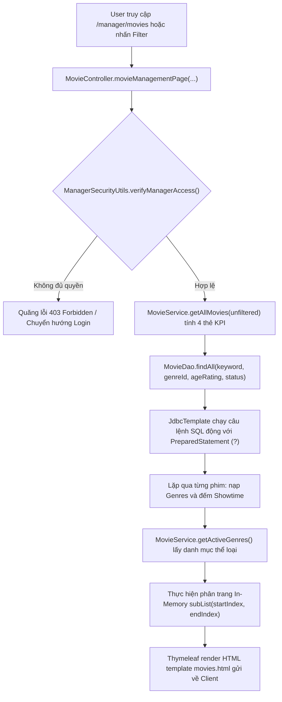
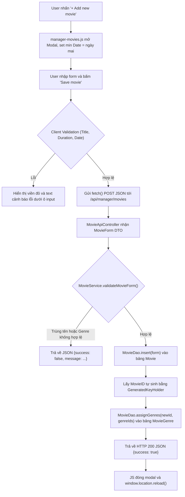
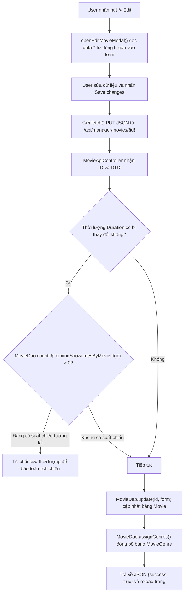
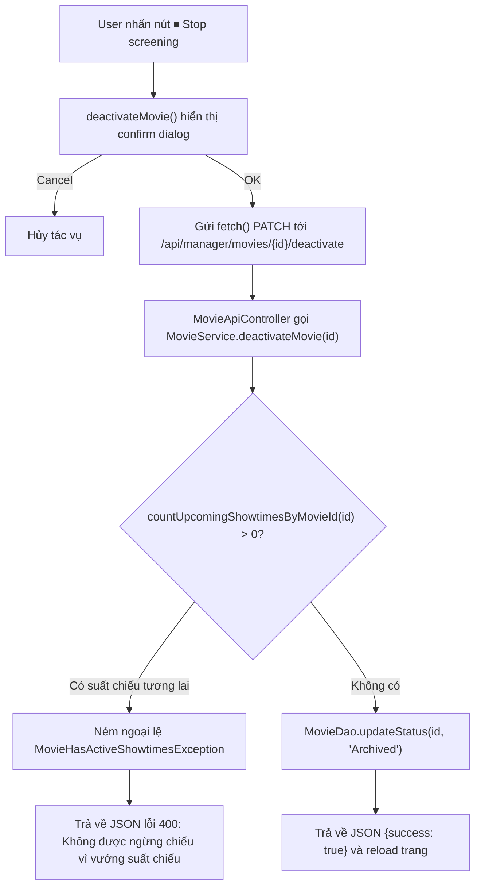
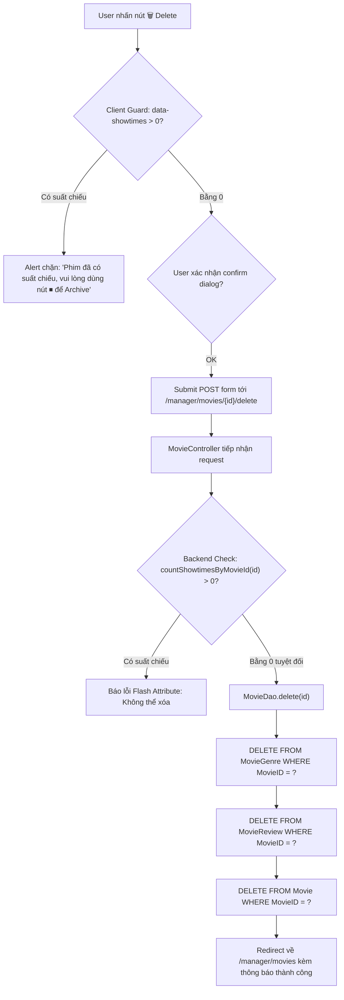
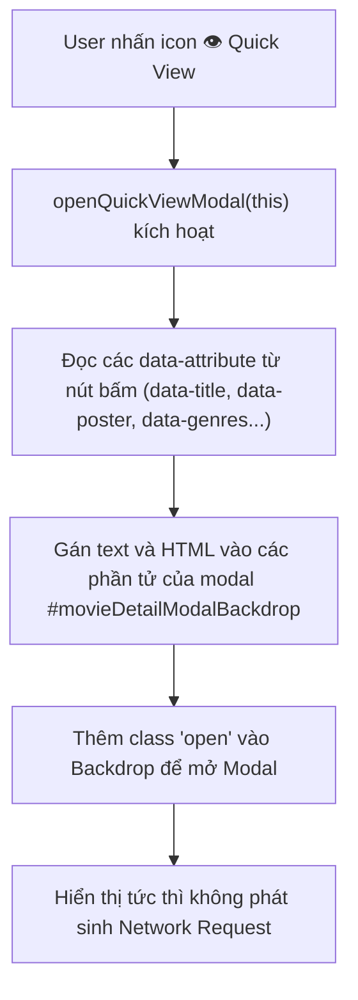
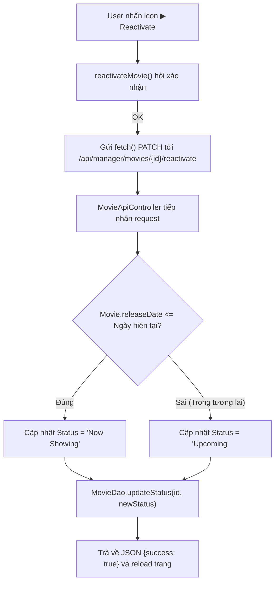

# TÀI LIỆU REVIEW TOÀN DIỆN VÀ BỘ ĐỀ VẤN ĐÁP: MOVIE MANAGEMENT – CINEORA SYSTEM

---

## PHẦN 1. TỔNG QUAN KIẾN TRÚC MOVIE MANAGEMENT

Hệ thống CINEORA triển khai màn hình **Movie Management** (Screen 54, UC-26) theo mô hình kiến trúc phân lớp chuẩn **MVC + Service Layer + DAO Layer** kết hợp **Dual Submission** (AJAX API hiện đại + Fallback HTML Form POST truyền thống).

```
[Trình duyệt Người dùng (Client Browser)]
  │
  ├─► (1) Tải trang / Filter: GET /manager/movies
  │     └─► MovieController.java ──► MovieService.java ──► MovieDao.java ──► DB (SQL Server)
  │           └─► Trả về View Thymeleaf: templates/manager/movies.html (SSR)
  │
  ├─► (2) Modal Quick View / Fill Form Edit:
  │     └─► Client-side pure DOM: Đọc các data-attribute từ <tr> trong HTML, không gọi thêm API
  │
  ├─► (3) Submit Thêm / Sửa phim:
  │     ├─► [Ưu tiên] AJAX fetch() ──► MovieApiController.java (POST / PUT JSON)
  │     │     └─► MovieService.java ──► MovieDao.java (JdbcTemplate)
  │     │           └─► Response JSON {success: true} ──► JS reload trang
  │     └─► [Fallback] Submit Form trực tiếp ──► MovieController.java (POST /manager/movies/save)
  │           └─► MovieService.java ──► Redirect /manager/movies
  │
  ├─► (4) Ngừng chiếu (Deactivate) / Kích hoạt lại (Reactivate):
  │     └─► AJAX fetch(PATCH) ──► MovieApiController.java
  │           └─► MovieService.java (Kiểm tra ràng buộc suất chiếu) ──► MovieDao.updateStatus()
  │
  └─► (5) Xóa cứng phim (Delete):
        └─► Form POST /manager/movies/{id}/delete ──► MovieController.java
              └─► MovieService.deleteMovie() (Kiểm tra ràng buộc Showtime = 0) ──► MovieDao.delete()
```

### Nguyên lý kiến trúc cốt lõi:
1. **Kiến trúc Server-Side Rendering (SSR) kết hợp Client-Side Enhancement**: Danh sách phim, KPI cards, dropdown thể loại được Spring Boot render sẵn bằng Thymeleaf tại Server. Khi render mỗi dòng `<tr>`, server đính kèm toàn bộ siêu dữ liệu (`data-id`, `data-title`, `data-duration`, `data-genres`, `data-showtimes`,...) vào các thẻ HTML.
2. **Không bị Overhead Network**: Khi người dùng nhấn nút xem chi tiết (👁) hoặc chỉnh sửa (✎), JavaScript lấy trực tiếp dữ liệu từ DOM của dòng đó để hiển thị lên Modal mà **không cần tạo thêm bất kỳ HTTP GET request nào** về backend.
3. **Dual Submission Pattern (Khả năng chịu lỗi cao)**: Nút Submit trong Form Modal xử lý bằng `fetch()` JSON lên REST API endpoint `/api/manager/movies`. Nếu có lỗi kết nối hoặc script lỗi, câu lệnh `catch (err) { movieForm.submit(); }` sẽ kích hoạt Form POST cổ điển lên `/manager/movies/save`, đảm bảo tính liên tục của hệ thống.
4. **Data Access Layer**: Sử dụng Spring `JdbcTemplate` với các câu lệnh SQL thuần được tham số hóa (`PreparedStatement`), không sử dụng Hibernate/JPA cồng kềnh, giúp tối ưu hóa hiệu năng truy vấn và kiểm soát chính xác 100% câu lệnh SQL gửi đến Microsoft SQL Server.

---

## PHẦN 2. DANH SÁCH TẤT CẢ FILE LIÊN QUAN

| STT | Loại File / Tầng | Đường Dẫn Thực Tế Trong Dự Án | Trách Nhiệm Nghiệp Vụ Chính |
|:---:|:---|:---|:---|
| 1 | **Frontend View** | [movies.html](file:///c:/Users/hoang/Downloads/SWP_RapPhim/src/main/resources/templates/manager/movies.html) | Giao diện quản lý phim, KPI, bảng dữ liệu, 2 Modals (Add/Edit & Quick View) |
| 2 | **Frontend Script** | [manager-movies.js](file:///c:/Users/hoang/Downloads/SWP_RapPhim/src/main/resources/static/js/manager-movies.js) | Điều khiển mở/đóng Modal, AJAX Fetch, preview ảnh, client validation, delete guard |
| 3 | **Frontend Style** | [manager-movies.css](file:///c:/Users/hoang/Downloads/SWP_RapPhim/src/main/resources/static/css/manager-movies.css) | Định dạng CSS giao diện, bảng, modal dialog, animation spinner và status badges |
| 4 | **MVC Controller** | [MovieController.java](file:///c:/Users/hoang/Downloads/SWP_RapPhim/src/main/java/com/cinema/controller/MovieController.java) | Xử lý request điều hướng GET `/manager/movies`, fallback POST save, POST delete |
| 5 | **REST Controller** | [MovieApiController.java](file:///c:/Users/hoang/Downloads/SWP_RapPhim/src/main/java/com/cinema/controller/api/MovieApiController.java) | API Endpoints: POST/PUT Movie, PATCH deactivate, PATCH reactivate, POST upload |
| 6 | **Business Service** | [MovieService.java](file:///c:/Users/hoang/Downloads/SWP_RapPhim/src/main/java/com/cinema/service/MovieService.java) | Xử lý toàn bộ logic nghiệp vụ (BR-07, BR-37, BR-44, P0-02), validation nghiệp vụ |
| 7 | **Data Access (DAO)** | [MovieDao.java](file:///c:/Users/hoang/Downloads/SWP_RapPhim/src/main/java/com/cinema/dao/MovieDao.java) | Thực thi câu lệnh SQL với `JdbcTemplate`, quản lý bảng `Movie`, `MovieGenre`, `Showtime` |
| 8 | **DTO Object** | [MovieForm.java](file:///c:/Users/hoang/Downloads/SWP_RapPhim/src/main/java/com/cinema/dto/MovieForm.java) | Đối tượng nhận dữ liệu form từ request (Binding model, chứa annotations validation) |
| 9 | **Data Model (Entity)**| [Movie.java](file:///c:/Users/hoang/Downloads/SWP_RapPhim/src/main/java/com/cinema/model/Movie.java) | Chứa các thuộc tính của một bộ phim tương ứng với bảng `dbo.Movie` |
| 10 | **Data Model (Genre)** | [Genre.java](file:///c:/Users/hoang/Downloads/SWP_RapPhim/src/main/java/com/cinema/model/Genre.java) | Đại diện cho thể loại phim (`dbo.Genre`) |
| 11 | **Security Guard** | [ManagerSecurityUtils.java](file:///c:/Users/hoang/Downloads/SWP_RapPhim/src/main/java/com/cinema/util/ManagerSecurityUtils.java) | Xác thực phân quyền Manager/Admin thông qua Session trước khi cho phép vào màn hình |
| 12 | **Database DDL** | [00_full_database.sql](file:///c:/Users/hoang/Downloads/SWP_RapPhim/database/00_full_database.sql) | Cấu trúc bảng `Movie`, `Genre`, `MovieGenre`, `Showtime`, constraints và foreign keys |

---

## PHẦN 3. GIẢI THÍCH LUỒNG TẢI MÀN HÌNH (`GET /manager/movies`)

### 1. Trình tự thực thi chi tiết
1. **Tiếp nhận Request**: Trình duyệt gửi `GET /manager/movies` kèm theo các Query Parameters:
   `keyword`, `genreId`, `ageRating`, `status`, `page`, `size`.
2. **Kiểm tra Phân Quyền (Security Interception)**:
   - File: [MovieController.java](file:///c:/Users/hoang/Downloads/SWP_RapPhim/src/main/java/com/cinema/controller/MovieController.java#L47-L49)
   - Phương thức: `ManagerSecurityUtils.verifyManagerAccess(request)`
   - Nếu Session không có user hợp lệ hoặc user không có vai trò `MANAGER` hoặc `ADMIN`, hệ thống lập tức ném ra ngoại lệ `AccessDeniedException` hoặc chuyển hướng về `/login`.
3. **Truy vấn Dữ liệu KPI Thống kê (System-wide Statistics)**:
   - File: [MovieController.java](file:///c:/Users/hoang/Downloads/SWP_RapPhim/src/main/java/com/cinema/controller/MovieController.java#L58-L76)
   - Gọi: `movieService.getAllMovies(null, null, "ALL", "ALL")`.
   - **Lưu ý nghiệp vụ cốt lõi**: Controller lấy toàn bộ phim trên toàn hệ thống (không bị ảnh hưởng bởi tham số filter tìm kiếm hiện tại) để tính 4 thẻ KPI bằng Java Stream:
     - `totalCount = allUnfiltered.size()`
     - `nowShowingCount = allUnfiltered.stream().filter(m -> "Now Showing".equalsIgnoreCase(m.getStatus())).count()`
     - `upcomingCount = allUnfiltered.stream().filter(m -> "Upcoming".equalsIgnoreCase(m.getStatus()) || "Coming Soon".equalsIgnoreCase(m.getStatus())).count()`
     - `archivedCount = allUnfiltered.stream().filter(m -> "Archived".equalsIgnoreCase(m.getStatus()) || "Ended".equalsIgnoreCase(m.getStatus())).count()`
4. **Truy vấn Danh sách Phim theo Bộ lọc (Filtered Movie List)**:
   - Gọi: `movieService.getAllMovies(keyword, genreId, ageRating, status)`.
   - Xuống tầng DAO: [MovieDao.java](file:///c:/Users/hoang/Downloads/SWP_RapPhim/src/main/java/com/cinema/dao/MovieDao.java#L93-L161) phương thức `findAll(...)`.
   - `MovieDao` dựng câu lệnh SQL động với điều kiện `WHERE 1=1`, bổ sung `LIKE ?` cho tiêu đề/đạo diễn/diễn viên, `EXISTS (SELECT 1 FROM MovieGenre ...)` cho thể loại, và gán tham số an toàn.
   - Với mỗi bản ghi phim trả về, `MovieDao` lập tức gọi:
     - `findGenresByMovieId(movieId)` để nạp danh sách `List<Genre>`.
     - `countShowtimesByMovieId(movieId)` để đếm số suất chiếu của phim trong bảng `Showtime`.
5. **Truy vấn Danh sách Thể loại Phim (Genres for Filter & Form Modal)**:
   - Gọi: `movieService.getActiveGenres()` lấy danh sách các thể loại có `Status = 'ACTIVE'` từ bảng `Genre` để điền vào dropdown lọc và các checkbox trong modal thêm mới.
6. **Thực hiện Phân trang (In-Memory Pagination)**:
   - File: [MovieController.java](file:///c:/Users/hoang/Downloads/SWP_RapPhim/src/main/java/com/cinema/controller/MovieController.java#L87-L95)
   - Tính toán chỉ số `startIndex` và `endIndex` dựa trên `page` và `size` (mặc định 10 phim/trang) và cắt lát danh sách bằng `movies.subList(startIndex, endIndex)`.
7. **Đẩy Model vào View & Render HTML**:
   - Controller đẩy vào Spring `Model`: `movies`, `genres`, `totalMovies`, `nowShowingCount`, `upcomingCount`, `archivedCount`, `totalFiltered`, `currentPage`, `totalPages`, v.v.
   - Trả về tên template `"manager/movies"`, Thymeleaf biên dịch thành mã HTML gửi về trình duyệt hiển thị.

---

## PHẦN 4. REVIEW CHI TIẾT TỪNG BUTTON VÀ CHỨC NĂNG TRÊN MÀN HÌNH

### A. Điều hướng và tải trang
1. **Sidebar Navigation ("Movie Management")**: Thẻ `<a th:href="@{/manager/movies}">` tại thanh sidebar điều hướng trực tiếp bằng HTTP GET đến `/manager/movies`.
2. **Breadcrumb ("Overview / Movie Management")**: Liên kết dẫn về `/manager/overview` và vị trí hiện tại.
3. **Quyền truy cập**: Chỉ tài khoản có `role = 'MANAGER'` hoặc `'ADMIN'` mới được phép truy cập. Mọi request không hợp lệ đều bị chặn bởi `ManagerSecurityUtils`.

### B. Dashboard Movie Statistics (4 Thẻ KPI)
- **Now Showing**: Số lượng phim đang chiếu (`status = 'Now Showing'`).
- **Coming Soon**: Số lượng phim sắp chiếu (`status = 'Upcoming'` hoặc `'Coming Soon'`).
- **Ended / Archived**: Số lượng phim đã ngừng chiếu hoặc lưu trữ (`status = 'Archived'` hoặc `'Ended'`).
- **All movies**: Tổng số lượng phim trên toàn bộ hệ thống rạp.
- **Cơ chế tính toán**: Được đếm trực tiếp trên `allUnfiltered` bằng Java Streams trong Controller ([MovieController.java#L61-L76](file:///c:/Users/hoang/Downloads/SWP_RapPhim/src/main/java/com/cinema/controller/MovieController.java#L61-L76)).
- **Câu hỏi đặc biệt**: *Tại sao phim có thể là Now Showing dù chưa có suất chiếu nào?*
  - **Trả lời**: Vì trạng thái vòng đời (`Status`) của phim được lưu trữ như một thuộc tính độc lập trong bảng `dbo.Movie`. Quản lý rạp có thể chuyển trạng thái phim sang `Now Showing` để phục vụ công tác marketing, truyền thông hoặc chuẩn bị mở bán trước khi bảng lịch chiếu (`Showtime`) được phân bổ phòng chiếu.

### C. Thanh Search và Filter
- **Thành phần**:
  - Ô input text: `name="keyword"`, tìm kiếm theo tên phim, tên gốc, đạo diễn, diễn viên.
  - Dropdown thể loại: `name="genreId"`, lấy động từ danh sách thể loại đang kích hoạt (`Status = 'ACTIVE'`).
  - Dropdown độ tuổi: `name="ageRating"`, các giá trị: `ALL`, `P`, `K`, `T13`, `T16`, `T18`, `C`.
  - Dropdown trạng thái: `name="status"`, các giá trị: `ALL`, `Now Showing`, `Upcoming`, `Archived`.
- **Phương thức gửi**: HTTP GET thông qua thẻ `<form th:action="@{/manager/movies}" method="get">`.
- **Cơ chế xử lý tại SQL (Chống SQL Injection)**:
  - File: [MovieDao.java#L121-L148](file:///c:/Users/hoang/Downloads/SWP_RapPhim/src/main/java/com/cinema/dao/MovieDao.java#L121-L148)
  - `MovieDao` sử dụng cú pháp dấu hỏi `?` của PreparedStatement:
    ```sql
    AND (
        LOWER(m.Title) LIKE LOWER(?)
        OR LOWER(ISNULL(m.OriginalTitle, '')) LIKE LOWER(?)
        OR LOWER(ISNULL(m.Director, '')) LIKE LOWER(?)
        OR LOWER(ISNULL(m.Actors, '')) LIKE LOWER(?)
    )
    ```
- **Nút "Clear filters"**: Thẻ liên kết `<a th:href="@{/manager/movies}">` đặt lại URL về mặc định không có query parameter nào.

### D. Button "+ Add new movie"
- **Bước 1**: Nhấn nút `+ Add new movie` (gọi hàm inline `onclick="openAddMovieModal()"`).
- **Bước 2**: [manager-movies.js#L111-L129](file:///c:/Users/hoang/Downloads/SWP_RapPhim/src/main/resources/static/js/manager-movies.js#L111-L129) chạy:
  - Reset toàn bộ form bằng `resetMovieForm()`.
  - Đổi tiêu đề modal thành `"Add new movie"`.
  - Đặt trạng thái mặc định: `Upcoming`.
  - Giới hạn ngày khởi chiếu tối thiểu: `min = Ngày mai` (ràng buộc không được tạo phim có ngày phát hành trong quá khứ).
  - Thêm class `open` vào `#movieModalBackdrop` để hiển thị Modal thêm phim.
- **Bước 3 (Nhấn Save movie)**:
  - Client Validation: Kiểm tra tên phim không rỗng và $\le 150$ ký tự, thời lượng là số nguyên dương $1 \le \text{duration} \le 600$, ngày phát hành từ ngày mai trở đi.
  - Client thu thập các checkbox thể loại đã chọn vào mảng `genreIds`.
  - Gửi payload JSON thông qua `fetch('/api/manager/movies', { method: 'POST', body: JSON.stringify(payload) })`.
  - Backend [MovieApiController.java](file:///c:/Users/hoang/Downloads/SWP_RapPhim/src/main/java/com/cinema/controller/api/MovieApiController.java) tiếp nhận `@RequestBody MovieForm form`, gọi `movieService.createMovie(form)`.
  - [MovieService.java](file:///c:/Users/hoang/Downloads/SWP_RapPhim/src/main/java/com/cinema/service/MovieService.java#L118-L145) kiểm tra:
    - Trùng tên phim (`checkDuplicateTitle`).
    - Tính hợp lệ của thể loại (`countInactiveOrMissingGenres == 0`).
  - [MovieDao.java#L257-L295](file:///c:/Users/hoang/Downloads/SWP_RapPhim/src/main/java/com/cinema/dao/MovieDao.java#L257-L295) thực thi lệnh `INSERT INTO Movie (...) VALUES (...)`, sử dụng `KeyHolder` lấy mã tự tăng `MovieID`.
  - Gọi tiếp `assignGenres(newId, form.getGenreIds())` thực thi `INSERT INTO MovieGenre (MovieID, GenreID, AssignedAt)`.
  - Trả về JSON `{ success: true, message: "Movie created successfully" }`. Trình duyệt nhận kết quả và gọi `window.location.reload()`.

### E. Bảng Movie List (Hiển thị danh sách phim)
- **Tên phim & Tên gốc**: Cột đầu tiên hiển thị `m.title` và dòng phụ `m.originalTitle`.
- **Poster Thumbnail**: Hiển thị ảnh từ `m.poster`. Nếu rỗng hoặc lỗi, fallback sang icon emoji 🎬.
- **Genre badges**: Duyệt qua danh sách `movie.genres` được hydrate từ bảng liên kết `MovieGenre`, render các thẻ pill màu hồng nhạt.
- **Age rating**: Render badge màu theo quy định kiểm duyệt (P: Xanh lá, K: Xanh lơ, T13/T16: Cam, T18/C: Đỏ).
- **Showtimes Count**: Cột hiển thị số suất chiếu kèm chữ `shows` màu đỏ đậm. Thẻ liên kết `<a th:href="@{/manager/showtimes(movieId=${movie.movieId})}">` cho phép người quản lý bấm vào để chuyển thẳng sang phân hệ Lịch chiếu, lọc riêng theo phim này.

### F. Button Xem chi tiết (👁 Quick View)
- **Vị trí**: Nút biểu tượng mắt trong cột `Actions`.
- **Cách thức hoạt động**: Gọi hàm `openQuickViewModal(this)` ([manager-movies.js#L201-L252](file:///c:/Users/hoang/Downloads/SWP_RapPhim/src/main/resources/static/js/manager-movies.js#L201-L252)).
- Đọc trực tiếp các thuộc tính HTML `data-*` đã được Thymeleaf nhúng sẵn trên chính thẻ button:
  - `data-id`, `data-title`, `data-original-title`, `data-duration`, `data-age-rating`, `data-status`, `data-release-date`, `data-director`, `data-actors`, `data-language`, `data-description`, `data-poster`, `data-trailer`, `data-genres`, `data-showtimes`.
- Gán nội dung vào các thẻ span/div của `#movieDetailModalBackdrop` và mở popup lên màn hình. **Hoàn toàn không tốn request mạng**.

### G. Button Chỉnh sửa (✎ Edit)
- **Vị trí**: Nút biểu tượng bút chì trong cột `Actions`.
- **Cách thức hoạt động**: Gọi hàm `openEditMovieModal(this)` ([manager-movies.js#L131-L199](file:///c:/Users/hoang/Downloads/SWP_RapPhim/src/main/resources/static/js/manager-movies.js#L131-L199)).
- Đọc các thuộc tính `data-*` tương tự như Quick View, điền giá trị vào form `#movieModalForm`, đánh dấu các checkbox thể loại tương ứng.
- Đặt `id` vào trường ẩn `<input type="hidden" id="movieId">`.
- Khi nhấn lưu, dữ liệu gửi lên endpoint `PUT /api/manager/movies/{id}`.
- Backend [MovieService.java#L147-L188](file:///c:/Users/hoang/Downloads/SWP_RapPhim/src/main/java/com/cinema/service/MovieService.java#L147-L188) kiểm tra:
  - Nếu sửa thời lượng phim (`duration`), hệ thống kiểm tra `countUpcomingShowtimesByMovieId(movieId)`. Nếu phim đã có suất chiếu trong tương lai, hệ thống **từ chối sửa thời lượng** để tránh làm vỡ khung giờ phòng chiếu (Showtime collision).

### H. Button Trạng thái (⏹ Stop / ▶ Reactivate)
- **Cơ chế hiển thị có điều kiện**:
  - Nếu `movie.status` là `Now Showing` hoặc `Upcoming`: Hiển thị nút dừng chiếu **⏹ (Archive/Stop screening)**.
  - Nếu `movie.status` là `Archived` hoặc `Ended`: Hiển thị nút kích hoạt lại **▶ (Reactivate)**.
- **Nghiệp vụ Dừng chiếu (BR-37 Soft Delete)**:
  - Nhấn ⏹ $\rightarrow$ Gọi `deactivateMovie(this)`. Hiển thị dialog xác nhận kèm cảnh báo nếu phim đang có suất chiếu.
  - Gửi request `PATCH /api/manager/movies/{id}/deactivate`.
  - Backend [MovieService.java#L226-L242](file:///c:/Users/hoang/Downloads/SWP_RapPhim/src/main/java/com/cinema/service/MovieService.java#L226-L242) kiểm tra:
    ```java
    int upcomingShows = movieDao.countUpcomingShowtimesByMovieId(movieId);
    if (upcomingShows > 0) {
        throw new MovieHasActiveShowtimesException("Cannot deactivate movie. There are " + upcomingShows + " upcoming showtimes scheduled.");
    }
    ```
  - Nếu không có suất chiếu tương lai nào, cập nhật `Status = 'Archived'`.
- **Nghiệp vụ Kích hoạt lại (Reactivate)**:
  - Nhấn ▶ $\rightarrow$ Gọi `reactivateMovie(this)` $\rightarrow$ `PATCH /api/manager/movies/{id}/reactivate`.
  - Backend tự động tính toán: Nếu ngày phát hành $\le$ ngày hiện tại thì set `Now Showing`, nếu trong tương lai thì set `Upcoming`.

### I. Button Xóa phim (🗑 Delete)
- **Vị trí**: Nút thùng rác màu đỏ nhạt trong cột `Actions`.
- **Cách thức hoạt động**: Nằm trong thẻ `<form th:action="@{/manager/movies/{id}/delete(id=${movie.movieId})}" method="post" class="delete-movie-form">`.
- **Bảo vệ 2 lớp (Dual-Layer Protection)**:
  - **Lớp 1 (Frontend Guard)**: [manager-movies.js#L634-L648](file:///c:/Users/hoang/Downloads/SWP_RapPhim/src/main/resources/static/js/manager-movies.js#L634-L648) bắt sự kiện submit của form xóa. Nếu thuộc tính `data-showtimes > 0`, JavaScript lập tức chặn lại (`e.preventDefault()`) và hiện thông báo: *"Data constraint prevents deletion: Movie has X linked showtimes in the system. You can use the 'Stop' button (⏹) to archive the movie."*
  - **Lớp 2 (Backend Integrity)**: [MovieService.java#L191-L203](file:///c:/Users/hoang/Downloads/SWP_RapPhim/src/main/java/com/cinema/service/MovieService.java#L191-L203) kiểm tra:
    ```java
    int showtimeCount = movieDao.countShowtimesByMovieId(movieId);
    if (showtimeCount > 0) {
        throw new MovieHasActiveShowtimesException("Cannot delete movie with existing showtimes.");
    }
    ```
  - Chỉ khi số suất chiếu bằng 0 tuyệt đối, `MovieDao.delete(movieId)` mới xóa các bản ghi liên kết trong `MovieGenre`, `MovieReview` và xóa bản ghi trong `Movie`.

---

## PHẦN 5. MAPPING UI – CODE – DATABASE

| Thành phần trên UI | Field Name / Control ID | Thuộc tính DTO / Model | Database Column (`dbo.Movie`) | Kiểu dữ liệu SQL | Ràng buộc nghiệp vụ |
|:---|:---|:---|:---|:---|:---|
| **Movie Title** | `#movieTitle` | `MovieForm.title` | `Title` | `NVARCHAR(150)` | NOT NULL, Max 150 ký tự, Unique |
| **Original Title** | `#movieOriginalTitle`| `MovieForm.originalTitle` | `OriginalTitle` | `NVARCHAR(150)` | NULLABLE |
| **Duration** | `#movieDuration` | `MovieForm.duration` | `Duration` | `INT` | NOT NULL, $1 \le \text{phút} \le 600$ |
| **Release Date** | `#movieReleaseDate` | `MovieForm.releaseDate` | `ReleaseDate` | `DATE` | Tạo mới: $\ge$ Ngày mai |
| **End Date** | `#movieEndDate` | `MovieForm.endDate` | `EndDate` | `DATE` | NULLABLE, $\ge$ ReleaseDate |
| **Age Rating** | `#movieAgeRating` | `MovieForm.ageRating` | `AgeRating` | `VARCHAR(10)` | P, K, T13, T16, T18, C |
| **Status** | `#movieStatus` | `MovieForm.status` | `Status` | `VARCHAR(20)` | Upcoming, Now Showing, Archived |
| **Language** | `#movieLanguage` | `MovieForm.language` | `Language` | `NVARCHAR(50)` | Mặc định: Vietnamese / English |
| **Director** | `#movieDirector` | `MovieForm.director` | `Director` | `NVARCHAR(100)` | Max 100 ký tự |
| **Cast / Actors** | `#movieActors` | `MovieForm.actors` | `Actors` | `NVARCHAR(500)` | Max 500 ký tự |
| **Description** | `#movieDescription`| `MovieForm.description` | `Description` | `NVARCHAR(1000)`| Max 1000 ký tự |
| **Poster Image** | `#moviePoster` | `MovieForm.poster` | `PosterURL` / `Poster` | `NVARCHAR(500)` | URL hoặc đường dẫn file đã upload |
| **Trailer Link** | `#movieTrailer` | `MovieForm.trailer` | `TrailerURL` / `Trailer` | `NVARCHAR(500)` | URL định dạng Youtube |
| **Thể loại (Badges)** | Checkboxes `.genre-checkbox-item` | `MovieForm.genreIds` | Bảng `dbo.MovieGenre` | `INT` (FK `MovieID`, `GenreID`) | BR-44: Không trùng lặp thể loại |
| **Cột Showtimes** | Cột "Showtimes" | `Movie.showtimeCount` | Bảng `dbo.Showtime` | `COUNT(1)` | Khóa ngoại tham chiếu `MovieID` |

---

## PHẦN 6. MERMAID FLOWCHART CHO CÁC NGHIỆP VỤ

### 1. Luồng Tải Trang và Tìm Kiếm / Lọc Phim (Load Page & Filter)


### 2. Luồng Thêm Mới Phim (Add New Movie)


### 3. Luồng Chỉnh Sửa Phim (Edit Movie)


### 4. Luồng Ngừng Chiếu / Lưu Trữ Phim (Deactivate / Archive - BR-37)


### 5. Luồng Xóa Phim (Hard Delete)


### 6. Luồng Xem Nhanh Thông Tin Phim (Quick View 👁)


### 7. Luồng Kích Hoạt Lại Phim (Reactivate Movie)


---

## PHẦN 7. KIỂM TRA VALIDATION, SECURITY VÀ EDGE CASES

### 1. Phân tầng Validation (Multi-tier Validation)
- **Frontend Validation**: Kiểm tra ngay khi nhập (sự kiện `input`, `change`) và khi nhấn Submit:
  - Tên phim bắt buộc, độ dài $\le 150$ ký tự.
  - Thời lượng: Số nguyên dương từ 1 đến 600 phút.
  - Ngày phát hành: Khi tạo mới phải $\ge$ ngày mai.
- **Backend Validation**:
  - DTO Annotations: `@NotBlank`, `@Size`, `@Min`, `@Max`.
  - Service Validation: [MovieService.java#L248-L272](file:///c:/Users/hoang/Downloads/SWP_RapPhim/src/main/java/com/cinema/service/MovieService.java#L248-L272) kiểm tra tính duy nhất của tên phim (`checkDuplicateTitle`), kiểm tra thể loại có tồn tại và đang hoạt động không (`countInactiveOrMissingGenres == 0`).

### 2. An ninh Bảo mật (Security & CSRF)
- **CSRF Token**: JavaScript đọc CSRF token từ thẻ meta `<meta name="_csrf">` hoặc input hidden và đính kèm vào header `X-XSRF-TOKEN` trong tất cả các request AJAX (`fetch`).
- **Chống SQL Injection**: Toàn bộ các truy vấn trong `MovieDao` đều sử dụng cú pháp tham số hóa `?` của Spring `JdbcTemplate`. Tuyệt đối không cộng chuỗi trực tiếp giá trị người dùng nhập vào câu SQL.
- **XSS Prevention**: Mọi giá trị text render qua Thymeleaf đều dùng `th:text` (mặc định HTML-escaped). Trong JavaScript có hàm `escapeHtml()` xử lý chuỗi trước khi gán vào innerHTML.

---

## PHẦN 8. BẢNG TỔNG HỢP ĐÁNH GIÁ MÃ NGUỒN (PASS / RISK / BUG)

| STT | Vấn đề phát hiện trong Source Code | Phân loại | Vị trí File | Đánh giá & Khuyến nghị giải thích với Giảng viên |
|:---:|:---|:---:|:---|:---|
| 1 | Phân trang thực hiện In-Memory (`subList`) thay vì phân trang bằng SQL (`OFFSET / FETCH`) | **RISK** | [MovieController.java#L87-L95](file:///c:/Users/hoang/Downloads/SWP_RapPhim/src/main/java/com/cinema/controller/MovieController.java#L87-L95) | **Giải thích:** Với quy mô rạp chiếu phim (khoảng vài trăm phim), In-memory pagination cho tốc độ phản hồi cực nhanh và đơn giản hóa logic đếm tổng số trang. Tuy nhiên, nếu dữ liệu lên đến hàng chục nghìn bản ghi, nên chuyển sang dùng `OFFSET ? ROWS FETCH NEXT ? ROWS ONLY` trực tiếp trong SQL. |
| 2 | Đếm KPI bằng Java Stream trên toàn bộ danh sách `allUnfiltered` | **PASS** | [MovieController.java#L61-L76](file:///c:/Users/hoang/Downloads/SWP_RapPhim/src/main/java/com/cinema/controller/MovieController.java#L61-L76) | **Giải thích:** Giúp giữ nguyên con số thống kê toàn cục của rạp ngay cả khi người quản lý đang áp dụng bộ lọc danh sách bên dưới, mang lại trải nghiệm dashboard trực quan. |
| 3 | Tương thích schema database linh hoạt với cột `PosterURL` / `Poster` | **PASS** | [MovieDao.java#L204-L238](file:///c:/Users/hoang/Downloads/SWP_RapPhim/src/main/java/com/cinema/dao/MovieDao.java#L204-L238) | **Điểm cộng:** DAO có hàm `resolveWritableColumns()` tự kiểm tra metadata bảng qua `sys.columns` để xác định cột nào là computed column, tránh hoàn toàn lỗi crash khi insert/update. |
| 4 | Kiểm tra bảo vệ suất chiếu khi sửa thời lượng và xóa phim | **PASS** | [MovieService.java#L162](file:///c:/Users/hoang/Downloads/SWP_RapPhim/src/main/java/com/cinema/service/MovieService.java#L162), [#L194](file:///c:/Users/hoang/Downloads/SWP_RapPhim/src/main/java/com/cinema/service/MovieService.java#L194) | **Điểm cộng:** Tuân thủ nghiêm ngặt quy tắc toàn vẹn nghiệp vụ rạp chiếu: không cho phép thay đổi thời lượng phim hoặc xóa phim khi đang có lịch chiếu phục vụ khách hàng. |

---

## PHẦN 9. BỘ 40 CÂU HỎI VẤN ĐÁP CÙNG ĐÁP ÁN VÀ BẰNG CHỨNG MÃ NGUỒN

### NHÓM A: 15 CÂU HỎI CƠ BẢN (MỨC ĐỘ HIỂU CODE)

#### Câu 1: Khi gõ URL `/manager/movies` trên trình duyệt, Controller nào sẽ bắt request và method nào được gọi?
- **Đáp án:** `MovieController` sẽ bắt request tại method `movieManagementPage(...)` gắn annotation `@GetMapping("/manager/movies")`.
- **Bằng chứng code:** [MovieController.java: dòng 41-43](file:///c:/Users/hoang/Downloads/SWP_RapPhim/src/main/java/com/cinema/controller/MovieController.java#L41-L43).

#### Câu 2: Làm sao hệ thống đảm bảo chỉ Quản lý (Manager) mới vào được trang này?
- **Đáp án:** Đầu method `movieManagementPage()`, chương trình gọi tiện ích bảo mật `ManagerSecurityUtils.verifyManagerAccess(request)`. Phương thức này kiểm tra `HttpSession`, nếu chưa đăng nhập hoặc không có quyền `ROLE_MANAGER`/`ADMIN` thì sẽ ném ra ngoại lệ `AccessDeniedException`.
- **Bằng chứng code:** [MovieController.java: dòng 47-49](file:///c:/Users/hoang/Downloads/SWP_RapPhim/src/main/java/com/cinema/controller/MovieController.java#L47-L49) và [ManagerSecurityUtils.java](file:///c:/Users/hoang/Downloads/SWP_RapPhim/src/main/java/com/cinema/util/ManagerSecurityUtils.java).

#### Câu 3: Màn hình này tương tác với những bảng nào trong cơ sở dữ liệu?
- **Đáp án:** Tương tác trực tiếp với 4 bảng: `dbo.Movie` (lưu phim), `dbo.Genre` (danh mục thể loại), `dbo.MovieGenre` (bảng liên kết n-n giữa phim và thể loại), và `dbo.Showtime` (đọc số suất chiếu và kiểm tra ràng buộc).
- **Bằng chứng code:** [MovieDao.java: dòng 95-115, 366-393, 439-465](file:///c:/Users/hoang/Downloads/SWP_RapPhim/src/main/java/com/cinema/dao/MovieDao.java#L95-L115).

#### Câu 4: Số lượng trên 4 thẻ KPI (Now Showing, Coming Soon, Ended, All) được tính như thế nào?
- **Đáp án:** Được tính tại backend bằng Java Stream filter trên danh sách phim toàn cục không lọc (`allUnfiltered`) được lấy từ `movieService.getAllMovies(null, null, "ALL", "ALL")`.
- **Bằng chứng code:** [MovieController.java: dòng 58-76](file:///c:/Users/hoang/Downloads/SWP_RapPhim/src/main/java/com/cinema/controller/MovieController.java#L58-L76).

#### Câu 5: Khi tôi tìm kiếm theo từ khóa thì hệ thống tìm kiếm trên những trường dữ liệu nào của phim?
- **Đáp án:** Tìm kiếm không phân biệt hoa thường trên 4 trường: Tên phim (`Title`), Tên gốc (`OriginalTitle`), Đạo diễn (`Director`), và Diễn viên (`Actors`).
- **Bằng chứng code:** [MovieDao.java: dòng 121-126](file:///c:/Users/hoang/Downloads/SWP_RapPhim/src/main/java/com/cinema/dao/MovieDao.java#L121-L126).

#### Câu 6: Dữ liệu phân trang (Pagination) ở màn hình này được xử lý ở SQL hay ở Java?
- **Đáp án:** Được xử lý In-Memory tại tầng Java trong `MovieController` bằng phương thức `movies.subList(startIndex, endIndex)`.
- **Bằng chứng code:** [MovieController.java: dòng 87-95](file:///c:/Users/hoang/Downloads/SWP_RapPhim/src/main/java/com/cinema/controller/MovieController.java#L87-L95).

#### Câu 7: Bấm nút "Clear filters" thì chuyện gì xảy ra?
- **Đáp án:** Thẻ HTML `<a th:href="@{/manager/movies}">` sẽ tải lại trang với đường dẫn gốc không kèm theo bất kỳ Query Parameter nào, đưa toàn bộ form lọc về trạng thái mặc định ban đầu.
- **Bằng chứng code:** [movies.html: dòng 114](file:///c:/Users/hoang/Downloads/SWP_RapPhim/src/main/resources/templates/manager/movies.html#L114).

#### Câu 8: Nút "+ Add new movie" mở popup bằng cách nào?
- **Đáp án:** Gọi hàm JavaScript `openAddMovieModal()`, hàm này gọi `resetMovieForm()`, thiết lập ngày chiếu nhỏ nhất là ngày mai, và thêm class CSS `open` vào phần tử `#movieModalBackdrop`.
- **Bằng chứng code:** [manager-movies.js: dòng 111-129](file:///c:/Users/hoang/Downloads/SWP_RapPhim/src/main/resources/static/js/manager-movies.js#L111-L129).

#### Câu 9: Khi bấm nút Xem nhanh (👁), hệ thống có gửi thêm request về server để lấy chi tiết phim không?
- **Đáp án:** **Không**. Hệ thống tối ưu bằng cách đọc trực tiếp các siêu dữ liệu `data-*` đã được Thymeleaf kết xuất sẵn trên thẻ HTML của nút bấm và điền thẳng vào popup.
- **Bằng chứng code:** [manager-movies.js: dòng 201-230](file:///c:/Users/hoang/Downloads/SWP_RapPhim/src/main/resources/static/js/manager-movies.js#L201-L230).

#### Câu 10: Tên phim có được phép trùng nhau không?
- **Đáp án:** Không được trùng. Backend gọi `movieService.checkDuplicateTitle(form.getTitle(), excludeId)` để kiểm tra, nếu trùng sẽ quăng lỗi.
- **Bằng chứng code:** [MovieService.java: dòng 123-125, 274-280](file:///c:/Users/hoang/Downloads/SWP_RapPhim/src/main/java/com/cinema/service/MovieService.java#L123-L125).

#### Câu 11: Thời lượng phim (Duration) được giới hạn trong khoảng nào?
- **Đáp án:** Thời lượng phải là số nguyên dương lớn hơn 0 và không vượt quá 600 phút (10 tiếng).
- **Bằng chứng code:** [manager-movies.js: dòng 306-323](file:///c:/Users/hoang/Downloads/SWP_RapPhim/src/main/resources/static/js/manager-movies.js#L306-L323) và [MovieForm.java: dòng 22-25](file:///c:/Users/hoang/Downloads/SWP_RapPhim/src/main/java/com/cinema/dto/MovieForm.java#L22-L25).

#### Câu 12: Khi thêm mới phim, ngày khởi chiếu (Release Date) có được chọn ngày trong quá khứ không?
- **Đáp án:** Không. Cả Frontend và Backend đều chặn: Ngày khởi chiếu khi tạo mới phải bắt đầu từ ngày mai trở đi (`min = tomorrow`).
- **Bằng chứng code:** [manager-movies.js: dòng 120-123](file:///c:/Users/hoang/Downloads/SWP_RapPhim/src/main/resources/static/js/manager-movies.js#L120-L123) và [MovieService.java: dòng 263-267](file:///c:/Users/hoang/Downloads/SWP_RapPhim/src/main/java/com/cinema/service/MovieService.java#L263-L267).

#### Câu 13: Thể loại phim được lưu trữ trong Database theo mô hình quan hệ nào?
- **Đáp án:** Quan hệ Nhiều - Nhiều (Many-to-Many) thông qua bảng trung gian `dbo.MovieGenre` gồm hai khóa ngoại `MovieID` và `GenreID`.
- **Bằng chứng code:** [00_full_database.sql: bảng MovieGenre](file:///c:/Users/hoang/Downloads/SWP_RapPhim/database/00_full_database.sql) và [MovieDao.java: dòng 360-394](file:///c:/Users/hoang/Downloads/SWP_RapPhim/src/main/java/com/cinema/dao/MovieDao.java#L360-L394).

#### Câu 14: Cột "Showtimes" trên bảng có bấm vào được không và dẫn đi đâu?
- **Đáp án:** Có bấm vào được. Đây là đường link dẫn sang màn hình Quản lý Lịch chiếu: `/manager/showtimes?movieId={id}`, tự động lọc lịch chiếu riêng cho phim đó.
- **Bằng chứng code:** [movies.html: dòng 212-217](file:///c:/Users/hoang/Downloads/SWP_RapPhim/src/main/resources/templates/manager/movies.html#L212-L217).

#### Câu 15: Dự án dùng công nghệ gì để thao tác với CSDL (JPA/Hibernate hay JDBC thuần)?
- **Đáp án:** Dự án dùng Spring `JdbcTemplate` với câu lệnh SQL thuần được tham số hóa, không dùng Spring Data JPA.
- **Bằng chứng code:** [MovieDao.java: dòng 30-34](file:///c:/Users/hoang/Downloads/SWP_RapPhim/src/main/java/com/cinema/dao/MovieDao.java#L30-L34).

---

### NHÓM B: 15 CÂU HỎI TRUNG BÌNH (XỬ LÝ DỮ LIỆU & RÀNG BUỘC NGHIỆP VỤ)

#### Câu 16: Tại sao một phim có thể có trạng thái "Now Showing" nhưng số suất chiếu lại bằng 0?
- **Đáp án:** Vì trạng thái `Status` là một trường thuộc tính độc lập của bản ghi phim trong bảng `dbo.Movie`. Quản lý rạp có thể kích hoạt phim sang "Now Showing" để phục vụ các chiến dịch truyền thông hoặc mở bán trước, dù chưa xếp lịch phòng chiếu cụ thể trong bảng `dbo.Showtime`.

#### Câu 17: Hãy giải thích cách `MovieDao.assignGenres()` cập nhật thể loại mà không làm trùng lặp (Quy tắc BR-44)?
- **Đáp án:** Phương thức lấy danh sách thể loại hiện tại của phim từ DB, chuyển thành `Set`. Sau đó so sánh với `Set` thể loại mới: Thể loại nào có trong DB mà không có trong danh sách mới thì chạy lệnh `DELETE`. Thể loại nào mới có thì chạy lệnh `INSERT`. Nhờ dùng cấu trúc `Set`, một thể loại không bao giờ bị chèn 2 lần.
- **Bằng chứng code:** [MovieDao.java: dòng 360-394](file:///c:/Users/hoang/Downloads/SWP_RapPhim/src/main/java/com/cinema/dao/MovieDao.java#L360-L394).

#### Câu 18: Khi sửa một bộ phim, nếu người dùng đổi thời lượng (`duration`) thì hệ thống kiểm tra điều kiện gì?
- **Đáp án:** Hệ thống kiểm tra xem phim có suất chiếu nào trong tương lai không qua hàm `movieDao.countUpcomingShowtimesByMovieId(movieId)`. Nếu có $>0$ suất chiếu tương lai, hệ thống sẽ ném lỗi ngăn chặn đổi thời lượng để không làm vỡ lịch chiếu đã lên khung giờ.
- **Bằng chứng code:** [MovieService.java: dòng 161-167](file:///c:/Users/hoang/Downloads/SWP_RapPhim/src/main/java/com/cinema/service/MovieService.java#L161-L167).

#### Câu 19: Nút ⏹ (Stop screening) thực hiện Soft Delete hay Hard Delete?
- **Đáp án:** Thực hiện **Soft Delete (Xóa mềm)** theo quy tắc BR-37: Hệ thống không xóa bản ghi mà chỉ chuyển `Status` của phim sang `'Archived'` và cập nhật cột thời gian `UpdatedAt`.
- **Bằng chứng code:** [MovieDao.java: dòng 346-354](file:///c:/Users/hoang/Downloads/SWP_RapPhim/src/main/java/com/cinema/dao/MovieDao.java#L346-L354).

#### Câu 20: Điều kiện gì để một bộ phim có thể bị bấm nút ⏹ (Stop screening) thành công?
- **Đáp án:** Bộ phim đó không được có bất kỳ suất chiếu nào trong tương lai (`countUpcomingShowtimesByMovieId == 0`). Nếu vẫn còn suất chiếu sắp tới, hệ thống ném ngoại lệ `MovieHasActiveShowtimesException` để bảo vệ khách hàng đã đặt vé.
- **Bằng chứng code:** [MovieService.java: dòng 231-236](file:///c:/Users/hoang/Downloads/SWP_RapPhim/src/main/java/com/cinema/service/MovieService.java#L231-L236).

#### Câu 21: Nếu một bộ phim đang ở trạng thái Archived, làm sao để phát hành chiếu lại?
- **Đáp án:** Người quản lý nhấn vào nút ▶ (Reactivate). Hệ thống sẽ kiểm tra ngày phát hành: Nếu `ReleaseDate` $\le$ ngày hiện tại thì đặt về `Now Showing`, ngược lại đặt về `Upcoming`.
- **Bằng chứng code:** [MovieService.java: dòng 212-223](file:///c:/Users/hoang/Downloads/SWP_RapPhim/src/main/java/com/cinema/service/MovieService.java#L212-L223).

#### Câu 22: Khi nào thì một bộ phim mới được phép xóa cứng (Hard Delete)?
- **Đáp án:** Chỉ khi bộ phim đó chưa từng có bất kỳ suất chiếu nào trong lịch sử rạp (`countShowtimesByMovieId(movieId) == 0`). Nếu đã có dù chỉ 1 suất chiếu, nút xóa sẽ bị chặn ngay tại Client và tiếp tục bị chặn tại Backend Service.
- **Bằng chứng code:** [manager-movies.js: dòng 638-643](file:///c:/Users/hoang/Downloads/SWP_RapPhim/src/main/resources/static/js/manager-movies.js#L638-L643) và [MovieService.java: dòng 194-196](file:///c:/Users/hoang/Downloads/SWP_RapPhim/src/main/java/com/cinema/service/MovieService.java#L194-L196).

#### Câu 23: Làm thế nào `MovieDao` lấy được ID của bộ phim vừa được thêm mới bằng câu lệnh INSERT?
- **Đáp án:** Sử dụng `org.springframework.jdbc.support.GeneratedKeyHolder` kết hợp `PreparedStatement.RETURN_GENERATED_KEYS` để nhận giá trị trường nhận dạng tự tăng (`IDENTITY`) do SQL Server trả về.
- **Bằng chứng code:** [MovieDao.java: dòng 266-288](file:///c:/Users/hoang/Downloads/SWP_RapPhim/src/main/java/com/cinema/dao/MovieDao.java#L266-L288).

#### Câu 24: Tại sao trong `MovieDao` lại có phương thức `resolveWritableColumns()`?
- **Đáp án:** Để xử lý trường hợp một số môi trường database coi cột `PosterURL` hoặc `TrailerURL` là cột tính toán (`computed column`). Hàm này truy vấn `sys.columns` để xác định chính xác tên cột được phép ghi (`Poster` hay `PosterURL`), chống lỗi `Update/Insert failed on computed column`.
- **Bằng chứng code:** [MovieDao.java: dòng 204-238](file:///c:/Users/hoang/Downloads/SWP_RapPhim/src/main/java/com/cinema/dao/MovieDao.java#L204-L238).

#### Câu 25: Nếu người dùng chọn một thể loại đã bị khóa (Inactive) để gán cho phim thì hệ thống xử lý thế nào?
- **Đáp án:** `MovieDao.countInactiveOrMissingGenres()` sẽ đếm số lượng thể loại không hợp lệ trong database. Nếu số này $> 0$, `MovieService` lập tức ném ngoại lệ `InvalidMovieDataException("One or more selected genres are invalid or inactive")`.
- **Bằng chứng code:** [MovieService.java: dòng 255-261](file:///c:/Users/hoang/Downloads/SWP_RapPhim/src/main/java/com/cinema/service/MovieService.java#L255-L261) và [MovieDao.java: dòng 670-686](file:///c:/Users/hoang/Downloads/SWP_RapPhim/src/main/java/com/cinema/dao/MovieDao.java#L670-L686).

#### Câu 26: Tại sao form Modal thêm phim vừa hỗ trợ AJAX Fetch vừa có code Fallback sang Form Submit truyền thống?
- **Đáp án:** Đây là kỹ thuật thiết kế **Graceful Degradation / Dual Submission**. Bình thường form sẽ dùng `fetch()` bất đồng bộ để mang lại trải nghiệm mượt mà không load lại trang. Nếu mạng lỗi hoặc trình duyệt gặp sự cố script, khối `catch(err)` sẽ gọi `movieForm.submit()` để gửi dữ liệu bằng HTTP POST chuẩn lên `MovieController`, đảm bảo dữ liệu của người dùng không bao giờ bị mất.
- **Bằng chứng code:** [manager-movies.js: dòng 625-627](file:///c:/Users/hoang/Downloads/SWP_RapPhim/src/main/resources/static/js/manager-movies.js#L625-L627).

#### Câu 27: Khi submit form qua Fetch API, token bảo mật CSRF được gửi kèm bằng cách nào?
- **Đáp án:** JavaScript đọc giá trị từ thẻ `<meta name="_csrf">` hoặc cookie `XSRF-TOKEN` thông qua hàm `getCsrfToken()` và gán vào request header với tên `X-XSRF-TOKEN`.
- **Bằng chứng code:** [manager-movies.js: dòng 81-88, 607-608](file:///c:/Users/hoang/Downloads/SWP_RapPhim/src/main/resources/static/js/manager-movies.js#L81-L88).

#### Câu 28: Dữ liệu ảnh poster và banner khi chọn file được upload ngay hay chờ bấm Save mới upload?
- **Đáp án:** Được upload ngay khi người dùng chọn file (`change` event) lên endpoint `/api/manager/movies/upload`. Khi upload thành công, server trả về URL ảnh, JavaScript gán URL này vào input ẩn và cập nhật khung xem trước ảnh (`updatePosterPreview`).
- **Bằng chứng code:** [manager-movies.js: dòng 495-507, 655-680](file:///c:/Users/hoang/Downloads/SWP_RapPhim/src/main/resources/static/js/manager-movies.js#L495-L507).

#### Câu 29: Làm thế nào hệ thống lọc được những bộ phim thuộc một thể loại cụ thể khi quan hệ là Nhiều - Nhiều?
- **Đáp án:** Trong câu truy vấn SQL của `MovieDao.findAll()`, hệ thống dùng mệnh đề `AND EXISTS (SELECT 1 FROM MovieGenre mg WHERE mg.MovieID = m.MovieID AND mg.GenreID = ?)`. Mệnh đề này có hiệu năng cao hơn việc JOIN rồi DISTINCT.
- **Bằng chứng code:** [MovieDao.java: dòng 135-138](file:///c:/Users/hoang/Downloads/SWP_RapPhim/src/main/java/com/cinema/dao/MovieDao.java#L135-L138).

#### Câu 30: Khi xóa một bộ phim thành công, những bản ghi nào ở các bảng khác bị xóa theo?
- **Đáp án:** Trong `MovieDao.delete(movieId)`, hệ thống xóa các bản ghi liên kết trong bảng `MovieGenre`, tiếp tục xóa các đánh giá trong bảng `MovieReview`, rồi cuối cùng mới thực thi lệnh xóa bản ghi chính trong bảng `Movie`.
- **Bằng chứng code:** [MovieDao.java: dòng 661-668](file:///c:/Users/hoang/Downloads/SWP_RapPhim/src/main/java/com/cinema/dao/MovieDao.java#L661-L668).

---

### NHÓM C: 10 CÂU HỎI NÂNG CAO (KIẾN TRÚC & TỐI ƯU HÓA HỆ THỐNG)

#### Câu 31: Giả sử hệ thống rạp có 100,000 bộ phim, cách thiết kế hiện tại gặp vấn đề hiệu năng gì và em sẽ khắc phục như thế nào?
- **Đáp án phản biện:**
  1. *Vấn đề 1 (N+1 Queries):* Vòng lặp `for (Movie movie : movies)` đang gọi `findGenresByMovieId` và `countShowtimesByMovieId` cho từng dòng, gây ra hiện tượng $2N+1$ câu truy vấn.
  2. *Vấn đề 2 (In-memory Pagination):* Đang `SELECT` toàn bộ các dòng phù hợp rồi mới dùng Java `subList()`, gây lãng phí bộ nhớ RAM (OOM) và băng thông mạng DB.
  3. *Khắc phục:* Viết lại câu SQL dùng `STRING_AGG` để gom nhóm tên thể loại trong 1 câu truy vấn duy nhất, kết hợp `LEFT JOIN (SELECT MovieID, COUNT(1) FROM Showtime GROUP BY MovieID)` và phân trang trực tiếp ở SQL bằng mệnh đề `OFFSET ? ROWS FETCH NEXT ? ROWS ONLY`.

#### Câu 32: Tại sao dự án chọn `JdbcTemplate` thay vì Spring Data JPA / Hibernate?
- **Đáp án kiến trúc:** `JdbcTemplate` giúp nhóm nắm quyền kiểm soát 100% câu lệnh SQL gửi xuống hệ quản trị CSDL, loại bỏ hoàn toàn các overhead phức tạp của Hibernate (như cơ chế dirty checking, lazy loading exception, session management, tự sinh câu lệnh SQL không tối ưu). Đồng thời `JdbcTemplate` giúp dự án khởi động nhẹ hơn và tối ưu hóa tốc độ thực thi cho các bài toán nghiệp vụ phức tạp.

#### Câu 33: Trong method `insert` của `MovieDao`, nếu thêm phim vào bảng `Movie` thành công nhưng bước chèn bảng `MovieGenre` bị lỗi thì dữ liệu có bị rác không? Làm sao để khắc phục triệt để?
- **Đáp án chuyên sâu:** Hiện tại nếu không có `@Transactional`, bản ghi `Movie` vẫn tồn tại dù chưa có thể loại. Để khắc phục triệt để và đảm bảo tính nguyên tố (ACID), method `createMovie` tại `MovieService` hoặc phương thức trong DAO cần được gắn annotation `@Transactional(rollbackFor = Exception.class)` của Spring để nếu bước thêm thể loại gặp sự cố, toàn bộ thao tác thêm phim sẽ được tự động Rollback hoàn toàn.

#### Câu 34: Tại sao trong câu lệnh search của `MovieDao` lại dùng `WHERE 1=1`?
- **Đáp án:** Đây là một mẫu thiết kế kinh điển (Design Pattern) khi xây dựng câu truy vấn SQL động. `WHERE 1=1` luôn đúng, giúp lập trình viên có thể tùy ý nối thêm các điều kiện `AND ...` phía sau bằng `StringBuilder` mà không cần phải viết logic phức tạp để kiểm tra xem đây có phải là điều kiện đầu tiên hay không.

#### Câu 35: Khi người dùng submit form thêm phim, nếu backend ném ra ngoại lệ thì giao diện xử lý thế nào để người dùng không bị mất trắng dữ liệu đã nhập?
- **Đáp án:** Trong nhánh AJAX của [manager-movies.js: dòng 621-624](file:///c:/Users/hoang/Downloads/SWP_RapPhim/src/main/resources/static/js/manager-movies.js#L621-L624), khi nhận mã lỗi từ server, script sẽ giữ nguyên Modal và toàn bộ dữ liệu đang nhập trên form, chỉ hiển thị thông báo lỗi vào thẻ cảnh báo `#modalErrorAlert` để người dùng sửa lại thông tin mà không bị mất dữ liệu.

#### Câu 36: Việc đặt min date cho ô Release Date ở Frontend có đủ an toàn không? Nếu một hacker dùng Postman gửi request thì sao?
- **Đáp án:** Không đủ an toàn vì thuộc tính `min` ở HTML chỉ là lớp phòng ngự trải nghiệm phía Client. Do đó, hệ thống luôn triển khai nguyên tắc **Bảo vệ Đa Tầng (Defense in Depth)**: Tại [MovieService.java: dòng 263-267](file:///c:/Users/hoang/Downloads/SWP_RapPhim/src/main/java/com/cinema/service/MovieService.java#L263-L267), backend kiểm tra `if (isCreate && form.getReleaseDate().isBefore(LocalDate.now().plusDays(1)))` và lập tức từ chối request, đảm bảo hacker dùng Postman/cURL cũng không thể lách qua được.

#### Câu 37: Bảng `dbo.MovieGenre` có cần trường khóa chính tự tăng `ID` riêng không, hay dùng khóa chính phức hợp (Composite Key)?
- **Đáp án:** Bảng `dbo.MovieGenre` là bảng liên kết thuần túy (Pure Join Table), tối ưu nhất là sử dụng khóa chính phức hợp gồm cặp `(MovieID, GenreID)`. Cách làm này vừa tự động tạo Clustered Index tối ưu tìm kiếm, vừa đảm bảo tính toàn vẹn cấp cơ sở dữ liệu: một bộ phim không bao giờ có thể bị chèn 2 lần cùng một thể loại.

#### Câu 38: Cơ chế chống tấn công Cross-Site Scripting (XSS) được triển khai như thế nào trên màn hình này?
- **Đáp án:** Triển khai qua 2 cơ chế:
  1. Trên view Thymeleaf: Toàn bộ dữ liệu hiển thị từ backend đều sử dụng cú pháp `th:text="${...}"`, cơ chế này tự động mã hóa (encode) các ký tự nguy hiểm như `<`, `>`, `&`, `"`.
  2. Trên client script: Hàm `escapeHtml()` trong file `manager-movies.js` thực hiện replace các ký tự đặc biệt thành mã HTML entities trước khi gán chuỗi động vào DOM.

#### Câu 39: Nếu hai người quản lý cùng mở trang và cùng sửa trạng thái của một bộ phim cùng một thời điểm thì hệ thống xử lý ra sao (Bài toán Concurrency)?
- **Đáp án:** Hiện tại hệ thống đang áp dụng cơ chế *Last Write Wins* (bản ghi ghi sau cùng sẽ đè lên). Để nâng cấp lên mức độ doanh nghiệp, có thể bổ sung cơ chế **Optimistic Locking (Khóa lạc quan)** bằng cách thêm một cột `Version INT` vào bảng `Movie`. Khi update sẽ kiểm tra `WHERE MovieID = ? AND Version = ?`, nếu số bản ghi cập nhật bằng 0 nghĩa là đã có người khác sửa trước, hệ thống sẽ báo lỗi xung đột phiên bản.

#### Câu 40: Nếu giảng viên yêu cầu chứng minh luồng Soft Delete (Dừng chiếu phim) trong code ngay bây giờ, em sẽ mở những file nào và chỉ vào những dòng nào?
- **Đáp án trả lời tự tin:**
  1. Em mở file **[manager-movies.js](file:///c:/Users/hoang/Downloads/SWP_RapPhim/src/main/resources/static/js/manager-movies.js#L348-L375)**, chỉ vào function `deactivateMovie(button)` để chứng minh client gọi `PATCH /api/manager/movies/{id}/deactivate`.
  2. Em mở file **[MovieApiController.java](file:///c:/Users/hoang/Downloads/SWP_RapPhim/src/main/java/com/cinema/controller/api/MovieApiController.java#L133-L148)**, chỉ vào `@PatchMapping("/{id}/deactivate")` để chứng minh API tiếp nhận request.
  3. Em mở file **[MovieService.java](file:///c:/Users/hoang/Downloads/SWP_RapPhim/src/main/java/com/cinema/service/MovieService.java#L226-L242)**, chỉ vào method `deactivateMovie()` để chứng minh nghiệp vụ kiểm tra suất chiếu tương lai (`countUpcomingShowtimesByMovieId`).
  4. Em mở file **[MovieDao.java](file:///c:/Users/hoang/Downloads/SWP_RapPhim/src/main/java/com/cinema/dao/MovieDao.java#L346-L354)**, chỉ vào method `updateStatus()` để chứng minh câu lệnh SQL `UPDATE Movie SET [Status] = 'Archived', UpdatedAt = SYSUTCDATETIME() WHERE MovieID = ?`.

---

## PHẦN 10. CHEAT SHEET – MỘT TRANG ÔN TẬP CỐT LÕI TRƯỚC KHI BẢO VỆ

```
┌───────────────────────────────────────────────────────────────────────────────────────────────────────┐
│                           CINEORA - MOVIE MANAGEMENT CHEAT SHEET VẤN ĐÁP                              │
├───────────────────────────────────────────────────────────────────────────────────────────────────────┤
│ 1. ROUTE CHÍNH:                                                                                       │
│    - Giao diện chính: GET /manager/movies  (MovieController.java -> movieManagementPage)              │
│    - Lưu phim (AJAX): POST/PUT /api/manager/movies (MovieApiController.java)                          │
│    - Lưu phim (Form Fallback): POST /manager/movies/save (MovieController.java)                       │
│    - Dừng chiếu (Archive): PATCH /api/manager/movies/{id}/deactivate (MovieApiController.java)        │
│    - Xóa phim: POST /manager/movies/{id}/delete (MovieController.java -> deleteMovie)                 │
├───────────────────────────────────────────────────────────────────────────────────────────────────────┤
│ 2. CSDL & BẢNG LIÊN QUAN:                                                                             │
│    - Movie (bảng chính)                                                                               │
│    - MovieGenre (bảng trung gian n-n MovieID - GenreID)                                               │
│    - Genre (danh mục thể loại, lọc Status = 'ACTIVE')                                                 │
│    - Showtime (đếm số suất chiếu để bảo toàn toàn vẹn dữ liệu)                                        │
├───────────────────────────────────────────────────────────────────────────────────────────────────────┤
│ 3. CÔNG NGHỆ DATA ACCESS:                                                                             │
│    - Dùng Spring JdbcTemplate (SQL thuần tham số hóa '?'). Không dùng Hibernate/JPA.                 │
│    - Lấy ID tự tăng bằng org.springframework.jdbc.support.GeneratedKeyHolder.                        │
├───────────────────────────────────────────────────────────────────────────────────────────────────────┤
│ 4. NGUYÊN TẮC NGHIỆP VỤ BẮT BUỘC NHỚ (BUSINESS RULES):                                                │
│    - BR-07: Chỉ phim "Now Showing" hoặc "Upcoming" mới được lên lịch chiếu (Showtime).                 │
│    - BR-37 (Soft Delete): Dừng chiếu chuyển Status sang 'Archived'. Chỉ cho phép khi KHÔNG CÒN        │
│      suất chiếu nào trong tương lai.                                                                  │
│    - BR-44: Không cho phép trùng lặp thể loại trên cùng 1 bộ phim (dùng cấu trúc Set trong DAO).      │
│    - Xóa cứng (Hard Delete): CHỈ ĐƯỢC PHÉP khi tổng số suất chiếu trong lịch sử = 0.                  │
│    - Đổi thời lượng (Duration): Bị chặn nếu phim đang có suất chiếu trong tương lai.                  │
├───────────────────────────────────────────────────────────────────────────────────────────────────────┤
│ 5. ĐIỂM SÁNG TRONG THIẾT KẾ ĐỂ "KHOE" VỚI GIẢNG VIÊN:                                                │
│    - Zero-network Quick View: Nút xem chi tiết (👁) đọc trực tiếp thẻ data-* từ DOM, không tốn       │
│      băng thông gọi API.                                                                              │
│    - Dual-submission: Form thêm/sửa ưu tiên AJAX JSON, tự động fallback sang Form POST nếu mạng lỗi.  │
│    - KPI Cards giữ nguyên số thống kê toàn hệ thống kể cả khi người dùng đang áp dụng bộ lọc.         │
│    - Phòng thủ đa tầng (Defense in Depth): Validation chặt chẽ cả ở Frontend JS lẫn Backend Service.  │
└───────────────────────────────────────────────────────────────────────────────────────────────────────┘
```

