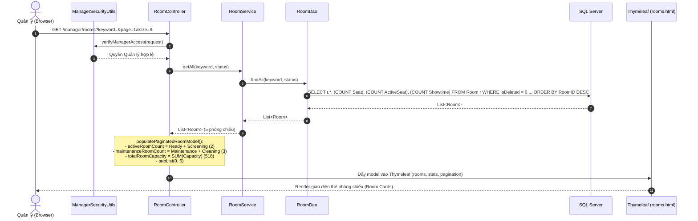
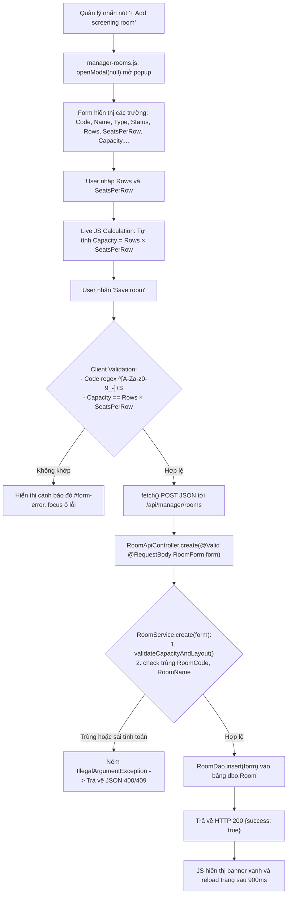
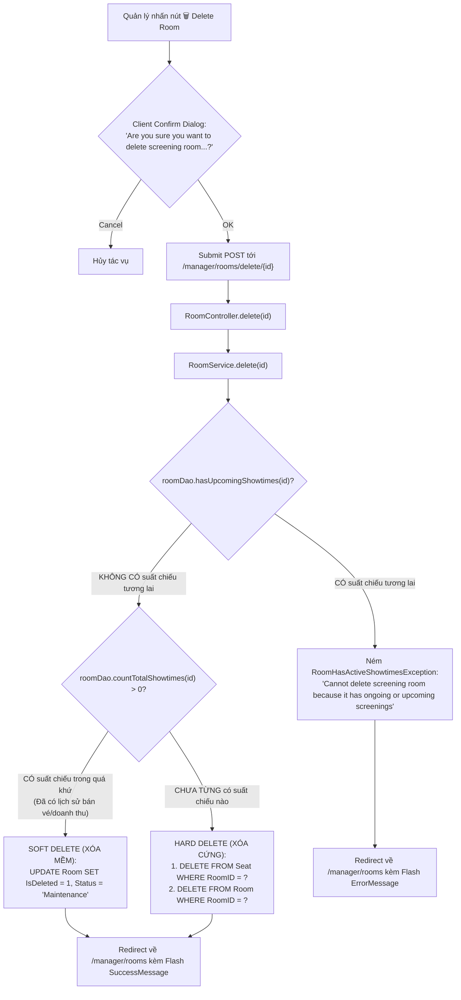
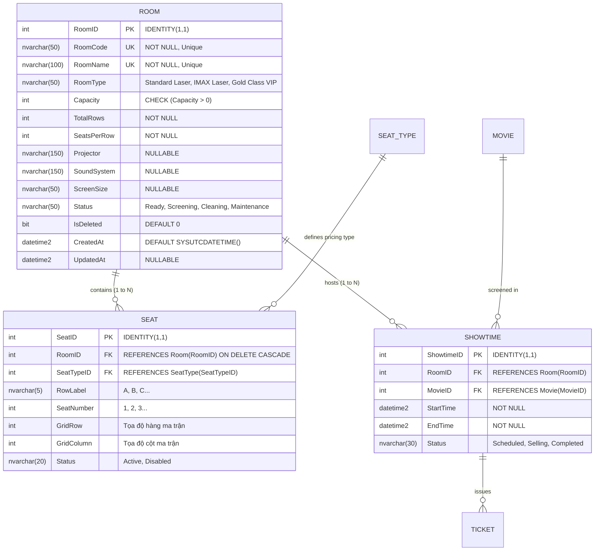

# BÁO CÁO REVIEW TOÀN DIỆN MÃ NGUỒN VÀ BỘ ĐỀ VẤN ĐÁP: SCREENING ROOM MANAGEMENT (SCREEN 56) – CINEORA SYSTEM

---

## PART 1 – ARCHITECTURE & RELATED FILES

### 1. Sơ đồ kiến trúc phân lớp thực tế

Màn hình **Screening Room Management** (Screen 56) quản lý toàn bộ phòng chiếu, thông số kỹ thuật phần cứng (máy chiếu, âm thanh, kích thước màn hình), cấu hình sơ đồ ghế và trạng thái vận hành của cụm rạp:

```
[Trình duyệt Quản lý (Manager Browser)]
  │
  ├─► (1) Tải trang / Tìm kiếm: GET /manager/rooms?keyword=...
  │     └─► RoomController.java ──► RoomService.java ──► RoomDao.java ──► DB (SQL Server)
  │           └─► Trả về View Thymeleaf: templates/manager/rooms.html (SSR)
  │
  ├─► (2) Nút "Seat map ( X )":
  │     └─► Điều hướng GET /manager/seats?roomId={id} ──► Mở màn hình Seat Map Management
  │
  ├─► (3) Nút "Showtimes":
  │     └─► Điều hướng GET /manager/showtimes?roomId={id}&startDate=... ──► Mở Lịch chiếu lọc theo phòng
  │
  ├─► (4) Thêm / Sửa phòng (Modal Configuration):
  │     ├─► [Ưu tiên] AJAX fetch(POST/PUT) ──► RoomApiController.java (/api/manager/rooms)
  │     │     └─► RoomService.java (Kiểm tra Capacity = Rows × SeatsPerRow) ──► RoomDao.java
  │     │           └─► JSON {success: true} ──► Reload trang
  │     └─► [Fallback] Form POST /manager/rooms/save ──► RoomController.java
  │
  ├─► (5) Đổi trạng thái sang Bảo trì (Maintenance):
  │     └─► AJAX fetch(PATCH) ──► RoomApiController.java (/api/manager/rooms/deactivate/{id})
  │           └─► RoomService.java (Chặn nếu có suất chiếu tương lai - BR-52) ──► RoomDao.update()
  │
  └─► (6) Xóa phòng chiếu (Nút 🗑):
        └─► Form POST /manager/rooms/delete/{id} ──► RoomController.java
              └─► RoomService.delete():
                    ├─ Có suất chiếu tương lai ──► CHẶN (Ném RoomHasActiveShowtimesException)
                    ├─ Đã có lịch sử chiếu cũ ──► SOFT DELETE (IsDeleted = 1, Status = 'Maintenance')
                    └─ Chưa từng có suất chiếu ──► HARD DELETE (Xóa Seat -> Xóa Room)
```

---

### 2. Bảng tổng hợp các file thực tế trong mã nguồn

| Layer | File Path | Class / Function Chính | Trách Nhiệm Nghiệp Vụ |
|:---|:---|:---|:---|
| **View (HTML)** | [rooms.html](file:///c:/Users/hoang/Downloads/SWP_RapPhim/src/main/resources/templates/manager/rooms.html) | Template Thymeleaf | Render 4 thẻ KPI, ô tìm kiếm, Room Grid Cards, Modal cấu hình phòng chiếu đa năng |
| **Client Script** | [manager-rooms.js](file:///c:/Users/hoang/Downloads/SWP_RapPhim/src/main/resources/static/js/manager-rooms.js) | JavaScript Client | Tính toán live `Capacity = Rows × SeatsPerRow`, kiểm tra mismatch, fetch API CRUD |
| **Style (CSS)** | [manager-rooms.css](file:///c:/Users/hoang/Downloads/SWP_RapPhim/src/main/resources/static/css/manager-rooms.css) | Stylesheet | Định dạng Room card hero gradient, status pills (`Ready`, `Screening`, `Cleaning`, `Maintenance`) |
| **Controller (MVC)**| [RoomController.java](file:///c:/Users/hoang/Downloads/SWP_RapPhim/src/main/java/com/cinema/controller/RoomController.java) | `RoomController` | Xử lý `GET /manager/rooms`, fallback `POST /manager/rooms/save`, `POST /delete/{id}` |
| **Controller (API)**| [RoomApiController.java](file:///c:/Users/hoang/Downloads/SWP_RapPhim/src/main/java/com/cinema/controller/api/RoomApiController.java) | `RoomApiController` | REST API: `GET /api/manager/rooms`, `POST`, `PUT /{id}`, `PATCH /deactivate/{id}`, `DELETE /{id}` |
| **Service Layer** | [RoomService.java](file:///c:/Users/hoang/Downloads/SWP_RapPhim/src/main/java/com/cinema/service/RoomService.java) | `RoomService` | Ràng buộc Capacity với Seat Map, BR-52 (chặn deactive khi có showtime), xử lý Soft/Hard Delete |
| **DAO Layer** | [RoomDao.java](file:///c:/Users/hoang/Downloads/SWP_RapPhim/src/main/java/com/cinema/dao/RoomDao.java) | `RoomDao` | Thực thi Spring `JdbcTemplate` với câu lệnh SQL Server, hỗ trợ khóa bi quan `lockRoomForUpdate` |
| **DTO Object** | [RoomForm.java](file:///c:/Users/hoang/Downloads/SWP_RapPhim/src/main/java/com/cinema/dto/RoomForm.java) | `RoomForm` | Binding đối tượng từ Form/Modal: mã phòng, tên, loại phòng, hàng/cột, sức chứa, máy chiếu, âm thanh |
| **Entity / Model** | [Room.java](file:///c:/Users/hoang/Downloads/SWP_RapPhim/src/main/java/com/cinema/model/Room.java) | `Room` | Đại diện cho thực thể bảng `dbo.Room`, đính kèm số ghế thực tế và số suất chiếu |
| **Liên kết Ghế** | [SeatDao.java](file:///c:/Users/hoang/Downloads/SWP_RapPhim/src/main/java/com/cinema/dao/SeatDao.java), [Seat.java](file:///c:/Users/hoang/Downloads/SWP_RapPhim/src/main/java/com/cinema/model/Seat.java) | `SeatDao` | Quản lý bảng `dbo.Seat`, đối chiếu số ghế thực tế với Capacity của Room |
| **Liên kết Suất chiếu**| [ShowtimeService.java](file:///c:/Users/hoang/Downloads/SWP_RapPhim/src/main/java/com/cinema/service/ShowtimeService.java) | `ShowtimeService` | Kiểm tra phòng có sẵn sàng (`isRoomReadyForShowtime`), tính Cleaning Buffer 15 phút (BR-09) |
| **Bảo Mật** | [ManagerSecurityUtils.java](file:///c:/Users/hoang/Downloads/SWP_RapPhim/src/main/java/com/cinema/util/ManagerSecurityUtils.java) | `ManagerSecurityUtils` | Kiểm tra session quản lý (`ROLE_MANAGER`/`ADMIN`) trước mọi tác vụ |
| **Database Schema**| [00_full_database.sql](file:///c:/Users/hoang/Downloads/SWP_RapPhim/database/00_full_database.sql#L264-L290) | Bảng `dbo.Room` | DDL bảng `Room`, ràng buộc `UQ_Room_RoomCode`, `UQ_Room_RoomName`, `CK_Room_Capacity` |

---

## PART 2 – PAGE LOADING FLOW (`GET /manager/rooms`)



### Các bước thực thi chi tiết trong mã nguồn:
1. **Tiếp nhận Request**: Manager gửi `GET /manager/rooms`.
2. **Kiểm tra Phân quyền**: [RoomController.java: dòng 45](file:///c:/Users/hoang/Downloads/SWP_RapPhim/src/main/java/com/cinema/controller/RoomController.java#L45) gọi `ManagerSecurityUtils.verifyManagerAccess(request)`.
3. **Truy vấn Danh sách Phòng và Thống kê Phụ trợ**:
   - Gọi `roomService.getAll(keyword, status)` $\rightarrow$ `roomDao.findAll(keyword, status)`.
   - File: [RoomDao.java: dòng 61-85](file:///c:/Users/hoang/Downloads/SWP_RapPhim/src/main/java/com/cinema/dao/RoomDao.java#L61-L85). Câu lệnh SQL sử dụng subqueries:
     ```sql
     SELECT r.*,
         (SELECT COUNT(*) FROM Seat s WHERE s.RoomID = r.RoomID) AS SeatCount,
         (SELECT COUNT(*) FROM Seat s WHERE s.RoomID = r.RoomID AND s.Status = 'Active') AS ActiveSeatCount,
         (SELECT COUNT(*) FROM Showtime sh WHERE sh.RoomID = r.RoomID) AS ShowtimeCount
     FROM Room r
     WHERE COALESCE(r.IsDeleted, 0) = 0
     ORDER BY r.RoomID DESC
     ```
   - **Lọc Soft-deleted**: Mệnh đề `COALESCE(r.IsDeleted, 0) = 0` tự động loại bỏ các phòng đã bị xóa mềm.
4. **Tính toán Chỉ số Thống kê trong Java**:
   - File: [RoomController.java: dòng 54-62](file:///c:/Users/hoang/Downloads/SWP_RapPhim/src/main/java/com/cinema/controller/RoomController.java#L54-L62):
     - `activeRoomCount`: Đếm số phòng có status là `Ready` hoặc `Screening`.
     - `maintenanceRoomCount`: Đếm số phòng có status là `Maintenance` hoặc `Cleaning`.
     - `totalRoomCapacity`: Dùng `rooms.stream().mapToLong(Room::getCapacity).sum()` tính tổng sức chứa.
5. **Phân trang In-Memory**: [RoomController.java: dòng 64-70](file:///c:/Users/hoang/Downloads/SWP_RapPhim/src/main/java/com/cinema/controller/RoomController.java#L64-L70) chia trang theo `size = 9` phòng/trang.
6. **Render HTML**: Thymeleaf biên dịch template [rooms.html](file:///c:/Users/hoang/Downloads/SWP_RapPhim/src/main/resources/templates/manager/rooms.html) gửi về trình duyệt.

---

## PART 3 – DASHBOARD STATISTICS (4 THẺ THỐNG KÊ TRÊN UI)

Đối chiếu trực tiếp với ảnh chụp giao diện thực tế của người dùng:

| Thẻ Thống Kê | Giá trị trên UI | Thuộc tính Model | Phương thức tính toán trong Code | Ý nghĩa nghiệp vụ thực tế |
|:---|:---:|:---|:---|:---|
| **Total screening rooms** | **5** | `totalFilteredCount` | `rooms.size()` sau khi lọc từ `findAll()` ([RoomController.java#L53](file:///c:/Users/hoang/Downloads/SWP_RapPhim/src/main/java/com/cinema/controller/RoomController.java#L53)) | Tổng số phòng chiếu đang tồn tại (không tính phòng đã bị xóa mềm `IsDeleted = 1`). Khi gõ từ khóa tìm kiếm, con số này thay đổi theo kết quả lọc (`Matching the current filter`). |
| **Active** | **2** | `activeRoomCount` | `rooms.stream().filter(r -> "Ready".equalsIgnoreCase(r.getStatus()) \|\| "Screening".equalsIgnoreCase(r.getStatus())).count()` ([L54-L56](file:///c:/Users/hoang/Downloads/SWP_RapPhim/src/main/java/com/cinema/controller/RoomController.java#L54-L56)) | Số phòng sẵn sàng đón khách hoặc đang trong giờ chiếu phim (`Ready or screening now`). |
| **Maintenance / Cleaning**| **3** | `maintenanceRoomCount` | `rooms.stream().filter(r -> "Maintenance".equalsIgnoreCase(r.getStatus()) \|\| "Cleaning".equalsIgnoreCase(r.getStatus())).count()` ([L57-L59](file:///c:/Users/hoang/Downloads/SWP_RapPhim/src/main/java/com/cinema/controller/RoomController.java#L57-L59)) | Số phòng tạm dừng hoạt động để dọn dẹp, bảo trì máy chiếu/âm thanh. Phòng ở trạng thái này **bị chặn không cho phép lên lịch chiếu mới** (`Unavailable for new showtimes`). |
| **Actual total seats** | **516** | `totalRoomCapacity` | `rooms.stream().mapToLong(r -> r.getCapacity() != null ? r.getCapacity() : 0).sum()` ([L60-L62](file:///c:/Users/hoang/Downloads/SWP_RapPhim/src/main/java/com/cinema/controller/RoomController.java#L60-L62)) | Tổng sức chứa thiết kế của các phòng chiếu hiện tại (`Sum of room capacities`). |

---

## PART 4 – SEARCH AND CLEAR

- **Ô tìm kiếm Keyword**:
  - File: [rooms.html: dòng 547-548](file:///c:/Users/hoang/Downloads/SWP_RapPhim/src/main/resources/templates/manager/rooms.html#L547-L548)
  - Thẻ: `<input type="text" placeholder="Search by room name or code..." th:value="${keyword}" name="keyword" id="keyword" />`
- **Nút "Search"**: Submit form bằng HTTP `GET /manager/rooms`.
- **Nút "Clear"**: Thẻ link `<a th:href="@{/manager/rooms}">` đặt lại URL gốc.
- **Xử lý SQL tại DAO**:
  [RoomDao.java: dòng 71-76](file:///c:/Users/hoang/Downloads/SWP_RapPhim/src/main/java/com/cinema/dao/RoomDao.java#L71-L76)
  ```sql
  AND (r.RoomName LIKE ? OR r.RoomCode LIKE ?)
  ```
  - Tìm kiếm đồng thời trên cả **Tên phòng chiếu** (`RoomName`) và **Mã phòng** (`RoomCode`).
  - Sử dụng tham số hóa `?` của PreparedStatement với `%keyword%`, chống SQL Injection tuyệt đối.

---

## PART 5 – ADD SCREENING ROOM FLOW (THÊM PHÒNG MỚI)



### Bảng đối chiếu các trường trong Form cấu hình phòng:

| UI Field Label | HTML Input Name | DTO Field (`RoomForm`) | Database Column (`dbo.Room`) | Kiểu dữ liệu | Ràng buộc nghiệp vụ |
|:---|:---|:---|:---|:---|:---|
| **Room code** | `roomCode` | `roomCode` | `RoomCode` | `NVARCHAR(50)` | Bắt buộc, Max 20 ký tự, regex `^[A-Za-z0-9_-]+$`, **DUY NHẤT (UQ)** |
| **Room name** | `roomName` | `roomName` | `RoomName` | `NVARCHAR(100)` | Bắt buộc, Max 100 ký tự, **DUY NHẤT (UQ)** |
| **Room type** | `roomType` | `roomType` | `RoomType` | `NVARCHAR(50)` | Bắt buộc (`Standard Laser`, `IMAX Laser`, `Gold Class VIP`) |
| **Operating status**| `status` | `status` | `Status` | `NVARCHAR(50)` | Bắt buộc (`Ready`, `Screening`, `Cleaning`, `Maintenance`) |
| **Number of rows** | `totalRows` | `totalRows` | `TotalRows` | `INT` | Bắt buộc, $1 \le \text{rows} \le 100$ |
| **Seats per row** | `seatsPerRow` | `seatsPerRow` | `SeatsPerRow` | `INT` | Bắt buộc, $1 \le \text{seats} \le 100$ |
| **Capacity** | `capacity` | `capacity` | `Capacity` | `INT` | Bắt buộc, **BẮT BUỘC BẰNG** `totalRows × seatsPerRow` |
| **Screen size** | `screenSize` | `screenSize` | `ScreenSize` | `NVARCHAR(50)` | Tùy chọn (ví dụ: `24m x 14m`) |
| **Projector** | `projector` | `projector` | `Projector` | `NVARCHAR(150)`| Tùy chọn (ví dụ: `Barco SP2K-11 Laser`) |
| **Sound system** | `soundSystem` | `soundSystem` | `SoundSystem` | `NVARCHAR(150)`| Tùy chọn (ví dụ: `Dolby 7.1 Studio Audio`) |
| **Description** | `description` | `description` | `Description` | `NVARCHAR(500)`| Tùy chọn, ghi chú trang thiết bị phòng chiếu |

---

## PART 6 – ROOM CARD RENDERING

Mỗi phòng chiếu trên giao diện được hiển thị dưới dạng một thẻ Card trực quan:

1. **Phần Hero Header (Màu nền Gradient sẫm)**:
   - **Status Pill (Trạng thái)**:
     - `● READY FOR GUESTS`: Màu xanh lá (`#34D399`) khi `status = 'Ready'`.
     - `● SCREENING`: Màu đỏ cam sáng khi `status = 'Screening'`.
     - `● CLEANING`: Màu vàng hổ phách khi `status = 'Cleaning'`.
     - `● MAINTENANCE`: Màu đỏ nhạt viền đỏ khi `status = 'Maintenance'`.
   - **Tech Pill (Loại phòng)**: Hiển thị `room.roomType` (ví dụ: `IMAX LASER`, `GOLD CLASS VIP`, `STANDARD LASER`).
   - **Tên phòng & Mã phòng**: In đậm tên phòng lớn (`room.roomName`) và dòng phụ `room.roomCode • room.capacity seats`.
2. **Phần Body Specs (Lưới thông số kỹ thuật 2 cột)**:
   - 📽 **Projector**: `room.projector`
   - 🔊 **Sound**: `room.soundSystem`
   - 📐 **Screen**: `room.screenSize`
   - 💺 **Capacity**: `room.capacity + ' seats'`
   - Dòng mô tả chi tiết: `room.description`
3. **Phần Footer (Các nút hành động)**:
   - Nút `Seat map ( X )`: Điều hướng sang sơ đồ ghế.
   - Nút `Showtimes`: Điều hướng sang lịch chiếu.
   - Nút `✎` (Edit): Mở modal chỉnh sửa phòng.
   - Nút `🗑` (Delete): Xóa phòng chiếu.

---

## PART 7 – SEAT MAP BUTTON FLOW (NÚT "SEAT MAP ( 80 )")

```
[Thẻ Phòng Chiếu]
  │
  └─► Nút bấm: <a th:href="@{'/manager/seats?roomId=' + ${room.roomId}}"> Seat map ( 80 ) </a>
        │
        └─► Trình duyệt gửi GET /manager/seats?roomId={id}
              └─► SeatController.java (bắt roomId)
                    └─► SeatDao.findByRoomId(roomId) ──► SELECT * FROM Seat WHERE RoomID = ?
                          └─► Nạp danh sách ghế thực tế (RowLabel, SeatNumber, GridRow, GridColumn, SeatType)
                                └─► Render giao diện ma trận ghế (Seat Map Grid)
```

### Quan hệ giữa Room Capacity và Seat Map:
- **Câu hỏi vấn đáp**: *"Tại sao nút bấm trên UI hiển thị 'Seat map ( 80 )'?"*
- **Trả lời**: Con số `80` trong nút bấm được lấy từ thuộc tính `${room.capacity}` ([rooms.html: dòng 607](file:///c:/Users/hoang/Downloads/SWP_RapPhim/src/main/resources/templates/manager/rooms.html#L607)).
- **Cơ chế đồng bộ chặt chẽ (Integrity Enforcement)**:
  Khi phòng đã được khởi tạo các ghế thực tế trong bảng `dbo.Seat`:
  Tại [RoomService.java: dòng 129-134](file:///c:/Users/hoang/Downloads/SWP_RapPhim/src/main/java/com/cinema/service/RoomService.java#L129-L134):
  ```java
  if (!form.getCapacity().equals(existingSeats.size())) {
      throw new IllegalArgumentException(
          "Room capacity (" + form.getCapacity() + " seats) does not match the configured Seat Map ("
          + existingSeats.size() + " seats). Please update the Seat Map before changing room capacity.");
  }
  ```
  Hệ thống **BẮT BUỘC SỨC CHỨA CỦA PHÒNG PHẢI KHỚP 100% VỚI SỐ LƯỢNG GHẾ CẤU HÌNH THỰC TẾ TRONG SEAT MAP**! Người quản lý không thể tự ý sửa capacity trên form thành 100 nếu trong Seat Map mới chỉ cấu hình 80 ghế.

---

## PART 8 – SHOWTIMES BUTTON FLOW (NÚT "SHOWTIMES")

- **Thẻ HTML**:
  [rooms.html: dòng 609-611](file:///c:/Users/hoang/Downloads/SWP_RapPhim/src/main/resources/templates/manager/rooms.html#L609-L611)
  ```html
  <a th:href="@{'/manager/showtimes?roomId=' + ${room.roomId} + '&startDate=' + ${#temporals.format(#temporals.createNow(), 'yyyy-MM-dd')}}"
     class="btn btn-secondary btn-sm" title="View showtimes for this room">
      <span class="material-symbols-outlined" style="font-size:18px">schedule</span> Showtimes
  </a>
  ```
- **Hành vi**:
  Chuyển hướng trực tiếp sang màn hình Quản lý Suất chiếu (`Showtime Management`) với 2 query parameter:
  1. `roomId={id}`: Tự động lọc lịch chiếu riêng của phòng chiếu này.
  2. `startDate={today}`: Lấy ngày hiện tại làm mốc bắt đầu xem lịch.
- **Câu hỏi vấn đáp**: *"Nếu phòng đang ở trạng thái Maintenance thì các suất chiếu đã tạo trước đó có bị hủy không?"*
  - **Trả lời**: **Không bị hủy tự động**. Các suất chiếu đã lên lịch vẫn tồn tại trong database để bảo vệ vé của khách hàng đã mua. Nhưng hệ thống sẽ **ngăn chặn không cho phòng chuyển sang Maintenance** nếu phòng đó đang có suất chiếu trong tương lai ([RoomService.java: dòng 104-110](file:///c:/Users/hoang/Downloads/SWP_RapPhim/src/main/java/com/cinema/service/RoomService.java#L104-L110)). Muốn chuyển sang Maintenance, Quản lý bắt buộc phải hủy hoặc dời lịch các suất chiếu đó trước.

---

## PART 9 – EDIT ROOM FLOW (NÚT ✎ CHỈNH SỬA PHÒNG)

1. **Mở Form**: Quản lý nhấn icon bút chì `✎`.
2. **Nạp dữ liệu qua AJAX**:
   [manager-rooms.js: dòng 168-182](file:///c:/Users/hoang/Downloads/SWP_RapPhim/src/main/resources/static/js/manager-rooms.js#L168-L182) gửi `GET /api/manager/rooms/{id}`. Nhận dữ liệu JSON và điền vào các ô input trong Modal, đổi tiêu đề thành `Screening room configuration — [Tên phòng]`.
3. **Các ràng buộc nghiệp vụ tối quan trọng khi sửa (Business Rules)**:
   - **Quy tắc 1 (BR-52 - Khóa thay đổi cấu trúc khi có suất chiếu)**:
     Tại [RoomService.java: dòng 112-119](file:///c:/Users/hoang/Downloads/SWP_RapPhim/src/main/java/com/cinema/service/RoomService.java#L112-L119):
     Nếu phòng đang có suất chiếu trong tương lai (`hasUpcomingShowtimes == true`), hệ thống **TỪ CHỐI THAY ĐỔI Capacity, TotalRows, SeatsPerRow**! Điều này ngăn chặn việc làm vỡ cấu trúc vé của các khách hàng đã đặt chỗ.
   - **Quy tắc 2 (Tọa độ ghế không vượt quá biên phòng)**:
     Tại [RoomService.java: dòng 136-143](file:///c:/Users/hoang/Downloads/SWP_RapPhim/src/main/java/com/cinema/service/RoomService.java#L136-L143):
     `totalRows` và `seatsPerRow` không được phép nhỏ hơn tọa độ hàng lớn nhất (`maxRow`) và cột lớn nhất (`maxCol`) của các ghế đã tồn tại trong Seat Map.

---

## PART 10 – DELETE ROOM FLOW (NÚT 🗑 XÓA PHÒNG)

Hệ thống triển khai cơ chế **Xử lý Xóa Thông Minh (Intelligent Dual-Mode Delete)**:



### Chứng minh bằng mã nguồn:
- File: [RoomService.java: dòng 196-215](file:///c:/Users/hoang/Downloads/SWP_RapPhim/src/main/java/com/cinema/service/RoomService.java#L196-L215)
- **Nhánh 1 (Chặn xóa)**: Nếu `hasUpcomingShowtimes(roomId) == true`, quăng `RoomHasActiveShowtimesException`.
- **Nhánh 2 (Xóa mềm - Soft Delete)**: Nếu phòng đã có lịch sử suất chiếu trong quá khứ (`countTotalShowtimes > 0`), gọi `roomDao.softDelete(roomId)`. Cập nhật `IsDeleted = 1, Status = 'Maintenance'`. Bản ghi bị ẩn khỏi giao diện nhưng được bảo toàn 100% trong database để phục vụ báo cáo tài chính, doanh thu vé và lịch sử booking của khách hàng.
- **Nhánh 3 (Xóa cứng - Hard Delete)**: Nếu phòng mới tạo chưa từng xếp lịch chiếu nào, gọi `roomDao.deleteSeatsByRoomId(roomId)` để xóa sạch ghế, sau đó gọi `roomDao.delete(roomId)` để xóa bản ghi phòng.

---

## PART 11 – DATABASE RELATIONSHIPS & ERD



---

## PART 12 – CAPACITY, STATUS & SHOWTIME CONSISTENCY (TÍNH NHẤT QUÁN TOÀN CỤC)

### 1. Công thức Xung đột Lịch chiếu và Dọn dẹp phòng (BR-09 & Cleaning Buffer)
Trong phân hệ Showtime, mối liên kết với Screening Room được quản lý bằng quy tắc:
$$\text{EndTime} = \text{StartTime} + \text{MovieDuration}$$
$$\text{RoomAvailableTime} = \text{EndTime} + 15\text{ phút Cleaning Buffer}$$

- **Hằng số trong code**: [ShowtimeService.java: dòng 36](file:///c:/Users/hoang/Downloads/SWP_RapPhim/src/main/java/com/cinema/service/ShowtimeService.java#L36)
  `public static final int CLEANING_BUFFER_MINUTES = 15;`
- **Kiểm tra phòng sẵn sàng (BR-08 & P1-01)**:
  Tại [RoomService.java: dòng 190-193](file:///c:/Users/hoang/Downloads/SWP_RapPhim/src/main/java/com/cinema/service/RoomService.java#L190-L193):
  ```java
  public boolean isRoomReadyForShowtime(int roomId) {
      Room room = getById(roomId);
      return room.isActiveForShowtimes() && room.getActiveSeatCount() > 0;
  }
  ```
  Một phòng chiếu chỉ được phép tạo suất chiếu khi:
  1. Trạng thái phòng là `Ready` hoặc `Screening` (Phòng `Maintenance` và `Cleaning` bị từ chối thẳng thừng!).
  2. Phòng đã được cấu hình sơ đồ ghế và có ít nhất 1 ghế đang kích hoạt (`activeSeatCount > 0`).

---

## PART 13 – SECURITY, VALIDATION & TRANSACTIONS

1. **Kiểm soát Phân quyền (RBAC)**: Toàn bộ thao tác CRUD phòng chiếu đều bắt buộc quyền `ROLE_MANAGER` hoặc `ADMIN` thông qua `ManagerSecurityUtils.verifyManagerAccess(request)`.
2. **Khóa Bi Quan (Pessimistic Locking chống Race Condition)**:
   Tại [RoomDao.java: dòng 172-175](file:///c:/Users/hoang/Downloads/SWP_RapPhim/src/main/java/com/cinema/dao/RoomDao.java#L172-L175):
   ```sql
   SELECT RoomID FROM Room WITH (UPDLOCK, HOLDLOCK) WHERE RoomID = ?
   ```
   Phương thức `lockRoomForUpdate(roomId)` khóa bản ghi phòng trong suốt transaction khi tạo lịch chiếu hoặc cập nhật sơ đồ ghế, ngăn ngừa triệt để xung đột khi 2 Manager cùng thao tác đồng thời.
3. **Transaction Boundaries**: Tất cả các method `create`, `update`, `deactivate`, `delete` trong `RoomService` đều được đánh dấu `@Transactional`, đảm bảo tính nguyên tố ACID.

---

## PART 14 – BUGS, RISKS & EDGE CASES (ĐÁNH GIÁ MÃ NGUỒN)

| STT | Vấn đề phát hiện | Phân loại | Bằng chứng mã nguồn | Đánh giá & Hướng trả lời khi vấn đáp |
|:---:|:---|:---:|:---|:---|
| 1 | Ràng buộc Sức chứa khớp ma trận ghế | **PASS** | [RoomService.java#L41-L62](file:///c:/Users/hoang/Downloads/SWP_RapPhim/src/main/java/com/cinema/service/RoomService.java#L41-L62), [manager-rooms.js#L238](file:///c:/Users/hoang/Downloads/SWP_RapPhim/src/main/resources/static/js/manager-rooms.js#L238) | Rất chặt chẽ: `Capacity == TotalRows × SeatsPerRow` (ở phòng mới) và `Capacity == Seat Map size` (ở phòng đã có ghế). |
| 2 | Chặn đổi cấu trúc phòng khi có suất chiếu tương lai | **PASS** | [RoomService.java#L112-L119](file:///c:/Users/hoang/Downloads/SWP_RapPhim/src/main/java/com/cinema/service/RoomService.java#L112-L119) | Bảo toàn toàn vẹn dữ liệu đặt vé của khách hàng. |
| 3 | Chặn chuyển sang Maintenance khi có suất chiếu (BR-52) | **PASS** | [RoomService.java#L104-L110](file:///c:/Users/hoang/Downloads/SWP_RapPhim/src/main/java/com/cinema/service/RoomService.java#L104-L110) | Không cho phép đưa phòng vào bảo trì khi khách hàng đã mua vé xem phim. |
| 4 | Xử lý Xóa phòng thông minh (Soft/Hard Delete) | **PASS** | [RoomService.java#L196-L215](file:///c:/Users/hoang/Downloads/SWP_RapPhim/src/main/java/com/cinema/service/RoomService.java#L196-L215) | Bảo lưu lịch sử doanh thu bằng Soft Delete nếu đã có suất chiếu trong quá khứ. |
| 5 | Phân trang In-Memory | **RISK** | [RoomController.java#L68-L70](file:///c:/Users/hoang/Downloads/SWP_RapPhim/src/main/java/com/cinema/controller/RoomController.java#L68-L70) | Một cụm rạp thường có từ 5 đến 20 phòng chiếu nên phân trang In-Memory không gây ảnh hưởng bộ nhớ. Tuy nhiên nếu chuỗi rạp mở rộng lên hàng nghìn phòng, cần chuyển sang `OFFSET / FETCH` tại SQL. |

---

## PART 15 – MOCK ORAL DEFENSE: 50 CÂU HỎI VẤN ĐÁP CÙNG ĐÁP ÁN

### NHÓM A: 15 CÂU HỎI CƠ BẢN (MỨC ĐỘ HIỂU CODE)

#### Câu 1: Màn hình Screening Room Management được điều khiển bởi Controller nào và file HTML nằm ở đâu?
- **Trả lời mẫu (30s):** Được điều khiển bởi `RoomController` tại method `list` gắn `@GetMapping("/manager/rooms")`. View template là file `src/main/resources/templates/manager/rooms.html`.
- **Chứng minh:** [RoomController.java: dòng 38-49](file:///c:/Users/hoang/Downloads/SWP_RapPhim/src/main/java/com/cinema/controller/RoomController.java#L38-L49).

#### Câu 2: Thông tin phòng chiếu được lưu trữ trong bảng nào của CSDL?
- **Trả lời mẫu (30s):** Bảng `dbo.Room`. Các cột chính gồm `RoomID` (PK tự tăng), `RoomCode` (Unique), `RoomName` (Unique), `RoomType`, `Capacity`, `TotalRows`, `SeatsPerRow`, `Projector`, `SoundSystem`, `ScreenSize`, `Status`, `IsDeleted`.
- **Chứng minh:** [00_full_database.sql: dòng 264-280](file:///c:/Users/hoang/Downloads/SWP_RapPhim/database/00_full_database.sql#L264-L280).

#### Câu 3: Bốn thẻ thống kê trên cùng của trang hiển thị những số liệu gì?
- **Trả lời mẫu (30s):** 
  1. `Total screening rooms`: Tổng số phòng chiếu khớp bộ lọc (không tính phòng đã xóa mềm).
  2. `Active`: Số phòng có status là `Ready` hoặc `Screening`.
  3. `Maintenance / Cleaning`: Số phòng có status là `Maintenance` hoặc `Cleaning`.
  4. `Actual total seats`: Tổng sức chứa thiết kế của các phòng chiếu hiện tại.
- **Chứng minh:** [RoomController.java: dòng 53-62](file:///c:/Users/hoang/Downloads/SWP_RapPhim/src/main/java/com/cinema/controller/RoomController.java#L53-L62).

#### Câu 4: Khi bấm nút "+ Add screening room", giao diện mở ra bằng cách nào?
- **Trả lời mẫu (30s):** Gọi JavaScript trong `manager-rooms.js` mở Modal `#room-modal`, đặt tiêu đề "Screening room configuration", reset các ô input và gán trạng thái mặc định là "Ready", loại phòng mặc định là "Standard Laser".
- **Chứng minh:** [manager-rooms.js: dòng 143-152](file:///c:/Users/hoang/Downloads/SWP_RapPhim/src/main/resources/static/js/manager-rooms.js#L143-L152).

#### Câu 5: Sức chứa của phòng (Capacity) có công thức tính bắt buộc như thế nào?
- **Trả lời mẫu (30s):** Bắt buộc: $\text{Capacity} = \text{TotalRows (Số hàng dọc)} \times \text{SeatsPerRow (Số ghế mỗi hàng ngang)}$. Cả Frontend JS và Backend `RoomService.validateCapacityAndLayout` đều kiểm tra công thức này.
- **Chứng minh:** [RoomService.java: dòng 54-61](file:///c:/Users/hoang/Downloads/SWP_RapPhim/src/main/java/com/cinema/service/RoomService.java#L54-L61).

#### Câu 6: Mã phòng chiếu (Room Code) có bắt buộc duy nhất không?
- **Trả lời mẫu (30s):** Có. CSDL có ràng buộc `CONSTRAINT UQ_Room_RoomCode UNIQUE`. Ngoài ra `RoomService` gọi `roomDao.existsByRoomCode` để kiểm tra trước khi ghi xuống CSDL.
- **Chứng minh:** [00_full_database.sql: dòng 266](file:///c:/Users/hoang/Downloads/SWP_RapPhim/database/00_full_database.sql#L266) và [RoomService.java: dòng 67-73](file:///c:/Users/hoang/Downloads/SWP_RapPhim/src/main/java/com/cinema/service/RoomService.java#L67-L73).

#### Câu 7: Bấm nút "Seat map ( 80 )" trên room card thì chuyển đi đâu?
- **Trả lời mẫu (30s):** Đây là thẻ liên kết `<a th:href="@{'/manager/seats?roomId=' + ${room.roomId}}">`, chuyển hướng sang màn hình Quản lý sơ đồ ghế (`Seat Map Management`), lọc riêng theo phòng chiếu đó.
- **Chứng minh:** [rooms.html: dòng 605-608](file:///c:/Users/hoang/Downloads/SWP_RapPhim/src/main/resources/templates/manager/rooms.html#L605-L608).

#### Câu 8: Bấm nút "Showtimes" trên room card thì chuyển đi đâu?
- **Trả lời mẫu (30s):** Chuyển hướng sang màn hình Quản lý Lịch chiếu: `/manager/showtimes?roomId={id}&startDate={today}` để xem lịch chiếu của riêng phòng đó bắt đầu từ hôm nay.
- **Chứng minh:** [rooms.html: dòng 609-611](file:///c:/Users/hoang/Downloads/SWP_RapPhim/src/main/resources/templates/manager/rooms.html#L609-L611).

#### Câu 9: Trạng thái vận hành của phòng chiếu gồm những giá trị nào?
- **Trả lời mẫu (30s):** Gồm 4 giá trị: `Ready` (Sẵn sàng đón khách), `Screening` (Đang chiếu phim), `Cleaning` (Đang dọn vệ sinh), `Maintenance` (Bảo trì kỹ thuật).
- **Chứng minh:** [RoomService.java: dòng 23](file:///c:/Users/hoang/Downloads/SWP_RapPhim/src/main/java/com/cinema/service/RoomService.java#L23).

#### Câu 10: Nút "Clear" trên thanh tìm kiếm làm gì?
- **Trả lời mẫu (30s):** Thẻ liên kết `<a th:href="@{/manager/rooms}">` tải lại trang với URL gốc, xóa bỏ từ khóa tìm kiếm và hiển thị lại toàn bộ danh sách phòng.
- **Chứng minh:** [rooms.html: dòng 551](file:///c:/Users/hoang/Downloads/SWP_RapPhim/src/main/resources/templates/manager/rooms.html#L551).

#### Câu 11: Phòng có trạng thái Maintenance có được xếp lịch chiếu phim không?
- **Trả lời mẫu (30s):** **Không được phép!** Phương thức `isRoomReadyForShowtime` chỉ chấp nhận phòng có trạng thái `Ready` hoặc `Screening`. Phòng `Maintenance` bị từ chối tạo suất chiếu.
- **Chứng minh:** [RoomService.java: dòng 190-193](file:///c:/Users/hoang/Downloads/SWP_RapPhim/src/main/java/com/cinema/service/RoomService.java#L190-L193).

#### Câu 12: Thời gian đệm dọn phòng (Cleaning Buffer) giữa 2 suất chiếu là bao nhiêu phút?
- **Trả lời mẫu (30s):** Là 15 phút, được khai báo cố định tại `ShowtimeService.CLEANING_BUFFER_MINUTES = 15`. Suất chiếu sau phải bắt đầu sau khi suất chiếu trước kết thúc ít nhất 15 phút.
- **Chứng minh:** [ShowtimeService.java: dòng 36](file:///c:/Users/hoang/Downloads/SWP_RapPhim/src/main/java/com/cinema/service/ShowtimeService.java#L36).

#### Câu 13: Khi bấm nút Edit (✎), dữ liệu phòng được lấy lên bằng cách nào?
- **Trả lời mẫu (30s):** JavaScript gửi AJAX `GET /api/manager/rooms/{id}` lên `RoomApiController.get()`. Dữ liệu phòng trả về dưới dạng JSON và JS điền vào form modal.
- **Chứng minh:** [manager-rooms.js: dòng 171-175](file:///c:/Users/hoang/Downloads/SWP_RapPhim/src/main/resources/static/js/manager-rooms.js#L171-L175).

#### Câu 14: Hệ thống sử dụng công nghệ truy cập cơ sở dữ liệu nào cho Room Management?
- **Trả lời mẫu (30s):** Dùng Spring `JdbcTemplate` với câu lệnh SQL thuần được tham số hóa, không dùng Hibernate/JPA.
- **Chứng minh:** [RoomDao.java: dòng 19](file:///c:/Users/hoang/Downloads/SWP_RapPhim/src/main/java/com/cinema/dao/RoomDao.java#L19).

#### Câu 15: Dự án phân biệt các loại phòng chiếu (Room Types) nào?
- **Trả lời mẫu (30s):** Gồm 3 loại chính: `Standard Laser`, `IMAX Laser`, và `Gold Class VIP`.
- **Chứng minh:** [rooms.html: dòng 711-713](file:///c:/Users/hoang/Downloads/SWP_RapPhim/src/main/resources/templates/manager/rooms.html#L711-L713).

---

### NHÓM B: 20 CÂU HỎI TRUNG BÌNH (XỬ LÝ DỮ LIỆU & RÀNG BUỘC)

#### Câu 16: Nếu phòng đang có suất chiếu trong tương lai, tôi có thể chuyển phòng sang "Maintenance" được không?
- **Trả lời mẫu (45s):** **Không được phép!** Quy tắc BR-52 quy định: nếu phòng đang có suất chiếu tương lai (`roomDao.hasUpcomingShowtimes(roomId) == true`), `RoomService.deactivate()` và `update()` sẽ ném lỗi `RoomHasActiveShowtimesException` yêu cầu hủy hoặc dời lịch chiếu trước.
- **Chứng minh:** [RoomService.java: dòng 104-110, 161-166](file:///c:/Users/hoang/Downloads/SWP_RapPhim/src/main/java/com/cinema/service/RoomService.java#L104-L110).

#### Câu 17: Khi phòng đã có suất chiếu tương lai, tôi có được sửa sức chứa (Capacity) hay số hàng/cột của phòng không?
- **Trả lời mẫu (45s):** **Bị chặn tuyệt đối!** Tại `RoomService.java` dòng 113-118, nếu phòng có suất chiếu tương lai mà `capacity`, `totalRows` hoặc `seatsPerRow` bị thay đổi, hệ thống sẽ ném lỗi `RoomHasActiveShowtimesException` để không làm sai lệch vị trí ghế mà khách hàng đã đặt.
- **Chứng minh:** [RoomService.java: dòng 113-118](file:///c:/Users/hoang/Downloads/SWP_RapPhim/src/main/java/com/cinema/service/RoomService.java#L113-L118).

#### Câu 18: Khi sửa một phòng đã cấu hình sơ đồ ghế (Seat Map), làm sao đảm bảo capacity không bị lệch với số ghế thực tế?
- **Trả lời mẫu (45s):** Trong `RoomService.update()`, code gọi `seatDao.findByRoomId(roomId)`. Nếu phòng đã có ghế, `form.getCapacity()` bắt buộc phải bằng đúng `existingSeats.size()`. Nếu người dùng nhập sai, hệ thống ném ngoại lệ yêu cầu sửa lại Seat Map trước.
- **Chứng minh:** [RoomService.java: dòng 129-134](file:///c:/Users/hoang/Downloads/SWP_RapPhim/src/main/java/com/cinema/service/RoomService.java#L129-L134).

#### Câu 19: Xóa phòng chiếu (Nút 🗑) là Xóa mềm (Soft Delete) hay Xóa cứng (Hard Delete)?
- **Trả lời mẫu (45s):** Hệ thống xử lý thông minh theo 2 trường hợp:
  - Nếu phòng **đã có suất chiếu trong lịch sử** (đã từng bán vé): Thực hiện **Soft Delete** (`UPDATE Room SET IsDeleted = 1, Status = 'Maintenance'`) để giữ nguyên vẹn lịch sử vé và doanh thu.
  - Nếu phòng **chưa từng có suất chiếu nào**: Thực hiện **Hard Delete** (`DELETE FROM Seat WHERE RoomID = ?`, sau đó `DELETE FROM Room WHERE RoomID = ?`).
- **Chứng minh:** [RoomService.java: dòng 205-214](file:///c:/Users/hoang/Downloads/SWP_RapPhim/src/main/java/com/cinema/service/RoomService.java#L205-L214).

#### Câu 20: Nếu phòng đang có suất chiếu sắp tới (chưa chiếu), bấm nút Xóa (🗑) thì sao?
- **Trả lời mẫu (30s):** Thao tác xóa sẽ bị từ chối ngay lập tức. `RoomService.delete()` kiểm tra `hasUpcomingShowtimes(roomId)` và ném `RoomHasActiveShowtimesException`.
- **Chứng minh:** [RoomService.java: dòng 198-203](file:///c:/Users/hoang/Downloads/SWP_RapPhim/src/main/java/com/cinema/service/RoomService.java#L198-L203).

#### Câu 21: Tại sao trong thẻ số 4 "Actual total seats" lại có giá trị là 516?
- **Trả lời mẫu (30s):** Con số 516 được tính bằng tổng trường `Capacity` của tất cả các phòng chiếu đang khớp với bộ lọc hiện tại: `rooms.stream().mapToLong(Room::getCapacity).sum()`.
- **Chứng minh:** [RoomController.java: dòng 60-62](file:///c:/Users/hoang/Downloads/SWP_RapPhim/src/main/java/com/cinema/controller/RoomController.java#L60-L62).

#### Câu 22: Khi tạo phòng mới thành công, hệ thống có tự động tạo các bản ghi ghế trong bảng `dbo.Seat` không?
- **Trả lời mẫu (45s):** Không tự động sinh ghế. Khi tạo phòng mới, hệ thống chỉ lưu thông tin phòng và kích thước ma trận (`totalRows`, `seatsPerRow`, `capacity`) vào bảng `dbo.Room`. Sau đó, quản lý sẽ click vào nút `Seat map` để vào màn hình cấu hình chi tiết loại ghế (Regular, VIP, Couple) và vị trí lối đi trong Seat Map Management.
- **Chứng minh:** [RoomService.java: dòng 90-95](file:///c:/Users/hoang/Downloads/SWP_RapPhim/src/main/java/com/cinema/service/RoomService.java#L90-L95).

#### Câu 23: Làm thế nào `RoomDao.findAll` đếm được số ghế và số suất chiếu mà không bị N+1 Queries?
- **Trả lời mẫu (45s):** `RoomDao.findAll` sử dụng 3 câu truy vấn con (correlated subqueries) ngay trong mệnh đề `SELECT`:
  `SELECT r.*, (SELECT COUNT(*) FROM Seat s WHERE s.RoomID = r.RoomID) AS SeatCount, ...`
  Vì vậy toàn bộ danh sách phòng, số ghế và số suất chiếu được nạp đầy đủ chỉ trong **1 câu truy vấn SQL duy nhất**.
- **Chứng minh:** [RoomDao.java: dòng 63-67](file:///c:/Users/hoang/Downloads/SWP_RapPhim/src/main/java/com/cinema/dao/RoomDao.java#L63-L67).

#### Câu 24: Một phòng chưa có ghế nào trong bảng `dbo.Seat` thì có được tạo suất chiếu không?
- **Trả lời mẫu (30s):** **Không được phép!** Quy tắc P1-01 yêu cầu `room.getActiveSeatCount() > 0`. Nếu phòng chưa có ghế hoạt động nào thì `ShowtimeService` sẽ từ chối tạo lịch chiếu vì khách hàng sẽ không có ghế để chọn.
- **Chứng minh:** [RoomService.java: dòng 192](file:///c:/Users/hoang/Downloads/SWP_RapPhim/src/main/java/com/cinema/service/RoomService.java#L192).

#### Câu 25: Form thêm/sửa phòng gửi request bằng phương thức gì?
- **Trả lời mẫu (45s):** Áp dụng mô hình **Dual Submission**: JavaScript chặn submit và gửi AJAX JSON (`POST` cho tạo mới, `PUT` cho cập nhật) tới `/api/manager/rooms`. Nếu mạng lỗi, form tự động fallback sang submit POST cổ điển tới `/manager/rooms/save`.
- **Chứng minh:** [manager-rooms.js: dòng 268-281](file:///c:/Users/hoang/Downloads/SWP_RapPhim/src/main/resources/static/js/manager-rooms.js#L268-L281) và [RoomController.java: dòng 88-116](file:///c:/Users/hoang/Downloads/SWP_RapPhim/src/main/java/com/cinema/controller/RoomController.java#L88-L116).

#### Câu 26: Khóa ngoại giữa `Seat` và `Room` được thiết lập như thế nào trong CSDL?
- **Trả lời mẫu (30s):** `CONSTRAINT FK_Seat_Room FOREIGN KEY (RoomID) REFERENCES dbo.Room(RoomID) ON DELETE CASCADE`. Do đó, khi xóa phòng cứng ở CSDL, các ghế con sẽ tự động được dọn sạch.
- **Chứng minh:** [00_full_database.sql: dòng 344](file:///c:/Users/hoang/Downloads/SWP_RapPhim/database/00_full_database.sql#L344).

#### Câu 27: Khóa ngoại giữa `Showtime` và `Room` có ON DELETE CASCADE không?
- **Trả lời mẫu (30s):** **Không có CASCADE!** `CONSTRAINT FK_Showtime_Room FOREIGN KEY (RoomID) REFERENCES dbo.Room(RoomID)`. CSDL áp dụng luật `RESTRICT/NO ACTION`, bảo đảm SQL Server sẽ chặn đứng bất kỳ câu lệnh nào cố tình xóa phòng đang có suất chiếu tham chiếu đến.
- **Chứng minh:** [00_full_database.sql: dòng 392](file:///c:/Users/hoang/Downloads/SWP_RapPhim/database/00_full_database.sql#L392).

#### Câu 28: Định dạng regex kiểm tra mã phòng (Room Code) là gì?
- **Trả lời mẫu (30s):** Regex là `^[A-Za-z0-9_-]+$`, tối đa 20 ký tự. Chỉ cho phép chữ cái, chữ số, dấu gạch ngang và dấu gạch dưới, không chứa khoảng trắng hay ký tự đặc biệt nguy hiểm.
- **Chứng minh:** [rooms.html: dòng 694](file:///c:/Users/hoang/Downloads/SWP_RapPhim/src/main/resources/templates/manager/rooms.html#L694) và [manager-rooms.js: dòng 217](file:///c:/Users/hoang/Downloads/SWP_RapPhim/src/main/resources/static/js/manager-rooms.js#L217).

#### Câu 29: Trạng thái phòng được kiểm tra ở Frontend hay Backend?
- **Trả lời mẫu (30s):** Được kiểm tra ở cả 2 nơi. Frontend dùng dropdown cố định 4 giá trị. Backend `RoomService.validateUniquenessAndStatus()` kiểm tra trong `Set.of("Ready", "Screening", "Cleaning", "Maintenance")`, nếu sai sẽ ném `IllegalArgumentException`.
- **Chứng minh:** [RoomService.java: dòng 23, 81-87](file:///c:/Users/hoang/Downloads/SWP_RapPhim/src/main/java/com/cinema/service/RoomService.java#L23).

#### Câu 30: Phương thức `lockRoomForUpdate(roomId)` trong `RoomDao` dùng để làm gì?
- **Trả lời mẫu (45s):** Thực thi câu lệnh SQL: `SELECT RoomID FROM Room WITH (UPDLOCK, HOLDLOCK) WHERE RoomID = ?`. Đây là cơ chế Khóa bi quan (Pessimistic Locking) giúp tuần tự hóa các giao dịch tạo suất chiếu hoặc sửa phòng, loại bỏ hoàn toàn nguy cơ tranh chấp dữ liệu (Race Condition).
- **Chứng minh:** [RoomDao.java: dòng 172-175](file:///c:/Users/hoang/Downloads/SWP_RapPhim/src/main/java/com/cinema/dao/RoomDao.java#L172-L175).

#### Câu 31: Khi tìm kiếm theo từ khóa, các thẻ thống kê KPI ở trên có bị thay đổi số lượng không?
- **Trả lời mẫu (30s):** Có thay đổi. Vì biến `rooms` được lấy từ `roomService.getAll(keyword, status)` đã áp dụng bộ lọc. Toàn bộ 4 thẻ KPI được tính toán trên tập kết quả lọc này.
- **Chứng minh:** [RoomController.java: dòng 46, 54-62](file:///c:/Users/hoang/Downloads/SWP_RapPhim/src/main/java/com/cinema/controller/RoomController.java#L46).

#### Câu 32: Bảng `dbo.Room` có cột nào lưu dấu thời gian tạo và sửa không?
- **Trả lời mẫu (30s):** Có 2 cột: `CreatedAt` (mặc định `SYSUTCDATETIME()`) và `UpdatedAt`. Mỗi khi sửa thông tin phòng, `UpdatedAt` được cập nhật lại giờ hiện tại.
- **Chứng minh:** [00_full_database.sql: dòng 277-278](file:///c:/Users/hoang/Downloads/SWP_RapPhim/database/00_full_database.sql#L277-L278) và [RoomDao.java: dòng 134](file:///c:/Users/hoang/Downloads/SWP_RapPhim/src/main/java/com/cinema/dao/RoomDao.java#L134).

#### Câu 33: Phân trang của màn hình phòng chiếu chia mỗi trang bao nhiêu phòng?
- **Trả lời mẫu (30s):** Mặc định là **9 phòng/trang** (`defaultValue = "9"`), phù hợp với layout dạng lưới 3x3 (Grid 3 cột) trên giao diện desktop.
- **Chứng minh:** [RoomController.java: dòng 42](file:///c:/Users/hoang/Downloads/SWP_RapPhim/src/main/java/com/cinema/controller/RoomController.java#L42).

#### Câu 34: Nếu nhập `TotalRows = 10`, `SeatsPerRow = 12` nhưng nhập `Capacity = 100` thì chuyện gì xảy ra?
- **Trả lời mẫu (45s):** Ngay trên giao diện, JavaScript sẽ báo viền đỏ và thông báo: *"Mismatch: 10 rows × 12 seats = 120 seats (current input: 100 seats)"*, đồng thời hiện nút *"Apply 120 seats"*. Nếu cố tình submit, Backend `RoomService.validateCapacityAndLayout()` sẽ ném ngoại lệ từ chối lưu.
- **Chứng minh:** [manager-rooms.js: dòng 66-77](file:///c:/Users/hoang/Downloads/SWP_RapPhim/src/main/resources/static/js/manager-rooms.js#L66-L77) và [RoomService.java: dòng 54-61](file:///c:/Users/hoang/Downloads/SWP_RapPhim/src/main/java/com/cinema/service/RoomService.java#L54-L61).

#### Câu 35: Khi xóa mềm một phòng, cờ `IsDeleted` được gán giá trị bao nhiêu và trạng thái đổi thành gì?
- **Trả lời mẫu (30s):** `IsDeleted` được gán thành `1`, và `Status` được tự động chuyển thành `'Maintenance'`.
- **Chứng minh:** [RoomDao.java: dòng 144](file:///c:/Users/hoang/Downloads/SWP_RapPhim/src/main/java/com/cinema/dao/RoomDao.java#L144).

---

### NHÓM C: 15 CÂU HỎI NÂNG CAO (KIẾN TRÚC & PHẢN BIỆN)

#### Câu 36: Giả sử hai Quản lý cùng tạo lịch chiếu trên cùng một phòng chiếu tại cùng một khung giờ, hệ thống giải quyết bài toán đồng thời (Concurrency) như thế nào?
- **Trả lời mẫu (60s):** Hệ thống áp dụng 3 cơ chế kết hợp:
  1. Trong `ShowtimeService.createShowtime()`, bước đầu tiên là gọi `roomDao.lockRoomForUpdate(roomId)` với khóa `WITH (UPDLOCK, HOLDLOCK)`. Transaction nào đến sau sẽ phải đợi transaction trước hoàn thành.
  2. Kiểm tra xung đột thời gian (BR-09) kèm 15 phút dọn phòng:
     `(newStart < existingEnd + 15m) AND (existingStart < newEnd + 15m)`.
  3. Nếu xung đột, ném ngoại lệ `ShowtimeConflictException` và tự động rollback toàn bộ transaction.
- **Chứng minh:** [ShowtimeService.java: dòng 107-109, 408-426](file:///c:/Users/hoang/Downloads/SWP_RapPhim/src/main/java/com/cinema/service/ShowtimeService.java#L107-L109).

#### Câu 37: Tại sao phòng chiếu lại cần cả `RoomCode` và `RoomName` mà không chỉ dùng một trong hai?
- **Trả lời mẫu (45s):** Đây là thiết kế chuẩn trong quản lý rạp chiếu phim thực tế:
  - `RoomCode` (ví dụ `ROOM-01`, `ROOM-IMAX-01`) là mã định danh kỹ thuật ngắn gọn dùng cho in vé, quét mã vạch và phân bổ hệ thống POS.
  - `RoomName` (ví dụ `Screening Room 01 — IMAX Laser`) là tên thương mại hiển thị thân thiện với khách hàng và phục vụ truyền thông marketing. Cả hai trường đều được đánh chỉ mục `UNIQUE` trong CSDL.
- **Chứng minh:** [00_full_database.sql: dòng 266-267](file:///c:/Users/hoang/Downloads/SWP_RapPhim/database/00_full_database.sql#L266-L267).

#### Câu 38: Nếu khách hàng đang thực hiện đặt vé và thanh toán trực tuyến, một Quản lý vào sửa cấu hình số hàng/ghế của phòng chiếu đó thì chuyện gì xảy ra?
- **Trả lời mẫu (60s):** Quản lý sẽ bị **CHẶN HOÀN TOÀN**! Bởi vì khi khách hàng đang đặt vé cho một suất chiếu tương lai, phương thức `roomDao.hasUpcomingShowtimes(roomId)` sẽ trả về `true`. Khi đó `RoomService.update()` sẽ quăng `RoomHasActiveShowtimesException("Cannot change room capacity or layout dimensions because the room has active or upcoming showtimes")`.
- **Chứng minh:** [RoomService.java: dòng 112-118](file:///c:/Users/hoang/Downloads/SWP_RapPhim/src/main/java/com/cinema/service/RoomService.java#L112-L118).

#### Câu 39: Tại sao trong constructor của `RoomDao` lại có câu lệnh `ALTER TABLE dbo.Room ADD IsDeleted BIT...`?
- **Trả lời mẫu (45s):** Đây là cơ chế **Tự động di trú và tương thích ngược (Self-healing Schema Migration)**: Đảm bảo nếu ứng dụng được triển khai trên môi trường database cũ chưa có cột `IsDeleted`, DAO sẽ tự động bổ sung cột này kèm giá trị mặc định là `0` mà không làm crash ứng dụng khi khởi động.
- **Chứng minh:** [RoomDao.java: dòng 23-26](file:///c:/Users/hoang/Downloads/SWP_RapPhim/src/main/java/com/cinema/dao/RoomDao.java#L23-L26).

#### Câu 40: Nếu một phòng chiếu có sức chứa 80 ghế, nhưng trong sơ đồ ghế Seat Map có 4 ghế bị hỏng (Disabled), thì khi bán vé hệ thống tính sức chứa khả dụng là bao nhiêu?
- **Trả lời mẫu (45s):** Sức chứa kỹ thuật của phòng vẫn là 80 ghế (lưu trong `Room.Capacity`). Nhưng khi bán vé cho suất chiếu, hệ thống chỉ mở bán các ghế có `Seat.Status = 'Active'`. Phương thức `room.getActiveSeatCount()` chỉ đếm các ghế Active, do đó sức chứa mở bán thực tế sẽ là $80 - 4 = 76$ ghế.
- **Chứng minh:** [RoomDao.java: dòng 65](file:///c:/Users/hoang/Downloads/SWP_RapPhim/src/main/java/com/cinema/dao/RoomDao.java#L65) và [Room.java: dòng 67-69](file:///c:/Users/hoang/Downloads/SWP_RapPhim/src/main/java/com/cinema/model/Room.java).

#### Câu 41: Khi đổi tên phòng chiếu (`RoomName`), các bảng `Showtime`, `Ticket`, `Booking` có cần cập nhật theo không?
- **Trả lời mẫu (45s):** Không cần cập nhật bất kỳ bảng nào! Vì CSDL tuân thủ Dạng chuẩn 3 (3NF): các bảng `Showtime`, `Seat` chỉ lưu trữ khóa ngoại `RoomID`. Tên phòng chỉ được đọc thông qua phép `JOIN Room r ON r.RoomID = ...`, đảm bảo không bao giờ bị dư thừa dữ liệu hay bất nhất khi đổi tên phòng.
- **Chứng minh:** [00_full_database.sql: dòng 333, 383](file:///c:/Users/hoang/Downloads/SWP_RapPhim/database/00_full_database.sql#L333).

#### Câu 42: Tại sao trong `RoomService.update()` lại kiểm tra `form.getTotalRows() < maxRow || form.getSeatsPerRow() < maxCol`?
- **Trả lời mẫu (45s):** Để bảo vệ tính hợp lệ của sơ đồ ghế đã cấu hình: Giả sử Seat Map đang có ghế ở tọa độ Hàng 10, Cột 12. Nếu Quản lý sửa kích thước phòng xuống thành 8 hàng và 10 cột thì chiếc ghế kia sẽ bị rơi ra ngoài biên phòng (out of bounds). Kiểm tra này ngăn chặn triệt để lỗi hiển thị ma trận ghế.
- **Chứng minh:** [RoomService.java: dòng 136-143](file:///c:/Users/hoang/Downloads/SWP_RapPhim/src/main/java/com/cinema/service/RoomService.java#L136-L143).

#### Câu 43: Làm thế nào hệ thống phòng chống tấn công XSS trên màn hình Room Management?
- **Trả lời mẫu (30s):**
  1. Thymeleaf escape toàn bộ chuỗi text bằng `th:text`.
  2. Input `roomCode` được kiểm duyệt chặt chẽ bằng regex `^[A-Za-z0-9_-]+$`.
  3. Mô tả phòng giới hạn 500 ký tự và không được giải mã HTML raw khi hiển thị.
- **Chứng minh:** [rooms.html: dòng 569, 580, 597](file:///c:/Users/hoang/Downloads/SWP_RapPhim/src/main/resources/templates/manager/rooms.html#L569).

#### Câu 44: Điểm khác biệt cốt lõi giữa hai phương thức xóa: `softDelete()` và `delete()` trong `RoomDao` là gì?
- **Trả lời mẫu (45s):**
  - `delete()` chạy lệnh `DELETE FROM Room WHERE RoomID = ?`, xóa vĩnh viễn dòng dữ liệu khỏi đĩa cứng (chỉ áp dụng cho phòng mới chưa từng xếp lịch).
  - `softDelete()` chạy lệnh `UPDATE Room SET IsDeleted = 1, Status = 'Maintenance' WHERE RoomID = ?`, giữ lại bản ghi để duy trì ràng buộc toàn vẹn khóa ngoại với bảng lịch chiếu và hóa đơn vé cũ.
- **Chứng minh:** [RoomDao.java: dòng 138-146](file:///c:/Users/hoang/Downloads/SWP_RapPhim/src/main/java/com/cinema/dao/RoomDao.java#L138-L146).

#### Câu 45: Nếu tôi dùng Postman gửi request `PUT /api/manager/rooms/{id}` với `status = "HACKED"` thì hệ thống xử lý sao?
- **Trả lời mẫu (30s):** Request sẽ bị chặn tại tầng Service. `validateUniquenessAndStatus()` kiểm tra `VALID_STATUSES.contains(status)`. Nếu không thuộc 4 trạng thái chuẩn, ném `IllegalArgumentException("Invalid room status: HACKED")` và trả về mã lỗi 400 Bad Request.
- **Chứng minh:** [RoomService.java: dòng 81-86](file:///c:/Users/hoang/Downloads/SWP_RapPhim/src/main/java/com/cinema/service/RoomService.java#L81-L86) và [RoomApiController.java: dòng 94-97](file:///c:/Users/hoang/Downloads/SWP_RapPhim/src/main/java/com/cinema/controller/api/RoomApiController.java#L94-L97).

#### Câu 46: Tại sao phương thức `create` và `update` trong `RoomService` lại cần `@Transactional`?
- **Trả lời mẫu (45s):** Vì trong các phương thức này, hệ thống thực hiện nhiều bước kiểm tra và ghi dữ liệu (đối chiếu danh sách ghế từ SeatDao, kiểm tra trùng lặp, kiểm tra suất chiếu tương lai, và cập nhật database). `@Transactional` đảm bảo nếu bất kỳ bước nào xảy ra lỗi hoặc ngoại lệ, toàn bộ trạng thái sẽ được Rollback hoàn toàn về ban đầu.
- **Chứng minh:** [RoomService.java: dòng 90, 97](file:///c:/Users/hoang/Downloads/SWP_RapPhim/src/main/java/com/cinema/service/RoomService.java#L90).

#### Câu 47: Loại phòng (RoomType) như IMAX hay Gold Class có ảnh hưởng đến giá vé bán ra không?
- **Trả lời mẫu (45s):** Có ảnh hưởng lớn! Trong phân hệ Quản lý Giá vé (Ticket Pricing), giá vé cơ bản của một suất chiếu phụ thuộc vào Loại phòng chiếu (`RoomType`), Thời điểm chiếu (Cuối tuần / Ngày thường), và Hệ số nhân loại ghế (`SeatType.PriceMultiplier`). Ví dụ phòng IMAX Laser luôn có giá vé cơ sở cao hơn phòng Standard.
- **Chứng minh:** [00_full_database.sql: dòng 307](file:///c:/Users/hoang/Downloads/SWP_RapPhim/database/00_full_database.sql#L307).

#### Câu 48: Nếu CSDL gặp lỗi vi phạm Unique Constraint khi thêm phòng (ví dụ trùng RoomCode), Controller xử lý thế nào để không crash trang?
- **Trả lời mẫu (45s):** Trong `RoomApiController.java`, có method `@ExceptionHandler(DataIntegrityViolationException.class)` bắt riêng lỗi này, trích xuất nguyên nhân từ SQL Server và trả về thông báo tiếng Việt/tiếng Anh thân thiện: *"Room code already exists in the system. Please enter a different room code."* với HTTP Status 409 Conflict.
- **Chứng minh:** [RoomApiController.java: dòng 99-110](file:///c:/Users/hoang/Downloads/SWP_RapPhim/src/main/java/com/cinema/controller/api/RoomApiController.java#L99-L110).

#### Câu 49: Nếu Quản lý muốn đổi mã phòng `ROOM-01` thành `ROOM-VIP-01` thì có được không?
- **Trả lời mẫu (30s):** Được phép nếu mã mới chưa bị phòng khác sử dụng và phòng không có xung đột dữ liệu. Hàm `existsByRoomCode(code, excludeRoomId)` sẽ loại trừ chính `RoomID` đang sửa để không tự báo trùng với chính nó.
- **Chứng minh:** [RoomDao.java: dòng 193-200](file:///c:/Users/hoang/Downloads/SWP_RapPhim/src/main/java/com/cinema/dao/RoomDao.java#L193-L200).

#### Câu 50: Hãy nêu 4 bước em sẽ mở code để chứng minh chức năng Xóa phòng chiếu với giảng viên?
- **Trả lời mẫu (45s):**
  1. Mở file [rooms.html: dòng 616-624](file:///c:/Users/hoang/Downloads/SWP_RapPhim/src/main/resources/templates/manager/rooms.html#L616-L624) để chứng minh form submit `POST /manager/rooms/delete/{id}` có hộp thoại `confirm()`.
  2. Mở file [RoomController.java: dòng 132-146](file:///c:/Users/hoang/Downloads/SWP_RapPhim/src/main/java/com/cinema/controller/RoomController.java#L132-L146) để chứng minh Controller gọi `roomService.delete(id)`.
  3. Mở file [RoomService.java: dòng 196-215](file:///c:/Users/hoang/Downloads/SWP_RapPhim/src/main/java/com/cinema/service/RoomService.java#L196-L215) để chỉ rõ: nếu có suất chiếu tương lai thì ném lỗi chặn xóa; nếu có suất chiếu cũ thì gọi `softDelete()`; nếu chưa có suất chiếu thì gọi `hardDelete()`.
  4. Mở file [RoomDao.java: dòng 138-146](file:///c:/Users/hoang/Downloads/SWP_RapPhim/src/main/java/com/cinema/dao/RoomDao.java#L138-L146) để chứng minh 2 câu lệnh SQL: `DELETE FROM Room` và `UPDATE Room SET IsDeleted = 1`.

---

## PART 16 – ONE-PAGE CHEAT SHEET

### 1. Bảng tra cứu Button $\rightarrow$ Handler $\rightarrow$ Endpoint $\rightarrow$ Code $\rightarrow$ SQL

| Button trên UI | Frontend Handler | Endpoint | Controller Method | Service Method | Repository / DAO Method | Bảng tác động | SQL Query chính |
|:---|:---|:---|:---|:---|:---|:---|:---|
| **+ Add screening room**| `openModal(null)` & `form.submit` | `POST /api/manager/rooms` | `RoomApiController.create` | `RoomService.create` | `RoomDao.insert` | `Room` | `INSERT INTO Room (RoomCode, RoomName, RoomType, Capacity, TotalRows, SeatsPerRow, Projector, SoundSystem, ScreenSize, Status, Description, CreatedAt, UpdatedAt) VALUES (?,?,?,?,?,?,?,?,?,?,?,?,?)` |
| **Search** | Form Submit GET | `GET /manager/rooms` | `RoomController.list` | `RoomService.getAll` | `RoomDao.findAll` | `Room` | `SELECT r.*, (COUNT Seat), (COUNT ActiveSeat), (COUNT Showtime) FROM Room r WHERE COALESCE(IsDeleted,0)=0 AND (RoomName LIKE ? OR RoomCode LIKE ?) ORDER BY RoomID DESC` |
| **Clear** | `<a>` link | `GET /manager/rooms` | `RoomController.list` | `RoomService.getAll` | `RoomDao.findAll` | `Room` | (Truy vấn lấy danh sách phòng mặc định không có điều kiện lọc) |
| **Seat map ( 80 )** | `<a>` link | `GET /manager/seats?roomId={id}` | `SeatController.seatMapPage` | `SeatService.getSeatsByRoom` | `SeatDao.findByRoomId` | `Seat`, `SeatType` | `SELECT s.*, st.TypeName FROM Seat s JOIN SeatType st ON st.SeatTypeID = s.SeatTypeID WHERE s.RoomID = ? ORDER BY s.GridRow, s.GridColumn` |
| **Showtimes** | `<a>` link | `GET /manager/showtimes?roomId={id}` | `ShowtimeController.showtimePage` | `ShowtimeService.getShowtimes` | `ShowtimeDao.findByRoom` | `Showtime`, `Movie` | `SELECT sh.*, m.Title FROM Showtime sh JOIN Movie m ON m.MovieID = sh.MovieID WHERE sh.RoomID = ? AND sh.StartTime >= ?` |
| **✎ (Edit room)** | `openModal(room)` & `form.submit` | `PUT /api/manager/rooms/{id}` | `RoomApiController.update` | `RoomService.update` | `RoomDao.update` | `Room` | `UPDATE Room SET RoomCode=?, RoomName=?, RoomType=?, Capacity=?, TotalRows=?, SeatsPerRow=?, Projector=?, SoundSystem=?, ScreenSize=?, Status=?, Description=?, UpdatedAt=? WHERE RoomID=?` |
| **🗑 (Delete room)** | Form Submit POST | `POST /manager/rooms/delete/{id}` | `RoomController.delete` | `RoomService.delete` | `RoomDao.softDelete` HOẶC `RoomDao.delete` | `Room`, `Seat` | `UPDATE Room SET IsDeleted = 1, Status = 'Maintenance' WHERE RoomID = ?` (nếu có lịch sử) HOẶC `DELETE FROM Room WHERE RoomID = ?` (nếu chưa có showtime) |

---

### 2. Kịch bản "Giảng viên chỉ ngẫu nhiên một button"

#### Kịch bản 1: Giảng viên chỉ nút "+ Add screening room"
> "Khi người dùng bấm **+ Add screening room**, JavaScript gọi `openModal(null)` mở modal cấu hình. Khi người dùng nhập số hàng và số ghế mỗi hàng, JS tự động tính toán `Capacity = Rows × SeatsPerRow`. Khi bấm Save room, JS kiểm tra hợp lệ và gửi `POST /api/manager/rooms`. `RoomApiController.create` tiếp nhận DTO `RoomForm`, gọi `RoomService.create` để kiểm tra công thức tính sức chứa và kiểm tra trùng lặp `RoomCode`/`RoomName`. Sau đó `RoomDao.insert` thực thi câu lệnh `INSERT INTO Room` lưu xuống bảng `dbo.Room`. Nếu thành công, trả về JSON 200 và giao diện tự động reload sau 900ms."

#### Kịch bản 2: Giảng viên chỉ nút "Seat map ( 80 )"
> "Khi người dùng bấm nút **Seat map ( 80 )**, hệ thống điều hướng trực tiếp bằng HTTP GET đến `/manager/seats?roomId={id}`. Request được xử lý tại `SeatController`, gọi `SeatService` và `SeatDao.findByRoomId(id)` để truy vấn toàn bộ ma trận ghế từ bảng `dbo.Seat`. Con số 80 trên nút được lấy từ cột `Capacity` của phòng, và hệ thống có cơ chế kiểm tra toàn vẹn: sức chứa của phòng bắt buộc phải khớp đúng với số lượng ghế thực tế đã được thiết lập trong Seat Map."

#### Kịch bản 3: Giảng viên chỉ nút "Showtimes"
> "Khi người dùng bấm nút **Showtimes**, hệ thống điều hướng sang `/manager/showtimes?roomId={id}&startDate={today}`. Controller Lịch chiếu sẽ tự động lọc danh sách các suất chiếu thuộc riêng phòng chiếu này. Hệ thống có quy tắc nghiệp vụ BR-08 và BR-09: chỉ phòng có trạng thái `Ready` hoặc `Screening` mới được xếp lịch chiếu, và giữa 2 suất chiếu liên tiếp trên cùng một phòng luôn được tự động cộng thêm 15 phút đệm dọn phòng (`CLEANING_BUFFER_MINUTES = 15`)."

#### Kịch bản 4: Giảng viên chỉ icon thùng rác 🗑 (Delete room)
> "Khi người dùng bấm nút **🗑**, hệ thống hiển thị confirm dialog. Nếu đồng ý, form gửi `POST /manager/rooms/delete/{id}` đến `RoomController.delete`. `RoomService.delete` kiểm tra 3 trường hợp:
> 1. Nếu phòng đang có suất chiếu trong tương lai, hệ thống chặn lại và ném ngoại lệ `RoomHasActiveShowtimesException`.
> 2. Nếu phòng đã có suất chiếu trong quá khứ, hệ thống thực hiện Xóa mềm (Soft Delete) bằng cách gọi `roomDao.softDelete()` cập nhật `IsDeleted = 1, Status = 'Maintenance'` để bảo toàn lịch sử bán vé.
> 3. Nếu phòng mới tạo chưa từng có suất chiếu, hệ thống thực hiện Xóa cứng (Hard Delete) bằng cách xóa toàn bộ ghế trong `dbo.Seat` rồi xóa bản ghi phòng trong `dbo.Room`."

