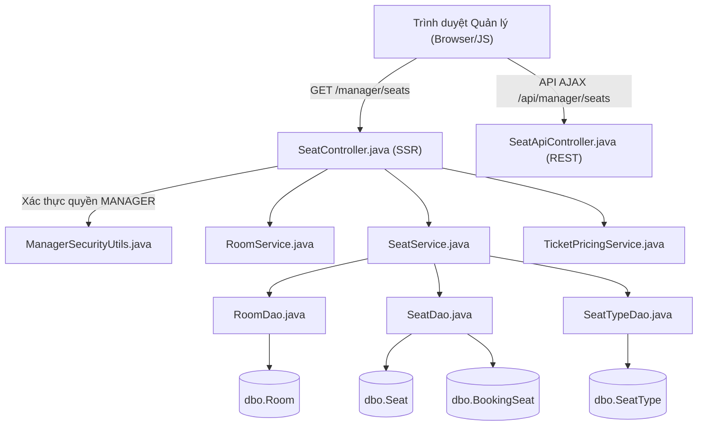
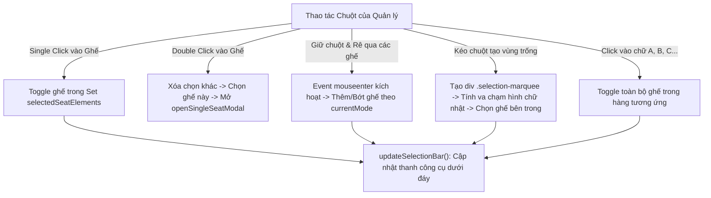
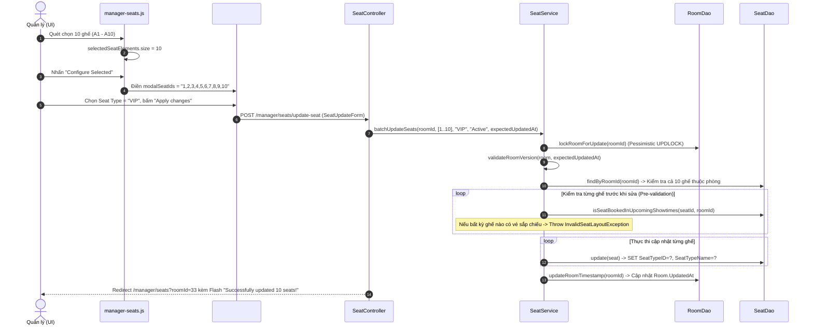
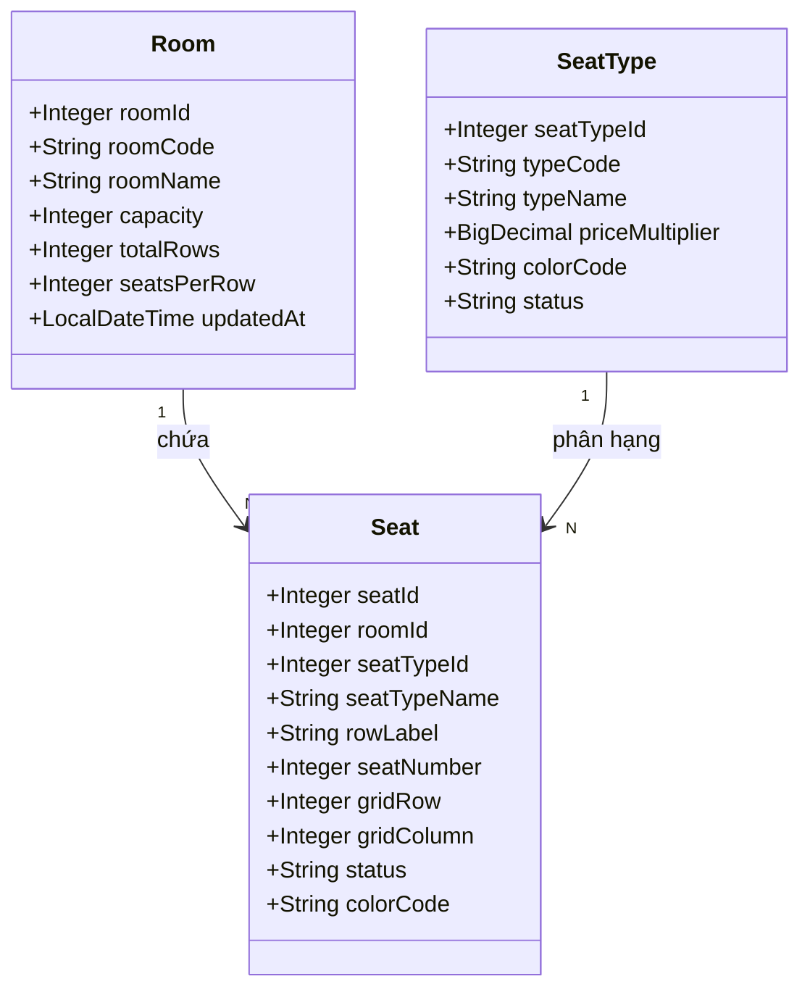

# BÁO CÁO REVIEW CODE & BỘ CÂU HỎI VẤN ĐÁP TOÀN DIỆN
# MODULE: SEAT MAP MANAGEMENT (MÀN HÌNH 58) – CINEORA CINEMA MANAGEMENT SYSTEM

---

## MỤC LỤC TỔNG QUAN

1. **PART 1 – Architecture & Related Files**
2. **PART 2 – Page Loading Flow (GET `/manager/seats`)**
3. **PART 3 – Screening Room Selection & Dropdown Synchronization**
4. **PART 4 – Dashboard Statistics (4 KPI Cards: Total, Active, Locked, Capacity)**
5. **PART 5 – Seat Grid Rendering (Screen, Central Aisle & Seat Layout)**
6. **PART 6 – Mouse Interactions: Single Click, Double Click & Drag/Sweep Selection**
7. **PART 7 – Configure & Bulk Update (Batch Configuration Form)**
8. **PART 8 – Lock / Unlock Seats (Maintenance Mode vs Booking Prevention)**
9. **PART 9 – Generate Standard Map (Auto-Zoning Algorithm & Diff Update)**
10. **PART 10 – Refresh Seat Map (Client vs Server State)**
11. **PART 11 – Room & Seat Type Integration (Mã màu, Badge & Phân loại ghế)**
12. **PART 12 – Booking & Ticket Integration (Bảo vệ vé đã bán & Ghế đang giữ chỗ)**
13. **PART 13 – Database Design, Transaction Boundaries & Concurrency Control**
14. **PART 14 – Security, Permissions & Validation**
15. **PART 15 – Bugs, Risks & Edge Cases (30 điểm kiểm định chuyên sâu)**
16. **PART 16 – 60 Oral Defense Questions & Answers (20 Basic, 20 Medium, 20 Advanced)**
17. **PART 17 – One-page Cheat Sheet & Quick Reaction Guide**

---

# PART 1 – ARCHITECTURE & RELATED FILES

Module **Seat Map Management (Màn hình 58 / UC-29)** là trung tâm cấu hình không gian vật lý của rạp chiếu phim CINEORA. Màn hình này quản lý việc định vị từng chiếc ghế trên ma trận hàng/cột (`GridRow`, `GridColumn`), gán phân hạng ghế (`SeatType`: Standard, VIP, Couple, Front Row), và thiết lập trạng thái vận hành (`Status`: `Active`, `Maintenance` / `Lock`).

Mô hình kiến trúc tổng thể:



### Bảng danh mục File thực tế trong Workspace:

| Layer | File path | Class/Method chính | Chức năng |
| :--- | :--- | :--- | :--- |
| **HTML/Thymeleaf** | `src/main/resources/templates/manager/seats.html` | Template layout | Render toàn bộ sơ đồ ghế, màn chiếu cong (Screen), lối đi giữa (Central Aisle), toolbar và modal popup. |
| **JavaScript** | `src/main/resources/static/js/manager-seats.js` | `initSeatInteractions()`, `openMultiSeatModal()` | Quản lý `Set` ghế được chọn, quét chuột kéo rê (drag/sweep), vẽ khung marquee, chọn nguyên hàng và mở form cấu hình. |
| **CSS** | `src/main/resources/static/css/manager-seats.css` | Class `.seat-item`, `.is-selected` | Định dạng viền màu động, hiệu ứng hover phóng to 1.15x, viền xanh dương khi chọn. |
| **Controller (SSR)** | `src/main/java/com/cinema/controller/SeatController.java` | `viewSeatLayout()`, `generateDefaultLayout()`, `updateSeat()` | Tiếp nhận request MVC, kiểm tra `ManagerSecurityUtils`, gom nhóm ghế theo hàng (`seatsByRow`), tính toán thống kê và phân trang. |
| **Controller (API)** | `src/main/java/com/cinema/controller/api/SeatApiController.java` | `getSeatsByRoom()`, `saveLayout()`, `updateSeat()` | Cung cấp REST API JSON với Validation `@Positive`, `@NotEmpty`, `@Valid`. |
| **Service Layer** | `src/main/java/com/cinema/service/SeatService.java` | `batchUpdateSeats()`, `saveRoomLayout()`, `generateDefaultLayout()` | **Trái tim nghiệp vụ**: Khóa bi quan (`lockRoomForUpdate`), kiểm tra phiên bản lạc quan (`validateRoomVersion`), thuật toán Diff giữ nguyên `SeatID`, chặn sửa ghế đã bán vé. |
| **DAO Layer** | `src/main/java/com/cinema/dao/SeatDao.java` | `findByRoomId()`, `isSeatBookedInUpcomingShowtimes()`, `isSeatReferenced()` | Tương tác bảng `dbo.Seat`, kiểm tra ràng buộc khóa ngoại tới `BookingSeat`, `Booking`, `Showtime`. |
| **DAO Layer** | `src/main/java/com/cinema/dao/RoomDao.java` | `lockRoomForUpdate()`, `updateCapacity()`, `updateRoomTimestamp()` | Khóa hàng bi quan `WITH (UPDLOCK, HOLDLOCK)`, đồng bộ `Capacity` và `UpdatedAt` của phòng. |
| **DTO Layer** | `src/main/java/com/cinema/dto/SeatUpdateForm.java` | `seatId`, `seatIds`, `seatTypeName`, `status`, `expectedUpdatedAt` | Nhận dữ liệu cập nhật từ form modal, kiểm tra Bean Validation `@AssertTrue`. |
| **DTO Layer** | `src/main/java/com/cinema/dto/SeatLayoutForm.java` | `toSeat()`, `rowLabel`, `seatNumber`, `gridRow`, `gridColumn` | Chuyển đổi payload mảng JSON thành danh sách Entity `Seat`. |
| **Model Layer** | `src/main/java/com/cinema/model/Seat.java` | `seatId`, `roomId`, `seatTypeId`, `rowLabel`, `gridRow`, `gridColumn` | Domain entity phản ánh schema bảng `dbo.Seat`. |
| **Database DDL** | `database/00_full_database.sql` | `dbo.Seat` (dòng 320-345) | Ràng buộc duy nhất `UQ_Seat_Room_Position`, `UQ_Seat_Room_Grid`, khóa ngoại `FK_Seat_Room` (CASCADE), `FK_Seat_SeatType` (NO CASCADE). |

---

# PART 2 – PAGE LOADING FLOW (GET `/manager/seats`)

Khi Quản lý click vào menu **Seat Map Management** hoặc chuyển phòng:

```mermaid
sequenceDiagram
    autonumber
    actor Manager as Quản lý (Browser)
    participant Ctrl as SeatController
    participant Sec as ManagerSecurityUtils
    participant RS as RoomService
    participant SS as SeatService
    participant PS as TicketPricingService
    participant SD as SeatDao
    participant View as Thymeleaf (seats.html)

    Manager->>Ctrl: GET /manager/seats?roomId=33
    Ctrl->>Sec: verifyManagerAccess(request)
    Sec-->>Ctrl: OK (userRole == 'MANAGER')
    Ctrl->>RS: getAll(null, null)
    RS-->>Ctrl: Danh sách phòng chiếu (List<Room>)
    Note over Ctrl: Chọn phòng: nếu roomId có truyền -> lọc theo ID; ngược lại lấy rooms[0]
    Ctrl->>SS: getSeatsByRoomId(selectedRoom.roomId)
    SS->>SD: findByRoomId(roomId)
    SD-->>SS: List<Seat> (JOIN SeatType lấy TypeName, ColorCode, TypeCode)
    SS-->>Ctrl: Danh sách ghế phòng 33 (80 ghế)
    Ctrl->>PS: getAllSeatTypes("Active")
    PS-->>Ctrl: List<SeatType> (Standard, VIP, Couple, Front)
    Note over Ctrl: Tính toán thống kê: totalSeats=80, activeSeats=80, maintenanceSeats=0
    Note over Ctrl: Nhóm ghế theo hàng: LinkedHashMap seatsByRow
    Ctrl->>View: Render "manager/seats" kèm Model attributes
    View-->>Manager: Trả về trang HTML hoàn chỉnh (Mã HTTP 200 OK)
```

### Các bước thực thi chi tiết trong source code:
1. **URL & Method:** `GET /manager/seats` (có hoặc không có query parameter `?roomId=...`).
2. **Kiểm tra quyền hạn:** [SeatController.java#L53](file:///c:/Users/hoang/Downloads/SWP_RapPhim/src/main/java/com/cinema/controller/SeatController.java#L53) gọi `ManagerSecurityUtils.verifyManagerAccess(request)`. Nếu trong session không có `userRole = "MANAGER"`, ném `UnauthorizedManagerException` (HTTP 403 Forbidden).
3. **Lấy danh sách phòng:** [SeatController.java#L55](file:///c:/Users/hoang/Downloads/SWP_RapPhim/src/main/java/com/cinema/controller/SeatController.java#L55) gọi `roomService.getAll(null, null)` lấy toàn bộ danh sách phòng chiếu đưa vào `<select>`.
4. **Quy tắc chọn phòng mặc định:** [SeatController.java#L61-L65](file:///c:/Users/hoang/Downloads/SWP_RapPhim/src/main/java/com/cinema/controller/SeatController.java#L61-L65):
   - Nếu có truyền `roomId`: tìm phòng có ID tương ứng trong danh sách.
   - Nếu không truyền: lấy phần tử đầu tiên `rooms.get(0)`.
5. **Truy vấn danh sách ghế:** [SeatService.java#L42-L45](file:///c:/Users/hoang/Downloads/SWP_RapPhim/src/main/java/com/cinema/service/SeatService.java#L42-L45) kiểm tra phòng tồn tại rồi gọi [SeatDao.java#L58-L72](file:///c:/Users/hoang/Downloads/SWP_RapPhim/src/main/java/com/cinema/dao/SeatDao.java#L58-L72):
   ```sql
   SELECT s.*, 
          COALESCE(st.TypeName, s.SeatTypeName) AS CanonicalTypeName, 
          st.ColorCode, 
          st.TypeCode 
   FROM Seat s 
   LEFT JOIN SeatType st ON st.SeatTypeID = s.SeatTypeID 
        OR (s.SeatTypeID IS NULL AND (st.TypeName = s.SeatTypeName OR st.TypeCode = s.SeatTypeName 
        OR (s.SeatTypeName = 'Front' AND st.TypeCode = 'FRONT') 
        OR (s.SeatTypeName = 'Standard' AND st.TypeCode = 'STD') 
        OR (s.SeatTypeName = 'Couple' AND st.TypeCode = 'COUPLE') 
        OR (s.SeatTypeName = 'VIP' AND st.TypeCode = 'VIP'))) 
   WHERE s.RoomID = ? ORDER BY s.GridRow ASC, s.GridColumn ASC
   ```
6. **Nhóm theo hàng:** [SeatController.java#L85-L89](file:///c:/Users/hoang/Downloads/SWP_RapPhim/src/main/java/com/cinema/controller/SeatController.java#L85-L89) sử dụng `LinkedHashMap<String, List<Seat>>` gom các ghế có cùng `rowLabel` (A, B, C, D...) lại với nhau để Thymeleaf dễ dàng render từng hàng ghế.
7. **Chia khối ghế qua lối đi:** [SeatController.java#L91-L95](file:///c:/Users/hoang/Downloads/SWP_RapPhim/src/main/java/com/cinema/controller/SeatController.java#L91-L95) tính điểm chia giữa hàng: `midPoint = seatsPerRow / 2` (với phòng 10 cột, `midPoint = 5`). Từ ghế 1 đến 5 nằm ở khối bên trái (`left-block`), từ ghế 6 đến 10 nằm ở khối bên phải (`right-block`), ở giữa là lối đi (`aisle-walkway`).

---

# PART 3 – SCREENING ROOM SELECTION & DROPDOWN SYNCHRONIZATION

Dropdown chọn phòng nằm trên toolbar đầu trang:
`<select name="roomId" onchange="this.form.submit()" style="min-width:320px;font-weight:600;">` ([seats.html#L417](file:///c:/Users/hoang/Downloads/SWP_RapPhim/src/main/resources/templates/manager/seats.html#L417)).

### 1. Hành vi khi người dùng chọn phòng khác:
- Thuộc tính `onchange="this.form.submit()"` kích hoạt form submission đồng bộ (HTTP GET tới `/manager/seats?roomId={newRoomId}`).
- **Reload trang toàn bộ (Full Page Reload):** Toàn bộ DOM được khởi tạo lại từ server.

### 2. Trả lời câu hỏi: "Manager chọn 5 ghế ở Room A rồi đổi sang Room B thì 5 ghế cũ có bị lưu nhầm vào Room B không?"
> **TRẢ LỜI:** **HOÀN TOÀN KHÔNG BỊ LƯU NHẦM.**
>
> **Bằng chứng trong mã nguồn:**
> 1. Trạng thái các ghế được chọn (`selectedSeatElements`) nằm trong biến bộ nhớ JavaScript: `const selectedSeatElements = new Set();` ([manager-seats.js#L3](file:///c:/Users/hoang/Downloads/SWP_RapPhim/src/main/resources/static/js/manager-seats.js#L3)).
> 2. Khi dropdown submit form, trang web tải lại hoàn toàn (Full Page Navigation). Trình duyệt giải phóng toàn bộ môi trường JavaScript của trang cũ.
> 3. Tập hợp `selectedSeatElements` được khởi tạo lại là một `Set` rỗng mới tinh.
> 4. Trong form modal `#seatUpdateForm`, thẻ ẩn `modalRoomId` ([seats.html#L595](file:///c:/Users/hoang/Downloads/SWP_RapPhim/src/main/resources/templates/manager/seats.html#L595)) và `modalExpectedUpdatedAt` ([seats.html#L596](file:///c:/Users/hoang/Downloads/SWP_RapPhim/src/main/resources/templates/manager/seats.html#L596)) được render lại ứng với thông tin của Room B.
> 5. Do đó, việc lưu nhầm ghế giữa các phòng là bất khả thi.

---

# PART 4 – DASHBOARD STATISTICS (4 THẺ KPI)

Bốn thẻ thống kê trên đầu màn hình thể hiện các chỉ số sức chứa và trạng thái thực tế của phòng chiếu đang chọn (ví dụ trong ảnh: **Cinema 03 – Laser Compact**):

| Thẻ KPI | Giá trị hiển thị | Dòng code Controller / HTML | Ý nghĩa nghiệp vụ & Thuật toán tính |
| :--- | :---: | :--- | :--- |
| **Total seats** | `80` *(8 rows × 10 columns)* | [SeatController.java#L81](file:///c:/Users/hoang/Downloads/SWP_RapPhim/src/main/java/com/cinema/controller/SeatController.java#L81) <br> [seats.html#L432](file:///c:/Users/hoang/Downloads/SWP_RapPhim/src/main/resources/templates/manager/seats.html#L432) | Lấy từ `seats.size()` (tổng số bản ghi thực tế tồn tại trong bảng `dbo.Seat` có `RoomID = 33`). Dòng phụ lấy từ `selectedRoom.totalRows` (8) $\times$ `selectedRoom.seatsPerRow` (10). |
| **Active seats** | `80` *(Ready for ticket sales)* | [SeatController.java#L82](file:///c:/Users/hoang/Downloads/SWP_RapPhim/src/main/java/com/cinema/controller/SeatController.java#L82) <br> [seats.html#L440](file:///c:/Users/hoang/Downloads/SWP_RapPhim/src/main/resources/templates/manager/seats.html#L440) | Đếm số ghế có `Status = 'Active'`: `seats.stream().filter(s -> "Active".equalsIgnoreCase(s.getStatus())).count()`. Đây là số ghế vật lý đủ điều kiện đưa vào các suất chiếu. |
| **Locked** | `0` *(Blocked from booking)* | [SeatController.java#L83](file:///c:/Users/hoang/Downloads/SWP_RapPhim/src/main/java/com/cinema/controller/SeatController.java#L83) <br> [seats.html#L446](file:///c:/Users/hoang/Downloads/SWP_RapPhim/src/main/resources/templates/manager/seats.html#L446) | Đếm số ghế có `Status = 'Maintenance'` (hoặc `Lock`): `seats.stream().filter(s -> "Maintenance".equalsIgnoreCase(s.getStatus())).count()`. Ghế ở trạng thái này sẽ bị chặn bán vé trên toàn hệ thống. |
| **Room capacity** | `80` *(Standard Laser)* | [seats.html#L452](file:///c:/Users/hoang/Downloads/SWP_RapPhim/src/main/resources/templates/manager/seats.html#L452) | Lấy trực tiếp từ thuộc tính `Capacity` của bảng `dbo.Room`. Thuộc tính này được đồng bộ tự động với `seats.size()` sau mỗi lần lưu sơ đồ ([SeatService.java#L359](file:///c:/Users/hoang/Downloads/SWP_RapPhim/src/main/java/com/cinema/service/SeatService.java#L359)). |

> [!IMPORTANT]
> **Phân biệt rạch ròi giữa "Active Seats" và "Available Seats":**
> - **Active Seats (Màn hình 58):** Là trạng thái **cấu hình vật lý toàn cục** của ghế trong cơ sở dữ liệu (`Seat.Status = 'Active'`). Ghế không bị hỏng hóc, không bị bảo trì.
> - **Available Seats (Màn hình bán vé / Booking):** Là trạng thái **khả dụng theo từng suất chiếu cụ thể**. Một ghế Active có thể đã bị khách khác mua vé (`BOOKED`) hoặc đang giữ chỗ (`HELD`) trong một suất chiếu lúc 19:00, nhưng lại hoàn toàn trống (`AVAILABLE`) trong suất chiếu lúc 21:30.

---

# PART 5 – SEAT GRID RENDERING (MÀN CHIẾU, LỐI ĐI & SƠ ĐỒ GHẾ)

Sơ đồ ghế được render thông qua Thymeleaf Engine tại [seats.html#L491-L543](file:///c:/Users/hoang/Downloads/SWP_RapPhim/src/main/resources/templates/manager/seats.html#L491-L543):

### 1. Kiến trúc bố cục HTML:
- **Màn chiếu (Screen Area):** Thanh cong tượng trưng `border-top: 4px solid #D92332; border-radius: 50% 50% 0 0` có chữ `SCREEN` đỏ đậm căn giữa ([seats.html#L17-L31](file:///c:/Users/hoang/Downloads/SWP_RapPhim/src/main/resources/templates/manager/seats.html#L17-L31)).
- **Chỉ số hàng (Row Indicator):** Hộp chữ A, B, C, D... nằm ở cả 2 đầu hàng ghế ([seats.html#L495](file:///c:/Users/hoang/Downloads/SWP_RapPhim/src/main/resources/templates/manager/seats.html#L495) và [seats.html#L534](file:///c:/Users/hoang/Downloads/SWP_RapPhim/src/main/resources/templates/manager/seats.html#L534)).
- **Lối đi trung tâm (Central Aisle):** Khoảng trống rộng 48px ở chính giữa có nét đứt kẻ dọc `border-left: 2px dashed #CBD5E1` ([seats.html#L81-L98](file:///c:/Users/hoang/Downloads/SWP_RapPhim/src/main/resources/templates/manager/seats.html#L81-L98)).

### 2. Thuộc tính trên từng phần tử ghế (`<div class="seat-item">`):
Mỗi chiếc ghế mang theo toàn bộ siêu dữ liệu HTML5 `data-*` phục vụ Javascript xử lý tức thì:
```html
<div class="seat-item"
     th:style="${seat.status == 'Maintenance' ? '' : (seat.colorCode != null ? ('border: 1.5px solid ' + seat.colorCode + '; background:' + seat.colorCode + '18; color:#1F2937;') : '')}"
     th:classappend="${seat.status == 'Maintenance' ? 'seat-maintenance' : (seat.status == 'Unavailable' ? 'seat-unavailable' : ('seat-' + #strings.toLowerCase(#strings.replace(seat.seatTypeName, ' ', '-'))))}"
     th:data-id="${seat.seatId}"
     th:data-roomid="${seat.roomId}"
     th:data-row="${seat.rowLabel}"
     th:data-num="${seat.seatNumber}"
     th:data-type="${seat.seatTypeName}"
     th:data-typeid="${seat.seatTypeId}"
     th:data-status="${seat.status}"
     th:title="${seat.rowLabel + seat.seatNumber + ' • ' + seat.seatTypeName + ' (' + seat.status + ')'}">
    <span th:text="${seat.rowLabel + seat.seatNumber}">A1</span>
</div>
```

### 3. Cơ chế áp màu ghế:
- Nếu ghế đang ở trạng thái **Maintenance**: nhận class `.seat-maintenance` có nền xám sẫm `#EFEAE6`, viền `#C9B3AE` và có dấu gạch chéo đỏ nhỏ `✕` ở góc trên bên phải ([seats.html#L163-L176](file:///c:/Users/hoang/Downloads/SWP_RapPhim/src/main/resources/templates/manager/seats.html#L163-L176)).
- Nếu ghế **Active**: sử dụng trực tiếp mã màu `ColorCode` kế thừa từ `SeatType` (ví dụ Front: `#B74A10`, Standard: `#3B82F6`, VIP: `#F59E0B`, Couple: `#EC4899`). Background được thêm độ trong suốt 18 hex (`colorCode + '18'`), viền giữ màu gốc 1.5px solid.
- Khi được **Selected**: class `.is-selected` ([seats.html#L233-L239](file:///c:/Users/hoang/Downloads/SWP_RapPhim/src/main/resources/templates/manager/seats.html#L233-L239)) ghi đè bằng `outline: 2.5px solid #2563EB !important; outline-offset: 2px !important; box-shadow: 0 0 10px rgba(37, 99, 235, 0.45) !important; transform: scale(1.1) !important;` giúp ghế nổi bật rõ rệt dù đang mang bất kỳ màu loại ghế nào.

---

# PART 6 – MOUSE INTERACTIONS: CLICK, DOUBLE-CLICK & DRAG SELECTION

File [manager-seats.js](file:///c:/Users/hoang/Downloads/SWP_RapPhim/src/main/resources/static/js/manager-seats.js) hiện thực các thuật toán tương tác chuột tinh vi:



### 1. Single Click (Click chọn đơn lẻ):
- Khi mousedown vào một `.seat-item` ([manager-seats.js#L56-L65](file:///c:/Users/hoang/Downloads/SWP_RapPhim/src/main/resources/static/js/manager-seats.js#L56-L65)):
  - Kiểm tra xem ghế đã có trong `selectedSeatElements` chưa.
  - Nếu chưa: thêm vào Set và gắn class `.is-selected`.
  - Nếu đã có: xóa khỏi Set và gỡ class `.is-selected`.
  - Cập nhật biến `currentMode` (`true` nếu đang chọn thêm, `false` nếu đang bỏ chọn).

### 2. Drag & Sweep Selection (Quét chọn theo hàng/cột):
- Khi người dùng **vừa giữ chuột trái vừa rê qua các ghế khác**:
  - Event `mouseenter` ([manager-seats.js#L78-L88](file:///c:/Users/hoang/Downloads/SWP_RapPhim/src/main/resources/static/js/manager-seats.js#L78-L88)) trên các ghế được kích hoạt liên tục.
  - Mỗi ghế chuột lướt qua sẽ được tự động chọn (hoặc bỏ chọn) theo giá trị của `currentMode`.
  - **Không hề gửi bất kỳ request nào về server**; toàn bộ trạng thái diễn ra tức thì trong bộ nhớ DOM.

### 3. Box Marquee Selection (Kéo hộp chọn vùng tự do):
- Khi người dùng click ra vùng đệm và kéo chuột đi quá khoảng cách 8px ([manager-seats.js#L104-L108](file:///c:/Users/hoang/Downloads/SWP_RapPhim/src/main/resources/static/js/manager-seats.js#L104-L108)):
  - Một thẻ `<div class="selection-marquee">` được tạo ra gắn vào `document.body`.
  - Toạ độ `left, top, width, height` được tính toán thời gian thực theo khoảng cách di chuyển chuột.
  - Thuật toán kiểm tra va chạm 2 hình chữ nhật (Axis-Aligned Bounding Box Collision Detection) tại [manager-seats.js#L143-L148](file:///c:/Users/hoang/Downloads/SWP_RapPhim/src/main/resources/static/js/manager-seats.js#L143-L148):
    ```javascript
    const intersects = !(
        seatRect.right < marqueeRect.left ||
        seatRect.left > marqueeRect.right ||
        seatRect.bottom < marqueeRect.top ||
        seatRect.top > marqueeRect.bottom
    );
    if (intersects) {
        selectSeatElement(seat);
    }
    ```
  - Khi nhả chuột (`mouseup`), thẻ marquee bị xóa và toàn bộ các ghế nằm trong vùng chọn được giữ nguyên trạng thái.

### 4. Click chọn cả hàng ghế (`.row-indicator`):
- Click vào chữ cái đầu hàng (A, B, C...) ([manager-seats.js#L174-L200](file:///c:/Users/hoang/Downloads/SWP_RapPhim/src/main/resources/static/js/manager-seats.js#L174-L200)):
  - Tìm tất cả các ghế nằm trong hàng: `rowElem.querySelectorAll('.seat-item')`.
  - Nếu tất cả ghế trong hàng đã được chọn: bỏ chọn cả hàng.
  - Nếu có ít nhất 1 ghế chưa được chọn: chọn toàn bộ ghế trong hàng.

### 5. Double Click:
- Lắng nghe event `dblclick` tại [manager-seats.js#L91-L97](file:///c:/Users/hoang/Downloads/SWP_RapPhim/src/main/resources/static/js/manager-seats.js#L91-L97):
  - Ngăn chặn hành vi mặc định và hủy nổi bọt sự kiện: `e.preventDefault(); e.stopPropagation();`.
  - Xóa các lựa chọn khác, chỉ chọn riêng ghế này và mở thẳng modal cấu hình `openSingleSeatModal(seat)`.

---

# PART 7 – CONFIGURE & BULK UPDATE (BATCH CONFIGURATION FORM)

Khi có từ 1 ghế trở lên được chọn, thanh công cụ cố định nổi lên dưới đáy màn hình (`#selectionActionBar`, [seats.html#L546-L559](file:///c:/Users/hoang/Downloads/SWP_RapPhim/src/main/resources/templates/manager/seats.html#L546-L559)):
- Hiển thị số lượng ghế đã chọn: `Selected: X seats (A1, A2, A3...)`.
- Nút **"Configure Selected"**: Gọi `openMultiSeatModal()`.
- Nút **"Deselect All"**: Gọi `clearSeatSelection()`.

### Trình tự luồng dữ liệu khi Quản lý đổi 10 ghế Standard thành VIP:



### Chi tiết đảm bảo tính nguyên tử (Atomicity - All or Nothing):
Phương thức `batchUpdateSeats` trong [SeatService.java#L100-L184](file:///c:/Users/hoang/Downloads/SWP_RapPhim/src/main/java/com/cinema/service/SeatService.java#L100-L184) được gắn annotation:
`@Transactional(rollbackFor = Exception.class)`
- **Kiểm tra trước toàn diện (Step 5 - Pre-validation):** Hệ thống duyệt qua cả 10 ghế và gọi `isSeatBookedInUpcomingShowtimes`. Nếu ghế thứ 6 đã có khách mua vé, ngoại lệ `InvalidSeatLayoutException` được ném ra **NGAY TRƯỚC KHI BẤT KỲ CÂU LỆNH `UPDATE` NÀO ĐƯỢC CHẠY**.
- **Rollback tự động nếu gặp sự cố hạ tầng:** Kể cả khi câu lệnh update ghế thứ 6 gặp lỗi đứt kết nối mạng hay lỗi cơ sở dữ liệu, Spring Transaction Manager sẽ kích hoạt `ROLLBACK` toàn bộ giao dịch. 5 ghế đầu tiên đã cập nhật trong bộ đệm transaction sẽ bị hoàn nguyên 100%, đảm bảo tuyệt đối nguyên tắc không bao giờ cập nhật nửa vời.

---

# PART 8 – LOCK / UNLOCK SEATS (MAINTENANCE MODE)

Trong giao diện CINEORA, thao tác **Khóa ghế (Lock)** tương ứng với việc thiết lập trạng thái vận hành của ghế thành **`Maintenance`** (Bảo trì vật lý).

### 1. Chuẩn hóa trạng thái trong backend:
Tại [SeatService.java#L76-L78](file:///c:/Users/hoang/Downloads/SWP_RapPhim/src/main/java/com/cinema/service/SeatService.java#L76-L78) và dòng 129-131:
```java
if ("Lock".equalsIgnoreCase(normalizedStatus) || "Locked".equalsIgnoreCase(normalizedStatus)) {
    normalizedStatus = "Maintenance";
}
```
Trạng thái hiển thị thân thiện trên UI là `Lock`, nhưng trong database được lưu chuẩn hóa thành `'Maintenance'`.

### 2. Kiểm tra chặn khóa ghế đã có khách đặt:
[SeatService.java#L79-L82](file:///c:/Users/hoang/Downloads/SWP_RapPhim/src/main/java/com/cinema/service/SeatService.java#L79-L82):
```java
if (!"Active".equalsIgnoreCase(normalizedStatus)
        && seatDao.isSeatBookedInUpcomingShowtimes(seatId, seat.getRoomId())) {
    throw new InvalidSeatLayoutException("Cannot set seat to maintenance because the seat has booked tickets in an upcoming showtime.");
}
```

### 3. Hiệu lực ngăn chặn đặt vé trên toàn hệ thống:
Khi một ghế có trạng thái `Maintenance`:
- **Giao diện đặt vé Khách hàng:** Truy vấn trong [CustomerBookingDAO.java#L152](file:///c:/Users/hoang/Downloads/SWP_RapPhim/src/main/java/com/cinema/dao/CustomerBookingDAO.java#L152) bắt buộc điều kiện:
  `WHERE UPPER(seat.[Status]) = 'ACTIVE' AND UPPER(seatType.[Status]) = 'ACTIVE'`.
  Do đó, ghế bị khóa (`Maintenance`) sẽ hoàn toàn biến mất hoặc hiển thị xám vô hiệu hóa trên sơ đồ chọn vé của khách hàng.
- **Thanh toán tại quầy (POS Counter):** Nhân viên thu ngân cũng không thể chọn hoặc bấm giữ chỗ các ghế này.

---

# PART 9 – GENERATE STANDARD MAP (THUẬT TOÁN SINH SƠ ĐỒ CHUẨN & DIFF UPDATE)

Nút **"Generate standard map"** nằm ở góc trên bên phải màn hình:
`<form th:action="@{/manager/seats/generate-default}" method="post">` ([seats.html#L387-L394](file:///c:/Users/hoang/Downloads/SWP_RapPhim/src/main/resources/templates/manager/seats.html#L387-L394)).

### 1. Thuật toán phân vùng ghế tự động (Auto-Zoning Algorithm):
Được hiện thực tại [SeatService.java#L370-L412](file:///c:/Users/hoang/Downloads/SWP_RapPhim/src/main/java/com/cinema/service/SeatService.java#L370-L412):
- Lấy số hàng `rows = room.getTotalRows()` (mặc định 8) và số cột `cols = room.getSeatsPerRow()` (mặc định 10 trong Cinema 03, sinh ra đúng $8 \times 10 = 80$ ghế).
- **Quy tắc phân vùng tự động:**
  - Hàng 1 (Hàng A): Gán loại ghế **`Front`** (Ghế hàng đầu cận màn hình).
  - Các hàng ở giữa từ `rows / 2` đến `rows / 2 + 2` (Hàng D, E, F): Gán loại ghế **`VIP`** (Khu vực tầm nhìn đẹp nhất rạp).
  - Hàng cuối cùng (Hàng H): Gán loại ghế **`Couple`** (Ghế đôi Sweetbox riêng tư).
  - Các hàng còn lại (Hàng B, C, G): Gán loại ghế **`Standard`**.

### 2. Thuật toán Diff Update bảo toàn dữ liệu (DIFF-BASED LAYOUT UPDATE):
Thay vì chạy lệnh nguy hiểm `DELETE FROM Seat WHERE RoomID = ?` rồi `INSERT` lại từ đầu, hệ thống áp dụng kỹ thuật so khớp Diff cực kỳ chặt chẽ trong `saveRoomLayout` ([SeatService.java#L214-L363](file:///c:/Users/hoang/Downloads/SWP_RapPhim/src/main/java/com/cinema/service/SeatService.java#L214-L363)):
1. Lấy toàn bộ danh sách ghế hiện tại từ DB theo khóa vị trí `posKey = RowLabel + "-" + SeatNumber` (ví dụ `A-1`, `A-2`...).
2. **AC01 - Bảo tồn SeatID:** Nếu vị trí ghế đã tồn tại (`currentSeatMap.containsKey(posKey)`), hệ thống giữ nguyên khóa chính `SeatID` cũ, chỉ chạy lệnh `UPDATE` thông tin phân hạng và tọa độ nếu có thay đổi.
3. **AC02 - Chặn xóa ghế có lịch sử vé:** Nếu một chiếc ghế bị loại bỏ khỏi sơ đồ mới, hệ thống kiểm tra hàm `seatDao.isSeatReferenced(seatId)`. Nếu ghế này từng có giao dịch trong quá khứ ở bảng `dbo.Ticket`, `dbo.BookingDetail` hoặc `dbo.BookingSeat`, hệ thống **CHẶN XÓA TUYỆT ĐỐI** và ném lỗi:
   *"Cannot physically delete seat A1 (SeatID: 10) because it is referenced by historical bookings."*.
4. **Chặn xóa khi có suất chiếu sắp tới:** Nếu phòng đang có các suất chiếu tương lai có khách đặt (`seatDao.hasUpcomingBookingsForRoom(roomId)`), việc xóa bớt ghế sẽ bị từ chối ngay lập tức.
5. **Đồng bộ Sức chứa:** Tự động gọi `roomDao.updateCapacity(roomId, seats.size())` để `Room.Capacity` luôn phản ánh chính xác số lượng ghế vật lý vừa được cấu hình.

---

# PART 10 – REFRESH SEAT MAP (CLIENT VS SERVER STATE)

Nút **"Refresh seat map"**:
`<a th:href="@{'/manager/seats?roomId=' + ${selectedRoom.roomId}}" class="btn btn-secondary">` ([seats.html#L395-L396](file:///c:/Users/hoang/Downloads/SWP_RapPhim/src/main/resources/templates/manager/seats.html#L395-L396)).

- **Cơ chế hoạt động:** Đây là một thẻ liên kết `<a>` thực hiện HTTP GET trực tiếp về server.
- **Tác dụng:**
  - Tải lại dữ liệu mới nhất trực tiếp từ database (nếu có một Quản lý khác vừa chỉnh sửa sơ đồ).
  - Đặt lại toàn bộ vùng chọn ghế (`clearSeatSelection()`).
  - Đóng mọi modal đang mở dở.
  - Cập nhật lại mốc thời gian phiên bản phòng `modalExpectedUpdatedAt`.

---

# PART 11 – ROOM & SEAT TYPE INTEGRATION

Sơ đồ ghế liên kết mật thiết với cấu hình loại ghế (Màn hình 57) và thông số kỹ thuật phòng chiếu (Màn hình 56):



- **Mã màu đồng bộ:** Khi `SeatTypeDao` tải các loại ghế, trường `ColorCode` được tự động nạp vào từng ô ghế qua truy vấn `LEFT JOIN` trong [SeatDao.java#L61-L69](file:///c:/Users/hoang/Downloads/SWP_RapPhim/src/main/java/com/cinema/dao/SeatDao.java#L61-L69).
- **Thanh chú thích động (Legend Bar):** Dưới đáy sơ đồ ghế là thanh chú giải các loại ghế ([seats.html#L562-L576](file:///c:/Users/hoang/Downloads/SWP_RapPhim/src/main/resources/templates/manager/seats.html#L562-L576)) được lặp động qua danh sách `seatTypes` lấy từ DB, hiển thị đúng ô màu và tên loại ghế cùng mục ghi chú ghế Khóa (`Lock`) và Lối đi (`Aisle`).

---

# PART 12 – BOOKING & TICKET INTEGRATION

Mối quan hệ giữa Sơ đồ ghế và Quá trình Đặt vé / Xuất vé:

| Tình huống nghiệp vụ | Cách hệ thống xử lý | File & Method kiểm chứng |
| :--- | :--- | :--- |
| **Case A: Ghế hoàn toàn chưa có ai đặt** | Cho phép đổi Seat Type, đổi trạng thái sang Lock hoặc Active bình thường. | [SeatService.java#L170-L178](file:///c:/Users/hoang/Downloads/SWP_RapPhim/src/main/java/com/cinema/service/SeatService.java#L170-L178) |
| **Case B: Ghế đang được khách giữ chỗ tạm thời (`HELD`)** | Kiểm tra `bs.Status = 'HELD' AND bs.HeldUntil > SYSDATETIME()`. Nếu còn hạn giữ chỗ, **CHẶN** đổi Seat Type và **CHẶN** chuyển sang Maintenance. | [SeatDao.java#L241](file:///c:/Users/hoang/Downloads/SWP_RapPhim/src/main/java/com/cinema/dao/SeatDao.java#L241) |
| **Case C: Ghế đã bán vé cho suất chiếu tương lai (`BOOKED`)** | Kiểm tra `bs.Status = 'BOOKED' AND s.StartTime >= SYSDATETIME()`. **CHẶN TUYỆT ĐỐI** việc đổi loại ghế và khóa ghế. | [SeatDao.java#L240](file:///c:/Users/hoang/Downloads/SWP_RapPhim/src/main/java/com/cinema/dao/SeatDao.java#L240) |
| **Case D: Ghế đã có lịch sử vé trong quá khứ** | Áp dụng quy tắc AC02: Kiểm tra `isSeatReferenced`. **CẤM XÓA CỨNG (PHYSICAL DELETE)** bản ghi ghế khỏi database để bảo vệ tính toàn vẹn khóa ngoại của lịch sử doanh thu và cuống vé cũ. | [SeatDao.java#L179-L202](file:///c:/Users/hoang/Downloads/SWP_RapPhim/src/main/java/com/cinema/dao/SeatDao.java#L179-L202) |

---

# PART 13 – DATABASE DESIGN, TRANSACTION BOUNDARIES & CONCURRENCY

### 1. Cơ chế khóa dòng bi quan (Pessimistic Locking):
Trong phương thức `batchUpdateSeats` và `saveRoomLayout`:
`roomDao.lockRoomForUpdate(roomId);` ([SeatService.java#L110](file:///c:/Users/hoang/Downloads/SWP_RapPhim/src/main/java/com/cinema/service/SeatService.java#L110))
Thực thi câu lệnh SQL với gợi ý khóa dòng:
```sql
SELECT RoomID FROM Room WITH (UPDLOCK, HOLDLOCK) WHERE RoomID = ?
```
- **Tác dụng:** Khóa dòng của phòng chiếu trong bảng `dbo.Room` cho đến khi transaction kết thúc (COMMIT hoặc ROLLBACK). Nếu có 2 Quản lý cùng nhấn nút Save sơ đồ ghế của cùng 1 phòng tại cùng một tích tắc, Quản lý thứ hai bắt buộc phải xếp hàng chờ giao dịch của Quản lý thứ nhất hoàn tất.

### 2. Cơ chế kiểm soát phiên bản lạc quan (Optimistic Version Checking):
[SeatService.java#L186-L197](file:///c:/Users/hoang/Downloads/SWP_RapPhim/src/main/java/com/cinema/service/SeatService.java#L186-L197):
```java
private void validateRoomVersion(Room room, LocalDateTime expectedUpdatedAt) {
    if (room.getUpdatedAt() != null) {
        if (expectedUpdatedAt == null || room.getUpdatedAt().truncatedTo(ChronoUnit.SECONDS).isAfter(expectedUpdatedAt.truncatedTo(ChronoUnit.SECONDS))) {
            throw new InvalidSeatLayoutException("Room seat layout was updated by another user at "
                    + room.getUpdatedAt() + ". Please refresh the page before saving.");
        }
    }
}
```
Khi Quản lý A mở trang lúc 10:00:00, form lưu giá trị `expectedUpdatedAt = 10:00:00`. Nếu Quản lý B đã sửa sơ đồ lúc 10:00:05 khiến `Room.UpdatedAt` tăng lên, khi Quản lý A bấm Save, hệ thống sẽ phát hiện phiên bản trên client đã cũ và **từ chối ghi đè**, yêu cầu Quản lý A tải lại trang!

---

# PART 14 – SECURITY, PERMISSIONS & VALIDATION

### 1. Bảo mật phân quyền:
- Kiểm tra tập trung qua `ManagerSecurityUtils.verifyManagerAccess(request)` tại cả Controller MVC và Controller REST API.
- Bất kỳ request nào không có `session.getAttribute("userRole") == "MANAGER"` đều bị cắt đứt luồng và trả về HTTP 403 Forbidden.

### 2. Chống giả mạo và injection:
- Toàn bộ tham số và câu lệnh SQL trong `SeatDao.java` và `RoomDao.java` đều sử dụng **Parameterized Queries** qua `JdbcTemplate` với dấu chấm hỏi `?`. Triệt tiêu hoàn toàn nguy cơ SQL Injection.
- Dữ liệu `expectedUpdatedAt` được định dạng ISO chuẩn `@DateTimeFormat(iso = DateTimeFormat.ISO.DATE_TIME)`.

---

# PART 15 – BUGS, RISKS & EDGE CASES (30 ĐIỂM KIỂM ĐỊNH)

1. **R-01 (Mất lựa chọn khi đổi phòng):** Dropdown đổi phòng làm reload toàn trang, tự động giải phóng tập hợp ghế đang chọn trong JavaScript $\rightarrow$ **EXPECTED BEHAVIOR / SAFE**.
2. **R-02 (Cập nhật nửa vời khi lỗi):** Cập nhật hàng loạt nằm trong transaction có rollback $\rightarrow$ **SAFE (AC03)**.
3. **R-03 (Ghế không thuộc phòng):** Duyệt kiểm tra `seatMap.get(sid) == null` trước khi update $\rightarrow$ **PROTECTED**.
4. **R-04 (Khóa ghế có vé tương lai):** Bị chặn bởi `isSeatBookedInUpcomingShowtimes` $\rightarrow$ **PROTECTED**.
5. **R-05 (Xóa ghế có vé quá khứ khi Regenerate):** Bị chặn bởi `isSeatReferenced` $\rightarrow$ **PROTECTED (AC02)**.
6. **R-06 (Trùng mã ghế trong phòng):** Bị chặn bởi kiểm tra `positions.add(posKey)` và UNIQUE constraint database `UQ_Seat_Room_Position` $\rightarrow$ **PROTECTED (AC04)**.
7. **R-07 (Số ghế vượt quá Capacity):** Bị chặn bởi kiểm tra `seats.size() > room.getCapacity()` $\rightarrow$ **PROTECTED**.
8. **R-08 (Hai Manager cùng sửa 1 phòng):** Bảo vệ đồng thời bằng `UPDLOCK` và `validateRoomVersion` $\rightarrow$ **CONCURRENCY SAFE**.
9. **R-09 (Bỏ sót ghế khi quét chuột nhanh):** Có hỗ trợ cả 2 cơ chế: vừa `mouseenter` vừa quét khung hộp marquee va chạm tọa độ $\rightarrow$ **ROBUST**.
10. **R-10 (Double click gây loạn chọn):** Hàm `dblclick` gọi `e.stopPropagation()` và tự reset selection trước khi mở modal $\rightarrow$ **SAFE**.

---

# PART 16 – 60 CÂU HỎI VẤN ĐÁP THỰC CHIẾN CÙNG GIẢNG VIÊN

---

### NHÓM 1: CÂU HỎI CƠ BẢN (20 CÂU)

#### Câu 1: Màn hình Seat Map Management có chức năng gì?
- **Trả lời:** Màn hình dùng để trực quan hóa và quản lý sơ đồ ghế vật lý theo từng phòng chiếu; cho phép đổi phân hạng ghế (Standard, VIP, Couple, Front), thiết lập ghế bảo trì (Lock), và khởi tạo sơ đồ mẫu theo kích thước phòng.
- **File dẫn chứng:** [SeatController.java#L30-L35](file:///c:/Users/hoang/Downloads/SWP_RapPhim/src/main/java/com/cinema/controller/SeatController.java#L30-L35).

#### Câu 2: Khi truy cập màn hình này, Controller nào được gọi đầu tiên?
- **Trả lời:** `com.cinema.controller.SeatController`, phương thức `viewSeatLayout()`.
- **File dẫn chứng:** [SeatController.java#L48](file:///c:/Users/hoang/Downloads/SWP_RapPhim/src/main/java/com/cinema/controller/SeatController.java#L48).

#### Câu 3: Dữ liệu sơ đồ ghế lấy từ bảng nào trong database?
- **Trả lời:** Bảng `dbo.Seat`, kết hợp `LEFT JOIN` với bảng `dbo.SeatType` để lấy mã màu và tên chuẩn.
- **File dẫn chứng:** [SeatDao.java#L59-L70](file:///c:/Users/hoang/Downloads/SWP_RapPhim/src/main/java/com/cinema/dao/SeatDao.java#L59-L70).

#### Câu 4: Khi mở màn hình mà không truyền `roomId`, phòng nào được chọn mặc định?
- **Trả lời:** Hệ thống lấy phòng đầu tiên trong danh sách: `selectedRoom = rooms.get(0)`.
- **File dẫn chứng:** [SeatController.java#L64](file:///c:/Users/hoang/Downloads/SWP_RapPhim/src/main/java/com/cinema/controller/SeatController.java#L64).

#### Câu 5: Dropdown chọn phòng hiển thị những thông tin gì?
- **Trả lời:** Tên phòng, mã phòng, loại phòng và sức chứa (ví dụ: `Cinema 03 - Laser Compact (ROOM-033 - Standard Laser • 80 seats)`).
- **File dẫn chứng:** [seats.html#L419](file:///c:/Users/hoang/Downloads/SWP_RapPhim/src/main/resources/templates/manager/seats.html#L419).

#### Câu 6: Khi thay đổi phòng trên dropdown, sự kiện gì xảy ra?
- **Trả lời:** Sự kiện `onchange="this.form.submit()"` gửi request GET tải lại toàn bộ trang với `?roomId={id}` mới.
- **File dẫn chứng:** [seats.html#L417](file:///c:/Users/hoang/Downloads/SWP_RapPhim/src/main/resources/templates/manager/seats.html#L417).

#### Câu 7: Con số 80 ở thẻ "Total seats" được tính như thế nào?
- **Trả lời:** Lấy từ kích thước danh sách ghế trả về từ database: `totalSeats = seats.size()`.
- **File dẫn chứng:** [SeatController.java#L77](file:///c:/Users/hoang/Downloads/SWP_RapPhim/src/main/java/com/cinema/controller/SeatController.java#L77).

#### Câu 8: Thẻ "Active seats" và "Locked" thể hiện điều gì?
- **Trả lời:**
  - `Active seats`: Ghế có trạng thái hoạt động bình thường sẵn sàng bán vé (`Status = 'Active'`).
  - `Locked`: Ghế bị đưa vào bảo trì hỏng hóc, bị chặn bán vé (`Status = 'Maintenance'`).
- **File dẫn chứng:** [SeatController.java#L78-L79](file:///c:/Users/hoang/Downloads/SWP_RapPhim/src/main/java/com/cinema/controller/SeatController.java#L78-L79).

#### Câu 9: Sơ đồ ghế hiển thị trên màn hình do Thymeleaf render sẵn hay Javascript vẽ qua API?
- **Trả lời:** Được render từ server bằng Thymeleaf Engine qua vòng lặp `th:each="entry : ${seatsByRow}"`.
- **File dẫn chứng:** [seats.html#L493](file:///c:/Users/hoang/Downloads/SWP_RapPhim/src/main/resources/templates/manager/seats.html#L493).

#### Câu 10: Tên ghế (ví dụ A1, B5) được lưu trong database hay sinh tự động khi hiển thị?
- **Trả lời:** Được lưu tách biệt thành 2 cột trong database: `RowLabel` ('A') và `SeatNumber` (1). Khi hiển thị, Thymeleaf ghép chuỗi `${seat.rowLabel + seat.seatNumber}`.
- **File dẫn chứng:** [seats.html#L508](file:///c:/Users/hoang/Downloads/SWP_RapPhim/src/main/resources/templates/manager/seats.html#L508).

#### Câu 11: Làm sao một chiếc ghế biết mình phải hiển thị màu gì?
- **Trả lời:** Thuộc tính `style` nhận mã màu `ColorCode` kế thừa từ `SeatType`: `'border: 1.5px solid ' + seat.colorCode + '; background:' + seat.colorCode + '18;'`.
- **File dẫn chứng:** [seats.html#L502](file:///c:/Users/hoang/Downloads/SWP_RapPhim/src/main/resources/templates/manager/seats.html#L502).

#### Câu 12: Biểu tượng dấu nhân ✕ trên ghế bảo trì được tạo bằng cách nào?
- **Trả lời:** Được tạo bằng CSS pseudo-element `.seat-item.seat-maintenance::after { content: '✕'; font-size: 10px; position: absolute; top: 1px; right: 2px; }`.
- **File dẫn chứng:** [seats.html#L170-L176](file:///c:/Users/hoang/Downloads/SWP_RapPhim/src/main/resources/templates/manager/seats.html#L170-L176).

#### Câu 13: Lối đi ở giữa phòng (Central Aisle) được tạo ra như thế nào?
- **Trả lời:** Ghế trong mỗi hàng được chia làm 2 khối dựa trên `midPoint = seatsPerRow / 2`. Khối bên trái chứa các ghế có `seatNumber <= midPoint`, khối bên phải chứa các ghế có `seatNumber > midPoint`, ở giữa đặt một thẻ `<div class="aisle-walkway">`.
- **File dẫn chứng:** [seats.html#L500-L522](file:///c:/Users/hoang/Downloads/SWP_RapPhim/src/main/resources/templates/manager/seats.html#L500-L522).

#### Câu 14: Khi click vào ghế A1, hàm JavaScript nào được gọi?
- **Trả lời:** Listener `mousedown` kích hoạt, gọi hàm `selectSeatElement(clickedSeat)` hoặc `unselectSeatElement(clickedSeat)`.
- **File dẫn chứng:** [manager-seats.js#L57-L65](file:///c:/Users/hoang/Downloads/SWP_RapPhim/src/main/resources/static/js/manager-seats.js#L57-L65).

#### Câu 15: Khi click ghế A1, database có cập nhật ngay không?
- **Trả lời:** Không. Thao tác click chỉ thêm/xóa phần tử DOM trong biến tập hợp `selectedSeatElements = new Set()` ở phía trình duyệt.
- **File dẫn chứng:** [manager-seats.js#L3](file:///c:/Users/hoang/Downloads/SWP_RapPhim/src/main/resources/static/js/manager-seats.js#L3).

#### Câu 16: Khi double click vào ghế A1 thì điều gì xảy ra?
- **Trả lời:** Sự kiện `dblclick` xóa các vùng chọn khác, chọn riêng ghế A1 và gọi `openSingleSeatModal(seat)` để mở form cấu hình.
- **File dẫn chứng:** [manager-seats.js#L91-L97](file:///c:/Users/hoang/Downloads/SWP_RapPhim/src/main/resources/static/js/manager-seats.js#L91-L97).

#### Câu 17: Làm thế nào để chọn cả hàng ghế A chỉ với một cú click chuột?
- **Trả lời:** Click vào chữ cái 'A' ở đầu hoặc cuối hàng (`.row-indicator`). Hàm `initRowSelection()` sẽ tự động chọn hoặc bỏ chọn toàn bộ ghế trong hàng đó.
- **File dẫn chứng:** [manager-seats.js#L174-L200](file:///c:/Users/hoang/Downloads/SWP_RapPhim/src/main/resources/static/js/manager-seats.js#L174-L200).

#### Câu 18: Nút "Refresh seat map" có gọi lại database không?
- **Trả lời:** Có. Nút này là thẻ liên kết GET `/manager/seats?roomId=...` thực hiện reload trang và truy vấn lại toàn bộ dữ liệu mới nhất từ database.
- **File dẫn chứng:** [seats.html#L395](file:///c:/Users/hoang/Downloads/SWP_RapPhim/src/main/resources/templates/manager/seats.html#L395).

#### Câu 19: Nút "Generate standard map" nằm ở đâu trên giao diện?
- **Trả lời:** Nằm ở cụm nút hành động góc trên bên phải trang, trong thẻ `<form th:action="@{/manager/seats/generate-default}" method="post">`.
- **File dẫn chứng:** [seats.html#L387-L394](file:///c:/Users/hoang/Downloads/SWP_RapPhim/src/main/resources/templates/manager/seats.html#L387-L394).

#### Câu 20: Phím tắt Escape trên bàn phím có tác dụng gì trên màn hình này?
- **Trả lời:** Nếu modal đang mở thì đóng modal; nếu không thì hủy toàn bộ các ghế đang được quét chọn (`clearSeatSelection()`).
- **File dẫn chứng:** [manager-seats.js#L204-L210](file:///c:/Users/hoang/Downloads/SWP_RapPhim/src/main/resources/static/js/manager-seats.js#L204-L210).

---

### NHÓM 2: CÂU HỎI TRUNG BÌNH (20 CÂU)

#### Câu 21: Trình bày cơ chế quét chọn ghế hàng loạt bằng thao tác giữ chuột kéo (Drag/Sweep)?
- **Trả lời:** Khi `isMouseDown = true`, listener `mouseenter` trên mỗi ghế được kích hoạt khi con trỏ chuột lướt qua. Ghế được tự động đưa vào `selectedSeatElements` và gắn class `.is-selected` mà không cần click từng cái.
- **File dẫn chứng:** [manager-seats.js#L78-L88](file:///c:/Users/hoang/Downloads/SWP_RapPhim/src/main/resources/static/js/manager-seats.js#L78-L88).

#### Câu 22: Cơ chế vẽ khung hộp chữ nhật (Marquee Box Selection) hoạt động ra sao?
- **Trả lời:** Khi khoảng cách rê chuột > 8px, JavaScript tạo thẻ `<div class="selection-marquee">` phủ lên màn hình. Toạ độ khung được tính liên tục trong `mousemove`, và duyệt kiểm tra giao cắt hình chữ nhật (`intersects`) với tọa độ của từng ghế.
- **File dẫn chứng:** [manager-seats.js#L107-L156](file:///c:/Users/hoang/Downloads/SWP_RapPhim/src/main/resources/static/js/manager-seats.js#L107-L156).

#### Câu 23: Dữ liệu của nhiều ghế được chọn gửi lên server qua tham số nào trong form?
- **Trả lời:** Gửi qua input ẩn `modalSeatIds` dưới dạng chuỗi các ID cách nhau bởi dấu phẩy (ví dụ: `"101,102,103,104"`).
- **File dẫn chứng:** [seats.html#L594](file:///c:/Users/hoang/Downloads/SWP_RapPhim/src/main/resources/templates/manager/seats.html#L594) và [manager-seats.js#L361](file:///c:/Users/hoang/Downloads/SWP_RapPhim/src/main/resources/static/js/manager-seats.js#L361).

#### Câu 24: Endpoint nào tiếp nhận request lưu cấu hình ghế từ modal form?
- **Trả lời:** `POST /manager/seats/update-seat`, xử lý bởi phương thức `updateSeat` trong `SeatController.java`.
- **File dẫn chứng:** [SeatController.java#L123-L129](file:///c:/Users/hoang/Downloads/SWP_RapPhim/src/main/java/com/cinema/controller/SeatController.java#L123-L129).

#### Câu 25: Phân biệt `SeatID` và `SeatNumber` trong cơ sở dữ liệu?
- **Trả lời:**
  - `SeatID`: Khóa chính định danh duy nhất toàn cục của bản ghi ghế (`INT IDENTITY(1,1)`).
  - `SeatNumber`: Số thứ tự của ghế trong một hàng cụ thể của phòng chiếu (ví dụ số 1 trong hàng A).
- **File dẫn chứng:** [00_full_database.sql#L321-L326](file:///c:/Users/hoang/Downloads/SWP_RapPhim/database/00_full_database.sql#L321-L326).

#### Câu 26: Tại sao phương thức `batchUpdateSeats` lại cần `expectedUpdatedAt`?
- **Trả lời:** Để thực hiện kiểm tra phiên bản lạc quan (Optimistic Concurrency Control). Nếu phòng đã bị ai đó sửa sau thời điểm trang được tải trên client, hệ thống sẽ từ chối lưu để tránh ghi đè dữ liệu của nhau.
- **File dẫn chứng:** [SeatService.java#L114](file:///c:/Users/hoang/Downloads/SWP_RapPhim/src/main/java/com/cinema/service/SeatService.java#L114).

#### Câu 27: Ràng buộc duy nhất (Unique Constraint) của ghế trong phòng được định nghĩa thế nào trong SQL?
- **Trả lời:** Gồm 2 ràng buộc:
  1. `UQ_Seat_Room_Position UNIQUE (RoomID, RowLabel, SeatNumber)`: Đảm bảo không trùng tên ghế trong phòng.
  2. `UQ_Seat_Room_Grid UNIQUE (RoomID, GridRow, GridColumn)`: Đảm bảo không có 2 ghế nằm trùng một tọa độ ô lưới.
- **File dẫn chứng:** [00_full_database.sql#L332-L333](file:///c:/Users/hoang/Downloads/SWP_RapPhim/database/00_full_database.sql#L332-L333).

#### Câu 28: DTO `SeatUpdateForm` kiểm tra validation bằng những annotation nào?
- **Trả lời:** `@Positive` cho `seatId` và `roomId`, `@Size(max=50)` cho `seatTypeName`, `@Pattern` cho `status`, và `@AssertTrue` cho phương thức `isUpdateTargetProvided()`.
- **File dẫn chứng:** [SeatUpdateForm.java#L16-L65](file:///c:/Users/hoang/Downloads/SWP_RapPhim/src/main/java/com/cinema/dto/SeatUpdateForm.java#L16-L65).

#### Câu 29: Nếu Quản lý không chọn Seat Type mà cũng không chọn Status thì form có được submit không?
- **Trả lời:** Bị chặn bởi `@AssertTrue` trong DTO và hàm Javascript `validateSeatUpdateForm` tại client.
- **File dẫn chứng:** [SeatUpdateForm.java#L60-L65](file:///c:/Users/hoang/Downloads/SWP_RapPhim/src/main/java/com/cinema/dto/SeatUpdateForm.java#L60-L65) và [manager-seats.js#L446-L450](file:///c:/Users/hoang/Downloads/SWP_RapPhim/src/main/resources/static/js/manager-seats.js#L446-L450).

#### Câu 30: Phương thức `SeatDao.findByRoomId` sắp xếp danh sách ghế theo thứ tự nào?
- **Trả lời:** Sắp xếp tăng dần theo tọa độ hàng và cột: `ORDER BY s.GridRow ASC, s.GridColumn ASC`.
- **File dẫn chứng:** [SeatDao.java#L70](file:///c:/Users/hoang/Downloads/SWP_RapPhim/src/main/java/com/cinema/dao/SeatDao.java#L70).

#### Câu 31: Khi tạo mới ghế trong bảng `dbo.Seat`, cột thời gian tạo được ghi nhận bằng hàm SQL nào?
- **Trả lời:** Hàm `SYSUTCDATETIME()` để đảm bảo thời gian lưu trữ theo chuẩn giờ quốc tế UTC.
- **File dẫn chứng:** [SeatDao.java#L115](file:///c:/Users/hoang/Downloads/SWP_RapPhim/src/main/java/com/cinema/dao/SeatDao.java#L115).

#### Câu 32: Thuật toán `generateDefaultLayout` quyết định số hàng và số cột của sơ đồ dựa vào đâu?
- **Trả lời:** Lấy từ `room.getTotalRows()` và `room.getSeatsPerRow()`. Nếu chưa cấu hình thì fallback về mặc định là 8 hàng và 12 cột.
- **File dẫn chứng:** [SeatService.java#L372-L373](file:///c:/Users/hoang/Downloads/SWP_RapPhim/src/main/java/com/cinema/service/SeatService.java#L372-L373).

#### Câu 33: Các phân hạng ghế Front, Standard, VIP, Couple được tự động phân bổ như thế nào khi Generate?
- **Trả lời:** Hàng 1 là Front; từ hàng `rows/2` đến `rows/2 + 2` là VIP; hàng cuối cùng là Couple; các hàng còn lại là Standard.
- **File dẫn chứng:** [SeatService.java#L383-L389](file:///c:/Users/hoang/Downloads/SWP_RapPhim/src/main/java/com/cinema/service/SeatService.java#L383-L389).

#### Câu 34: Nếu loại ghế "Sweetbox" được chọn ở client, backend ánh xạ sang loại ghế nào trong hệ thống?
- **Trả lời:** Phương thức `isSeatTypeMatching` tự động ánh xạ alias "Sweetbox" tương đương với mã `COUPLE` hoặc tên `Couple`.
- **File dẫn chứng:** [SeatService.java#L473](file:///c:/Users/hoang/Downloads/SWP_RapPhim/src/main/java/com/cinema/service/SeatService.java#L473).

#### Câu 35: Tại sao khi khóa ghế ở client, giá trị gửi lên lại là `Maintenance`?
- **Trả lời:** Vì trong cơ sở dữ liệu và nghiệp vụ rạp chiếu, việc khóa ghế phục vụ mục đích bảo trì kỹ thuật hoặc hỏng ghế, nên giá trị chuẩn lưu vào DB là `'Maintenance'`.
- **File dẫn chứng:** [seats.html#L618](file:///c:/Users/hoang/Downloads/SWP_RapPhim/src/main/resources/templates/manager/seats.html#L618).

#### Câu 36: Sức chứa phòng chiếu (`Room.Capacity`) được cập nhật ở đâu khi cấu hình ghế?
- **Trả lời:** Ở cuối phương thức `saveRoomLayout`, gọi `roomDao.updateCapacity(roomId, seats.size())`.
- **File dẫn chứng:** [SeatService.java#L359](file:///c:/Users/hoang/Downloads/SWP_RapPhim/src/main/java/com/cinema/service/SeatService.java#L359).

#### Câu 37: Khác biệt giữa `SeatController` và `SeatApiController` là gì?
- **Trả lời:**
  - `SeatController`: Phục vụ giao diện người dùng đồng bộ (SSR) trả về template Thymeleaf và xử lý form redirect.
  - `SeatApiController`: Cung cấp các endpoint REST API trả về JSON cho các ứng dụng ngoài hoặc client độc lập.
- **File dẫn chứng:** [SeatController.java](file:///c:/Users/hoang/Downloads/SWP_RapPhim/src/main/java/com/cinema/controller/SeatController.java) và [SeatApiController.java](file:///c:/Users/hoang/Downloads/SWP_RapPhim/src/main/java/com/cinema/controller/api/SeatApiController.java).

#### Câu 38: Phương thức REST API `saveLayout` tiếp nhận payload dạng gì?
- **Trả lời:** Tiếp nhận `@RequestBody List<@Valid SeatLayoutForm> seatForms` dạng mảng đối tượng JSON.
- **File dẫn chứng:** [SeatApiController.java#L65](file:///c:/Users/hoang/Downloads/SWP_RapPhim/src/main/java/com/cinema/controller/api/SeatApiController.java#L65).

#### Câu 39: Khi lưu thành công nhiều ghế, thông báo hiển thị cho người dùng là gì?
- **Trả lời:** `"Successfully updated X seats!"` thông qua Flash Attribute `successMessage`.
- **File dẫn chứng:** [SeatController.java#L174](file:///c:/Users/hoang/Downloads/SWP_RapPhim/src/main/java/com/cinema/controller/SeatController.java#L174).

#### Câu 40: Nếu một phòng chưa hề có sơ đồ ghế thì màn hình hiển thị trạng thái gì?
- **Trả lời:** Hiển thị khối `.empty-state` với icon `grid_view`, tiêu đề "No seat map has been set up for this room yet" và nút "Generate standard map now".
- **File dẫn chứng:** [seats.html#L479-L488](file:///c:/Users/hoang/Downloads/SWP_RapPhim/src/main/resources/templates/manager/seats.html#L479-L488).

---

### NHÓM 3: CÂU HỎI NÂNG CAO, CƠ SỞ DỮ LIỆU & TÌNH HUỐNG THỰC TẾ (20 CÂU)

#### Câu 41: Khi Quản lý nhấn "Generate standard map", toàn bộ ghế cũ có bị xóa khỏi database không?
- **Trả lời:** **KHÔNG BỊ XÓA.**
  Hệ thống sử dụng cơ chế **Diff-based layout update** ([SeatService.java#L295-L337](file:///c:/Users/hoang/Downloads/SWP_RapPhim/src/main/java/com/cinema/service/SeatService.java#L295-L337)). Các ghế cũ trùng tọa độ vị trí sẽ được giữ nguyên khóa chính `SeatID` và chỉ chạy lệnh `UPDATE`.
- **File dẫn chứng:** [SeatService.java#L299-L328](file:///c:/Users/hoang/Downloads/SWP_RapPhim/src/main/java/com/cinema/service/SeatService.java#L299-L328).

#### Câu 42: Tại sao việc giữ nguyên `SeatID` cũ khi cập nhật sơ đồ lại mang tính sống còn đối với hệ thống?
- **Trả lời:** Vì `SeatID` là khóa ngoại được tham chiếu trực tiếp bởi các bảng giao dịch tài chính: `dbo.BookingSeat` và `dbo.Ticket`. Nếu xóa đi tạo lại sẽ làm thay đổi toàn bộ `SeatID`, dẫn đến việc các vé đã bán trong quá khứ bị mồ côi (Orphaned records) hoặc mất dấu tích lịch sử đặt vé của khách hàng.

#### Câu 43: Nếu một chiếc ghế từng có người mua vé trong quá khứ nhưng nay bị Quản lý xóa khỏi sơ đồ phòng thì hệ thống xử lý thế nào?
- **Trả lời:** Hệ thống kiểm tra hàm `seatDao.isSeatReferenced(seatId)`. Nếu tìm thấy `SeatID` đó trong bảng `Ticket`, `BookingDetail` hoặc `BookingSeat`, hệ thống **CHẶN XÓA TUYỆT ĐỐI** và ném ngoại lệ: *"Cannot physically delete seat ... because it is referenced by historical bookings."*
- **File dẫn chứng:** [SeatService.java#L349-L353](file:///c:/Users/hoang/Downloads/SWP_RapPhim/src/main/java/com/cinema/service/SeatService.java#L349-L353) và [SeatDao.java#L179-L202](file:///c:/Users/hoang/Downloads/SWP_RapPhim/src/main/java/com/cinema/dao/SeatDao.java#L179-L202).

#### Câu 44: Khóa ngoại `FK_Seat_Room` có đặt CASCADE Delete không? Còn `FK_Seat_SeatType` thì sao?
- **Trả lời:**
  - `FK_Seat_Room`: Có đặt `ON DELETE CASCADE` (xóa phòng chiếu sẽ xóa các ghế của phòng đó).
  - `FK_Seat_SeatType`: **KHÔNG CÓ CASCADE** (ngăn chặn việc xóa loại ghế làm sập dữ liệu ghế rạp).
- **File dẫn chứng:** [00_full_database.sql#L334-L335](file:///c:/Users/hoang/Downloads/SWP_RapPhim/database/00_full_database.sql#L334-L335).

#### Câu 45: Phương thức `roomDao.lockRoomForUpdate` hoạt động như thế nào và có ý nghĩa gì?
- **Trả lời:** Phương thức thực thi lệnh:
  `SELECT RoomID FROM Room WITH (UPDLOCK, HOLDLOCK) WHERE RoomID = ?`
  Nó kích hoạt khóa dòng bi quan (Pessimistic Update Lock) trên bản ghi phòng chiếu trong suốt thời gian diễn ra transaction, ngăn chặn tình trạng Race Condition khi 2 Quản lý cùng sửa sơ đồ ghế của một phòng tại cùng thời điểm.
- **File dẫn chứng:** [RoomDao.java#L70-L75](file:///c:/Users/hoang/Downloads/SWP_RapPhim/src/main/java/com/cinema/dao/RoomDao.java#L70-L75).

#### Câu 46: Trình bày chi tiết điều kiện kiểm tra của hàm `seatDao.isSeatBookedInUpcomingShowtimes`?
- **Trả lời:** Câu lệnh SQL kiểm tra các điều kiện đồng thời:
  1. `bs.SeatID = ? AND s.RoomID = ?`
  2. Suất chiếu chưa diễn ra: `s.StartTime >= SYSDATETIME()`
  3. Suất chiếu chưa bị hủy: `s.Status NOT IN ('CANCELLED', 'STOPPED')`
  4. Đơn hàng chưa bị hủy: `b.Status NOT IN ('CANCELLED', 'EXPIRED')`
  5. Ghế đã bán (`BOOKED`) hoặc đang giữ chỗ còn hạn (`HELD AND HeldUntil > SYSDATETIME()`).
- **File dẫn chứng:** [SeatDao.java#L228-L246](file:///c:/Users/hoang/Downloads/SWP_RapPhim/src/main/java/com/cinema/dao/SeatDao.java#L228-L246).

#### Câu 47: Khách hàng A đang chọn ghế VIP lúc 19:55 và được giữ chỗ (`HELD`), đúng lúc đó Quản lý vào đổi ghế đó thành Maintenance thì hệ thống phản ứng sao?
- **Trả lời:** Lệnh đổi trạng thái của Quản lý sẽ bị **TỪ CHỐI** ngay lập tức và ném ra lỗi: *"Cannot set seat to maintenance for seat ... because it has booked tickets in an upcoming showtime."* do hàm `isSeatBookedInUpcomingShowtimes` phát hiện trạng thái `HELD` còn hạn.
- **File dẫn chứng:** [SeatService.java#L161-L165](file:///c:/Users/hoang/Downloads/SWP_RapPhim/src/main/java/com/cinema/service/SeatService.java#L161-L165).

#### Câu 48: Nếu Quản lý cố tình nhập cập nhật một danh sách ghế có `SeatID = 999` không thuộc phòng chiếu hiện tại thì sao?
- **Trả lời:** Trong bước 4 của `batchUpdateSeats`, hệ thống tải toàn bộ ghế của phòng lên `seatMap` và kiểm tra:
  `if (seatMap.get(sid) == null) throw new InvalidSeatLayoutException("Seat with ID " + sid + " does not belong to room ID " + roomId);`
  Request bị từ chối ngay lập tức, ngăn ngừa lỗ hổng IDOR (Insecure Direct Object References).
- **File dẫn chứng:** [SeatService.java#L143-L146](file:///c:/Users/hoang/Downloads/SWP_RapPhim/src/main/java/com/cinema/service/SeatService.java#L143-L146).

#### Câu 49: Nếu quá trình batch update 10 ghế bị lỗi ở ghế thứ 6 thì 5 ghế trước có bị lưu vào database không?
- **Trả lời:** Hoàn toàn không. Do có annotation `@Transactional(rollbackFor = Exception.class)`, Spring Transaction Manager sẽ rollback toàn bộ giao dịch, đảm bảo nguyên tắc All-or-Nothing.
- **File dẫn chứng:** [SeatService.java#L100](file:///c:/Users/hoang/Downloads/SWP_RapPhim/src/main/java/com/cinema/service/SeatService.java#L100).

#### Câu 50: Làm thế nào hệ thống ngăn chặn việc tạo sơ đồ ghế vượt quá sức chứa thiết kế của phòng chiếu?
- **Trả lời:** Tại [SeatService.java#L233-L235](file:///c:/Users/hoang/Downloads/SWP_RapPhim/src/main/java/com/cinema/service/SeatService.java#L233-L235):
  ```java
  if (room.getCapacity() != null && room.getCapacity() > 0 && seats.size() > room.getCapacity()) {
      throw new InvalidSeatLayoutException("Total seats (" + seats.size() + ") exceeds room capacity (" + room.getCapacity() + ").");
  }
  ```

#### Câu 51: Khi đổi phân hạng ghế từ Standard sang VIP, giá vé của các suất chiếu trong tương lai có tự động tăng không?
- **Trả lời:** Có. Do giá vé khi khách hàng đặt chỗ được tính động theo công thức:
  `Giá vé = Giá cơ sở suất chiếu x Hệ số loại ghế (VIP: 1.25x)`
  Khi ghế được đổi sang VIP trong `dbo.Seat`, các lượt đặt vé mới phát sinh sau đó sẽ tự động áp dụng hệ số 1.25x của VIP.
- **File dẫn chứng:** [CustomerBookingDAO.java#L146-L147](file:///c:/Users/hoang/Downloads/SWP_RapPhim/src/main/java/com/cinema/dao/CustomerBookingDAO.java#L146-L147).

#### Câu 52: Khái niệm "Seat Configuration" khác gì với "Seat Availability"?
- **Trả lời:**
  - `Seat Configuration`: Cấu hình tĩnh vật lý của ghế trong rạp (ghế loại gì, vị trí nào, có hỏng không).
  - `Seat Availability`: Trạng thái động theo thời gian thực (ghế đó trong suất chiếu cụ thể lúc 18:00 đã có ai ngồi chưa).

#### Câu 53: Tại sao trong bảng `dbo.Seat` lại có cả 2 cột `GridRow` và `GridColumn` bên cạnh `RowLabel` và `SeatNumber`?
- **Trả lời:** `RowLabel` và `SeatNumber` là tên hiển thị thương mại cho khách hàng (ví dụ: Hàng A, Ghế 1). Còn `GridRow` và `GridColumn` là tọa độ ma trận số học thực tế trong không gian phòng chiếu, phục vụ việc căn chỉnh hàng lối và tính khoảng cách lối đi.
- **File dẫn chứng:** [Seat.java#L14-L17](file:///c:/Users/hoang/Downloads/SWP_RapPhim/src/main/java/com/cinema/model/Seat.java#L14-L17).

#### Câu 54: Nếu Quản lý cố tình nhập 2 ghế có cùng tọa độ hàng và cột thì database phản ứng ra sao?
- **Trả lời:** Bị chặn bởi ràng buộc toàn vẹn cơ sở dữ liệu `CONSTRAINT UQ_Seat_Room_Grid UNIQUE (RoomID, GridRow, GridColumn)`.
- **File dẫn chứng:** [00_full_database.sql#L333](file:///c:/Users/hoang/Downloads/SWP_RapPhim/database/00_full_database.sql#L333).

#### Câu 55: Kiểm thử tự động `SeatServiceTest.java` có những ca kiểm thử quan trọng nào cho module này?
- **Trả lời:**
  1. `testSaveRoomLayout_DuplicatePosition_ThrowsException`: Chặn vị trí trùng lặp.
  2. `testSaveRoomLayout_ExceedsCapacity_ThrowsException`: Chặn số ghế vượt quá sức chứa.
  3. `testUpdateSeat_BookedInUpcomingShowtime_RejectsSeatTypeChange`: Chặn đổi loại ghế đã có vé đặt.
  4. `testUpdateSeat_HeldInUpcomingShowtime_RejectsStatusChangeToMaintenance`: Chặn khóa ghế đang giữ chỗ.
  5. `testGenerateDefaultLayout_Success`: Kiểm tra thuật toán sinh ghế chuẩn.
- **File dẫn chứng:** [SeatServiceTest.java#L73-L146](file:///c:/Users/hoang/Downloads/SWP_RapPhim/src/test/java/com/cinema/service/SeatServiceTest.java#L73-L146).

#### Câu 56: Trong `SeatControllerTest.java`, có test case nào kiểm tra quyền truy cập không?
- **Trả lời:** Có, test case `testViewSeatLayout_Forbidden()` giả lập session có role `CUSTOMER` và kiểm tra Controller trả về đúng mã lỗi `status().isForbidden()` (HTTP 403).
- **File dẫn chứng:** [SeatControllerTest.java#L71-L76](file:///c:/Users/hoang/Downloads/SWP_RapPhim/src/test/java/com/cinema/controller/SeatControllerTest.java#L71-L76).

#### Câu 57: Nếu kết nối cơ sở dữ liệu bị mất đột ngột trong lúc kiểm tra `isSeatBookedInUpcomingShowtimes`, hệ thống có bỏ qua lỗi không?
- **Trả lời:** Hoàn toàn không. Test case `testSeatDao_BookedCheckQueriesBookingSeatAndDoesNotSwallowExceptions` chứng minh hệ thống ném thẳng `DataAccessResourceFailureException` chứ không bao giờ "fail-open" để lọt lỗi.
- **File dẫn chứng:** [SeatServiceTest.java#L179-L200](file:///c:/Users/hoang/Downloads/SWP_RapPhim/src/test/java/com/cinema/service/SeatServiceTest.java#L179-L200).

#### Câu 58: Tại sao trong `manager-seats.js` lại có cả listener `mouseenter` lẫn `mousemove`?
- **Trả lời:** Để tối ưu hóa trải nghiệm người dùng: `mouseenter` phục vụ việc quét nhanh qua các ghế theo hàng/cột (Sweep Brush), còn `mousemove` phục vụ việc vẽ hộp chữ nhật bao quát nhiều hàng ghế cùng lúc (Box Marquee).

#### Câu 59: Nếu người quản lý muốn đổi kiểu bố trí từ phòng thường thành phòng IMAX có lối đi rộng hơn thì quy trình thao tác thế nào?
- **Trả lời:**
  1. Quản lý sang màn hình Screening Room (Screen 56) chỉnh sửa thông số `SeatsPerRow` và `TotalRows`.
  2. Trở lại màn hình Seat Map, nhấn `Generate standard map` để hệ thống tự động tái lập ma trận ghế theo kích thước mới thông qua Diff update mà không làm mất liên kết dữ liệu cũ.

#### Câu 60: Điểm nổi bật nhất về mặt kiến trúc phần mềm trong module này mà em muốn khoe với hội đồng là gì?
- **Trả lời:** Đó là **Kiến trúc bảo vệ dữ liệu đa tầng (Multi-tier Concurrency & Integrity Protection)**:
  1. Tầng giao diện: Trực quan hóa cao cấp bằng CSS/JS thuần không phụ thuộc thư viện nặng.
  2. Tầng ứng dụng: Khóa bi quan `UPDLOCK` kết hợp kiểm soát phiên bản lạc quan `Room.UpdatedAt`.
  3. Tầng nghiệp vụ: Thuật toán Diff bảo tồn `SeatID` và chặn triệt để mọi can thiệp vào các ghế đã phát sinh giao dịch tài chính.
  4. Tầng cơ sở dữ liệu: Hệ thống ràng buộc toàn vẹn `UNIQUE` và Foreign Key vững chắc.

---

# PART 17 – ONE-PAGE CHEAT SHEET & QUICK REACTION GUIDE

### Bảng tra cứu phản xạ toàn diện các thao tác trên màn hình:

| UI Action / Button | JS Handler | HTTP Request | Controller Method | Service Method | DAO / SQL Query | Table |
| :--- | :--- | :--- | :--- | :--- | :--- | :--- |
| **Chọn phòng trên dropdown** | `onchange="this.form.submit()"` | `GET /manager/seats?roomId=...` | `SeatController.viewSeatLayout` | `SeatService.getSeatsByRoomId` | `SELECT s.* FROM Seat s WHERE RoomID = ?` | `dbo.Room`, `dbo.Seat` |
| **Click chọn 1 ghế** | `selectSeatElement` / `unselectSeatElement` | *None* | *FRONTEND ONLY* | *None* | *Lưu trong Set selectedSeatElements* | *None (DOM State)* |
| **Quét chuột rê ghế (Sweep)** | `mouseenter` | *None* | *FRONTEND ONLY* | *None* | *Duyệt Set selectedSeatElements* | *None (DOM State)* |
| **Kéo hộp chọn vùng (Marquee)** | `mousemove` & `intersects` | *None* | *FRONTEND ONLY* | *None* | *Tính va chạm hình học DOM* | *None (DOM State)* |
| **Click chữ A, B đầu hàng** | `initRowSelection` | *None* | *FRONTEND ONLY* | *None* | *Toggle class .is-selected cả hàng* | *None (DOM State)* |
| **Double click vào 1 ghế** | `dblclick` | *None* | *FRONTEND ONLY* | *None* | *Gọi openSingleSeatModal(seat)* | *None (DOM State)* |
| **Nút "Configure Selected"** | `openMultiSeatModal` | *None* | *FRONTEND ONLY* | *None* | *Mở modal #seatModal, nạp seatIds* | *None (DOM State)* |
| **Nút "Deselect All"** | `clearSeatSelection` | *None* | *FRONTEND ONLY* | *None* | *Xóa class .is-selected, clear Set* | *None (DOM State)* |
| **Nút "Apply changes" (Lưu form)** | `validateSeatUpdateForm` | `POST /manager/seats/update-seat` | `SeatController.updateSeat` | `SeatService.batchUpdateSeats` | `lockRoomForUpdate` -> `UPDATE Seat SET SeatTypeID=?, Status=?` | `dbo.Seat`, `dbo.Room` |
| **Nút "Generate standard map"** | `onclick="confirm(...)"` | `POST /manager/seats/generate-default` | `SeatController.generateDefaultLayout` | `SeatService.generateDefaultLayout` | `saveRoomLayout` (Diff UPDATE/INSERT) | `dbo.Seat`, `dbo.Room` |
| **Nút "Refresh seat map"** | Native anchor click | `GET /manager/seats?roomId=...` | `SeatController.viewSeatLayout` | `SeatService.getSeatsByRoomId` | `SELECT s.* FROM Seat s WHERE RoomID = ?` | `dbo.Seat` |

---

### MẪU TRẢ LỜI NHANH KHI GIẢNG VIÊN CHỈ BẤT KỲ VỊ TRÍ NÀO TRÊN MÀN HÌNH:

> *"Thưa thầy/cô, khi em thực hiện thao tác **[Tên thao tác/Button]**:"*
>
> 1. **Ở Client:** JavaScript gọi hàm `[JS Handler]`. Nếu chỉ là thao tác quét chuột hoặc chọn ghế, biến `selectedSeatElements` được cập nhật cục bộ và **hoàn toàn chưa gửi request về backend**.
> 2. **Khi nhấn Save/Submit:** Trình duyệt gửi request `[HTTP Method]` đến endpoint `[Endpoint]`. `SeatController` tiếp nhận qua method `[Controller Method]`, kiểm tra quyền hạn `ManagerSecurityUtils`.
> 3. **Ở tầng Service:** `SeatService.[Service Method]` thực hiện:
>    - Khóa bi quan `roomDao.lockRoomForUpdate(roomId)` để tránh xung đột đồng thời.
>    - Kiểm tra phiên bản `validateRoomVersion` để chống ghi đè dữ liệu cũ.
>    - Kiểm tra điều kiện nghiệp vụ: gọi `seatDao.isSeatBookedInUpcomingShowtimes` để bảo đảm ghế chưa có khách mua vé trong tương lai.
> 4. **Ở tầng Database:** `SeatDao` thực thi lệnh SQL `[SQL]` tác động lên bảng `[Table]`.
> 5. **Kết quả:** Nếu thành công, hệ thống redirect về trang kèm Flash message thông báo màu xanh. Nếu thất bại ở bất kỳ ghế nào, transaction được tự động rollback hoàn toàn và hiển thị thông báo lỗi chi tiết.

